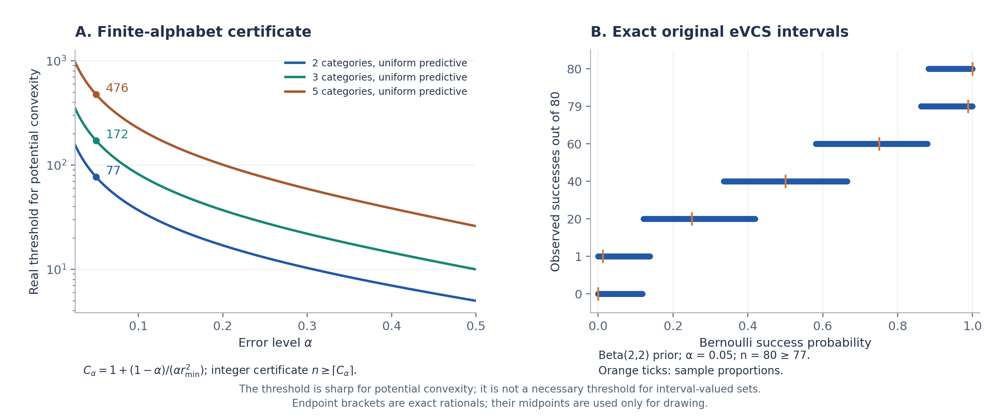

# Exact Geometry of Calibrated Confidence Sets

## Abstract

Time-uniform coverage alone does not make a confidence set easy to invert.
For confidence sequences obtained by overlap calibration, we prove a
regularity and geometry theory that permits arbitrary proper priors and
nonsmooth calibrations. A measurable-set envelope gives uniform local
semiconcavity of the log calibration. In natural exponential families a
conditional-variance decomposition strengthens this to a bound relative to
Fisher curvature. Under explicit compact likelihood localization, the exact
original confidence sets are eventually convex, uniformly over a compact
range of empirical sufficient statistics and confidence thresholds. When
localization holds near the true sufficient-statistic mean, the last failure
under an interior sampling law has an exponential upper tail.
For categorical observations, the potential-convexity threshold is exactly
$1+(1-\alpha)/(\alpha r_{\min}^2)$, and calibration has a finite sorting
algorithm. We supply exact rational endpoint certificates in a Bernoulli
example. In the Gaussian case, every proper prior has eventual interval
geometry on each bounded data range, yet there is a dense $G_\delta$ set
of priors in both weak and total-variation topologies admitting adverse
disconnected sections at every sample size and every threshold. A single such
prior can have a strictly positive entire density, a finite quadratic
exponential moment, and arbitrarily small total-variation distance to any
nondegenerate Gaussian. The two conclusions have different data quantifiers
and are compatible. Complete earlier Gaussian endpoint characterization
and counterexample proofs are retained in the appendix. Coverage remains
the inherited extended-Ville guarantee.

# Contributions, quantifiers, and prior work

The paper studies the exact extended-Ville mixture construction of
Cortinovis, Kilian and Caron [1], whose general convexity theorem uses
log-concavity. Their Appendix C.2 gives grid inversion and a two-root
approximation that is exact when interval geometry holds. The present
results provide a different mechanism and a certificate for the entire
original set. They do not change the confidence set to its convex hull.

The elementary overlap envelope, Gaussian identities, exponential-family
score calculus, Baire theorem and Ville inequality are existing tools.
The proposed contribution is their quantitative calibration-curvature
theory and the resulting exact-inversion and quantifier conclusions.

| Result | Precise scope and consequence |
| --- | --- |
| Calibration regularity | General dominated measurable models with compact $L^1$-regular parameter families; changing active sets and discrete observations are allowed. |
| Relative curvature | In a regular minimal natural exponential family, $b_\alpha-C_K A$ is concave; $C_K=1+(1-a)/(a q_K(1-b)^2)$ works for every $\alpha\in[a,b]$. |
| Eventual exact convexity | Every proper prior; explicit equicoercive likelihood sublevels; compact empirical-statistic range; convexity is in natural parameters. |
| Finite categorical certificate | A sharp threshold for convexity of the inversion potential, for all data, using only the positive one-step predictive masses. Necessity for the set's convexity is not claimed. |
| Universal Gaussian local result | Every proper Borel prior, even with incorrect support: all bounded data means and a fixed level band have exact interval sections after a finite, explicit sufficient time. |
| Sampling-law consequence | Under each stated interior true parameter, the supremum of failure times over a fixed level band is almost surely finite and has an exponential tail. |
| Global Gaussian obstruction | One fixed analytic light-tailed prior can have $\forall n\ge1\ \forall\alpha\in(0,1)\ \exists x$ a disconnected section; this property is topologically generic. |

The prior can exclude the true parameter in the positive results. This
does not imply posterior consistency or shrinking confidence sets. The
Gaussian uniform-in-data obstruction does not imply infinitely many
failures along one random sample path. Topological genericity is not a
probability-one statement under an unspecified law on priors.

For example, a uniform binary predictive and $\alpha=0.05$ yield the
all-data potential-convexity certificate $n\ge77$; a uniform
five-category predictive yields $n\ge476$. The Bernoulli implementation
at $n=80$ checks endpoints by exact rational signs. For a general
Gaussian prior, the explicit universal threshold can be extremely large:
it supplies a sufficient finite certificate, not a practical sharp onset
claim. The finite-alphabet formula has no such hidden modulus.

## Organization and inherited results

Part I develops measurable calibration, likelihood transfer, and its sharper
relative-curvature form, including the complete non-Gaussian examples.
Part II gives explicit Gaussian constants, exact-root certificates, and the
finite sorting algorithm. Part III proves the fixed-level Gaussian bad
blocks, topological classification, and the single regular prior.
Part IV records computational evidence, limitations and source positioning.
Appendix A retains the full prior Gaussian development: endpoint
characterization, precision transfer, heavy-tailed sufficient classes,
symmetric counterexamples, fixed-level total-variation instability and
arbitrary-horizon failures. Its center lemma is used in Parts II and III.

Section and equation identifiers are local to each part. In Part I the
relative-curvature refinement appears in Section 9 after the basic
Euclidean proof, so both the general dominated-model result and the
stronger exponential-family specialization remain available.

# Part I. Calibration regularity and exponential-family geometry

## 2. General overlap calibration

Let $(\mathcal Z,\mathcal F,\nu)$ be a dominated measurable sample space. Let $D\subset\mathbb R^d$ be open, and let $p_\theta$ be probability densities for $\theta\in D$. Let $m$ be another probability density and write $P_\theta$ and $M$ for the corresponding laws. Assume

```math
P_\theta\ll M\qquad(\theta\in D).
\tag{2.1}
```

The density $m$ can be a proper prior predictive; no support or moment assumption on the prior will be used beyond what is needed for (2.1). Define

```math
g_\theta(c)=\int\min\{p_\theta(z),m(z)/c\}\,d\nu(z),
\qquad c>0.
\tag{2.2}
```

For $\alpha\in(0,1)$, let $c_\alpha(\theta)$ be the unique positive solution of $g_\theta(c)=\alpha$, and let

```math
b_\alpha(\theta)=\log c_\alpha(\theta).
\tag{2.3}
```

### Lemma 2.1. Existence and measurable-set variational representation

Under (2.1), $c_\alpha(\theta)$ exists uniquely and

```math
0 \lt c_\alpha(\theta)\le1/\alpha.
\tag{2.4}
```

Moreover,

```math
c_\alpha(\theta)
=\inf_{A\in\mathcal F:\ P_\theta(A^c)<\alpha}
\frac{M(A)}{\alpha-P_\theta(A^c)}.
\tag{2.5}
```

The infimum is attained at the threshold set

```math
A_{\theta,\alpha}=
\{z:m(z) \lt c_\alpha(\theta)p_\theta(z)\}.
\tag{2.6}
```

**Proof.** Dominated convergence gives continuity in $c$, limit one at zero by (2.1), and limit zero at infinity. If $g_\theta(c)<1$, the set on which $m/c \lt p_\theta$ has positive $P_\theta$-measure and therefore positive $M$-measure; increasing $c$ then strictly decreases its integral contribution. This proves uniqueness at levels strictly below one. Since the integrand is at most $m/c$, $g_\theta(c)\le1/c$, proving (2.4).

For every measurable $A$,

```math
g_\theta(c)\le P_\theta(A^c)+M(A)/c,
```

with equality for $A=\{m \lt cp_\theta\}$. Thus $g_\theta(c)\ge\alpha$ is equivalent to all inequalities $P_\theta(A^c)+M(A)/c\ge\alpha$. Those with $P_\theta(A^c)\ge\alpha$ are automatic; each other inequality is exactly the upper bound in (2.5). At $c=c_\alpha(\theta)$, the threshold set has $M(A)>0$ and

```math
\alpha-P_\theta(A^c)=M(A)/c_\alpha(\theta)>0,
```

which verifies attainment. Equality sets in (2.6) can be assigned either way without changing the equality. $\square$

The identity (2.5) is a variational representation for the actual calibration. The subsequent regularity bound is the main use made of it here.

## 3. A compact absolute-continuity modulus

For compact $K\subset D$ and $s\in(0,1)$, put

```math
q_K(s)=\inf\{M(A):\theta\in K,\ A\in\mathcal F,\ P_\theta(A)\ge s\}.
\tag{3.1}
```

### Lemma 3.1. Positivity

Suppose $\theta\mapsto p_\theta$ is continuous in $L^1(\nu)$ and (2.1) holds. Then $q_K(s)>0$.

**Proof.** Otherwise choose $\theta_j\in K$ and $A_j$ with $P_{\theta_j}(A_j)\ge s$ and $M(A_j)\to0$. Pass to a subsequence with $\theta_j\to\theta_*\in K$. Absolute continuity of the single probability $P_{\theta_*}$ with respect to $M$ gives $P_{\theta_*}(A_j)\to0$; $L^1$-continuity gives $|P_{\theta_j}(A_j)-P_{\theta_*}(A_j)|\to0$, a contradiction. $\square$

This is a compact uniform absolute-continuity argument. It neither requires nor asserts a bounded likelihood ratio $p_\theta/m$.

Fix a level band

```math
0 \lt a\le b<1,
\qquad
\Delta=a\,q_K(1-b)>0.
\tag{3.2}
```

For the minimizing threshold set from Lemma 2.1,

```math
P_\theta(A)>1-\alpha\ge1-b,
\quad M(A)\ge q_K(1-b),
\quad \alpha-P_\theta(A^c)=M(A)/c_\alpha(\theta)\ge\Delta.
\tag{3.3}
```

The last inequality uses $c_\alpha\le1/a$. In particular the denominator in the attained variational branch is uniformly separated from zero, even when the predictive has arbitrarily thin tails or the sample space has atoms.

## 4. Uniform semiconcavity without differentiating threshold boundaries

Assume that $\theta\mapsto p_\theta$ is twice continuously differentiable as an $L^1(\nu)$-valued map on a neighborhood of a compact convex set $K\subset D$. Define finite bounds

```math
L_1=\sup_{\theta\in K}\int\|\nabla p_\theta(z)\|\,d\nu(z),
\qquad
L_2=\sup_{\theta\in K}\int\|\nabla^2p_\theta(z)\|_{\mathrm{op}}\,d\nu(z).
\tag{4.1}
```

These integrals can be replaced by any valid common upper bounds. If desired, take them on a slightly larger compact neighborhood of $K$; that avoids derivative conventions at its boundary.

### Theorem 4.1. Uniform calibration semiconcavity

For all $\alpha\in[a,b]$, the function $b_\alpha$ is $H_K$-semiconcave on $K$, where

```math
H_K=\frac{2L_2}{\Delta}+\frac{4L_1^2}{\Delta^2},
\qquad \Delta=a q_K(1-b).
\tag{4.2}
```

Equivalently, $b_\alpha(\theta)-H_K\|\theta\|^2/2$ is concave on $K$. No differentiability of $b_\alpha$ is required.

**Proof.** First, $b_\alpha$ is continuous. The map $g_\theta(c)$ is continuous in $\theta$, uniformly for fixed $c$, because

```math
|g_\theta(c)-g_\eta(c)|\le\|p_\theta-p_\eta\|_1.
```

Continuity of the inverse at a level below one follows from strict monotonicity around its unique crossing. This gives continuity in $\theta$; the argument also permits varying $\alpha$ inside the level band.

Fix $\theta_0\in K$ and $\alpha\in[a,b]$. Choose its attained threshold set $A$. For this one fixed measurable set, write

```math
P(\theta)=P_\theta(A^c),
\qquad
B_A(\theta)=\log M(A)-\log[\alpha-P(\theta)].
```

Wherever the denominator is positive, (2.5) gives

```math
b_\alpha(\theta)\le B_A(\theta),
\qquad b_\alpha(\theta_0)=B_A(\theta_0).
\tag{4.3}
```

By (3.3), $\alpha-P(\theta_0)\ge\Delta$. The gradient bound in (4.1) shows that if $\|\theta-\theta_0\|\le\Delta/(2L_1)$, with the zero-$L_1$ case interpreted separately, then $\alpha-P(\theta)\ge\Delta/2$. The segment is restricted to $K$. Differentiating the fixed-set branch, rather than the threshold set, gives

```math
\nabla^2B_A(\theta)
=\frac{\nabla^2P(\theta)}{\alpha-P(\theta)}
+\frac{\nabla P(\theta)\nabla P(\theta)^\top}{[\alpha-P(\theta)]^2}
\preceq H_K I.
\tag{4.4}
```

Taylor's upper bound and (4.3) therefore give a quadratic upper support to $b_\alpha$ at every $\theta_0$, with the same curvature $H_K$. In particular, whenever $\theta_0\pm h\in K$ and $\|h\|$ is small enough,

```math
b_\alpha(\theta_0+h)+b_\alpha(\theta_0-h)
\le2b_\alpha(\theta_0)+H_K\|h\|^2.
\tag{4.5}
```

Hence $b_\alpha-H_K\|\cdot\|^2/2$ is locally midpoint-concave along every line segment in $K$. By continuity it is locally concave there, and a continuous locally concave function on an interval is concave on the entire interval (apply the local nonincreasing-secant-slope property along a finite cover). This proves concavity on all segments in $K$, and therefore the claim. $\square$

The bound is intentionally conservative. Its purpose is a uniform finite certificate; no sharp constant is claimed. Downward kinks in the calibration potential are allowed, which is essential for discrete models.

## 5. A general likelihood-curvature transfer

Let $f_{n,y}(\theta)>0$ denote the likelihood for an observed sample $y$ and $m_n(y)>0$ the corresponding proper mixture likelihood. The exact eVCS is

```math
C_{n,\alpha}(y)=
\{\theta:m_n(y)/f_{n,y}(\theta)\le c_\alpha(\theta)\}.
\tag{5.1}
```

Equivalently it is the sublevel set

```math
C_{n,\alpha}(y)=
\{\theta:-\log f_{n,y}(\theta)-b_\alpha(\theta)
\le-\log m_n(y)\}.
\tag{5.2}
```

### Corollary 5.1. Eventual convexity on a localized parameter set

Suppose, uniformly over data $y$ in a specified set $\mathcal D_n$ and levels $\alpha\in[a,b]$:

1. $C_{n,\alpha}(y)\subset K$, where $K\subset D$ is compact and convex;
2. $-\nabla^2\log f_{n,y}(\theta)\succeq\lambda_n I$ on $K$;
3. the assumptions of Theorem 4.1 hold on $K$.

If $\lambda_n\ge H_K$, then every such exact eVCS is convex. If the confidence set is closed, it is compact as well.

**Proof.** The function $-\log f_{n,y}-H_K\|\theta\|^2/2$ is convex by the likelihood curvature condition. The function $H_K\|\theta\|^2/2-b_\alpha$ is convex by Theorem 4.1. Their sum is the sublevel potential in (5.2), hence has convex sublevel sets within $K$. Because all accepted points lie in the same convex $K$, this proves convexity of the entire original set. $\square$

This statement does not claim the confidence set is nonempty in every statistical model. Nonemptiness, when available, is a separate result.

## 6. Arbitrary proper priors in regular exponential families

Consider a regular minimal natural exponential family

```math
p_\theta(z)=h(z)\exp\{\theta^\top T(z)-A(\theta)\},
\qquad\theta\in\Theta\subset\mathbb R^d,
\tag{6.1}
```

where $\Theta$ is open and convex, $A$ is smooth, and $\nabla^2A(\theta)\succ0$. Let $\Pi$ be any Borel probability on $\Theta$. No density, full support, finite moments, or agreement with the true parameter is assumed for $\Pi$. The one-step predictive $m=\int p_u\,\Pi(du)$ has the same support as $h$; thus (2.1) holds for every $\theta\in\Theta$.

For the empirical sufficient statistic $t=n^{-1}\sum_i T(y_i)$, cancel the base-density factors and put

```math
Z_n(t)=\int_\Theta e^{n(u^\top t-A(u))}\,\Pi(du).
\tag{6.2}
```

Then

```math
L_{n,t}(\theta)=Z_n(t)e^{n(A(\theta)-\theta^\top t)}.
\tag{6.3}
```

Let $\mathcal T$ be a compact set of sufficient-statistic values. Assume the following explicit equicoercivity condition: for each finite $R$, the set

```math
\bigcup_{t\in\mathcal T}
\{\theta\in\Theta:A(\theta)-\theta^\top t\le R\}
\quad\text{has compact closure contained in }\Theta.
\tag{6.4}
```

This is a condition on the likelihood and the selected statistic range, not on the prior. It holds for Gaussian means on compact data ranges; for Poisson means when $\mathcal T$ is bounded away from zero; for Bernoulli probabilities when $\mathcal T$ is bounded away from zero and one; and for gamma families with known shape when $\mathcal T$ is bounded away from zero. These examples follow directly from the corresponding log-partition functions, listed below.

### Theorem 6.1. Uniform eventual convexity for arbitrary proper priors

Under (6.1)--(6.4), for each $0 \lt a\le b<1$ there exists a finite deterministic $N$ such that, for every integer $n\ge N$, every sample with empirical statistic $t\in\mathcal T$, and every $\alpha\in[a,b]$, the exact eVCS $C_{n,\alpha}(t)$ is compact and convex in the natural parameter.

**Proof: finiteness and localization.** Equicoercivity makes the union of each likelihood sublevel compactly contained in the natural parameter domain. Continuity on the product with the compact statistic range then rules out arbitrarily negative values of A(theta)-theta dot t. Thus its infimum is uniformly finite and 0&lt;Z_n(t)&lt;infinity on the stated data range. Outside that range, the mixture likelihood is defined on its almost-sure finite set (a proper mixture density is finite almost everywhere); arbitrary null exceptional data do not enter the sampling-law conclusion. Choose a compact $U\subset\Theta$ with $w=\Pi(U)>0$, possible by tightness of a Borel probability on an open Euclidean set. Define

```math
B=\sup_{u\in U,\ t\in\mathcal T}\{A(u)-u^\top t\}<\infty,
\qquad R_0=B+\log\frac1{aw}.
\tag{6.5}
```

For every relevant $t$,

```math
Z_n(t)\ge w e^{-nB}.
```

If $\theta$ is accepted, (2.4) and (6.3) give

```math
w e^{n[A(\theta)-\theta^\top t-B]}
\le L_{n,t}(\theta)\le1/a.
```

Consequently

```math
A(\theta)-\theta^\top t
\le B+\frac1n\log\frac1{aw}\le R_0.
\tag{6.6}
```

By (6.4), all accepted parameters are in one compact subset of $\Theta$, uniformly for every $n\ge1$, every $t\in\mathcal T$, and every level in the band. Let $K$ be its compact convex hull, enlarged slightly within $\Theta$. Compactness and convexity of the open natural parameter domain ensure this is possible.

**Proof: curvature.** On $K$, regularity of the natural exponential family implies the needed twice continuous $L^1$ differentiability. In detail, finite exponential moments in a neighborhood of each parameter control the score and Hessian densities, and a finite compact cover gives common integrable bounds. The score identities are

```math
\nabla p_\theta=p_\theta(T-\nabla A(\theta)),
\quad
\nabla^2p_\theta=p_\theta\{(T-\nabla A)(T-\nabla A)^\top-\nabla^2A\}.
\tag{6.7}
```

For example, with $V=\sup_{\theta\in K}\operatorname{tr}\nabla^2A(\theta)$, one may take $L_1\le\sqrt V$ and $L_2\le2V$. Theorem 4.1 therefore supplies a finite $H_K$. Minimality and compactness give

```math
\lambda=\min_{\theta\in K}\lambda_{\min}(\nabla^2A(\theta))>0.
\tag{6.8}
```

The negative log likelihood has Hessian $n\nabla^2A\succeq n\lambda I$. Corollary 5.1 applies once

```math
n\ge N:=\max\{1,\lceil H_K/\lambda\rceil\}.
\tag{6.9}
```

The confidence set is closed in $\Theta$ by continuity, and contained in a compact subset strictly inside $\Theta$, so it is compact in $\mathbb R^d$. $\square$

#### Examples of (6.4)

| Family | Natural parameter and log-partition | Compact statistic restriction |
| --- | --- | --- |
| Gaussian, fixed covariance $\Sigma$ | $\theta\in\mathbb R^d$, $A(\theta)=\theta^\top\Sigma\theta/2$ | Any compact $\mathcal T\subset\mathbb R^d$ |
| Poisson | $\theta\in\mathbb R$, $A(\theta)=e^\theta$ | $0 \lt t_-\le t\le t_+<\infty$ |
| Bernoulli | $\theta\in\mathbb R$, $A(\theta)=\log(1+e^\theta)$ | $0 \lt t_-\le t\le t_+<1$ |
| Gamma, fixed shape $r>0$ | $\theta<0$, $A(\theta)=-r\log(-\theta)$, up to an immaterial constant | $0 \lt t_-\le t\le t_+<\infty$ |

In the scalar examples, the natural-to-mean parameter map is strictly monotone, so convexity is the interval property in either coordinate. In multiple dimensions, nonlinear parameter transformations need not preserve convexity; the theorem states its coordinates explicitly.

## 7. Exponentially late failure is unlikely under the sampling law

Let data be iid from a true $\theta_*\in\Theta$. Write $\mu_*=\nabla A(\theta_*)$. Suppose (6.4) holds for a compact $\mathcal T$ containing an open neighborhood of $\mu_*$. There exist $C,c>0$ such that

```math
\Pr_{\theta_*}\{\overline T_n\notin\mathcal T\}\le C e^{-cn}.
\tag{7.1}
```

For completeness, choose a coordinate box of radius $\epsilon>0$ around $\mu_*$ inside $\mathcal T$. The identity

```math
\log\mathbb E_{\theta_*}e^{s^\top(T-\mu_*)}
=A(\theta_*+s)-A(\theta_*)-s^\top\mu_*
```

is finite near zero and has vanishing linear term. For each coordinate and sign choose a small positive Chernoff parameter so that the resulting exponent is positive. A union bound gives (7.1), with $C=2d$ and $c$ the smallest of the finitely many exponents.

There is a sharper direct bound for all late sample sizes. For each coordinate and sign, choose a positive $\lambda_j$ so that

```math
c_j=\lambda_j\epsilon-\psi_j(\lambda_j)>0,
\qquad
\psi_j(\lambda)=\log\mathbb E_{\theta_*}
e^{\lambda\,s_j(T_j-\mu_{*,j})},\quad s_j\in\{-1,1\}.
```

The nonnegative mean-one martingale

```math
\mathcal M_{n,j}=
\exp\left\{\lambda_j\sum_{i=1}^n s_j(T_j(Y_i)-\mu_{*,j})
-n\psi_j(\lambda_j)\right\}
```

is at least $e^{mc_j}$ if the corresponding signed empirical average exceeds $\epsilon$ at any $n\ge m$. Ville's inequality, or its elementary stopped-martingale proof, therefore bounds the probability of any such late crossing by $e^{-mc_j}$. Summing over the $2d$ coordinate/sign pairs and taking $c=\min_j c_j$, Theorem 6.1 gives for every integer $m\ge N$,

```math
\Pr_{\theta_*}\left\{
\exists n\ge m,\ \exists\alpha\in[a,b]:
C_{n,\alpha}(Y_{1:n})\text{ is nonconvex}
\right\}
\le 2d e^{-cm}.
\tag{7.2}
```

The same deterministic criterion covers the entire uncountable level band, so no union bound over levels is taken. Equivalently, the last nonconvex section across the band is almost surely finite and has an exponential upper tail after the deterministic threshold. This conclusion is valid even if the prior excludes the true parameter, because the preceding geometric argument used only some positive prior mass on a compact set.

This is a geometric sampling-law result. It does not alter the original eVCS coverage theorem, does not assert an all-data guarantee outside $\mathcal T$, and does not provide a uniform statement as $a\downarrow0$ or $b\uparrow1$.

### Additional example: Gaussian mean and variance both unknown

For scalar Gaussian observations with unknown $\mu\in\mathbb R$, $\sigma^2>0$, use natural parameters $(\eta,\tau)=(\mu/\sigma^2,-1/(2\sigma^2))$, sufficient statistic $(X,X^2)$, and

```math
A(\eta,\tau)=-\frac{\eta^2}{4\tau}-\frac12\log(-2\tau),
\qquad \tau<0,
```

up to a constant absorbed into the base measure. Write $q=-2\tau>0$, $\mu=\eta/q$, $t=(t_1,t_2)$, and $v=t_2-t_1^2$. The likelihood localization potential is exactly

```math
A(\eta,\tau)-\eta t_1-\tau t_2
=\frac q2\{(\mu-t_1)^2+v\}-\frac12\log q.
\tag{7.3}
```

If $|t_1|$ is bounded and $v$ stays in a compact subinterval of $(0,\infty)$, each sublevel of (7.3) forces $q$ bounded above and away from zero, and then forces $\mu$ bounded. Thus (6.4) holds. The general theorem therefore supplies eventual convex exact joint regions for both parameters in these natural coordinates under any proper prior on $(\mu,\sigma^2)$. The concentration argument applies because Gaussian linear/quadratic sufficient statistics have exponential moments in a neighborhood of zero.

This does not assert that the nonlinear image of that joint region in $(\mu,\sigma^2)$ is convex. Canonical-coordinate convexity is the precise conclusion; no nuisance-parameter profiling result is claimed.

## 8. Bernoulli calibration and its exact potential threshold

Let the Bernoulli success probability be $p\in(0,1)$, and let the one-step predictive success probability be $r\in(0,1)$. Directly solving

```math
\min(1-p,(1-r)/c)+\min(p,r/c)=\alpha
```

gives

```math
c_\alpha(p)=
\begin{cases}
(1-r)/(\alpha-p),&p\le\alpha r,\\
1/\alpha,&\alpha r\le p\le1-\alpha(1-r),\\
r/(p+\alpha-1),&p\ge1-\alpha(1-r).
\end{cases}
\tag{8.1}
```

Write $\eta=\log[p/(1-p)]$, $A(\eta)=\log(1+e^\eta)$. On the left branch,

```math
\frac{b_\alpha''(\eta)}{A''(\eta)}
=\frac{\alpha-2\alpha p+p^2}{(\alpha-p)^2}
=1+\frac{\alpha(1-\alpha)}{(\alpha-p)^2}.
\tag{8.2}
```

Its supremum is $1+(1-\alpha)/[\alpha(1-r)^2]$. The right branch is symmetric and gives $1+(1-\alpha)/(\alpha r^2)$; the middle branch has zero curvature. At both joins the derivative of $b_\alpha$ jumps downward, which contributes favorable upward derivative jumps to the confidence-set potential

```math
F_{n,s,\alpha}(\eta)=nA(\eta)-s\eta-b_\alpha(\eta).
```

Thus this potential is convex on all of $\mathbb R$, for every success count $s$, if and only if

```math
n\ge1+\frac{1-\alpha}{\alpha\min\{r,1-r\}^2}.
\tag{8.3}
```

The necessity here is only for convexity of this potential; it is not a necessary threshold for the eVCS itself to be an interval. On $\alpha\in[a,b]$, taking $\alpha=a$ suffices because $(1-\alpha)/\alpha$ is decreasing. The full prior affects $m_n$ and the sublevel height, but the uniform curvature certificate depends only on its one-step predictive mean $r$.

## 9. Stronger relative-curvature theorem for natural exponential families

The following relative-curvature refinement replaces the separate Euclidean score bounds and smallest-information-eigenvalue ratio by one coefficient relative to the log-partition function itself.

Fix a measurable set $B$, put $q(\theta)=P_\theta(B)$, and consider its variational branch

```math
v_B(\theta)=\log M(B^c)-\log[\alpha-q(\theta)],
\qquad q(\theta)<\alpha.
\tag{9.1}
```

For a direction $v\in\mathbb R^d$, define the centered score

```math
Z=v^\top(T-\nabla A(\theta)),\qquad
V=\mathbb E_\theta Z^2=v^\top\nabla^2A(\theta)v.
```

Let $d_0=\alpha-q$. Differentiating the probability of the fixed set gives

```math
q'=\mathbb E[1_B Z],\qquad
q''=\operatorname{Cov}(1_B,Z^2),
```

and hence

```math
v_B''=\frac{\operatorname{Cov}(1_B,Z^2)}{d_0}
+\frac{(\mathbb E[1_B Z])^2}{d_0^2}.
\tag{9.2}
```

For $0 \lt q<1$, decompose the total variance into three nonnegative pieces:

```math
V_B=q\operatorname{Var}(Z\mid B),\quad
V_C=(1-q)\operatorname{Var}(Z\mid B^c),\quad
W=q(1-q)(\mathbb E[Z\mid B]-\mathbb E[Z\mid B^c])^2.
```

Then $V=V_B+V_C+W$, and elementary conditioning gives

```math
\operatorname{Cov}(1_B,Z^2)
=(1-q)V_B-qV_C+(1-2q)W,
\quad
(\mathbb E[1_BZ])^2=q(1-q)W.
\tag{9.3}
```

The three coefficients in (9.2) are therefore

```math
\frac{1-q}{d_0},\qquad-\frac q{d_0},\qquad
\frac{1-2q}{d_0}+\frac{q(1-q)}{d_0^2}
=1+\frac{\alpha(1-\alpha)}{d_0^2}.
\tag{9.4}
```

The last coefficient dominates the first because their difference is
$q(1-\alpha)/d_0^2\ge0$, and it also dominates the second. The cases $q=0$ follow directly; $q=1$ is excluded by $q<\alpha<1$. Thus, for every direction,

```math
\boxed{\quad
\nabla^2 v_B(\theta)
\preceq
\left[1+\frac{\alpha(1-\alpha)}{[\alpha-P_\theta(B)]^2}\right]
\nabla^2A(\theta).
\quad}
\tag{9.5}
```

### Theorem 9.1. Relative calibration curvature on compact parameter sets

In the natural exponential family of Section 6, let $K\subset\Theta$ be compact and convex and let $q_K$ be (3.1). For a fixed $\alpha\in(0,1)$, set

```math
C_{K,\alpha}
=1+\frac{1-\alpha}{\alpha\,q_K(1-\alpha)^2}.
\tag{9.6}
```

Then $b_\alpha-C_{K,\alpha}A$ is concave on $K$. Uniformly for $\alpha\in[a,b]$, one may use the common coefficient

```math
C_K=1+\frac{1-a}{a\,q_K(1-b)^2}.
\tag{9.7}
```

**Proof.** At any $\theta_0\in K$, select the attained threshold set $A_0$ from Lemma 2.1 and put $B=A_0^c$. By (3.3),

```math
d_0=\alpha-P_{\theta_0}(B)
=M(A_0)/c_\alpha(\theta_0)
\ge\alpha M(A_0)
\ge\alpha q_K(1-\alpha).
```

The fixed-set branch $v_B$ is defined on a neighborhood of $\theta_0$, majorizes $b_\alpha$, equals it at $\theta_0$, and satisfies $\nabla^2v_B(\theta_0)\preceq C_{K,\alpha}\nabla^2A(\theta_0)$ by (9.5).

Here is an elementary argument that turns these pointwise upper branches into global concavity. Fix $\epsilon>0$. If $b_\alpha-(C_{K,\alpha}+\epsilon)A$ violated concavity on any segment in $K$, its difference from the chord joining two endpoints would attain a negative minimum at an interior point $\theta_0$. At that point take the attained smooth upper branch $v_B$. The difference of $v_B-(C_{K,\alpha}+\epsilon)A$ and the same chord is locally at least that minimum and equals it at $\theta_0$, so it has a local minimum. Its second derivative along the segment, however, is at most

```math
-\epsilon\,v^\top\nabla^2A(\theta_0)v<0
```

for the segment's nonzero direction $v$, contradicting the second derivative condition at a smooth local minimum. Thus the function is concave for every $\epsilon>0$; letting $\epsilon\downarrow0$ proves the claim. Finally, $q_K$ is nondecreasing in its argument and $(1-\alpha)/\alpha$ is decreasing, which yields (9.7). $\square$

### Consequence for Theorem 6.1

With the same compact likelihood localization $K$, it suffices to take

```math
N=\max\{1,\lceil C_K\rceil\}.
\tag{9.8}
```

Indeed

```math
nA(\theta)-n\theta^\top t-b_\alpha(\theta)
=(n-C_K)A(\theta)-n\theta^\top t+
[C_KA(\theta)-b_\alpha(\theta)]
```

is convex on $K$. This stronger bound does not require dividing by the smallest Fisher-information eigenvalue. The earlier Euclidean theorem remains valid for non-exponential families and so is not discarded.

### Categorical consequence and sharpness check

For a categorical model with at least two categories and positive predictive masses $r_1,\ldots,r_J$, every nonempty measurable set of categories has $M$-mass at least $r_{\min}=\min_i r_i$. No compact parameter restriction is needed for this bound. Therefore

```math
C_\alpha=1+\frac{1-\alpha}{\alpha r_{\min}^2}
\tag{9.9}
```

gives concavity of $b_\alpha-C_\alpha A$ on the entire natural parameter space. It follows that the exact confidence-set potential is globally convex for all sample data when $n\ge C_\alpha$. There is no additional alphabet-size factor beyond the predictive mass $r_{\min}$, which itself can depend on the alphabet size.

The constant is sharp for that potential-convexity statement. Choose a category $i$ with $r_i=r_{\min}$; let $A_0=\{i\}$, $B=A_0^c$, and vary their aggregate odds while keeping $p_j/r_j$ constant over $j\ne i$. Approach $q=P(B)=\alpha(1-r_i)$ from below. In that open branch, $c_\alpha=r_i/(\alpha-q)$ and the score is constant within each group, so $V_B=V_C=0$ in (9.3). The relative curvature equals the last coefficient of (9.4) and approaches (9.9). Thus for any $n \lt C_\alpha$, a nearby interior parameter gives a negative second derivative of $nA-b_\alpha$ along this direction. The data-dependent linear term does not affect it. This does not show disconnectedness of any particular sublevel set below the threshold.


# Part II. Explicit certificates and exact computation

## 1. Definitions

Let the observations be iid normal with mean theta and known variance
sigma squared, where sigma>0. Let Pi be ANY Borel probability on the real
line, including an atomic prior or one whose support excludes the true
mean. Put

```math
 f_n(x\mid\theta)=\frac{\sqrt n}{\sigma\sqrt{2\pi}}
 \exp\left(-\frac{n(x-\theta)^2}{2\sigma^2}\right),\qquad
 m_n(x)=\int f_n(x\mid u)\Pi(du),\qquad m=m_1.
```

The one-step overlap calibration and its inverse are

```math
 g_\theta(c)=\int\min\{f_1(z\mid\theta),m(z)/c\}\,dz,
 \quad g_\theta(c_\alpha(\theta))=\alpha,
 \quad b_\alpha=\log c_\alpha.
```

The exact section is

```math
 C_{n,\alpha}(x)=
 \left\{\theta:\frac{m_n(x)}{f_n(x\mid\theta)}
          \le c_\alpha(\theta)\right\}.
\tag{G1}
```

These definitions reproduce the original extended-Ville construction.
They do not replace it by a convex hull. Its anytime coverage is inherited
from the extended Ville inequality and is not a new claim of this note.

## 2. A fully explicit uniform compact-data certificate

Fix X>=0 and 0<a<=b<1. Choose R>=0 for which

```math
w=\Pi([-R,R])>0.
```

Such an R exists for every proper prior, including Dirac priors. Define

```math
\delta=1-b,\qquad
H=X+\sqrt{(X+R)^2+2\sigma^2\log\frac1{aw}}+\sigma,
\tag{G2}
```
```math
T=\sigma\sqrt{2\log\frac4\delta},\qquad
Q=\frac{w\delta}{2}
\exp\left[-\frac{(H+T+R)^2}{2\sigma^2}\right]>0,
\tag{G3}
```
```math
\boxed{\quad
N=\left\lceil 1+\frac{1-a}{aQ^2}\right\rceil.
\quad}
\tag{G4}
```

**Theorem G.** For every integer n>=N, every data mean |x|<=X and every
alpha in [a,b], the original set C in (G1) is a nonempty compact interval.
No density, local support, moment, symmetry or log-concavity assumption on
Pi is required. The number N is deliberately conservative and can be very
large; it is an explicit sufficient certificate, not a sharp onset time.

### Proof: one parameter box contains the entire original set

For |x|<=X and u in [-R,R], |x-u|<=X+R. Hence

```math
m_n(x)\ge\frac{\sqrt n}{\sigma\sqrt{2\pi}}
w\exp\left[-\frac{n(X+R)^2}{2\sigma^2}\right].
\tag{G5}
```

Since c_alpha<=1/alpha<=1/a, every accepted theta satisfies

```math
|\theta-x|\le
\sqrt{(X+R)^2+\frac{2\sigma^2}{n}\log\frac1{aw}}.
\tag{G6}
```

Therefore every accepted parameter, at every n>=1, lies strictly within
K=[-H,H]. This argument uses some positive mass in a bounded prior set;
it never asserts that the radius in (G6) tends to zero. In particular it
does not impose an unstated prior-support condition.

### Proof: the calibration modulus has an explicit lower bound

Take any theta in K and any measurable set A with P_theta(A)>=delta.
The elementary normal tail inequality gives

```math
P_\theta\{|Z-\theta|>T\}\le
2e^{-T^2/(2\sigma^2)}=\delta/2.
```

Thus P_theta(A intersect [theta-T,theta+T])>=delta/2. On this intersection,
|z|<=H+T and

```math
m(z)\ge\frac{w}{\sigma\sqrt{2\pi}}
e^{-(H+T+R)^2/(2\sigma^2)},\qquad
f_1(z\mid\theta)\le\frac1{\sigma\sqrt{2\pi}}.
```

Integrating their ratio lower bound yields M(A)>=Q. Consequently the
compact absolute-continuity modulus q_K(1-b) in the general theorem is
at least Q.

### Proof: likelihood curvature dominates calibration

In the mean coordinate the normal log-partition is
A(theta)=theta squared/(2 sigma squared). The relative-calibration theorem
therefore says that

```math
b_\alpha(\theta)-C\frac{\theta^2}{2\sigma^2}
\quad\hbox{is concave on }K,
\qquad C=1+\frac{1-a}{aQ^2}.
```

The exact accepted set is the sublevel set of

```math
F_{n,x,\alpha}(\theta)
=\frac{n(\theta-x)^2}{2\sigma^2}-b_\alpha(\theta)
\tag{G7}
```

at height

```math
D_n(x)=\log\frac{\sqrt n}{\sigma\sqrt{2\pi}\,m_n(x)}.
\tag{G8}
```

For n>=C this potential is convex on K. Since all accepted points already
lie in K, the entire original set is an interval. Continuity and (G6)
make it compact. The inherited Gaussian center lemma gives a parameter
theta_c with overlap p_{n,x}(theta_c)=1; because alpha<1, this point is
strictly accepted, proving nonemptiness. This also covers Dirac priors,
as proved separately in the inherited lemma. This proves Theorem G.

## 3. A computable certificate for the current data

For a given n,x and a fixed alpha, the ordinary Ville interval is

```math
V=[x-r,x+r],\qquad
r=\sigma\sqrt{\frac2n\log
\frac{\sqrt n}{\alpha\sigma\sqrt{2\pi}\,m_n(x)}}.
\tag{G9}
```

The expression inside the logarithm is greater than one: m_n(x) is at
most the normal density peak and alpha<1. Every accepted point lies in V.
Choose any finite H with V contained in [-H,H], choose a known bounded
prior mass w in [-R,R], and compute Q by (G3) with delta=1-alpha. If

```math
n\ge 1+\frac{1-\alpha}{\alpha Q^2},
\tag{G10}
```

then (G7) is convex on the whole enclosing interval and certifies the exact
two-endpoint computation. A verified lower bound on m_n and a verified
enlargement of V can be used in place of exact integrals. A sharper valid
lower bound on q_K can likewise replace Q; no change to the theorem is
needed. Failure of this sufficient test is inconclusive.

An interior accepted point can be obtained from the center equation. In
standardized units define

```math
h(z)=\log\int e^{zu-u^2/2}\Pi_\sigma(du),
\quad \Pi_\sigma=\operatorname{Law}(U/\sigma),\quad x_0=x/\sigma.
```

The function

```math
t\longmapsto h'(nx_0-(n-1)t)-t
\tag{G11}
```

is continuous, strictly decreasing, and has opposite infinite-end signs;
its unique zero t_c gives theta_c=sigma t_c with p=1. Those facts are
proved in the inherited Gaussian analysis and require no prior moments.

Set H0(theta)=F(theta)-D_n(x). At theta_c it is strictly negative. At
either endpoint of V it is nonnegative, because there the likelihood ratio
is 1/alpha and c_alpha<=1/alpha. Convexity then implies exactly one zero on
each side of theta_c, allowing an endpoint itself to be the zero. To see
uniqueness, two zeros on one side with a strictly negative value farther
towards theta_c would force secant slopes to increase in the wrong order.
Thus bracketed root finding returns the two endpoints of the entire exact
set; it cannot silently skip an additional accepted component.

Given exact signs, bisection needs at most

```math
\max\{0,\left\lceil\log_2(\ell/\varepsilon)\right\rceil\}
\tag{G12}
```

iterations to reduce a starting bracket of length ell to epsilon. Numerical
implementation must use certified sign enclosures or retain an unresolved
bracket. The theorem does not turn floating-point gridding into a proof,
and no universal integration oracle or complexity bound for arbitrary
black-box priors is claimed. The explicit constant (G4) may be impractical;
the finite-alphabet result below gives an exact and much simpler certificate.

## 4. Exponential control of the LAST Gaussian geometry failure

Fix a true Gaussian mean theta_star and a data-radius d>0. Apply Theorem G
with X=|theta_star|+d, and fix the band [a,b]. Let L be the supremum of the integer times n
at which at least one section with alpha in [a,b] is not an interval, taking
values in {0,1,2,...,infinity}, with L=0 if there is none. It is enough to interpret the next inequality in
outer probability; the events are universally measurable as explained below.

**Theorem H.** For every integer m>=N,

```math
\boxed{\quad
\Pr_{\theta_*}\{L\ge m\}
\le \min\left\{1,\;2\exp\left(-\frac{m d^2}{2\sigma^2}\right)\right\}.
\quad}
\tag{G13}
```

In particular L is almost surely finite and has finite exponential moments
of every positive order strictly below d squared/(2 sigma squared).

**Proof.** If a section at some n>=N fails to be an interval, Theorem G
implies |barY_n|>X and hence |barY_n-theta_star|>d. Put
S_n=sum_{i<=n}(Y_i-theta_star). For either sign, the process

```math
M_n^\pm=\exp\left(\pm\frac d{\sigma^2}S_n
-\frac{n d^2}{2\sigma^2}\right)
```

is a nonnegative mean-one martingale. If for some n>=m its corresponding
signed mean exceeds d, then M_n>=exp(m d squared/(2 sigma squared)).
The ordinary Ville inequality bounds each one-sided event by the reciprocal
of this threshold. Union over the two signs proves (G13). The same
deterministic geometry certificate covers all levels in the band, so there
is no union bound over an uncountable set of levels. The exponential-moment
claim follows from the geometric-series tail bound for integer-valued L.

For a measurability justification, the overlap is jointly continuous in
x,theta and the level. A noninterval section has three ordered real
parameters with the middle strictly rejected and both outer ones accepted.
The set of (x,alpha,theta_1,theta_2,theta_3) satisfying these relations and
alpha in the compact band is Borel. Its projection is analytic, hence
universally measurable; a countable union over n preserves universal
measurability. Alternatively the displayed proof controls outer probability
by a Borel deviation event, giving the asserted almost-sure consequence
without needing a stronger descriptive-set claim.

This theorem makes no assertion that the sets shrink under a support-misspecified
prior, and no uniform bound as a tends to zero or b tends to one. It concerns
geometry and computation, not a change to the confidence coverage.

## 5. Exact finite-alphabet evaluation and sharp potential curvature

For J>=2 categories, let r_i>0 be their prior-predictive masses and p_i>0
the tested distribution. Then

```math
g_p(c)=\sum_{i=1}^J\min\{p_i,r_i/c\}.
\tag{C1}
```

Sort rho_i=r_i/p_i increasingly, and write P_k and R_k for the cumulative
p and r masses of the first k categories. In the branch
rho_(k)<=c<=rho_(k+1), with rho_(J+1)=infinity,

```math
g_p(c)=1-P_k+R_k/c,\qquad
c=\frac{R_k}{\alpha-1+P_k}.
\tag{C2}
```

Scanning the k values with a positive denominator finds a valid branch.
Ties can be assigned consistently to either adjacent branch and yield the
same c. This gives exact calibration with O(J log J) sorting and O(J)
arithmetic after sorting; for rational p,r,alpha every comparison and
returned c is rational. It independently agrees with the all-subset
variational envelope; the latter is useful as a finite reference check,
not required by this algorithm.

In natural log-odds eta_i=log(p_i/p_J), i< J, let

```math
A(\eta)=\log\left(1+\sum_{i \lt J}e^{\eta_i}\right),\qquad
F_{n,s,\alpha}(\eta)=nA(\eta)-\sum_{i \lt J}s_i\eta_i-b_\alpha(\eta).
\tag{C3}
```

Here s_i are the observed category counts. The general relative-curvature
proof and its singleton sharpness construction give the exact statement

```math
\boxed{\quad
F_{n,s,\alpha}\text{ is convex on }\mathbb R^{J-1}
\iff n\ge C_\alpha:=1+\frac{1-\alpha}{\alpha r_{\min}^2},
\quad r_{\min}=\min_i r_i.
\quad}
\tag{C4}
```

The Hessian does not depend on s, so this holds for every count vector.
Convexity of F certifies convexity of every exact accepted sublevel set in
natural parameters. The reverse direction in (C4) concerns F only; it
does not claim an accepted set is disconnected whenever n< C_alpha.
Convexity need not survive a nonlinear map to the probability simplex.
For a fixed band alpha>=a, the sufficient integer sample size is ceil(C_a).
The full prior still enters the mixture likelihood and thus the sublevel
height, even though its geometric curvature certificate uses only r.

Examples of the exact potential certificate are C=77 for a uniform binary
predictive with alpha=0.05, and C=476 for a uniform five-category predictive
at the same level. These are algebraic implications of (C4), not empirical
onset estimates.

For Bernoulli success probability p and predictive mean r,

```math
c_\alpha(p)=
\begin{cases}
(1-r)/(\alpha-p),&p\le\alpha r,\\
1/\alpha,&\alpha r\le p\le1-\alpha(1-r),\\
r/(p+\alpha-1),&p\ge1-\alpha(1-r).
\end{cases}
\tag{C5}
```

The two branches join continuously. Their natural-parameter derivatives
jump downward at both joins, so no spurious differentiability assumption is
used in (C4). The natural-to-probability transformation is monotone in this
one-dimensional example, hence a certified convex natural-parameter set is
an interval in success probability as well. Some sets are unbounded in
natural coordinates for boundary count data; compactness is not asserted
by this all-data categorical corollary.


# Part III. Persistent global Gaussian disconnection

## Definitions

Let `P` be any Borel probability measure on R, and let

```math
f_n(x\mid\theta)=\sqrt n\,\phi(\sqrt n(x-\theta)),\qquad
m_{n,P}(x)=\int f_n(x\mid u)P(du),\quad m_P=m_{1,P}.
```

Define

```math
p^P_{n,x}(\theta)=\int_{\mathbb R}
\min\left\{\phi(z-\theta),
\frac{f_n(x\mid\theta)}{m_{n,P}(x)}m_P(z)\right\}\,dz.
\tag{1}
```

For `0<a<b<1` and an integer `n>=1`, let `B(n,a,b)` consist of priors for
which there are a real data mean `x` and parameters `theta_1<theta_2<theta_3`
such that

```math
p^P_{n,x}(\theta_1)>b,\qquad
p^P_{n,x}(\theta_2) \lt a,\qquad
p^P_{n,x}(\theta_3)>b.                         \tag{2}
```

The *same* data and triple witness noninterval geometry for every level
`alpha in [a,b]`. The data and triple are permitted to depend on `n,a,b`.

## Theorem A: strict witnesses at arbitrary sample sizes and level bands

For every integer `n>=1` and every `0< a< b<1`, `B(n,a,b)` contains a
two-atom probability measure. It also contains a strictly positive analytic
two-Gaussian-mixture density, with both component variances at most one.

### Explicit two-atom family

Fix real `s` and `H>0` such that

```math
\Phi(s) \lt a,\qquad \Phi(s+H/2)>b.                 \tag{3}
```

For a parameter `A` tending to infinity, put

```math
e_A=\frac{4\log A}{A},\qquad r_A=A/2,
```

```math
\eta_A=e^{(-A^2+e_A^2)/2}
\frac{e^{-As}-e^{-Ar_A}}{e^{e_A r_A}-e^{e_A s}},
\qquad
P_A=\frac{\delta_{-A}+\eta_A\delta_{e_A}}{1+\eta_A}.
\tag{4}
```

Take `A` sufficiently large that `r_A>s`, `A>H`, and `A>1`.
Then `eta_A>0`. Define

```math
h_A(z)=\log\frac{m_{P_A}(z)}{\phi(z)}
=\log\frac{e^{-Az-A^2/2}+
\eta_A e^{e_Az-e_A^2/2}}{1+\eta_A}.
```

Formula (4) gives the exact endpoint identity

```math
h_A(s)=h_A(r_A)=\log c_A.                     \tag{5}
```

Let

```math
K_{n,A}(q)=\log\frac{e^{-Aq-nA^2/2}+
\eta_Ae^{e_Aq-ne_A^2/2}}{1+\eta_A}.
```

This is strictly convex and coercive. It is pointwise no greater than `h_A`
and has a unique right root `q_A` of

```math
K_{n,A}(q_A)=\log c_A,
\qquad q_A\ge r_A.                            \tag{6}
```

Set `x_A=q_A/n`. Then

```math
\boxed{p^{P_A}_{n,x_A}(0)\longrightarrow\Phi(s),\qquad
p^{P_A}_{n,x_A}(-H)\longrightarrow\Phi(s+H/2).}\tag{7}
```

There is also a parameter `theta_A^circ>0` with
`p^{P_A}_{n,x_A}(theta_A^circ)=1`. Consequently, for every sufficiently
large `A`, the triple `(-H,0,theta_A^circ)` satisfies (2).

### Proof of the limits

Throughout, `n,s,H` are fixed while `A` grows. Elementary rearrangement of
(4) gives

```math
\eta_A=e^{-A^2/2-As+e_A^2/2}
\frac{1-e^{-A(r_A-s)}}{A^2-e^{e_As}}.
\tag{8}
```

Thus

```math
\eta_A\sim A^{-2}e^{-A^2/2-As},\qquad
c_A\sim e^{-A^2/2-As},\qquad
\frac{\eta_A}{(1+\eta_A)c_A}\sim A^{-2}.
\tag{9}
```

In particular, the negative-atom contribution to `h_A(s)` has normalized
share `w_A -> 1`, where

```math
w_A=\frac{e^{-As-A^2/2}}{(1+\eta_A)c_A}.
\tag{10}
```

At the right endpoint, the positive-atom share tends to one with deficit
`O(exp(-A(r_A-s)))`. At `q=r_A+1`, its ratio to the right side of (6) is

```math
(1-O(e^{-A(r_A-s)}))
\exp\{e_A-(n-1)e_A^2/2\}>1
```

for all sufficiently large `A`, since `e_A -> 0` and the exponential
deficit is `o(e_A)`. Since `K_{n,A}(r_A)<=log c_A`, its right root obeys

```math
r_A\le q_A \lt r_A+1,
\qquad q_A/A\longrightarrow 1/2.             \tag{11}
```

At `theta=0`, the active interval in the overlap integral is exactly
`(s,r_A)` by (5) and strict convexity. Therefore

```math
p^{P_A}_{n,x_A}(0)
=\Phi(s)+1-\Phi(r_A)+\frac1{c_A}\int_s^{r_A}m_{P_A}(z)\,dz.
```

The integral is bounded using the elementary Mills bound:

```math
0\le\frac1{c_A}\int_s^{r_A}m_{P_A}
\le\frac{\phi(s)}{A+s}
+\frac{\eta_A}{(1+\eta_A)c_A}\longrightarrow0.
\tag{12}
```

Here the negative component uses
`phi(A+s)/((1+eta_A)c_A)<=phi(s)`, directly from the crossing identity.
This proves the first limit of (7).

At `theta=-H`, the data likelihood ratio has exact value

```math
c_{A,H}:=\frac{m_{n,P_A}(x_A)}{f_n(x_A\mid-H)}
=c_A\exp\{q_AH+nH^2/2\}.                    \tag{13}
```

Write the ratio determining the active interval as

```math
T_A(z)=\frac{m_{P_A}(z)}{c_{A,H}\phi(z+H)}
=T_A^-(z)+T_A^+(z).
```

Its negative component is exactly

```math
T_A^-(z)=w_A
\exp\{-(A-H)z+As-q_AH-(n-1)H^2/2\}
=\exp\{-(A-H)(z-d_A)\},                      \tag{14}
```

where

```math
d_A=\frac{As-q_AH-(n-1)H^2/2+\log w_A}{A-H}
\longrightarrow s-H/2.
\tag{15}
```

For every fixed `z`, its positive component is

```math
T_A^+(z)=\frac{\eta_A}{(1+\eta_A)c_A}
\exp\{(e_A+H)z-e_A^2/2-q_AH-(n-1)H^2/2\}
\longrightarrow0.                           \tag{16}
```

Both component coefficients are positive, the slopes in (14) and (16)
have opposite signs, and `T_A` is strictly convex and coercive. For every
fixed `delta>0`, equations (14)--(16) imply

```math
T_A(s-H/2-\delta)>1,
\qquad T_A(s-H/2+\delta)<1
```

eventually. Thus the left root `l_{A,H}` of `T_A=1` tends to `s-H/2`.
Every fixed point strictly above that limit lies in `{T_A<1}` eventually,
so the right root `r_{A,H}` tends to infinity. The active interval is
exactly `(l_{A,H},r_{A,H})`.

Again using Mills and the crossing at the left endpoint,

```math
0\le\frac{\int_{l_{A,H}}^{r_{A,H}}m_{P_A}(z)\,dz}{c_{A,H}}
\le\frac{\phi(l_{A,H}+H)}{A+l_{A,H}}
+\frac{\eta_A}{(1+\eta_A)c_{A,H}}
\longrightarrow0.                           \tag{17}
```

The last term equals `O(A^-2) exp(-q_A H-nH^2/2)`. Consequently

```math
p^{P_A}_{n,x_A}(-H)
=\Phi(l_{A,H}+H)+1-\Phi(r_{A,H}+H)
+\frac{\int_{l_{A,H}}^{r_{A,H}}m_{P_A}}{c_{A,H}}
\longrightarrow\Phi(s+H/2),
```

as claimed. Finally, strict convexity and the equal endpoint heights imply
`h_A'(r_A)>0`, so `h_A'(q_A)>0`. Appendix A1's center lemma
then gives `theta_A^circ>0` and overlap one. This uses an already-proved
lemma, not an identification with the n-observation posterior mean.

To smooth the construction, replace `P_A` by `P_A*N(0,tau^2)` with
`0< tau<=1`. Weak continuity of the fixed three p-values, proved below,
preserves all strict inequalities for sufficiently small `tau`. This is a
positive analytic two-Gaussian-mixture density. This proves Theorem A.

## Lemma B: prior continuity and remote-mixture localization

1. For fixed `n,x,theta`, `P -> p^P_{n,x}(theta)` is continuous in weak
   convergence and hence in total variation. It is also continuous in
   `(x,theta)`.
2. Fix priors `P,Q`, a weight `w in (0,1)`, and let `Q_t` translate `Q` by
   `t`. Set `P_t=(1-w)P+wQ_t`. For fixed `n,x,theta`,

```math
p^{P_t}_{n,t+x}(t+\theta)\longrightarrow p^Q_{n,x}(\theta)
\qquad(t\longrightarrow+\infty).             \tag{18}
```

### Proof

For weak continuity, the Gaussian kernels are bounded continuous, so
`m_{n,P_j}(x)->m_{n,P}(x)>0` and `m_{P_j}(z)->m_P(z)` for each `z`.
The overlap integrand in (1) is bounded by the integrable function
`phi(z-theta)`. Dominated convergence proves the assertion. Local changes
of `(x,theta)` are handled with a common integrable Gaussian envelope.

For (18), substitute `z=t+y`. Then

```math
m_{P_t}(t+y)=(1-w)m_P(t+y)+wm_Q(y),
```

and similarly for `m_n`. For every proper probability measure, every
Gaussian convolution tends to zero at positive infinity: the integrand
converges pointwise to zero and is uniformly bounded against a probability
measure. Thus the density ratio in (1) converges pointwise to the Q ratio;
the common upper bound `phi(y-theta)` gives dominated convergence.
This proof treats the n-observation normalizer as well as the one-step
predictive density. It does not infer p-value convergence merely from G_k.

## Theorem C: residual persistent failure at every level

Each `B(n,a,b)` is open and dense in the space of all Borel probability
measures on R, both for weak convergence and for total variation.
Consequently the set

```math
\mathcal B=\bigcap_{n\ge1}\ \bigcap_{j\ge3}
B(n,1/j,1-1/j)                               \tag{19}
```

is a dense G-delta in either topology. Every prior in `B` has the following
property:

> For every integer sample size n and every level alpha in (0,1), there is
> a real data mean x for which the original eVCS section at level alpha is
> disconnected.

The data may depend on both n and alpha. Each individual band witness uses
one data mean and one triple for an entire compact band of levels.

### Proof

Openness follows from Lemma B and the strict inequalities (2). For density,
start from any `P` and any total-variation tolerance. Choose the smooth bad
block `Q` from Theorem A and a mixture weight `w` smaller than the tolerance.
Lemma B shows that a sufficiently distant translation produces a member
of `B(n,a,b)`, while its total-variation distance to `P` is at most `w`.
This also gives weak density, since total-variation convergence implies
weak convergence. The probability-measure space is a Baire space for both
topologies: the weak topology is Polish (for example under a complete
Prokhorov metric on R), and the total-variation space is a complete metric
space. Baire's theorem proves (19). If desired, the same density conclusion
can be proved directly by a summable-perturbation diagonal argument.
For any `alpha in (0,1)`, choose `j` with `1/j< alpha<1-1/j`; its band
witness proves disconnectedness.

In the notation of Appendix A1, every safe class `C_k={P:G_k}` is
closed and nowhere dense. In fact its complement is exactly the union of
`B(k,a,b)` over rational `0< a< b<1`: any noninterval superlevel set has a
rejected middle value strictly below its two accepted outer values, and
one can fit such a rational band in this strict gap. This also proves
closedness without needing extra continuity claims about G_k. The dense
set (19) lies in the complement of every `C_k`. Thus the union of
finite-burn-in safe classes is meagre and does not exhaust the priors.
A fixed pair of endpoints does eventually become safe: its G_k left side
converges by dominated convergence to `P{vartheta}`, strictly smaller than
`c` for a non-Dirac prior (the endpoint expression for c includes the
positive contribution of all other mass). A Dirac prior is already safe.
The persistent failure is necessarily nonuniform over witnesses.

## Theorem D: one analytic light-tailed prior, arbitrarily near any Gaussian

Let `G=N(mu_0,v_0)` with `v_0>0`, and let `epsilon>0`. There is a probability
measure `P` such that:

* `d_TV(P,G)< epsilon`;
* P has a strictly positive density which extends to an entire function;
* `integral exp(c u^2) P(du)<infinity` for some `c>0` (in particular, every
  absolute polynomial moment is finite);
* P belongs to `B` in (19): it fails interval geometry at every integer
  sample size and every confidence threshold in (0,1), with data permitted
  to vary.

No symmetry, monotonicity, or log-concavity of this constructed density is
asserted. It is a countable Gaussian mixture.

### Recursive construction and proof

Enumerate all pairs `(n,j)` with `n>=1,j>=3` as `(n_i,j_i)`, `i>=1`.
For each i choose a smooth block `Q_i` from Theorem A with a strict band
witness for `[1/j_i,1-1/j_i]`. Its two component variances are at most one
and its means are finite. Let `D_i` bound the absolute values of these means.

Start with `P_0=G`. Set

```math
V=\max\{v_0,1\},\qquad \beta=\frac1{8(V+1)}.
```

At stage i choose a translation `t_i` as large as needed and put

```math
w_i=e^{-\beta t_i^2},\qquad
P_i=(1-w_i)P_{i-1}+w_i(Q_i)_{t_i}.             \tag{20}
```

Require `t_i>=2^i`, `t_i>=2D_i+2`, and require `t_i` to exceed the preceding
translation. Impose

```math
w_i<2^{-i-1}\epsilon,\qquad
w_i<2^{-i-1}r_l\quad(1\le l \lt i),              \tag{21}
```

where `r_l>0` is a total-variation neighborhood radius preserving the strict
band witness fixed at stage l.

It remains to justify that (20) can itself obtain the new witness despite
the varying weight. The measure `P_{i-1}` is a *finite* Gaussian mixture
with component variances at most V. For every fixed z and each of the two
precisions `h=1,n_i`, its predictive density satisfies

```math
\frac{m_{h,P_{i-1}}(t+z)}{e^{-\beta t^2}}
\longrightarrow0.                            \tag{22}
```

Indeed the predictive component variances are at most `V+1`; for t above
all the finitely many component centers, their densities are bounded by a
fixed constant times `exp(-(t-O(1))^2/[2(V+1)])`. The exponent remains
strictly negative after multiplication by `exp(beta t^2)`.
Thus exactly the dominated-convergence argument in (18), now dividing
numerator and normalizer by the variable weight, still gives the Q_i
overlap at each of its fixed witness points. This proves that every
sufficiently large t_i satisfies the new strict band witness as well as
(21) and the center-size constraints. Choose such a t_i, and then use
openness to choose its preservation radius r_i.

The sequence converges in total variation, since
`d_TV(P_i,P_{i-1})<=w_i` and the weights are summable. Its limit has mixture
representation

```math
P=p_0G+\sum_{i\ge1}p_i(Q_i)_{t_i},\qquad
p_0=\prod_{i\ge1}(1-w_i)>0,
\quad p_i=w_i\prod_{l>i}(1-w_l)\le w_i.        \tag{23}
```

For each fixed i, (21) gives
`d_TV(P,P_i)<=sum_{l>i}w_l< r_i`, so its stage-i witness survives in the
limit. Also `d_TV(P,G)<=sum_i w_i< epsilon`. Thus P belongs to (19).

For regularity, every center b of `(Q_i)_{t_i}` lies in
`[t_i/2,3t_i/2]`; its standard deviation tau obeys `0<tau<=1`.
For any fixed complex disk `|z|<=R`, when `b>=4R+2`,

```math
|\phi_{\tau}(z-b)|
\le (2\pi)^{-1/2}\tau^{-1}
\exp\{-b^2/(4\tau^2)\}
\le (2\pi)^{-1/2}e^{-b^2/4}.                  \tag{24}
```

The last bound holds for `b>=2`, because the expression is increasing in
tau on `(0,1]`. Since `t_i>=2^i`, the series converges uniformly on every
complex compact set. It is entire; its real restriction is the density
of P by nonnegative summation. Positivity follows from `p_0G>0`.

Finally choose `c=beta/16`. For a Gaussian `N(b,tau^2)` with `tau<=1`,

```math
E e^{cU^2}=(1-2c\tau^2)^{-1/2}
\exp\{cb^2/(1-2c\tau^2)\}
\le\sqrt2\exp\{(9/2)c t_i^2\}.              \tag{25}
```

Multiplying by `p_i<=exp(-beta t_i^2)` yields a summable bound
`sqrt(2) exp(-(23 beta/32)t_i^2)`. The base Gaussian has a finite same
quadratic-exponential moment because `c<1/(2v_0)`. This proves Theorem D.


# Part IV. Verification, interpretation, and limitations

## 1. Independent finite evidence

The general proofs above are analytic. Finite verification has a separate
role: checking the calibration algebra through independent implementations,
exercising active-set changes and providing operational exact-root examples.

| Check | Evidence | Result |
| --- | --- | --- |
| Finite categorical calibration | Sorted breakpoints, all nonempty subsets, and direct overlap sum; rational arithmetic | 16,600 exact agreements |
| Active branches | Denominator positivity and predictive-mass lower bounds | 20,037 exact checks |
| Curvature | Direct softmax Hessian versus centered-score derivatives | 114,784 exact directional checks |
| Matrix comparison | All principal minors on a deterministic finite subsample | 6,184 exact nonnegative minors |
| Bernoulli formula and joins | Separate rational grids and derivative jumps | 7,200 values and 300 joins |
| Sharp potential coefficient | Singleton minimal-predictive-mass branches | 16 rational families with the required below/above signs |
| Independent relative-curvature implementation | Arbitrary finite events and categorical subsets | 2,400 event checks and 2,400 calibration checks |
| Original Bernoulli eVCS roots | Exact likelihood integral and rational endpoint signs | Seven pairs of endpoint certificates |
| Gaussian fixed-band witnesses | Independent 90-digit evaluation | Four identical diagnostic rows |

For the root example the prior is Beta(2,2), $\alpha=1/20$, and
$n=80$. Its ordered-sample mixture likelihood is exactly

```math
m_n=6\frac{(s+1)!(n-s+1)!}{(n+3)!}.
```

The geometry threshold is $77$. The following decimals only display the
exact rational brackets; every non-boundary bracket is narrower than
$2^{-59}$, with its acceptance and rejection signs checked exactly.

| Successes $s$ | Lower endpoint | Upper endpoint |
| ---: | ---: | ---: |
| 0 | 0 | 0.117828818295856 |
| 1 | 0.000002177008197 | 0.138223083154849 |
| 20 | 0.120995853282181 | 0.418999305052727 |
| 40 | 0.335592637097186 | 0.664407362902814 |
| 60 | 0.581000694947273 | 0.879004146717819 |
| 79 | 0.861776916845151 | 0.999997822991803 |
| 80 | 0.882171181704144 | 1 |

At boundary counts, 0 and 1 are endpoints of the closure in probability
coordinates; the finite natural parameter domain maps to $(0,1)$.
The method computes the original set, with the interval theorem as an
explicit mathematical input. It neither takes a convex hull nor treats a
finite grid as a completeness certificate.



For the Gaussian obstruction, $s=-2,H=8,A=1000n$ at
$n=1,2,10,100$ gives diagnostic values $p(-8)$ between
0.9745676788 and 0.9754570974 and $p(0)$ between 0.0227506720 and
0.0228052101. The center lemma supplies a third value equal to one.
These finite examples witness the level band $[0.05,0.95]$. The
90-digit computation is not an interval-arithmetic certificate; Part III's
proofs establish the universal and infinite-mixture claims.

## 2. What the results change and what they leave open

The earlier endpoint characterization remains useful for a global prior
classification, but its infinitely many inequalities do not by themselves
make a generic prior decidable. The new relative-curvature mechanism gives
positive, checkable geometry certificates and proves that actual regular
experiments eventually remain in a certified regime. The single-prior
construction shows why this cannot be promoted to an unconditional
all-data waiting time, even for extremely regular light-tailed priors.

The positive and negative results are compatible because the adverse data
means can move out of each fixed bounded set as the sample size increases.
The theorem also forbids a persistent compact-data bad sequence for one
fixed prior and a fixed compact level band. No probability of a pathological
prior is asserted by the dense-G-delta conclusion.

Important boundaries are retained. The categorical threshold is sharp for
the potential's convexity, not for every particular accepted sublevel set.
The multivariate results use natural coordinates; nonlinear mean-variance
or simplex transformations can change convexity. Proper priors are required.
General exponential families require the stated equicoercivity and interior
sampling parameters. The local modulus is not a finite oracle algorithm for
an arbitrary measure. The explicit Gaussian bound can be numerically huge.
Sharp Student-t/Cauchy scale classification and a general nuisance-profiled
unknown-variance interval theorem are not proved. None of these statements
is a claim of new coverage or faster boundary rates.

## 3. Literature positioning and source-access limits

Wang and Ramdas [4] supply the extended Ville inequality. Fixed-sample FAB
geometry [2] and the predictive bounded-mean construction [3] are different
objects. In particular, [3, Appendix E] already supplies conservative
cellwise endpoint certification; the present claim is exact geometry of
the original overlap-calibrated inversion.

Howard et al. [5] study time-uniform concentration and confidence sequences.
Its mixture and stitched boundaries address broadly applicable time-uniform
coverage, concentration rates and rigorous numerical boundaries. The present
paper addresses a different layer: when prior-dependent calibration retains
an exactly convex inversion, how to certify it, and why global guarantees
can fail despite eventual sampling-law regularity. The comparator's general
coverage contributions are not claimed here.

Ryu and Wornell [7, Theorems 3(a) and 7(a)] already obtain always-convex
categorical and probability-vector confidence sets in probability-simplex
coordinates through gambling constructions. The present categorical theorem
concerns the exact overlap-calibrated construction and a sharp threshold for
its potential in natural coordinates. It is not a first multivariate convex
confidence sequence or a dominance claim over those constructions.

The mathematical comparison with [1] uses arXiv v3. The journal metadata
is corroborated by the author’s institutional publication list, and the
publisher’s full text was unavailable. The comparison with [5] uses the
postpublication arXiv v6 author PDF. The comparison with [6] is limited to
its primary abstract.

## 4. Verification status

The manuscript contains written proofs. Formal proof-assistant verification
and external peer review have not been completed.

# Appendix A. Preserved complete Gaussian theory

The following five parts preserve the original proved statements and their
full written proofs. References to a scope being unresolved in this
appendix describe that particular result: the main text supplies the new
general-family and fixed-prior conclusions separately.

## Appendix A1. Endpoint characterization and horizon transfer

### 1. Definitions and theorem

First set the observation variance to one. Let $\Pi$ be an arbitrary Borel
probability measure on $\mathbb R$. No moment, density or support boundedness
assumption is imposed. For an integer $n\geq1$, put
```math
 f_n(x\mid\theta)=\sqrt n\,\phi(\sqrt n(x-\theta)),\qquad
 m_n(x)=\int f_n(x\mid u)\,\Pi(du),\qquad
 a_{n,x}(\theta)=\frac{f_n(x\mid\theta)}{m_n(x)}.
```
Write $m=m_1$, and define
```math
 p_{n,x}(\theta)=
 \int_{\mathbb R}\min\{f_1(z\mid\theta),a_{n,x}(\theta)m(z)\}\,dz.
```
For every finite $l \lt r$, define the following quantities solely from the
one-observation predictive density:
```math
 M_{l,r}=\int_l^r m(z)\,dz,\qquad
 R_{l,r}=\frac{m(l)-m(r)}{M_{l,r}},
```
```math
 \vartheta_{l,r}=
 \frac{l+r}{2}+\frac{\log m(r)-\log m(l)}{r-l},\qquad
 c_{l,r}=\frac{m(l)}{\phi(l-\vartheta_{l,r})}.
```
All of these are finite; $M_{l,r}>0$ and $c_{l,r}>0$.
The definition of $\vartheta_{l,r}$ also gives
```math
 c_{l,r}=\frac{m(r)}{\phi(r-\vartheta_{l,r})}.
```

For an integer $k\geq1$, let condition $\mathcal G_k$ be
```math
 \boxed{\quad
 \int_{\mathbb R}
 \exp\!\left\{
 R_{l,r}(u-\vartheta_{l,r})
 -\frac{k}{2}(u-\vartheta_{l,r})^2
 \right\}\Pi(du)
 \ \leq\ c_{l,r}
 \quad\text{for every }l \lt r.\quad}
 \tag{G_k}
```

**Theorem.** For every integer $k\geq1$, the following statements are
equivalent:

1. For every integer $n\geq k$, every $x\in\mathbb R$ and every
   $\alpha\in(0,1)$, the set
   $\{\theta:p_{n,x}(\theta)\geq\alpha\}$ is an interval.
2. For every $x\in\mathbb R$ and every $\alpha\in(0,1)$, the set
   $\{\theta:p_{k,x}(\theta)\geq\alpha\}$ is an interval.
3. The prior satisfies $\mathcal G_k$.

Every interval in statements 1 and 2 is in fact nonempty and compact.
The conditions are nested:
```math
 \mathcal G_k\Longrightarrow\mathcal G_{k+1}.
 \tag{1}
```
For $k=1$, $\mathcal G_1$ is exactly the explicit two-endpoint condition
```math
 \boxed{\quad
 \left|
 \frac{m(l)-m(r)}{\int_l^r m(z)\,dz}
 +\frac{\log m(r)-\log m(l)}{r-l}
 \right|\leq\frac{r-l}{2}
 \quad\text{for every }l \lt r.\quad}
 \tag{G_1'}
```

Thus one-observation interval-valuedness is equivalent to interval-valuedness
at every later sample size. Conditions $(G_k)$ eliminate the data, confidence
level and all later sample sizes from the test. They do not define the class
by repeating quasiconcavity of the original $p_{n,x}$.

The proof below also works for real precisions $n\geq k\geq1$, when the
displayed Gaussian densities are defined at those precisions. This is an
analytic extension, not a claim of a new continuous-time coverage theorem.

### 2. Gaussian smoothing and convex transforms

The functions $m_n$ are strictly positive and smooth. Every polynomial
times a Gaussian is bounded, so differentiating the integrals is legitimate
locally in $x$, without moments of the original prior.

Let
```math
 h(z)=\log\int_{\mathbb R}e^{zu-u^2/2}\,\Pi(du)
     =\log m(z)+\frac{z^2}{2}+\frac12\log(2\pi).
 \tag{2}
```
Its first two derivatives are the mean and variance under the probability
measure with density proportional to $e^{zu-u^2/2}$ relative to $\Pi$.
Consequently $h'$ is finite and continuous. If $\Pi$ is not a Dirac
measure, then $h''(z)>0$ for every real $z$.

For fixed tested value $\theta$, define
```math
 K_j^\theta(q)
 =\log\int_{\mathbb R}
       e^{q(u-\theta)-j(u-\theta)^2/2}\,\Pi(du),
 \qquad j\geq1.
 \tag{3}
```
These functions are finite and convex. They are strictly convex when the
prior is not a Dirac measure. Two identities will be used repeatedly:
```math
 K_1^\theta(q)=h(\theta+q)-\theta q-\frac{\theta^2}{2},
 \qquad
 (K_1^\theta)'(q)=h'(\theta+q)-\theta,
 \tag{4}
```
```math
 \log\frac{m_n(x)}{f_n(x\mid\theta)}
 =K_n^\theta(n(x-\theta)).
 \tag{5}
```
Most importantly, whenever $n\geq j\geq1$,
```math
 K_n^\theta(q)\leq K_j^\theta(q)
 \quad\text{for every }q\in\mathbb R.
 \tag{6}
```
This follows pointwise inside the integral. For $n>j$, the inequality is
strict unless $\Pi=\delta_\theta$.

Let $A=\inf\operatorname{supp}\Pi$ and
$B=\sup\operatorname{supp}\Pi$, in the extended real line.
For a non-Dirac prior, every $\theta\in(A,B)$ has positive prior mass on
both sides. This makes $K_j^\theta(q)$ tend to $+\infty$ as
$q\to-\infty$ and $q\to+\infty$. It therefore has a unique minimizer.
For $\theta\leq A$, $K_j^\theta$ is strictly increasing; for
$\theta\geq B$, it is strictly decreasing.

At a finite support boundary, the limiting value at the noncoercive end is
$\log\Pi\{\theta\}$, interpreted as $-\infty$ if that atom is absent.
For any finite $q$, the value $K_j^\theta(q)$ is strictly greater than
$\log\Pi\{\theta\}$ unless the entire prior is $\delta_\theta$.
Thus the half-line crossings used below always exist.

### 3. A common center with p-value one

For $n\geq1$ and fixed data mean $x$, define
```math
 B_{n,x}(\theta)=h'(nx-(n-1)\theta)-\theta.
 \tag{7}
```
This continuous function is strictly decreasing. Indeed, as $\theta$
increases its argument in $h'$ does not increase, and the final
$-\theta$ term strictly decreases. Moreover, for $\theta\leq0$,
```math
 B_{n,x}(\theta)\geq h'(nx)-\theta,
```
whereas for $\theta\geq0$,
```math
 B_{n,x}(\theta)\leq h'(nx)-\theta.
```
It follows that there is exactly one zero, denoted $\theta^\circ_{n,x}$.
For a non-Dirac prior this zero belongs to $(A,B)$.

Put $q=n(x-\theta^\circ_{n,x})$. Equations (4) and (7) give
$(K_1^{\theta^\circ_{n,x}})'(q)=0$, so $q$ minimizes $K_1$.
By (6),
```math
 K_n^{\theta^\circ_{n,x}}(q)
 \leq \inf_t K_1^{\theta^\circ_{n,x}}(t).
 \tag{8}
```
The ratio $m(z)/f_1(z\mid\theta)$ equals
$\exp K_1^\theta(z-\theta)$. Hence (8) says that
```math
 a_{n,x}(\theta^\circ_{n,x})m(z)
 \geq f_1(z\mid\theta^\circ_{n,x})
 \quad\text{for all }z.
```
Integrating gives
```math
 p_{n,x}(\theta^\circ_{n,x})=1.
 \tag{9}
```

For $n=1$, the center is $h'(x)$, the one-observation posterior mean.
For $n>1$, the center in (7) need not be the $n$-observation posterior
mean. The proof must not identify these quantities. A plateau at value one
may contain both.

Independently, $p_{n,x}$ is continuous, is strictly positive everywhere,
and satisfies
```math
 0 \lt p_{n,x}(\theta)\leq
 \min\{1,a_{n,x}(\theta)\}.
 \tag{10}
```
In particular $p_{n,x}(\theta)\to0$ as $|\theta|\to\infty$. Therefore
an interval superlevel set at a level in $(0,1)$ is nonempty, bounded
and closed.

### 4. The derivative identity

Fix $n,x,\theta$, and abbreviate
```math
 q=n(x-\theta),\quad
 c=\frac{m_n(x)}{f_n(x\mid\theta)}
   =e^{K_n^\theta(q)},\quad a=c^{-1}.
```
The region on which the predictive-density term is the smaller integrand is
```math
 J=\{z:a\,m(z) \lt f_1(z\mid\theta)\}
  =\{z:K_1^\theta(z-\theta)<\log c\}.
 \tag{11}
```
For a non-Dirac prior, strict convexity makes $J$ empty, a bounded interval,
or a half-line. The equality set consists of at most two points.
Differentiation under the integral is legitimate: on a compact interval of
tested values, $|\partial_\theta f_1(z\mid\theta)|$ has an integrable
Gaussian envelope, and $|\partial_\theta a|$ is bounded times $m(z)$.
The equality set has Lebesgue measure zero, so no ambiguity in differentiating
the minimum affects the integral.

If $J$ is empty, then $p=1$ and the same differentiation gives $p'=0$.
If $J=(l,r)$, allowing one endpoint to be infinite, put
```math
 M=\int_l^r m(z)\,dz,\qquad R=\frac{m(l)-m(r)}{M},
 \tag{12}
```
where $m(-\infty)=m(+\infty)=0$. These limits follow by dominated
convergence from propriety of $\Pi$.
Since $\partial_\theta a=q a$ and
$\partial_\theta f_1(z\mid\theta)=(z-\theta)f_1(z\mid\theta)$,
```math
 \begin{aligned}
 p'_{n,x}(\theta)
 &= -\int_l^r(z-\theta)f_1(z\mid\theta)\,dz+q aM\\
 &= f_1(r\mid\theta)-f_1(l\mid\theta)+q aM\\
 &= aM(q-R).
 \end{aligned}
 \tag{13}
```
The last equality uses $f_1=a m$ at each finite crossing. The infinite
endpoint contributes zero. No derivative of a moving endpoint is needed.

### 5. Half-lines need no additional prior condition

Suppose $\theta\leq A$. Then $J=(-\infty,r)$, and monotonicity of
$K_1^\theta$, together with $K_n^\theta(q)\leq K_1^\theta(q)$, gives
```math
 q\geq r-\theta.
 \tag{14}
```
Let $U\sim\Pi$, let $E\sim N(0,1)$ be independent, and put $Z=U+E$.
The identity
```math
 R=-\frac{m(r)}{\Pr(Z \lt r)}
   =\mathbb E[E\mid Z \lt r]
 \tag{15}
```
follows by integrating $e\phi(e)$ over the lower half-line and then
integrating over $U$. The relevant integrals are absolutely integrable
because $\mathbb E|E|<\infty$; no moment of $U$ is needed.
On $\{Z \lt r\}$, $U\geq\theta$, so $E=Z-U\leq r-\theta$. Thus
$R\leq r-\theta\leq q$, and (13) gives $p'\geq0$.

Similarly, if $\theta\geq B$, then $J=(l,\infty)$,
```math
 q\leq l-\theta,\qquad
 R=\frac{m(l)}{\Pr(Z>l)}
  =\mathbb E[E\mid Z>l]\geq l-\theta,
 \tag{16}
```
and $p'\leq0$. These arguments include finite support endpoints with atoms.
When an endpoint of the support is infinite, the corresponding external
case simply does not occur.

### 6. Sufficiency of the burn-in condition

Assume $\Pi$ is non-Dirac and satisfies $\mathcal G_k$. Fix $n\geq k$
and $x$. At a tested value for which $J=(l,r)$ is nonempty and bounded,
the equality of the two endpoint ratios implies
$\theta=\vartheta_{l,r}$ and $c=c_{l,r}$.
Let $t_l=l-\theta$, $t_r=r-\theta$. These are the two roots of
```math
 K_1^\theta(t)=\log c.
 \tag{17}
```
The tested value belongs to $(A,B)$, and $K_n^\theta$ is coercive.
Its minimum is no greater than that of $K_1^\theta$, while
$\log c>\min K_1^\theta$. Hence it has exactly two roots
$q_- \lt q_+$ at height $\log c$. From (6),
```math
 q_-\leq t_l \lt t_r\leq q_+.
 \tag{18}
```
Condition $\mathcal G_k$ and (6) give
```math
 K_n^\theta(R)\leq K_k^\theta(R)\leq\log c.
 \tag{19}
```
Strict convexity then yields $q_-\leq R\leq q_+$.
The actual $q=n(x-\theta)$ is one of these two roots, by (5).

If $\theta<\theta^\circ_{n,x}$, equation (7) says
$(K_1^\theta)'(q)>0$. The left root $q_-\leq t_l$ has a negative
$K_1^\theta$ derivative, so $q=q_+$. Thus (13) gives $p'\geq0$.
If $\theta>\theta^\circ_{n,x}$, the corresponding argument gives
$q=q_-$ and $p'\leq0$.

The half-line cases have the same signs by Section 5, because the center
lies inside $(A,B)$. Empty sublevel regions have derivative zero.
Consequently $p_{n,x}$ is nondecreasing to the left of
$\theta^\circ_{n,x}$ and nonincreasing to its right.
All of its upper level sets are intervals. Section 3 supplies nonemptiness
and compactness. This proves statement 3 implies statement 1.

The same argument shows the nesting (1) directly, or it follows at once
from (6) in $(G_k)$.

### 7. Necessity from a single sample size

Suppose statement 2 holds and the prior is non-Dirac.
A continuous function with value one at a point, values at most one
everywhere, and interval upper level sets at every level in $(0,1)$
must be nondecreasing to the left of that point and nonincreasing to its
right. To see this, a decrease on the left would leave a point between
an earlier larger value and the value-one point outside an appropriate
upper level set. The right-hand case is identical.
This observation applies to $p_{k,x}$ at $\theta^\circ_{k,x}$ for
every fixed $x$, without assuming a unique maximum.

Take any finite pair $l \lt r$, set $\theta=\vartheta_{l,r}$, and write
$c=c_{l,r}$, $R=R_{l,r}$. Strict convexity of $h$ gives
```math
 h'(l)<\theta \lt h'(r).
 \tag{20}
```
In particular $\theta\in(A,B)$. The numbers $t_l=l-\theta$ and
$t_r=r-\theta$ are the two roots of $K_1^\theta(t)=\log c$.
As in Section 6, $K_k^\theta$ has two roots at this height,
```math
 q_{-,k}\leq t_l \lt t_r\leq q_{+,k}.
 \tag{21}
```
Choose two actual data means
```math
 x_-=\theta+q_{-,k}/k,\qquad
 x_+=\theta+q_{+,k}/k.
 \tag{22}
```
At both data means the overlap sublevel region is exactly $(l,r)$.
Furthermore,
```math
 B_{k,x_-}(\theta)=(K_1^\theta)'(q_{-,k})<0,\qquad
 B_{k,x_+}(\theta)=(K_1^\theta)'(q_{+,k})>0.
 \tag{23}
```
Thus $\theta$ is to the right of the value-one center for $x_-$, and
to the left for $x_+$. Interval-valuedness forces, by the preceding
monotonicity observation and (13),
```math
 aM(q_{-,k}-R)\leq0,\qquad
 aM(q_{+,k}-R)\geq0.
 \tag{24}
```
Therefore $q_{-,k}\leq R\leq q_{+,k}$, which is equivalent by convexity
to $K_k^\theta(R)\leq\log c$. This is precisely $\mathcal G_k$.
Statement 1 trivially implies statement 2, completing the equivalence
for non-Dirac priors.

### 8. Dirac priors and the k=1 simplification

If $\Pi=\delta_u$, then $h(z)=uz-u^2/2$ and
$\theta^\circ_{n,x}=u$. At $\theta=u$, both likelihood ratios equal
one and $p_{n,x}(u)=1$. On each side of $u$, the half-line argument
of Section 5 applies, giving a nondecreasing left side and nonincreasing
right side. Continuity at $u$ follows from the defining overlap integral.
Thus all the required superlevel sets are compact nonempty intervals.

For every finite pair, $\vartheta_{l,r}=u$, $c_{l,r}=1$, and the
left side of $(G_k)$ equals one. Hence the general equivalence also
covers every Dirac prior.

For a non-Dirac prior and $k=1$, the sublevel set of $K_1^\theta$
at height $\log c$ is exactly $[l-\theta,r-\theta]$. Consequently
$(G_1)$ is equivalent to
```math
 l-\vartheta_{l,r}\leq R_{l,r}\leq r-\vartheta_{l,r}.
 \tag{25}
```
Substituting the definition of $\vartheta_{l,r}$ gives $(G_1')$.
For a Dirac prior, the same inequality holds because
```math
 R_{l,r}=\mathbb E[Z-u\mid l \lt Z \lt r]\in[l-u,r-u],
 \qquad Z\sim N(u,1).
 \tag{26}
```
This proves the stated two-endpoint characterization in all cases.

### 9. Known variance sigma squared

Apply the preceding theorem to $U/\sigma$, $x/\sigma$ and
$\theta/\sigma$. In original units, for $m=\phi_\sigma*\Pi$, define
```math
 R=\frac{m(l)-m(r)}{\int_l^r m},\qquad
 \vartheta=\frac{l+r}{2}
       +\sigma^2\frac{\log m(r)-\log m(l)}{r-l},\qquad
 c=\frac{m(l)}{\phi_\sigma(l-\vartheta)}.
```
Then $(G_1')$ becomes
```math
 \boxed{
 \left|R+\frac{\log m(r)-\log m(l)}{r-l}\right|
 \leq\frac{r-l}{2\sigma^2}
 }\quad(l \lt r),
 \tag{27}
```
and the general burn-in condition is
```math
 \boxed{
 \int\exp\!\left\{
 R(u-\vartheta)-\frac{k}{2\sigma^2}(u-\vartheta)^2
 \right\}\Pi(du)\leq c
 }\quad(l \lt r).
 \tag{28}
```
The linear term in (28) is $R(u-\vartheta)$, with no additional
$\sigma^{-2}$ factor: the scaled two-endpoint statistic is $\sigma R$.


## Appendix A2. Curvature certificates and heavy-tailed positive classes

Observation variance is initially one. Put f=log(m), where m=phi*Pi. Appendix A1's scalar chord condition is
```math
\left|
\frac{\int_l^r f'(z)m(z)\,dz}{\int_l^r m(z)\,dz}
-\frac{f(r)-f(l)}{r-l}
\right|\le\frac{r-l}{2}\qquad(l \lt r).
\tag{1}
```

### 1. A global second-derivative certificate

**Proposition D.** Suppose f is twice continuously differentiable and $|f''(z)|\le1$ on R. Then (1) holds.

Proof. Let U be uniform on [l,r] and independently let Z have density $m(z)/\int_l^r m$ on that interval. Since f' is 1-Lipschitz,
```math
|E f'(Z)-E f'(U)|\le E|Z-U|.
```
For fixed z in [l,r],
```math
E|z-U|=\frac{(z-l)^2+(r-z)^2}{2(r-l)}
\le\frac{r-l}{2}.
```
Taking expectation over Z proves the claim. The uniform expectation is $(f(r)-f(l))/(r-l)$, and the weighted expectation is the first term in (1). No optimal-transport theorem is needed.

For a unit Gaussian convolution, f''(z)=Var(Pi_z)-1>=-1 automatically. Therefore it suffices to check
```math
f''(z)\le1\quad\text{for all }z. \tag{2}
```

The condition (2) is sufficient, not claimed necessary. It does not claim that the constants in the heavy-tail scale corollaries below are sharp.

### 2. A directly checkable prior-density certificate

**Proposition E.** Let Pi have a positive C^2 probability density pi on R. If
```math
(\log\pi)''(u)\le c\le\frac12\quad\text{for all }u,
\tag{3}
```
then m=phi*pi satisfies -1<= (log m)'' <=1 and hence passes (1).

Proof. The Gaussian-tilted posterior at observation z has density
```math
\rho_z(u)=Z_z^{-1}\exp(-(u-z)^2/2)\pi(u)
=Z_z^{-1}\exp(-V_z(u)),
```
where $V_z''(u)=1-(\log\pi)''(u)\ge\lambda:=1-c\ge1/2$.
It is strongly log-concave. Let its mean be mu. By the mean-value inequality,
```math
(u-\mu)\{V_z'(u)-V_z'(\mu)\}\ge\lambda(u-\mu)^2.
```
The posterior has Gaussian-or-faster tails because V_z is strongly convex. Integration by parts gives
```math
E[(U-\mu)V_z'(U)]=1.
```
Here boundary terms vanish; integrability of $(u-\mu)V_z'(u)\rho_z(u)$ follows by integrating the nonnegative monotone-tail pieces of $-\rho_z'$. The constant V_z'(mu) has zero covariance with U-mu. Hence
```math
\operatorname{Var}_{\rho_z}(U)\le1/\lambda\le2.
```
Differentiation of the Gaussian convolution, justified by the bounded Gaussian-polynomial kernels against the probability measure Pi, gives
```math
(\log m)''(z)=\operatorname{Var}_{\rho_z}(U)-1\in[-1,1].
```
This proves Proposition E. The argument is the elementary one-dimensional strong-log-concavity variance bound; it must not be described as a new variance inequality.

### 3. Genuine non-log-concave prior classes

### Cauchy priors

For a centered Cauchy prior with scale tau>0,
```math
\pi_\tau(u)=\frac{\tau}{\pi(\tau^2+u^2)},\qquad
(\log\pi_\tau)''(u)=\frac{2(u^2-\tau^2)}{(\tau^2+u^2)^2}.
```
Writing v=u^2/tau^2, the maximum of $(v-1)/(v+1)^2$ over v>=0 occurs at v=3 and equals 1/8. Consequently
```math
\sup_u(\log\pi_\tau)''(u)=\frac1{4\tau^2}.
```
Thus every Cauchy prior with tau>=1/sqrt(2) passes the chord condition and, by Appendix A1's equivalence theorem, produces interval-valued eVCSs for all n, data and levels.

### Student-t priors

For degrees of freedom nu>0 and scale tau>0,
```math
\pi_{\nu,\tau}(u)
=C_{\nu,\tau}\left(1+\frac{u^2}{\nu\tau^2}\right)^{-(\nu+1)/2},
```
```math
(\log\pi_{\nu,\tau})''(u)
=(\nu+1)\frac{u^2-\nu\tau^2}{(\nu\tau^2+u^2)^2},
```
and hence
```math
\sup_u(\log\pi_{\nu,\tau})''(u)
=\frac{\nu+1}{8\nu\tau^2}.
```
The sufficient scale range is therefore
```math
\boxed{\tau^2\ge\frac{\nu+1}{4\nu}.}\tag{4}
```

These are proper polynomial-tailed priors. They are not log-concave, since their displayed log-curvatures are strictly positive in their tails. Their unit Gaussian convolutions are also not log-concave. To see this without a tail-equivalence theorem, restrict the convolution to Gaussian noise w in [-1,1]. For z>=2, symmetry and monotonicity of the prior give m(z)>=pi(z+1) times the positive Gaussian mass of [-1,1], hence a positive polynomial lower bound. In contrast, if a positive integrable density m were log-concave, some x1>x0 must satisfy m(x1)< m(x0); otherwise its right-tail integral would be infinite. Concavity of log m then bounds log m(x) above, for x>=x1, by the affine line with the strictly negative secant slope between x0,x1. This exponential upper bound contradicts the polynomial lower bound. Thus these examples genuinely lie beyond the source's log-concave marginal condition.

### Return to arbitrary known observation variance

For observation standard deviation sigma, rescale u by sigma. The sufficient Cauchy condition becomes tau>=sigma/sqrt(2), and (4) becomes
```math
\tau^2\ge\frac{\nu+1}{4\nu}\sigma^2.
```
The prior-density curvature condition is $(\log\pi)''\le1/(2\sigma^2)$.

### 4. What is and is not settled

The propositions give positive heavy-tailed families beyond the source paper's log-concave marginal sufficient condition. Appendices A3 and A4 give negative heavy-tailed examples. Thus heavy tails, symmetry and strict unimodality alone do not decide geometry; a quantitative structural condition matters.

These propositions do not determine the exact critical scale of the Cauchy or Student-t families below the sufficient ranges. The horseshoe case is not settled here. No assertion that the sufficient curvature bound is necessary is made.


## Appendix A3. Exact symmetric-unimodal counterexamples

### 1. Notation and a first-time derivative identity

Write
```math
\varphi_v(z)=(2\pi v)^{-1/2}\exp(-z^2/(2v))
```
for the centered Gaussian density of **variance** $v$. Observation variance is one. Let $\Pi$ be a probability prior, $m=\varphi_1*\Pi$, and
```math
K(z)=\log(m(z)/\varphi_1(z))
=\log\int e^{zu-u^2/2}\Pi(du).
```
For the priors below $K$ is smooth and strictly convex: differentiation of the Gaussian-damped moment-generating function gives $K''(z)=\operatorname{Var}_{\Pi_z}(U)>0$. All moments under $\Pi_z(du)\propto e^{zu-u^2/2}\Pi(du)$ are finite even for the Cauchy-tailed priors used later.

At time $n=1$, with observation $x$, put
```math
a_x(\theta)=\frac{\varphi_1(x-\theta)}{m(x)},\qquad
p_x(\theta)=\int\min\{\varphi_1(z-\theta),a_x(\theta)m(z)\}\,dz.
```
Take $y \lt x$, set
```math
\theta=\frac{K(x)-K(y)}{x-y},\qquad M=\int_y^x m(z)\,dz.
```
Strict convexity implies
```math
\{z:\varphi_1(z-\theta)>a_x(\theta)m(z)\}=(y,x).
```
Indeed, the logarithm of the ratio is
```math
\theta(z-x)-K(z)+K(x),
```
which vanishes at $y,x$, is positive between them and negative outside.

The two equality points have Lebesgue measure zero. Differentiation under the integral is justified by an integrable envelope for the Gaussian derivative and $|a_x'(\theta)|m(z)$ on any compact theta-neighborhood. Thus
```math
\begin{aligned}
p_x'(\theta)
&=\int_{\mathbb R\setminus(y,x)}(z-\theta)\varphi_1(z-\theta)\,dz
 +(x-\theta)a_x(\theta)M\\
&=\varphi_1(x-\theta)-\varphi_1(y-\theta)
 +(x-\theta)a_x(\theta)M\\
&=a_x(\theta)\{m(x)-m(y)+(x-\theta)M\}. \tag{1}
\end{aligned}
```

Moreover, $p_x(K'(x))=1$. The tangent-line inequality
$K(z)\ge K(x)+K'(x)(z-x)$ makes the Gaussian the minimum everywhere at that parameter. Strict convexity gives
```math
\theta \lt K'(x).
```
Consequently a negative derivative in (1) produces a disconnected superlevel set: choose sufficiently small $h>0$ so $p_x(\theta-h)>p_x(\theta)$, choose alpha strictly between these values, and use $p_x(K'(x))=1>\alpha$. Both $p_x(\theta)>0$ and $p_x(\theta-h)\le1$. The omitted middle point theta lies strictly between the two accepted points.

This argument proves existence of an alpha in (0,1); it does not replace the calibrated construction with its interval hull.

### 2. Explicit smooth, strictly unimodal Gaussian-mixture family

For any real $t\ge4$, define
```math
\varepsilon_t
=\sqrt5\,e^{-39t^2/20}
\frac{1-e^{-5t^2/4}}{1-e^{-3t^2/20}},
\qquad
w_t=\frac{1}{1+\varepsilon_t},
```
and the prior
```math
\Pi_t=w_t\,N(0,1)+(1-w_t)\,N(0,9). \tag{2}
```
Both weights are strictly between zero and one. Its density is smooth, positive, even, and strictly decreasing on (0,infinity), since the derivative of either centered Gaussian density is strictly negative there. Thus it is symmetric and strictly unimodal, without atoms.

The marginal is
```math
m_t=w_t\varphi_2+(1-w_t)\varphi_{10}.
```
Let
```math
y=3t,\quad x=4t,\quad A=m_t(y),\quad B=m_t(x).
```
Direct substitution in (2) gives the exact endpoint identity
```math
\frac BA=e^{-t^2/2}. \tag{3}
```
For an easily checked derivation, let
```math
U=\varphi_2(x),\quad V=\varphi_{10}(x),\quad
A_2=\varphi_2(y),\quad A_{10}=\varphi_{10}(y),\quad k=e^{-t^2/2}.
```
The condition $(U+\varepsilon V)/(A_2+\varepsilon A_{10})=k$ is solved by
```math
\varepsilon=\frac{kA_2-U}{V-kA_{10}}.
```
Here $U/A_2=e^{-7t^2/4}$, $V/A_{10}=e^{-7t^2/20}$, and
$A_2/A_{10}=\sqrt5e^{-9t^2/5}$, which yield (2).

Equation (3) implies that the chord parameter in Section 1 is exactly
```math
\theta=\frac{x+y}{2}+\frac{\log B-\log A}{x-y}=3t=y. \tag{4}
```
Define the marginal broad-to-narrow ratio at y by
```math
r_t=\frac{\varepsilon_t\varphi_{10}(3t)}{\varphi_2(3t)}
=\frac{e^{-3t^2/20}(1-e^{-5t^2/4})}{1-e^{-3t^2/20}}. \tag{5}
```

For $z\ge y>0$, integration of $-\varphi_v'(z)=z\varphi_v(z)/v$ gives the elementary one-sided Mills bound
```math
\int_y^x\varphi_v(z)\,dz
<\int_y^\infty\varphi_v(z)\,dz
\le\frac vy\varphi_v(y).
```
Consequently
```math
\frac{tM}{A}\le\frac{2+10r_t}{3(1+r_t)}. \tag{6}
```
At theta=y the crossing identity gives $a_x(y)A=\varphi_1(0)$, so (1) becomes
```math
\frac{p_x'(y)}{\varphi_1(0)}
=\frac BA-1+\frac{tM}{A}
\le e^{-t^2/2}-1+\frac{2+10r_t}{3(1+r_t)}. \tag{7}
```

All remaining bounds have elementary exact certificates. Since t>=4,
```math
e^{3t^2/20}\ge e^{12/5}
>\sum_{j=0}^5\frac{(12/5)^j}{j!}>10,
```
so (5) implies $0 \lt r_t<1/9$. The rational function in (7) is strictly increasing for r>=0 and its value at 1/9 is 14/15. Also
```math
e^{t^2/2}\ge e^8>1+8+8^2/2=41.
```
Therefore
```math
\boxed{
p_{4t}'(3t)
<-\frac{26}{615}\,\varphi_1(0)<0
\qquad(t\ge4).
} \tag{8}
```
Section 1 now proves that every prior (2) has a disconnected eVCS at time one for some alpha and observation x=4t.

**Theorem A.** Symmetry and even strict unimodality of a smooth, strictly positive, proper prior do not suffice for interval-valued extended Ville confidence sequences in the Gaussian known-variance model. The counterexamples include the explicit two-scale Gaussian family (2) for all t>=4.

No floating-point numerical value is used to prove Theorem A.

### 3. A quantitative open neighborhood and genuine heavy tails

Fix t=4 in Theorem A and abbreviate the prior and marginal by $\Pi_0,m_0$. Fix y=12,x=16 and put
```math
A=m_0(12)>0,\quad B=m_0(16)=e^{-8}A,\quad
M_0=\int_{12}^{16}m_0(z)\,dz.
```
The preceding proof establishes
```math
D_0:=B-A+4M_0<-\frac{26}{615}A<-\frac1{25}A,
\quad M_0\le A.
\tag{9}
```
The weaker $M_0\le A$ follows from $4M_0/A<14/15$.

Let H be **any** Borel probability prior, let $q=\varphi_1*H$, and set
```math
\Pi_\delta=(1-\delta)\Pi_0+\delta H,\quad
m_\delta=(1-\delta)m_0+\delta q,
\quad 0<\delta\le B/1000. \tag{10}
```
Both q and m0 have density bounded above by $\varphi_1(0)<1$; both integrate to one. Write
```math
A_\delta=m_\delta(12),\ B_\delta=m_\delta(16),\
M_\delta=\int_{12}^{16}m_\delta(z)\,dz.
```
Then
```math
|A_\delta-A|\le\delta,\quad |B_\delta-B|\le\delta,\quad
|M_\delta-M_0|\le\delta.
\tag{11}
```
Since B<=A<1 and delta<=B/1000< B/2, the elementary inequality
$|\log(1+u)|\le2|u|$ for |u|<=1/2 gives
```math
\left|
\theta_\delta-12
\right|
\le\frac14\left(\frac{2\delta}{A}+\frac{2\delta}{B}\right)
\le\frac{\delta}{B},\quad
\theta_\delta=14+\frac14\log(B_\delta/A_\delta). \tag{12}
```
Furthermore $M_\delta\le M_0+\delta\le3A/2$. Thus, for
```math
D_\delta=B_\delta-A_\delta+(16-\theta_\delta)M_\delta,
```
one has
```math
\begin{aligned}
|D_\delta-D_0|
&\le 2\delta+4\delta+
 |\theta_\delta-12|M_\delta\\
&\le6\delta+\frac{3\delta A}{2B}
\le8\frac{\delta A}{B}
\le \frac{A}{125}.
\end{aligned}\tag{13}
```
Combining (9) and (13),
```math
\boxed{D_\delta<-\frac4{125}A<0.} \tag{14}
```
Because the Gaussian part of Pi_delta remains present, $K_\delta''>0$ everywhere. Identity (1), now at the exact perturbed chord parameter theta_delta, yields $p_{16,\delta}'(\theta_\delta)<0$. The posterior-mean argument again produces a disconnected superlevel set.

**Theorem B.** The counterexample persists under every prior contamination in (10), with the explicit positive bound delta<=m0(16)/1000.

In particular take the standard Cauchy prior with density
```math
h(u)=\frac{1}{\pi(1+u^2)}.
```
Then Pi_delta has a smooth positive even density strictly decreasing for u>0, and
```math
\pi_\delta(u)\sim\frac{\delta}{\pi u^2}\quad(|u|\to\infty).
```
It is a genuinely heavy-tailed, proper, symmetric, strictly unimodal counterexample. It even lacks a finite absolute first moment, but every Gaussian-tilted posterior moment needed above exists. This is not merely a light-tailed approximation to a heavy-tailed prior.

### 4. Scope and relation to the full classification

These results settle the symmetric-unimodal sufficiency question negatively and exhibit explicit robust heavy-tailed counterexamples. They do **not** show that every Student-t or horseshoe prior fails, nor that every symmetric non-log-concave prior fails. They do not characterize all interval-preserving priors by themselves.

The failure occurs at n=1, so no asymptotic or stopping-time reduction is needed. Nothing here challenges the original anytime coverage guarantee: disconnected geometry and valid coverage are compatible.

The slope identity (1) is the n=1 instance of Appendix A1. Here the Gaussian subscript is a variance, as specified in Appendix A3, Section 1.


## Appendix A4. Fixed-level instability in every Gaussian neighborhood

### Theorem C

For every $\alpha\in(0,1)$ and every $\eta>0$, there is a smooth, strictly positive, symmetric, strictly unimodal prior $\Pi$ such that
```math
\sup_{E\ {\mathrm{Borel}}}|\Pi(E)-N(0,1)(E)|<\eta,
```
but the extended-Ville confidence set at the prescribed level $\alpha$, time $n=1$, and some observation x is disconnected.

The prior can be chosen either as a mixture of $N(0,1)$ and $N(0,9)$, or with a genuine Cauchy tail.

#### Proof for Gaussian mixtures

Let $\Phi$ be the standard normal cdf and fix
$s=-\Phi^{-1}(\alpha)$. For a real t sufficiently large, set
```math
y_0=3t,\quad x=4t,\quad
k_t=e^{-t^2/2+st},
```
```math
\varepsilon_t=
\frac{k_t\varphi_2(3t)-\varphi_2(4t)}
{\varphi_{10}(4t)-k_t\varphi_{10}(3t)},\quad
w_t=\frac1{1+\varepsilon_t},
```
```math
\Pi_t=w_tN(0,1)+(1-w_t)N(0,9),\qquad
m_t=w_t\varphi_2+(1-w_t)\varphi_{10}.
\tag{1}
```
These weights are positive whenever
```math
-\frac54t \lt s<\frac3{20}t.
```
This condition holds for every fixed s when t is sufficiently large. By the defining equation,
```math
m_t(4t)/m_t(3t)=k_t.
```
Thus, with $K_t(z)=\log(m_t(z)/\varphi_1(z))$, the chord parameter at $3t,4t$ is exactly $3t+s$.

Let h be any fixed real number and take t>|h|. Define
```math
y_h=3t+h,\qquad
\theta_t(h)=\frac{K_t(4t)-K_t(3t+h)}{t-h}.
\tag{2}
```
As in Appendix A3, Section 1, the active interval of the minimum defining $p_{4t}$ is exactly $(y_h,4t)$. Strict convexity of $K_t$ also implies that h -> theta_t(h) is strictly increasing on h< t and
```math
\theta_t(h) \lt K_t'(4t).
\tag{3}
```

Define the broad-to-narrow marginal ratio
```math
r_t(h)=\varepsilon_t\frac{\varphi_{10}(3t+h)}{\varphi_2(3t+h)}.
```
The exact formulas give
```math
r_t(0)=\frac{e^{-3t^2/20+st}-e^{-7t^2/5}}
{1-e^{-3t^2/20+st}}\longrightarrow0,
\qquad
r_t(h)=r_t(0)e^{(6th+h^2)/5}\longrightarrow0
\tag{4}
```
for each fixed h. Indeed the leading logarithm is
$-3t^2/20+(s+6h/5)t+O(1)$, which tends to minus infinity.

The same formula implies
```math
\varepsilon_t=\sqrt5\,e^{-9t^2/5}r_t(0)\longrightarrow0.
\tag{5}
```
The entire prior therefore converges to $N(0,1)$ in total variation, since its distance in the displayed convention is at most $1-w_t$.

For fixed h, the explicit two-Gaussian form yields
```math
K_t(3t+h)-K_t(3t)
=\frac{6th+h^2}{4}
+\log(1+r_t(h))-\log(1+r_t(0)).
```
Substitution in (2), using the exact base chord, gives
```math
\theta_t(h)
=\frac{3t^2+st-\frac32th-\frac14h^2
-\log(1+r_t(h))+\log(1+r_t(0))}{t-h}
=3t+s+\frac32h+o(1).
\tag{6}
```
In particular,
```math
y_h-\theta_t(h)\longrightarrow-s-\frac h2,\qquad
4t-\theta_t(h)\longrightarrow+\infty.
\tag{7}
```

Let $M_t(h)=\int_{y_h}^{4t}m_t(z)\,dz$ and
$a_t(h)=\varphi_1(4t-\theta_t(h))/m_t(4t)$.
The crossing at y_h implies
$a_t(h)m_t(y_h)=\varphi_1(y_h-\theta_t(h))$.
For large t the Mills bound applied to each mixture component gives
```math
0\le\frac{M_t(h)}{m_t(y_h)}
\le\frac{10}{y_h}.
```
Thus $0\le a_t(h)M_t(h)\le10\varphi_1(0)/y_h\to0$.

The overlap integral has the exact expression
```math
p_{4t}(\theta_t(h))
=\Phi(y_h-\theta_t(h))
+1-\Phi(4t-\theta_t(h))
+a_t(h)M_t(h).
```
Together with (7) this proves the nonconstant limiting profile
```math
\boxed{
p_{4t}(\theta_t(h))\longrightarrow
\Phi(-s-h/2).
}\tag{8}
```

Take h=-1 and h=1. Since $\Phi(-s)=\alpha$, (8) gives, for all sufficiently large t,
```math
p_{4t}(\theta_t(-1))>\alpha>
p_{4t}(\theta_t(1)).
```
At the posterior mean $\mu_t=K_t'(4t)$, the tangent argument gives $p_{4t}(\mu_t)=1$. By (3),
```math
\theta_t(-1)<\theta_t(1)<\mu_t.
```
The first and third points belong to the alpha-superlevel set and the middle point does not. The set is therefore not an interval; since it is a superlevel set of a continuous real function, this is disconnectedness.

Finally choose t sufficiently large for both these inequalities and $1-w_t<\eta$. The prior's density is even, positive and strictly decreasing on the positive half-line.

#### Quantitative preservation of any fixed three-point certificate

Let m be any unit-variance Gaussian convolution of a probability prior, let x be fixed, and let
$m_\delta=(1-\delta)m+\delta q$, where q is another such convolution and $0<\delta\le1/2$. Denote the first-time overlap functions by p and p_delta.

The min function is 1-Lipschitz in either argument. Its two first arguments here coincide. An exact cancellation gives
```math
\frac{m_\delta(z)}{m_\delta(x)}-\frac{m(z)}{m(x)}
=
\frac{\delta\{q(z)m(x)-m(z)q(x)\}}
{m_\delta(x)m(x)}.
```
Both m and q integrate to one and are bounded by $\varphi_1(0)$. Also $m_\delta(x)\ge m(x)/2$. Uniformly over theta,
```math
\begin{aligned}
|p_{x,\delta}(\theta)-p_x(\theta)|
&\le \varphi_1(x-\theta)
 \int\left|\frac{m_\delta(z)}{m_\delta(x)}
             -\frac{m(z)}{m(x)}\right|dz\\
&\le\frac{2\delta\varphi_1(0)\{m(x)+q(x)\}}{m(x)^2}\\
&\le\frac{4\delta\varphi_1(0)^2}{m(x)^2}
=\frac{2\delta}{\pi m(x)^2}
<\frac{\delta}{m(x)^2}.
\end{aligned}\tag{9}
```

For any strict accepted/rejected/accepted triple at a fixed alpha, let
```math
b=\min\{p_x(\theta_1)-\alpha,\,
\alpha-p_x(\theta_2),\,
p_x(\theta_3)-\alpha\}>0.
```
Choosing
```math
0<\delta\le\min\{1/2,\ b\,m(x)^2/2\}
\tag{10}
```
preserves all three strict inequalities, and hence disconnectedness.

To obtain the heavy-tailed version of Theorem C, first choose the Gaussian mixture from the first part at total variation distance < eta/2. In (9)-(10), take q to be the Gaussian convolution of a standard Cauchy prior and additionally choose delta< eta/2. The contaminated prior has total variation distance < eta from the base Gaussian, is even and strictly unimodal, and has density asymptotic to delta/(pi*u^2).

### Interpretation and limitations

This is a strong non-stability statement for interval geometry: no total-variation neighborhood of the Gaussian prior can ensure interval-valuedness over all data, even when both the confidence level and smooth symmetric strict unimodality are fixed. The construction requires increasingly distant observations x=4t as the prior approaches the Gaussian. It does not assert that disconnected sets occur frequently under the base Gaussian data-generating law.

Equation (8) also explains why the negative derivative in the explicit family persists: a nonconstant reverse transition appears before the posterior-mean point, where p returns to one. This is an inference-geometry phenomenon, not a failure of anytime validity.


## Appendix A5. No prior-uniform finite burn-in

### 1. Statement and quantifiers

Use observation variance one and the definitions of
Appendix A1. In particular, for the predictive density
$m=\phi*\Pi$ and endpoints $l \lt r$, put
```math
 M=\int_l^r m(z)\,dz,\qquad
 R=\frac{m(l)-m(r)}{M},\qquad
 \vartheta=\frac{l+r}{2}
       +\frac{\log m(r)-\log m(l)}{r-l},\qquad
 c=\frac{m(l)}{\phi(l-\vartheta)}.
```
The condition $\mathcal G_k$ requires
```math
 \int e^{R(u-\vartheta)-k(u-\vartheta)^2/2}\,\Pi(du)\leq c
 \quad\text{for every }l \lt r.
 \tag{1}
```

**Theorem.** For every integer $k\geq1$, there is a proper two-point
prior $\Pi_k$ for which $\mathcal G_k$ fails strictly. Consequently
there are data $x_k\in\mathbb R$ and a level $\alpha_k\in(0,1)$
for which the eVCS section at sample size $n=k$ is not an interval.
One can choose the prior explicitly from the family below with
$t=2\sqrt{k}$.

There is therefore no finite sample size, independent of the prior, after
which interval-valuedness holds for every proper prior and every data/level
choice. The same negative result holds if the prior is required to have a
strictly positive smooth density.

The quantifiers here are
```math
 \forall k\in\mathbb N_{\geq1}\ \exists\Pi_k\ \exists x_k\ \exists\alpha_k.
```
The construction does not assert that one fixed prior fails at arbitrarily
large sample sizes. It does not rule out a finite burn-in depending on a
particular prior.

More explicitly, if $\mathcal C_k$ denotes the class satisfying
$\mathcal G_k$, the horizon theorem gives
$\mathcal C_k\subseteq\mathcal C_{k+1}$. The present result proves that
every $\mathcal C_k$ is a proper subclass of all proper priors, even
after restricting the ambient class to priors with positive smooth
densities. Neither strictness of each successive inclusion nor exhaustion
of the prior class by $\bigcup_k\mathcal C_k$ is asserted here.

### 2. The prior and the exact endpoint identity

For $t>0$, define
```math
 s_t=e^{-3t^2},\qquad
 A_t=e^{-27t^2/2},\qquad
 \eta_t=A_t e^{1/(2t^2)}\frac{1-s_t}{e^4-e^3},
 \qquad
 \Pi_t=\frac{\delta_{-3t}+\eta_t\delta_{1/t}}{1+\eta_t}.
 \tag{2}
```
Both masses are strictly positive and finite, so this is a proper prior.
Set $l_t=3t$ and $r_t=4t$. Its predictive density satisfies
```math
 \frac{m_t(z)}{\phi(z)}
 =\frac{e^{-3tz-9t^2/2}
          +\eta_t e^{z/t-1/(2t^2)}}{1+\eta_t}.
 \tag{3}
```
At the two endpoints the numerator in (3) is, respectively,
```math
 A_t\left(1+\frac{1-s_t}{e-1}\right)
 \quad\text{and}\quad
 A_t\left(s_t+\frac{e(1-s_t)}{e-1}\right).
```
They are exactly equal. Thus
```math
 c_t:=\frac{m_t(3t)}{\phi(3t)}
     =\frac{m_t(4t)}{\phi(4t)}
     =\frac{A_t}{1+\eta_t}\frac{e-s_t}{e-1},
 \tag{4}
```
and the associated chord parameter is exactly
$\vartheta_t=0$. Also,
```math
 \frac{m_t(4t)}{m_t(3t)}=e^{-7t^2/2}.
 \tag{5}
```
In the logarithmic convention of Appendix A1, equation (4) says
$K_1^0(3t)=K_1^0(4t)=\log c_t$, not $c_t$.

The ratio of the negative-atom and positive-atom contributions to
$m_t(3t)$ is exactly
```math
 \frac{\phi(6t)}{\eta_t\phi(3t-1/t)}
 =\frac{e-1}{1-s_t}.
 \tag{6}
```
Their normalized shares at this endpoint are therefore
```math
 w_{-,t}=\frac{e-1}{e-s_t},\qquad
 w_{+,t}=\frac{1-s_t}{e-s_t},\qquad
 w_{-,t}+w_{+,t}=1.
 \tag{7}
```

### 3. Tail estimates with explicit remainders

Write $Q(a)=\int_a^\infty\phi(z)\,dz$. Integration by parts gives,
for $a>0$,
```math
 Q(a)=\frac{\phi(a)}a-\int_a^\infty\frac{\phi(z)}{z^2}\,dz.
```
Since the last integral is at most $Q(a)/a^2$, it follows that
```math
 \frac{a}{1+a^2}\leq\frac{Q(a)}{\phi(a)}\leq\frac1a,
 \qquad
 0\leq\frac1a-\frac{Q(a)}{\phi(a)}\leq\frac1{a^3}.
 \tag{8}
```
For $0 \lt a \lt b$, this yields the truncated-tail bounds
```math
 0<\frac{Q(a)-Q(b)}{\phi(a)}\leq\frac1a,
```
```math
 0\leq\frac1a-\frac{Q(a)-Q(b)}{\phi(a)}
 \leq\frac1{a^3}
       +\frac{e^{-(b^2-a^2)/2}}b.
 \tag{9}
```

Define
```math
 J_{-,t}=\frac{Q(6t)-Q(7t)}{\phi(6t)},\qquad
 J_{+,t}=\frac{Q(3t-1/t)-Q(4t-1/t)}{\phi(3t-1/t)}.
```
For $t\geq1$, all lower limits are positive and (9) implies
```math
 0\leq\frac1{6t}-J_{-,t}
 \leq\frac1{216t^3}+\frac{e^{-13t^2/2}}{7t},
 \tag{10}
```
```math
 0\leq\frac1{3t-1/t}-J_{+,t}
 \leq\frac1{(3t-1/t)^3}
       +\frac{e^{1-7t^2/2}}{4t-1/t}.
 \tag{11}
```
In particular,
```math
 J_{-,t}=\frac1{6t}+O(t^{-3}),\qquad
 J_{+,t}=\frac1{3t}+O(t^{-3}).
 \tag{12}
```
Here the constants in the remainder bounds (10)--(11) do not depend on
$k$. The second expansion also uses the exact identity
```math
 \frac1{3t-1/t}-\frac1{3t}=\frac1{3t(3t^2-1)}.
```

Let $M_t=\int_{3t}^{4t}m_t(z)\,dz$ and
$R_t=(m_t(3t)-m_t(4t))/M_t$. Equations (5) and (7) give the exact
relations
```math
 \frac{M_t}{m_t(3t)}=w_{-,t}J_{-,t}+w_{+,t}J_{+,t},
```
```math
 \frac{R_t}{t}
 =\frac{1-e^{-7t^2/2}}
 {w_{-,t}\,tJ_{-,t}+w_{+,t}\,tJ_{+,t}}.
 \tag{13}
```
Consequently,
```math
 \frac{tM_t}{m_t(3t)}
 =\frac{e+1}{6e}+O(t^{-2}),
 \qquad
 \frac{R_t}{t}
 =\frac{6e}{e+1}+O(t^{-2}).
 \tag{14}
```
The limiting constant is strictly larger than four because $e>2$.

### 4. The asymptotic violation for every fixed k

The positive atom alone contributes the following fraction of the
right-hand side of (1):
```math
 H_{k,t}
 :=\frac{\eta_t\exp\{R_t/t-k/(2t^2)\}}
 {(1+\eta_t)c_t}
 =\frac{1-s_t}{e-s_t}
   \exp\!\left\{\frac{R_t}{t}-3-\frac{k-1}{2t^2}\right\}.
 \tag{15}
```
This is an exact identity. The occurrence of $k-1$, rather than $k$,
in the final expression comes from the factor $e^{1/(2t^2)}$ in
$\eta_t$.

For each fixed integer $k\geq1$, equations (14)--(15) imply
```math
 H_{k,t}\longrightarrow
 \exp\!\left\{\frac{6e}{e+1}-4\right\}>1
 \quad(t\longrightarrow\infty).
 \tag{16}
```
Thus the positive atom alone eventually exceeds $c_t$, which proves
strict failure of $\mathcal G_k$. The remaining atom is nonnegative
and cannot undo this violation.

For completeness, the fraction contributed by the negative atom is
```math
 N_{k,t}
 =\frac{e-1}{e-s_t}
   \exp\!\left\{
       \left(\frac{27}{2}-\frac{9k}{2}\right)t^2-3tR_t
   \right\}.
```
For every fixed $k\geq1$, it tends to zero: its exponent divided by
$t^2$ tends to a number at most
$9-18e/(e+1)<0$. Hence the entire left side of (1), divided by
$c_t$, has the same limit as (16).

### 5. Explicit choice t = 2 sqrt(k)

The conclusion does not require a nonconstructive choice of a large
parameter. Suppose $t\geq2$. Equation (7) gives
$w_{+,t}\leq1/e$. The upper bounds in (9), together with
$t^2/(3t^2-1)\leq4/11$, imply
```math
 \frac{tM_t}{m_t(3t)}
 \leq\frac{w_{-,t}}6+w_{+,t}\frac{t^2}{3t^2-1}
 \leq\frac16+\frac{13}{66e}
 =\frac{11e+13}{66e}.
```
Since $e^{-7t^2/2}\leq e^{-14}$, (13) gives
```math
 \frac{R_t}{t}\geq
 \frac{66e}{11e+13}(1-e^{-14}).
 \tag{17}
```
If also $t^2\geq4k$, then $(k-1)/(2t^2)\leq1/8$.
Moreover $s_t\leq e^{-12}$ and $e-s_t\leq e$. Therefore (15)
implies
```math
 \log H_{k,t}\geq
 \frac{66e}{11e+13}(1-e^{-14})
 -4-\frac18+\log(1-e^{-12}).
 \tag{18}
```
Here is a rational certificate that the last expression is positive.
The function $x\mapsto66x/(11x+13)$ is increasing, and
$e>8/3>2$. Also $\log(1-y)\geq-y/(1-y)$ for $0 \lt y<1$.
Thus the right side of (18) is strictly greater than
```math
 \frac{528}{127}\left(1-\frac1{16384}\right)
 -\frac{33}{8}-\frac1{4095}
 =\frac{134111}{4193280}>0.
 \tag{19}
```
For reference, the analytic lower bound in (18) is about $0.056855$,
and its purely rational lower bound (19) is about $0.031982$.
The positivity in (19), not these decimal evaluations, is the certificate.

Taking $t=2\sqrt{k}$ satisfies both requirements. In fact the proof
shows $H_{k,t}>\exp(134111/4193280)>1$ whenever $t\geq2\sqrt{k}$.
This supplies an explicit strict violation of (1) for every integer
$k\geq1$.

### 6. Direct disconnectedness witness at sample size k

This section makes the geometrical consequence explicit rather than only
invoking the characterization theorem. Fix $k\geq1$ and
$t\geq2\sqrt{k}$. For this prior set
```math
 K_j(q)=\log\int e^{qu-ju^2/2}\,\Pi_t(du),\qquad j\geq1.
```
Because the two atoms lie on opposite sides of zero, $K_j$ is strictly
convex and coercive. By (4), the two roots of
$K_1(q)=\log c_t$ are $3t$ and $4t$. Pointwise
$K_k\leq K_1$, so $K_k(q)=\log c_t$ has two roots
```math
 q_{-,k}\leq3t<4t\leq q_{+,k}.
```
The proof of (17)--(19) gives $R_t>4t$, while strict failure of (1)
gives $K_k(R_t)>\log c_t$. It follows that
```math
 R_t>q_{+,k}.
 \tag{20}
```
Choose the data mean $x_k=q_{+,k}/k$. At the tested parameter
$\theta=0$, the likelihood ratio is $c_t$, and the active overlap
region is exactly $(3t,4t)$. The overlap derivative identity from
Appendix A1 therefore gives
```math
 \left.\frac{d}{d\theta}p_{k,x_k}(\theta)\right|_{\theta=0}
 =\frac{M_t}{c_t}(q_{+,k}-R_t)<0.
 \tag{21}
```
Let $h=K_1$, and let $\theta^\circ$ be the unique zero of
```math
 \theta\longmapsto h'(kx_k-(k-1)\theta)-\theta.
```
Strict convexity and equal endpoint heights imply $h'(4t)>0$.
Hence $h'(q_{+,k})>0$, so $\theta^\circ>0$.
The center lemma in Appendix A1 gives
$p_{k,x_k}(\theta^\circ)=1$.

Since the active region is nonempty, $0 \lt p_{k,x_k}(0)<1$.
Equation (21) gives an $\varepsilon>0$ with
$p_{k,x_k}(-\varepsilon)>p_{k,x_k}(0)$. Choose any
```math
 p_{k,x_k}(0)<\alpha_k \lt p_{k,x_k}(-\varepsilon).
```
This level lies in $(0,1)$. The set
$\{\theta:p_{k,x_k}(\theta)\geq\alpha_k\}$ contains
$-\varepsilon$ and $\theta^\circ>0$, but excludes zero.
It is therefore not an interval.

### 7. Smooth-density corollary by strict-inequality stability

Fix one of the strict witnesses above and let
$\Pi_{t,\epsilon}=\Pi_t*N(0,\epsilon^2)$ for $\epsilon>0$.
This is a proper prior with a strictly positive smooth density, namely a
two-component Gaussian mixture. It converges weakly to $\Pi_t$ as
$\epsilon\downarrow0$.

Keep the endpoints $l_t,r_t$ fixed, but compute
$M_\epsilon,R_\epsilon,\vartheta_\epsilon,c_\epsilon$ from the new
predictive density. Gaussian convolution and integration on a fixed finite
interval give
```math
 (M_\epsilon,R_\epsilon,\vartheta_\epsilon,c_\epsilon)
 \longrightarrow (M_t,R_t,0,c_t).
```
All denominators in these definitions remain positive. For fixed $k$,
the functions
```math
 F_\epsilon(u)=
 \exp\{R_\epsilon(u-\vartheta_\epsilon)
             -k(u-\vartheta_\epsilon)^2/2\}
```
converge uniformly on $\mathbb R$ to $F_0$. To see the uniformity,
restrict the parameters to a compact neighborhood of their limits: the
function and its parameter derivatives are a Gaussian times a polynomial,
and are bounded uniformly on that neighborhood and on all $u$.
Thus weak convergence and uniform convergence together give
```math
 \int F_\epsilon\,d\Pi_{t,\epsilon}-c_\epsilon
 \longrightarrow
 \int F_0\,d\Pi_t-c_t>0.
```
The violation of $\mathcal G_k$ persists for all sufficiently small
$\epsilon>0$. The characterization theorem, or the same derivative
construction, then gives a disconnected section at $n=k$.

The smoothing scale is allowed to depend on $k$; no uniform smoothing
claim is needed for the stated corollary. For observation variance
$\sigma^2$, push these priors forward by $u\mapsto\sigma u$ and
scale the data/endpoints by $\sigma$. The conclusion is unchanged.


# References

[1] Stefano Cortinovis, Valentin Kilian, François Caron.
*Confidence sequences with informative, bounded-influence priors*.
Electronic Journal of Statistics 20(2), 4727-4762 (2026),
DOI: [10.1214/26-EJS2575](https://doi.org/10.1214/26-EJS2575).
Mathematical version inspected: [arXiv:2506.22925v3](https://arxiv.org/html/2506.22925v3),
8 May 2026. Publisher full-text equivalence to this version was not checked.

[2] Stefano Cortinovis, François Caron.
*Bayes-assisted Confidence Regions: Focal Point Estimator and
Bounded-influence Priors*.
[arXiv:2410.20169v3](https://arxiv.org/html/2410.20169v3), 8 June 2026.

[3] Valentin Kilian, Stefano Cortinovis, François Caron.
*Asymptotically Log-Optimal Bayes-Assisted Confidence Sequences for
Bounded Means*.
[arXiv:2605.07964v3](https://arxiv.org/html/2605.07964v3), 7 November 2026.
The comparison uses the arXiv author version.

[4] Hongjian Wang, Aaditya Ramdas.
*The extended Ville's inequality for nonintegrable nonnegative
supermartingales*. Bernoulli 31(4), 2723-2746 (2025).
DOI: [10.3150/24-BEJ1823](https://doi.org/10.3150/24-BEJ1823).
Author version: [arXiv:2304.01163v3](https://arxiv.org/html/2304.01163v3).

[5] Steven R. Howard, Aaditya Ramdas, Jon McAuliffe, Jasjeet Sekhon.
*Time-uniform, nonparametric, nonasymptotic confidence sequences*.
Annals of Statistics 49(2), 1055-1080 (2021).
DOI: [10.1214/20-AOS1991](https://doi.org/10.1214/20-AOS1991).
Technical comparator inspected: [postpublication author v6](https://arxiv.org/pdf/1810.08240v6).

[6] Fabian Denoodt, Sibylle Hess, Joaquin Vanschoren, Christian A. Naesseth.
*On the Tightness and Computational Tractability of Higher-Dimensional
Confidence Sequences*.
[arXiv:2610.03727](https://arxiv.org/abs/2610.03727).
Primary abstract only was accessible in the recorded search; no theorem-level
or publication-status assertion is made from this item.

[7] Jongha Jon Ryu, Gregory W. Wornell.
*Gambling-Based Confidence Sequences for Bounded Random Vectors*.
Proceedings of the 41st International Conference on Machine Learning,
PMLR 235, 42856-42869 (2024).
[Official proceedings](https://proceedings.mlr.press/v235/ryu24a.html).
Technical comparison: Theorems 3(a) and 7(a) and their appendix proofs in the
[author PDF](https://sia.mit.edu/wp-content/uploads/2024/12/2024-ryu-wornell-icml.pdf).
