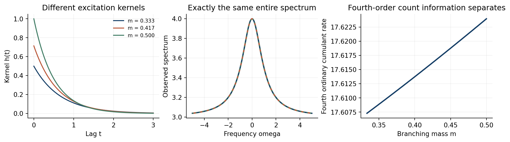

# Hawkes Processes with Missed and Spurious Events

## Abstract

We study a stationary linear Hawkes process observed after independent event deletion and independent Poisson contamination, with both observation parameters unknown. For every nonnegative causal integrable kernel of mass strictly between zero and one, the entire Bartlett spectrum and two scalar long-window cumulant rates, of orders three and four, identify the kernel, immigrant rate, retention probability, and contamination rate. An explicit continuum shares the entire spectrum and all count-cumulant rates through order three, proving a sharp order threshold for this specified population hierarchy. We then construct estimators from one unlabelled record. On known compact support and parameter sets separated from degeneracy and criticality, the four scalar parameters admit mean-squared risk of order at most $(1+\log T)^7/T$. For integer Sobolev kernels, squared kernel risk is at most

$$
C\left\{\left(\frac{(1+\log T)^3}{T}\right)^{2s/(2s+1)}
+\frac{(1+\log T)^7}{T}\right\},
$$

whereas a matching polynomial lower bound $cT^{-2s/(2s+1)}$ holds even with all scalar parameters fixed and known. The two unknown observation mechanisms therefore preserve the classical nonparametric polynomial exponent on this class, with logarithmic overhead. The proof combines fourth-order calibration, two-window boundary cancellation, a configuration-level coupling to independent blocks, stable causal spectral inversion, and a genealogical comparison experiment. A separate no-deletion multitype theorem classifies the full-law ambiguity exactly: all kernels and all active-parent rates are identifiable; a type with no outgoing excitation retains only the sum of its immigrant and contamination rates. Long-delay examples distinguish population identification from uniform statistical learning.

**Status.** This manuscript supplies written proofs and finite algebraic checks. External peer review and formal proof-assistant verification have not been completed.

# Introduction and contribution boundaries

Independent missing events attenuate correlations, whereas independent spurious events increase the mean without producing descendants. Their simultaneous unknown strengths create an observation-channel calibration problem before one can infer the latent excitation kernel. We ask whether this ambiguity persists at the population level, and whether calibrating the channel from the same finite record changes the nonparametric learning exponent.

Nonparametric inference for completely observed Hawkes processes has an established theoretical foundation. Reynaud-Bouret and Schbath (2010) developed nonasymptotic model selection and minimax results for compactly supported Hölder kernels, with the familiar polynomial squared-risk exponent $2a/(2a+1)$ and logarithmic overhead in the upper bounds. Bacry and Muzy (2016) proved that first- and second-order statistics characterize a general multivariate Hawkes process through a uniquely solvable Wiener–Hopf system. Minimum-phase spectral recovery in scalar and certain symmetric models already appears in Bacry, Dayri and Muzy (2012), while Donnet, Rivoirard and Rousseau (2020) established nonparametric Bayesian contraction results. Our inferential target is the unknown observation mechanism and the resulting latent-process recovery problem. [1, 2, 3, 14]

The closest additive-contamination model is that of Bonnet et al. (2025), whose observations superpose Hawkes events and independent Poisson events without source labels. Their Proposition 3 constructs spectral aliases for the scalar exponential model, whereas Proposition 4 already proves identification from its full distribution. The latter question is therefore not an open problem solved here. Unknown constant event retention is also a prior modeling choice: Deutsch and Ross develop an ABC method permitting unknown distortion parameters, and Deutsch's thesis examines constant deletion with unknown probability and discusses difficulties near the Poisson limit. Das, Banerjee and Sun (2025) discuss unknown reporting rates; their supplementary lemma assumes equality of reporting-weighted conditional intensities on the same complete history, which does not establish identification from equality of the marginal thinned observation laws. [4, 5, 6, 7]

Several ingredients of our reconstruction must likewise be attributed. Hawkes cumulants have long been computed by genealogical enumeration and recursive methods. Every Borel factorial-moment formula through order four used below is explicitly listed in Steliga and Szynal (2019, Corollary 4.3). The broader idea of using fourth-order count information to learn unknown detection efficiency occurs in Heger et al. (2017, 2018) for a different branching-count model. Trouleau et al. (2021) establish integrated-cumulant robustness under random translations of timestamps. We claim neither new Borel moment formulas nor invention of higher-order detector calibration or minimum-phase recovery. [11, 12, 8, 9, 10, 13]

Our scalar identification theorem treats both observation mechanisms as unknown: independent Bernoulli retention with probability $p$, followed by independent Poisson contamination with intensity $\lambda$. For every nonnegative causal $L^1$ kernel of mass $m\in(0,1)$, the entire Bartlett spectrum and the third and fourth long-window count-cumulant rates identify $h,\mu,p,\lambda$. The proof establishes global strict monotonicity of the scale-free ratio $F_4F_2/F_3^2$, calibrates both observation mechanisms, and reconstructs the arbitrary kernel. A compact continuum of feasible models with $0 \lt p<1$ and $\lambda>0$ shares its entire Bartlett spectrum and all first three count-cumulant rates, while its fourth rate varies strictly. This establishes a sharp threshold for the specified spectrum-plus-count-rate hierarchy. It makes no assertion about the sufficiency of the full third-order cumulant density or bispectrum.

The statistical theorem implements recovery from a single finite record under explicit uniformity conditions: a known support bound, parameters separated from zero-signal and critical boundaries, and a fixed compact-support $H^s(\mathbb R)$ kernel ball. Differences between two block lengths cancel the constant window-boundary term; a configuration-level cluster coupling controls dependence; fourth-order calibration and stable causal inversion yield
$$
\sup\mathbb E\|\widehat h-h\|_2^2
\le C\left[
\left(\frac{(1+\log T)^3}{T}\right)^{2s/(2s+1)}
+\frac{(1+\log T)^7}{T}
\right].
$$
A genealogical comparison experiment gives a lower bound of order $T^{-2s/(2s+1)}$ on a smooth interior subclass, even with every scalar parameter fixed and known. The contribution is preservation of the classical nonparametric polynomial exponent despite two unknown observation mechanisms. The logarithmic factors are not claimed optimal, and the minimum-distance construction is an existence result rather than a guarantee of computationally efficient optimization, adaptive smoothness selection, or semiparametric efficiency.

A complementary multivariate theorem characterizes complete-law equivalence without deletion and with heterogeneous unknown Poisson contamination. Canonical cluster information of sizes at most three determines every excitation kernel. For each type with a nonzero outgoing kernel column, it also separates immigration and contamination intensities; a type with a zero outgoing column identifies only their sum, even when it has incoming excitation. A common unknown contamination rate removes these remaining ambiguities whenever the kernel matrix is nonzero. These canonical cluster quantities are structural functionals of the complete observation law. They are neither observed cluster labels nor ordinary cumulants of orders one through three.

The population-order counterexample uses exponential kernels and belongs to the general $L^1$ class. It is not a proof of an order lower bound inside the later compact-support subclass. The statistical construction there uses fourth-order information without asserting that no other lower-order statistic could work. The lower risk bound fixes the observation channel; it concerns the polynomial information limit, not the necessity of this particular estimator.

Related work treats integrated cumulants for clean multitype processes [16], marked contamination fitting [17], Cox-immigration identification [18], bispectral orientation [19], clean spectral inference [20], and long-memory branching-ratio inference [21]. Davis and Kresin [22] study fixed-dimensional estimating equations built on the compensator of the observed compact-memory Hawkes process. Their assumptions and observation model differ from calibration with simultaneous unknown thinning and contamination. The literature comparison is limited to the cited sources.

## Reading map and notation

| Part | Question and assumptions | Principal result |
|---|---|---|
| C | Scalar process, unknown retention and Poisson contamination, arbitrary causal nonnegative $L^1$ kernel | Global population reconstruction; sharp stated spectrum/count hierarchy |
| D | One record, known support and fixed parameter bounds; integer $H^s(\mathbb R)$ for kernel risk | Uniform calibration and nonparametric rates with matching polynomial lower bounds |
| M | Finite labelled types, no deletion, arbitrary nonnegative $L^1$ kernels | Exact full-law equivalence class and canonical cluster order |
| A | Scalar no-deletion specialization | Spectrum plus one third-order count rate |
| B | No uniform memory-scale bound | Exact finite-window no-learning risk |
| E | Multitype canonical reconstruction | A posteriori enclosure, local deterministic stability, weak-excitation boundary, and example |

Parts C and D are the main statistical results. Part M is a complementary structural theorem; its canonical measures are determined by the entire process law, not supplied event labels. Each part specifies its own notation. In scalar parts, $\nu$ denotes the observed mean intensity; in Parts M and B, $\nu$ and $\nu_W$ denote canonical configuration measures. Superscripts such as $A^T$ denote transpose, whereas the scalar $T$ denotes the observation horizon. All equalities of kernels are almost-everywhere equalities.

Throughout, a stationary linear Hawkes process means the canonical Poisson-immigration branching process, equivalently the unique finite-intensity stationary solution of the linear conditional-intensity equations. Unrestricted stationary conditional-intensity solutions without a finite mean intensity are outside the model. This convention applies to the scalar and multitype parts alike; it is the model used in the proofs below.

# C. Global scalar identification under two unknown observation mechanisms

## C.1 Model and observable signature

Let $H$ be a stationary scalar linear Hawkes process with immigrant rate $\mu>0$, a measurable kernel $h:\mathbb R\to[0,\infty)$ supported on $(0,\infty)$, and

$$
0 \lt m:=\int_0^\infty h(t)\,dt<1.
$$

No moment of the offspring delay distribution is assumed. Independently retain each event of the complete process $H$ with probability $p\in(0,1]$; then add an independent homogeneous Poisson process $P_\lambda$, $\lambda\ge0$. The observation is

$$
Y=\operatorname{Thin}_p(H)+P_\lambda.
\tag{C.1}
$$

Deletion occurs after the complete Hawkes genealogy has been generated. A deleted event still has its descendants in the complete process. Poisson contamination does not excite that process.

Write $u=\mu/(1-m)$ and $\nu=pu+\lambda$. Use the Fourier convention $\widehat h(\omega)=\int e^{-i\omega t}h(t)\,dt$, and normalize the Bartlett spectral density $J_Y$ so a homogeneous Poisson process of rate $c$ has $J_Y\equiv c$.

Let

$$
\kappa_k=\lim_{T\to\infty}T^{-1}\operatorname{cum}_k(Y([0,T]))
$$

be the ordinary count-cumulant rates. Define the factorial count-cumulant rates $F_k$ by the corresponding limit of the derivatives of
$\log \mathbb E(1+z)^{Y([0,T])}$ at $z=0$. Up to order four,

$$
\begin{aligned}
F_1&=\kappa_1=\nu,\\
F_2&=\kappa_2-\kappa_1,\\
F_3&=\kappa_3-3\kappa_2+2\kappa_1,\\
F_4&=\kappa_4-6\kappa_3+11\kappa_2-6\kappa_1.
\end{aligned}
\tag{C.2}
$$

**Theorem C.1.** On the model class (C.1), the population signature

$$
\bigl(J_Y(\cdot),\kappa_3,\kappa_4\bigr)
\tag{C.3}
$$

uniquely determines $(h,\mu,p,\lambda)$, with equality of kernels understood almost everywhere. The reconstruction is explicit except for inversion of one strictly increasing scalar rational function. The smaller signature $\bigl(J_Y(\cdot),\kappa_3\bigr)$ does not identify this class; in fact Section C.5 gives a compact continuum of feasible models with exactly the same signature.

Since
$$
\nu=\lim_{|\omega|\to\infty}J_Y(\omega),\qquad
\kappa_2=J_Y(0),
\tag{C.4}
$$
the first two ordinary cumulant rates need not be supplied separately in (C.3).

The sharpness assertion concerns the full second-order spectrum augmented by the zero-frequency third-order count-cumulant rate. It is not an assertion that the full third-order cumulant density or its two-frequency bispectrum is insufficient.

## C.2 Factorial cumulant rates without a delay-moment hypothesis

Let $C$ be one complete Hawkes immigrant cluster, $Z=|C|$, and $C_v([0,T])$ its count in the window after translating its root to $v$. The cluster count $Z$ is the total progeny of a Galton–Watson process with Poisson($m$) offspring. It has an exponential moment for arguments in a neighborhood of zero: its probability generating function $y(z)$ solves

$$
y(z)=z\exp\{m(y(z)-1)\},
\tag{C.5}
$$

and the implicit function theorem at $(z,y)=(1,1)$, together with monotone convergence of the truncated-generation generating functions, gives a finite solution at some $z>1$.

The Poisson cluster generating functional and independent thinning yield, for $z$ sufficiently close to zero,

$$
\log \mathbb E(1+z)^{Y([0,T])}
=\mu\int_{\mathbb R}
  \left\{\mathbb E(1+pz)^{C_v([0,T])}-1\right\}\,dv
+\lambda Tz.
\tag{C.6}
$$

The integral is legitimate for small positive $z$, because its integrand is bounded by
$$
pz\,\mathbb E\!\left[C_v([0,T])(1+pz)^{Z-1}\right],
$$
and integration in $v$ gives
$$
pz\,T\,\mathbb E[Z(1+pz)^{Z-1}]<\infty.
$$
The same domination, or analyticity in a neighborhood of zero, justifies differentiation.

Write $(n)_k=n(n-1)\cdots(n-k+1)$. For deterministic cluster times $t_1,\ldots,t_Z$,

$$
\int_{\mathbb R}(C_v([0,T]))_k\,dv
=
\sum_{\substack{(i_1,\ldots,i_k)\\\text{all distinct}}}
\left[T-\left(\max_a t_{i_a}-\min_a t_{i_a}\right)\right]_+.
\tag{C.7}
$$

After division by $T$, every summand increases to one and the sum is bounded by $(Z)_k$. Dominated convergence and (C.6) imply

$$
F_1=p\mu\,\mathbb EZ+\lambda,\qquad
F_k=\mu p^k f_k(m),\quad k\ge2,\qquad
f_k(m):=\mathbb E(Z)_k.
\tag{C.8}
$$

This proof uses finite cluster-size moments and finite cluster durations almost surely; it does not require a finite expectation of cluster duration, offspring delay, or any power of delay.

For completeness, the needed factorial moments can be computed by differentiating
$\log y=\log z+m(y-1)$. At $z=1$, this gives

$$
\begin{aligned}
(1-m)f_1&=1,\\
(1-m)f_2&=f_1^2-1,\\
(1-m)f_3&=3f_1f_2-2f_1^3+2,\\
(1-m)f_4&=4f_1f_3+3f_2^2-12f_1^2f_2+6f_1^4-6.
\end{aligned}
\tag{C.9}
$$

Consequently,

$$
\begin{aligned}
f_1(m)&=\frac1{1-m},\\
f_2(m)&=\frac{m(2-m)}{(1-m)^3},\\
f_3(m)&=\frac{m^2(9-8m+2m^2)}{(1-m)^5},\\
f_4(m)&=\frac{m^3(64-79m+36m^2-6m^3)}{(1-m)^7}.
\end{aligned}
\tag{C.10}
$$

The general branching/cluster cumulant calculation and binomial scaling are classical ingredients. More specifically, all four Borel factorial moments in (C.10), including the polynomial $64-79m+36m^2-6m^3$, already appear in Corollary 4.3 of Steliga and Szynal (2019), listed as reference [8]. No novelty claim is attached to (C.8), (C.10), or to the existence of moment recursions.

## C.3 Algebraic recovery of both observation mechanisms

The nuisance scales $\mu,p$ disappear from

$$
R:=\frac{F_4F_2}{F_3^2}
=\Psi(m)
:=
\frac{(2-m)(64-79m+36m^2-6m^3)}
     {(9-8m+2m^2)^2}.
\tag{C.11}
$$

Direct differentiation and factorization give

$$
\Psi'(m)
=
\frac{2(1-m)(2m^2-16m+25)}
     {(2m^2-8m+9)^3}
>0,\qquad 0 \lt m<1.
\tag{C.12}
$$

Indeed $2m^2-8m+9\ge3$, and $2m^2-16m+25\ge11$ on $[0,1]$. The endpoint values are

$$
\Psi(0+)=\frac{128}{81},\qquad
\Psi(1-)=\frac53.
\tag{C.13}
$$

Thus the observed ratio has one and only one solution
$m\in(0,1)$, and the remaining scalar parameters follow from

$$
p=\frac{F_3}{F_2}\frac{f_2(m)}{f_3(m)},\qquad
\mu=\frac{F_2}{p^2 f_2(m)},\qquad
\lambda=\nu-\frac{p\mu}{1-m}.
\tag{C.14}
$$

These inversion formulas are asserted for signatures generated by the stated model, so $0 \lt p\le1$ and $\lambda\ge0$ are automatic. For an arbitrary supplied signature, they give necessary model-consistency inequalities rather than a guarantee that a valid Hawkes kernel exists.

The ratio is dimensionless. Its strict monotonicity establishes global identification, not merely a nonzero Jacobian at a generic point.

## C.4 Recovering the arbitrary causal kernel

Independent thinning preserves the off-diagonal factorial covariance measure up to a factor $p^2$; its diagonal rate becomes $pu$. Independent Poisson contamination adds $\lambda$ to the diagonal. Therefore

$$
J_Y(\omega)
=\nu+p^2u\left(|1-\widehat h(\omega)|^{-2}-1\right).
\tag{C.15}
$$

One can also verify this directly from the complete Hawkes spectrum $u|1-\widehat h|^{-2}$ and the conditional covariance of Bernoulli retention. Because $h\in L^1$, the Riemann–Lebesgue lemma gives the first identity in (C.4). Evaluating (C.15) at zero and using (C.8) gives its second identity.

With $m,p,\mu,\lambda$ known, form the positive function

$$
S(\omega)
:=
1+\frac{J_Y(\omega)-\nu}{p^2u}
=|1-\widehat h(\omega)|^{-2}.
\tag{C.16}
$$

Equivalently, since $F_2=p^2u((1-m)^{-2}-1)$,

$$
S(\omega)
=1+\frac{(1-m)^{-2}-1}{F_2}\,[J_Y(\omega)-\nu].
\tag{C.17}
$$

The arbitrary $L^1$ kernel is then recovered by causality. Set

$$
q=\sum_{n=1}^{\infty}\frac{h^{*n}}n.
\tag{C.18}
$$

The series converges absolutely in $L^1(\mathbb R)$, $q\ge0$, $q$ is supported on positive times, and
$\|q\|_1=-\log(1-m)$. Since $|\widehat h|\le m<1$,

$$
\log S(\omega)
=\widehat q(\omega)+\widehat q(-\omega)
=\mathcal F(q+q^\leftarrow)(\omega),
\quad q^\leftarrow(t):=q(-t).
\tag{C.19}
$$

Fourier uniqueness on $L^1$ determines $q+q^\leftarrow$; its restriction to positive times determines $q$. This argument does not assume that $\log S$ is integrable in frequency.

An explicit regularized recovery, valid under the stated assumptions, is

$$
g_\epsilon(t)=\frac1{2\pi}\int_{\mathbb R}
 e^{-\epsilon\omega^2}\log S(\omega)e^{i\omega t}\,d\omega.
\tag{C.20}
$$

The logarithm is bounded by (C.19), so the integral exists. Gaussian approximate-identity convergence gives
$$
g_\epsilon\longrightarrow q+q^\leftarrow
\quad\text{in }L^1(dt).
$$
Restriction to $(0,\infty)$ gives $q$ in the same norm. Finally,

$$
h=\sum_{n=1}^{\infty}
\frac{(-1)^{n+1}}{n!}\,q^{*n},
\tag{C.21}
$$

with absolute $L^1$ convergence. Its Fourier transform is $1-e^{-\widehat q}=\widehat h$, proving the formula by uniqueness. Equations (C.11)–(C.21) establish Theorem C.1.

## C.5 Exact alias of the full spectrum and all first three count-cumulant rates

Let $m$ range over the nontrivial compact interval $[1/3,1/2]$, and put

$$
\begin{gathered}
D(m)=9-8m+2m^2,\qquad
\beta_m=\frac1{1-m},\qquad
h_m(t)=m\beta_m e^{-\beta_m t}\mathbf1_{\{t>0\}},\\
p_m=\frac{(1-m)^2(2-m)}{mD(m)},\qquad
\mu_m=\frac{mD(m)^2}{(1-m)(2-m)^3},\qquad
\lambda_m=1-\frac1{(2-m)^2}.
\end{gathered}
\tag{C.22}
$$

All models are admissible. In particular, on this interval,
$$
0 \lt p_m\le
\frac{(2/3)^2(5/3)}{(1/3)(11/2)}
=\frac{40}{99}<1,\qquad
\lambda_m\ge\frac59>0,\qquad
\mu_m>0.
\tag{C.23}
$$

Using $D(m)=2(2-m)^2+1$, direct substitution gives

$$
\frac{p_m\mu_m}{1-m}
=\frac{D(m)}{(2-m)^2}
=2+\frac1{(2-m)^2},
\qquad
\nu_m=3,\quad F_{2,m}=F_{3,m}=1.
\tag{C.24}
$$

For an exponential kernel,
$$
|1-\widehat h_m(\omega)|^{-2}-1
=\frac{m(2-m)\beta_m^2}
       {(1-m)^2\beta_m^2+\omega^2}.
$$
Since $(1-m)\beta_m=1$ and
$$
p_m^2u_m\,m(2-m)\beta_m^2=F_{2,m}=1,
$$
every model in (C.22) has the identical full Bartlett spectrum

$$
J_{Y_m}(\omega)=3+\frac1{1+\omega^2}.
\tag{C.25}
$$

Its ordinary cumulant rates satisfy

$$
\kappa_{1,m}=3,\qquad
\kappa_{2,m}=4,\qquad
\kappa_{3,m}=7,\qquad
\kappa_{4,m}=16+\Psi(m).
\tag{C.26}
$$

The last quantity is strictly increasing, by (C.12). Hence these are genuinely different process laws with the same entire second-order spectrum and the same first three long-window ordinary cumulant rates. Fourth-order count information separates the displayed aliases.

For two explicit endpoints:

| $m$ | $h(t)$, $t>0$ | $p$ | $\mu$ | $\lambda$ |
|---|---|---|---|---|
| $1/3$ | $\tfrac12e^{-3t/2}$ | $20/59$ | $3481/750$ | $16/25$ |
| $1/2$ | $e^{-2t}$ | $3/22$ | $242/27$ | $5/9$ |

This construction establishes a sharp threshold for the particular observable hierarchy $\{J_Y,\kappa_3,\ldots,\kappa_q\}$. It leaves open whether suitably chosen nonzero-frequency third-order information can replace $\kappa_4$.

## C.6 What external calibration changes

The need for the additional fourth-order rate has a precise source: both observation mechanisms are unknown.

If $\lambda$ is known but $p$ is unknown, then already

$$
\frac{F_3(\nu-\lambda)}{F_2^2}
=\frac{f_3(m)f_1(m)}{f_2(m)^2}
=2+\frac1{(2-m)^2}
\tag{C.27}
$$

is strictly increasing in $m\in(0,1)$. Thus the spectrum and $\kappa_3$ identify $m$, then $p,\mu$, then $h$. If $p$ is known but $\lambda$ is unknown, use

$$
\frac{F_3}{pF_2}
=\frac{m(9-8m+2m^2)}{(1-m)^2(2-m)}.
\tag{C.28}
$$

To see strict monotonicity without a long rational derivative, put $x=(1-m)^{-1}>1$. The right-hand side becomes
$$
3x^2-2x-\frac{2}{x+1},
$$
whose derivative is $6x-2+2/(x+1)^2>0$.

If $p,\lambda$ are both known, the mean and zero-frequency spectrum determine $u=(\nu-\lambda)/p$ and
$$
F_2=p^2u((1-m)^{-2}-1);
$$
the full second-order spectrum then recovers the kernel.

These are structural comparisons of the specified population signatures. No finite-sample efficiency comparison follows from their order alone.

## C.7 Degeneracy and unbounded-delay impossibility

At $m=0$, nonnegativity implies $h=0$ almost everywhere. The observation is simply Poisson with rate $\nu=p\mu+\lambda$, and $(p,\mu,\lambda)$ has a continuum of equivalent decompositions. Thus $m>0$ is necessary. The model also excludes $p=0$ and $\mu=0$, at which no excitation information is observed.

The fixed-$p$ version of the finite-window boundary in Appendix B continues to hold. Fix any known $p_0\in(0,1]$, fixed known $m_0\in(0,1)$, an observed intensity $s>0$, and an interval $0 \lt v_- \lt v_+ \lt s$. For $v\in[v_-,v_+]$ and $L>0$, let

$$
h_L(t)=\frac{m_0}{L}\mathbf1_{[L,2L]}(t),\quad
\mu_v=(1-m_0)\frac{v}{p_0},\quad
p=p_0,\quad
\lambda_v=s-v.
\tag{C.29}
$$

All observations have the same intensity $s$. For a window of length $T \lt L$, the pair-measure argument of Appendix B gives

$$
d_{\rm TV}\!\left(
\mathcal L(Y_{v,L}|_{[0,T]}),
\operatorname{Pois}(s\,dt)|_{[0,T]}
\right)
\le
\frac{3p_0v\,m_0^2T^2}{2(1-m_0)^2L}.
\tag{C.30}
$$

Indeed the non-diagonal factorial covariance of the retained process is $p_0^2$ times that of the complete process; its complete-process intensity is $u=v/p_0$. Thus the bound from Appendix B, $3u m_0^2T^2/[2(1-m_0)^2L]$, acquires exactly a factor $p_0^2$.

For each finite $T$, the minimax absolute-error risk for $\lambda$ over (C.29) is exactly $(v_+-v_-)/2$, and the squared-error risk is exactly $(v_+-v_-)^2/4$. The midpoint estimator attains these upper bounds. For the lower bounds, send $L\to\infty$ for the two endpoint models; their window laws approach the same Poisson law in total variation, so the usual common-subprobability two-point argument yields the no-data risks. This obstruction persists with the branching mass and retention probability both fixed and known.

As in Appendix B, this is a boundary statement for an unrestricted memory scale. It is not evidence against pointwise estimation or against uniform inference on classes with a quantitative delay envelope.

# D. Statistical recovery from one observed record

## D.1 Experiment, classes, and conclusions

Let a stationary scalar linear Hawkes process have immigrant rate $\mu$ and a nonnegative kernel $h$, with mass $m=\int h$. Independently retain every event with probability $p$, and superpose an independent homogeneous Poisson process of rate $\lambda$. In this part the observed process is denoted by $N$. We observe its entire point configuration on $[0,T]$, with no parent labels or noise labels. Write

$$
\theta=(m,p,\mu,\lambda),\qquad
\nu=p\mu/(1-m)+\lambda,\qquad c=p^2\mu/(1-m).
$$

Fix $\tau>0$, $0 \lt m_- \lt m_+<1$, $0 \lt p_-\le1$, $0<\mu_-<\mu_+<\infty$, and $0<\lambda_+<\infty$. Let

$$
\Theta=[m_-,m_+]\times[p_-,1]\times[\mu_-,\mu_+]\times[0,\lambda_+].
$$

For calibration alone, allow every nonnegative $L^1$ kernel supported in $[0,\tau]$, with mass in $[m_-,m_+]$. No upper bound on its pointwise height and no parametric shape are imposed. For kernel estimation fix an integer $s\ge1$ and $R<\infty$, and restrict to

$$
\mathcal H_s(R)=\{h\ge0:\operatorname{supp}h\subset[0,\tau],\
m_-\le\int h\le m_+,\quad h\in H^s(\mathbb R),\quad
\sum_{r=0}^s\|h^{(r)}\|_2^2\le R^2\}.
$$

The zero extension belongs to $H^s(\mathbb R)$; this boundary regularity is part of the class. We do not assert the same rates for every causal $L^1$ kernel. Define $\ell_T=1+\log T$.

**Theorem D.1 (uniform calibration).** For all sufficiently large $T$, there is an estimator based on the observed record alone such that, uniformly over the calibration class,

$$
\mathbb E\|\widehat\theta_T-\theta\|_2\le
C\ell_T^{7/2}T^{-1/2},\qquad
\mathbb E\|\widehat\theta_T-\theta\|_2^2\le
C\ell_T^7T^{-1}.
$$

If the parameter class contains an interior positive value of $\lambda$, the corresponding minimax joint risks are bounded below by $c_0T^{-1/2}$ and $c_0T^{-1}$, respectively. This lower bound concerns the joint loss (and the $\lambda$ coordinate); it is not a separate optimality assertion for each of $m,p,\mu$.

**Theorem D.2 (nonparametric kernel risk).** On $\mathcal H_s(R)$, there is an estimator satisfying

$$
\sup\mathbb E\|\widehat h_T-h\|_2^2
\le C\left\{
\left(\frac{\ell_T^3}{T}\right)^{2s/(2s+1)}
+\frac{\ell_T^7}{T}\right\}.
\tag{D.1}
$$

If the class contains a kernel in $C_c^\infty(0,\tau)$ whose mass is strictly between $m_-$ and $m_+$, whose Sobolev norm is strictly less than $R$, and which is bounded below on some interval inside $(0,\tau)$, then

$$
\inf_{\widetilde h_T}\sup\mathbb E\|\widetilde h_T-h\|_2^2
\ge c_1T^{-2s/(2s+1)}.
\tag{D.2}
$$

The lower bound already holds with fixed, known $m,p,\mu,\lambda$. The upper and lower bounds match in their power of $T$; logarithmic factors are not claimed optimal. The estimator uses a theoretical minimum-distance search, so these theorems do not assert computationally efficient global optimization.

## D.2 Uniform cluster tails and block moments

Let $Z$ be total progeny of one Hawkes immigrant, including its root. Its offspring distribution is Poisson with mean $m$, so $Z$ is Borel. Coupling with a Poisson branching tree of mean $m_+<1$ gives, for some $a>0$,

$$
\sup_{m\le m_+}\mathbb E e^{aZ}<\infty.
\tag{D.3}
$$

For completeness, its generating function $F(z)=ze^{m(F(z)-1)}$ is analytic for real $z>1$ sufficiently close to one: the derivative with respect to $F$ at $(z,F)=(1,1)$ is $1-m\ge1-m_+>0$. Alternatively, the explicit Borel probability $e^{-mn}(mn)^{n-1}/n!$, together with Stirling's bound and $m_+e^{1-m_+}<1$, yields (D.3) directly, including a uniform constant. The zero-offspring case follows by domination.

Let $S$ be the last time in a cluster relative to its immigrant. Compact support implies

$$
0\le S\le\tau(Z-1).
\tag{D.4}
$$

After Bernoulli retention, the observed cluster has at most $Z$ points and span at most $S$. Thus, with constants uniform on the class, for every fixed integer $r$,

$$
\mathbb E[Z^r(S-u)_+]\le C_re^{-bu},\quad u\ge0,
\tag{D.5}
$$

for a sufficiently small $b>0$. We use one common smaller $b$ for all finitely many orders required below.

If $X_l=N([0,l])$, the Poisson cluster formula gives, for each ordinary cumulant order $r\ge1$,

$$
\operatorname{cum}_r(X_l)
=\mu\,\mathbb E\sum_{(v_1,\ldots,v_r)}
(l-\operatorname{span}(v_1,\ldots,v_r))_++\lambda l.
\tag{D.6}
$$

The sum is over ordered tuples of retained points in the same cluster, with repetitions allowed. Empty retained clusters contribute zero. The $\lambda l$ term is the ordinary cumulant of the independent ghost process. Since the sum has at most $Z^r$ terms, $0\le\operatorname{cum}_r(X_l)\le C_rl$. The moment-cumulant partition formula consequently yields

$$
\mathbb E X_l^r\le C_r(1+l)^r.
\tag{D.7}
$$

Only the cases up to order eight are needed for the calibration estimators.

Writing $(l-a)_+=l-a+(a-l)_+$ in (D.6) gives

$$
C_r(l):=\operatorname{cum}_r(X_l)=l\kappa_r-B_r+R_r(l),
\quad |R_r(l)|\le C_re^{-bl},
\tag{D.8}
$$

where $\kappa_r=\mu\mathbb E W^r+\lambda$, $W$ is the retained total cluster size, and
$B_r=\mu\mathbb E\sum\operatorname{span}(v_1,\ldots,v_r)$ is finite. In particular,

$$
\left|\frac{C_r(2L)-C_r(L)}{L}-\kappa_r\right|
\le Ce^{-bL}/L.
\tag{D.9}
$$

Using just $C_r(L)/L$ would retain an order $L^{-1}$ boundary bias. The difference of the two lengths removes the entire constant term, independently of the unknown kernel.

## D.3 Independent-block comparison for the full configuration

Consider $J$ ordered observation intervals separated by gaps of length at least $D$. Let $P_{\rm blocks}$ be the joint law of their point configurations and let $P_{\rm prod}$ be the product of their true marginal laws. Then

$$
\|P_{\rm blocks}-P_{\rm prod}\|_{\rm TV}
\le3\mu(J-1)\mathbb E(S-D)_+
\le CJe^{-bD}.
\tag{D.10}
$$

Here total variation means the supremum difference over measurable events.

**Proof.** Use the Poisson random measure of immigrant times with independently marked full clusters, including retention marks. Call a cluster bad if it contributes to at least two observation intervals. Delete all bad clusters. Clusters now assigned to distinct intervals arise from disjoint measurable portions of the immigrant Poisson random measure, hence give independent restrictions. To restore each true marginal, independently superpose in each interval a copy of the projection of the bad-cluster Poisson random measure. These are compound Poisson projections, not ordinary Poisson replacements.

If a cluster hits $r\ge2$ intervals, its original copy plus all marginal copies have total coupling cost at most $1+r\le3(r-1)$. If it spans $c$ of the separating gaps then $c\ge r-1$. For a fixed cluster of span at most $S$, immigrant positions allowing it to span any specified gap of length $D$ occupy a set of Lebesgue measure at most $(S-D)_+$. Integrating $1+r\le3c$ over immigrant positions and cluster marks, and using a union bound for the original and replacement Poisson random measures, proves (D.10). Ghost-process restrictions are already independent. This comparison concerns complete interval configurations, so it also applies to all statistics subsequently computed from them. $\square$

Choose $L=A\ell_T$ and $D=A\ell_T$, where $A$ is a sufficiently large fixed constant depending only on the known class bounds. Place $K$ pairs of intervals of lengths $L,2L$, with a gap $D$ after each interval. For example,

$$
K=\left\lfloor\frac{T}{3L+2D}\right\rfloor
\asymp T/\ell_T.
\tag{D.11}
$$

The joint block law differs from the product law by at most $CT^{-3}$ after increasing $A$. All estimators below are functions of these blocks only. We first analyze the product experiment and then transfer bounded final risks by (D.10).

## D.4 Unbiased cumulant estimators and calibration

For each length $l\in\{L,2L\}$, let $X_1,\ldots,X_K$ be its block counts. Under the product comparison experiment these are independent and identically distributed. For a partition $\pi$ of $\{1,\ldots,r\}$ into $q$ nonempty blocks of sizes $a_1,\ldots,a_q$, define

$$
U_\pi=\frac{1}{(K)_q}\sum_{i_1,\ldots,i_q\ \mathrm{distinct}}\prod_{j=1}^q X_{i_j}^{a_j},
$$

and set

$$
\widehat C_r(l)=\sum_{\pi}(-1)^{|\pi|-1}(|\pi|-1)!U_\pi,
\qquad 1\le r\le4.
\tag{D.12}
$$

The partition formula makes this exactly unbiased for the finite-block cumulant $C_r(l)$. In the variance of each $U_\pi$, terms involving disjoint index sets have zero covariance. The proportion of pairs with an overlap is at most $C_r/K$. By (D.7) and Cauchy-Schwarz, each remaining covariance has absolute value at most $C_rl^{2r}$ for $l\ge1$. Summing the finitely many partitions gives

$$
\operatorname{Var}\widehat C_r(l)\le C_rl^{2r}/K.
\tag{D.13}
$$

Define $\widehat\kappa_r=[\widehat C_r(2L)-\widehat C_r(L)]/L$. Equations (D.9) and (D.13) imply

$$
\mathbb E|\widehat\kappa_r-\kappa_r|^2
\le C\{L^{2r-2}/K+e^{-2bL}/L^2\}.
\tag{D.14}
$$

Write $q(\theta)=(\kappa_1,\ldots,\kappa_4)$. The fourth-order inversion in Section C implies a uniform inverse-Lipschitz bound on $\Theta$:

$$
\|\theta_1-\theta_2\|_2\le C\|q(\theta_1)-q(\theta_2)\|_2.
\tag{D.15}
$$

To check uniformity rather than merely pointwise continuity, form the factorial cumulant rates $F_2,F_3,F_4$ from the ordinary rates. On $\Theta$, $F_2,F_3$ are bounded away from zero and bounded above; the derivative of $R(m)=F_4F_2/F_3^2$ is bounded below by a positive constant on $[m_-,m_+]$. The rational map to $R$, followed by $R^{-1}$, is uniformly Lipschitz there. The explicit formulas for $p,\mu,\lambda$ have denominators bounded away from zero. This proves (D.15) for any two image points, including $p=1$ and $\lambda=0$.

Choose $\widehat\theta\in\Theta$ whose moment-vector distance from $\widehat\kappa$ is within $T^{-1}$ of the infimum over $\Theta$. One may choose the first admissible member of a fixed countable dense subset, giving a measurable estimator. Then

$$
\|\widehat\theta-\theta\|_2
\le C(2\|\widehat\kappa-q(\theta)\|_2+T^{-1}).
\tag{D.16}
$$

This construction also covers noisy estimates whose computed ratio falls outside the feasible interval; it never evaluates the population inverse at an illegal ratio. The estimate stays in the compact set $\Theta$, so its losses are bounded. Equations (D.11), (D.14), and (D.16), followed by (D.10), prove both upper bounds of Theorem D.1. They also show

$$
\mathbb E|\widehat c-c|^2\le C\ell_T^7/T,
\quad \widehat c=\widehat p^2\widehat\mu/(1-\widehat m),
\quad \widehat c\ge p_-^2\mu_-.
\tag{D.17}
$$

## D.5 A uniformly bias-corrected spectral estimate

Use the Fourier convention $\widehat h(\omega)=\int e^{-i\omega t}h(t)dt$. Let

$$
S_h(\omega)=|1-\widehat h(\omega)|^{-2},\quad
f(\omega)=\nu+c(S_h(\omega)-1),\quad g=f-\nu.
$$

For a block of length $l$, in coordinates relative to its left endpoint, put $Y_l(\omega)=\int_0^l e^{-i\omega t}N(dt)$. A cluster pair expansion gives

$$
\operatorname{Var}Y_l(\omega)=lf(\omega)-B(\omega)+R_l(\omega),
\qquad \sup_\omega|R_l(\omega)|\le Ce^{-bl}.
\tag{D.18}
$$

Indeed, diagonal pairs contribute $\nu l$. Every ordered distinct pair in a retained cluster contributes
$e^{-i\omega(v-u)}(l-|v-u|)_+$; expand the last factor exactly as in (D.8). Its boundary term is independent of $l$, and its remainder is bounded by $\mu\mathbb E Z^2(S-l)_+$. This also proves the uniformity in $\omega$, without assuming an integrable spectral logarithm.

For independent blocks of the same length, use the unbiased complex sample variance

$$
\widehat V_l(\omega)=\frac1K\sum_j|Y_{l,j}(\omega)|^2
-\frac1{K(K-1)}\sum_{i\ne j}
Y_{l,i}(\omega)\overline{Y_{l,j}(\omega)}.
\tag{D.19}
$$

Since $|Y_{l,j}(\omega)|\le X_{l,j}$, the same overlap argument using fourth moments gives
$\sup_\omega\operatorname{Var}\widehat V_l(\omega)\le Cl^4/K$. Define

$$
\widehat f(\omega)=\frac{\widehat V_{2L}(\omega)-\widehat V_L(\omega)}L.
$$

Let $\widehat\nu$ be the sum of counts in all selected blocks divided by their total length $3KL$. Under the product experiment it is unbiased and has variance at most $C/(KL)$, because $\operatorname{Var}X_l\le Cl$. Set $\widehat g=\widehat f-\widehat\nu$. For every $\Omega\ge1$,

$$
\mathbb E\int_{-\Omega}^{\Omega}|\widehat g-g|^2d\omega
\le C\Omega\{L^2/K+e^{-2bL}/L^2+(KL)^{-1}\}
\le C\Omega\ell_T^3/T.
\tag{D.20}
$$

Only this product-experiment expectation is needed; bounded kernel risk will subsequently transfer to the actual dependent blocks. Dependence between $\widehat c$ and $\widehat g$ is allowed throughout.

## D.6 Stable causal inversion and the kernel upper bound

For two causal kernels in $L^1\cap L^2$ with masses at most $m_+$, in particular for two kernels in $\mathcal H_s(R)$, define
$q_h=\sum_{n\ge1}h^{*n}/n$. Then $q_h\in L^1\cap L^2$, $\|q_h\|_1\le-\log(1-m_+)$, and

$$
\log S_h=\mathcal F(q_h+q_h^{\rm rev}),
\quad q_h^{\rm rev}(t)=q_h(-t).
$$

The supports of $q_h$ and $q_h^{\rm rev}$ are disjoint up to a null set. Plancherel gives
$\|q_{h_1}-q_{h_2}\|_2=(2\sqrt\pi)^{-1}\|\log S_{h_1}-\log S_{h_2}\|_2$, where the norm on the right is in frequency. The convolution-exponential identity $h=\delta-\exp_*(-q_h)$ and its integral difference formula imply

$$
\|h_1-h_2\|_2
\le \frac{(1+m_+)^2}{2\sqrt\pi(1-m_+)}
\|S_{h_1}-S_{h_2}\|_{L^2(d\omega)}.
\tag{D.21}
$$

Here the convolution exponential has measure norm at most $e^{\|q_h\|_1}$, and $S_h\ge(1+m_+)^{-2}$ bounds the derivative of the real logarithm. No pointwise inversion of an empirical spectrum is required.

Also,

$$
|S_h-1|\le\frac{2+m_+}{(1-m_+)^2}|\widehat h|,
\qquad
\int_{|\omega|>\Omega}|S_h-1|^2d\omega
\le C R^2\Omega^{-2s}.
\tag{D.22}
$$

The second bound follows from Plancherel applied to $h^{(s)}$. In particular $\|S_h-1\|_2\le CR$ uniformly on the kernel class.

Choose $\widehat h\in\mathcal H_s(R)$ to be an approximate minimizer, within $T^{-1}$ in norm, of

$$
\|\widehat c(S_h-1)-\widehat g\|_{L^2([-\Omega,\Omega])}.
\tag{D.23}
$$

Again a fixed countable dense subset and its first approximate minimizer give a measurable choice. The class is separable in $L^2$, and the displayed map is continuous there because $\|h\|_1\le m_+<1$ and $|1-\widehat h|\ge1-m_+$. We impose no additional constraint $\int\widehat h=\widehat m$: the true kernel must remain a candidate even when the preliminary mass estimate has error.

By comparison with the true $h$,

$$
\widehat c\|S_{\widehat h}-S_h\|_{L^2([-\Omega,\Omega])}
\le2\|\widehat g-g\|_{L^2([-\Omega,\Omega])}
+2|\widehat c-c|\|S_h-1\|_2+T^{-1}.
\tag{D.24}
$$

Use the lower bound on $\widehat c$, the tail bound (D.22) for both kernels, and (D.21). Taking expectations under the product experiment proves

$$
\mathbb E\|\widehat h-h\|_2^2
\le C\{\Omega\ell_T^3/T+\ell_T^7/T+\Omega^{-2s}\}.
\tag{D.25}
$$

Both kernels have norm at most $R$, so the loss is bounded by $4R^2$. Transfer by (D.10) adds only $CT^{-3}$. Taking $\Omega=(T/\ell_T^3)^{1/(2s+1)}$ proves (D.1).

## D.7 The parametric lower bound

Fix an admissible $h,p,\mu$ and an interior $\lambda_0>0$. Compare $\lambda_0$ with $\lambda_0+a/\sqrt T$, where $a>0$ is a sufficiently small fixed constant. The experiment observing the retained Hawkes component and the ghost process separately is more informative than their superposition. Its KL divergence is exactly the Poisson divergence

$$
T\left[(\lambda_0+a/\sqrt T)\log
\frac{\lambda_0+a/\sqrt T}{\lambda_0}-a/\sqrt T\right]
\le Ca^2.
$$

Data processing and the elementary two-point testing bound therefore give absolute-error risk at least $cT^{-1/2}$ and squared-error risk at least $cT^{-1}$ for $\lambda$, hence for the joint Euclidean losses. This proves the lower assertions of Theorem D.1. It does not give coordinatewise lower bounds for the other three parameters.

## D.8 A genealogical comparison experiment and the kernel lower bound

We give the lower-bound construction because unknown observation noise cannot be handled by silently borrowing a noiseless rate without checking experiments and stationary boundaries.

Choose $h_0\in C_c^\infty(0,\tau)$, strictly positive on a closed interval $I\subset(0,\tau)$, with mass $m_0\in(m_-,m_+)$ and Sobolev norm below $R$. Fix $\mu_0,p_0,\lambda_0$ in the allowed class. Choose $\psi\in C_c^\infty(0,1)$ with integral zero and positive $L^2$ norm. Partition $I$, of length $a_I$, into $J$ cells and write

$$
h_\eta(t)=h_0(t)+\varepsilon J^{-s}
\sum_{j=1}^J\eta_j\psi\left(\frac{J(t-t_j)}{a_I}\right),
\qquad \eta\in\{-1,1\}^J,
\tag{D.26}
$$

with each bump supported in its own cell. Take a fixed sufficiently small $\varepsilon>0$. All kernels remain nonnegative, have the same mass $m_0$, and belong to $\mathcal H_s(R)$. Indeed the squared $L^2$ norm of the order-$r$ derivative of the perturbation is $C_r\varepsilon^2J^{2r-2s}$, uniformly bounded for every $r\le s$. Adjacent vertices, differing only in coordinate $j$, obey

$$
\|h_\eta-h_{\eta^{(j)}}\|_2^2
=c_\psi\varepsilon^2J^{-(2s+1)}.
\tag{D.27}
$$

For an interval of immigrant times $[-D_0,T]$, consider the more informative experiment observing all immigrant times and their complete genealogical trees, with every offspring delay, and also all retention marks and the independent ghost process on $[0,T]$. Its projection contains the truncated observed process generated by these immigrants.

For two kernels $h_1,h_0$ with common mass $m_0$, the KL divergence between the laws of one full genealogical cluster is

$$
D_{\rm tree}(h_1\|h_0)
=\frac1{1-m_0}\int_0^\tau
\left[h_1\log\frac{h_1}{h_0}-h_1+h_0\right]dt.
\tag{D.28}
$$

Each parent produces an independent Poisson point process of children with intensity $h$; the log-likelihood ratio is the sum of their Poisson log-likelihood ratios over all parents. Its expectation is the expected number $(1-m_0)^{-1}$ of parents times the one-parent divergence. One can first truncate by generations, then use integrability (the neighboring kernels have bounded likelihood ratios on their differing support and the total progeny has finite expectation) to pass to the full finite tree. The common retention and ghost mechanisms add no divergence. The Poisson number of immigrant trees thus gives divergence

$$
\mu_0(T+D_0)D_{\rm tree}(h_\eta\|h_{\eta^{(j)}})
\le C(T+D_0)J^{-(2s+1)}.
\tag{D.29}
$$

The inequality uses a fixed positive lower bound for both kernels on the bump support and $x\log(x/y)-x+y\le(x-y)^2/y$. Outside that support the kernels coincide, including wherever both vanish.

The true stationary observation also receives clusters whose immigrant lies before $-D_0$. Their probability of contributing any point in $[0,T]$ is at most

$$
\mu_0\int_{D_0}^{\infty}\Pr(S\ge v)dv\le Ce^{-bD_0}.
\tag{D.30}
$$

Couple the truncated and full stationary experiments by retaining all later immigrants and the same ghosts. Hence their total variation distance is bounded by (D.30), uniformly in $\eta$. Taking $D_0=A_0\ell_T$ and $J$ a sufficiently large constant times $T^{1/(2s+1)}$, Pinsker's inequality, data processing, and (D.29) show that adjacent true observed laws have total variation at most $1/2$ for all large $T$.

Finally, project any kernel estimator onto the disjoint bump directions. The average probability of a wrong sign in each coordinate, averaged over the paired hypercube vertices, is bounded below by a constant by the two-point testing inequality. A wrong sign costs at least a fixed multiple of the squared one-coordinate separation (D.27). Summing over the $J$ orthogonal cells gives

$$
\inf_{\widetilde h}\sup_\eta
\mathbb E_\eta\|\widetilde h-h_\eta\|_2^2
\ge cJ\,J^{-(2s+1)}
\ge c_1T^{-2s/(2s+1)}.
$$

This proves (D.2). All four scalar parameters remain fixed in this lower-bound family. Thus the lower bound reflects nonparametric kernel uncertainty even when the observation mechanism is fully known.

## D.9 Scope and limitations

The results separate two logically different statements. Population identification requires only a nonnegative causal $L^1$ kernel of mass strictly between zero and one. Uniform statistical rates here require known compact support and parameters bounded away from the zero-signal and critical boundaries; kernel rates additionally require known Sobolev regularity and radius. The unbounded-delay impossibility construction in Parts B and C shows why one cannot erase a quantitative memory restriction from these uniform claims.

The fourth-order calibration is used for two unknown observation mechanisms. Known-channel cases can use lower-order formulas from Section C, but no improved log factors are claimed here. The upper rate is an existence result for a measurable minimum-distance procedure. It does not establish semiparametric efficiency, sharp logarithmic minimax constants, adaptation to unknown support or smoothness, or a polynomial-time optimizer. No multivariate thinning theorem is asserted.

# M. Multitype classification without deletion

## M.1. Model and conventions

Let the labelled type space be $D=\{1,\ldots,d\}$, with finite $d\ge1$. For each pair $(i,j)$, let
$$
h_{ij}:(0,\infty)\longrightarrow[0,\infty)
$$
be measurable and integrable. The index $j$ is the parent type and $i$ the child type. Set
$$
A_{ij}=\int_0^\infty h_{ij}(t)\,dt,
\qquad a_j=\sum_i A_{ij},
\qquad \rho(A)<1.
$$
Assume $\mu_j>0$ and $\lambda_j\ge0$, all finite. A parent of type $j$ produces, independently across child types, Poisson offspring processes with intensities $h_{ij}(t)dt$, and all reproduction is independent. Let $C_j$ be the resulting cluster with one type-$j$ root at time zero. Poisson immigrants of type $j$ have rate $\mu_j$. The superposition of their independent clusters is a stationary linear Hawkes process $H$. Independently, let $P_j$ be independent homogeneous Poisson processes with rates $\lambda_j$. We observe only the labelled superposition $N=H+P$.

Integrable kernel *functions* on strictly positive lags exclude immediate offspring atoms. Subcriticality gives
$$
\mathbb E|C_j|=\mathbf1^T(I-A)^{-1}e_j<\infty.
$$
Thus every cluster is finite almost surely. Its root is its unique earliest point almost surely; all event times inside a cluster are distinct almost surely. To justify the last statement, condition on a finite genealogical tree: offspring lags have densities, and the difference of the times of any two distinct vertices contains a continuously distributed edge lag independent of all other relevant lags. A finite union over pairs and the countable union over possible finite trees then have zero tie probability.

Kernels are identified only up to Lebesgue-null sets. Type labels are fixed; identification is not modulo an unspecified permutation of types.

## M.2. Canonical cluster measure is determined by the stationary process law

Let $\mathfrak N_f^*$ be the measurable space of nonzero finite point configurations on $\mathbb R\times D$, with its counting-map sigma field. Let $\theta_u$ translate all times by $u$. Define the sigma-finite measure
$$
\nu=\sum_j\mu_j\int_{\mathbb R}\mathcal L(\theta_uC_j)\,du
 +\sum_j\lambda_j\int_{\mathbb R}\delta_{\{(u,j)\}}\,du.
\tag{M.2.1}
$$
For any bounded time window $W$, write $E_W=W\times D$. Then
$$
\nu\{\xi:\xi(E_W)>0\}
\le \int\xi(E_W)\,\nu(d\xi)
=|W|\,\mathbf1^T[(I-A)^{-1}\mu+\lambda]<\infty.
\tag{M.2.2}
$$
The Poisson superposition construction gives, for any nonnegative bounded compactly supported measurable $f$,
$$
\log\mathbb E e^{-N(f)}
=\int\big(e^{-\xi(f)}-1\big)\,\nu(d\xi).
\tag{M.2.3}
$$

### Lemma M.2.1 — uniqueness in the present class

If two measures of the form (M.2.1) give the same process law, they are equal. More generally, uniqueness holds for sigma-finite measures on $\mathfrak N_f^*$ satisfying the local hit-finiteness in (M.2.2).

**Proof.** Fix a bounded window $W$ and a finite measurable partition $B_1,\ldots,B_m$ of $E_W$. The count vector $(N(B_1),\ldots,N(B_m))$ is compound Poisson. Define
$$
q_k=\nu\{\xi:(\xi(B_1),\ldots,\xi(B_m))=k\},
\quad k\in\mathbb N^m\setminus\{0\}.
$$
By (M.2.2), $\sum_{k\ne0}q_k<\infty$. Its probability generating function satisfies, for $z\in(0,1)^m$,
$$
\log \mathbb E\prod_{\ell=1}^m z_\ell^{N(B_\ell)}
=\sum_{k\ne0}q_k(z^k-1).
\tag{M.2.4}
$$
The right side is an absolutely convergent power series on the open unit polydisc, with real branch on $(0,1)^m$. Equality of process laws gives equality of these real analytic functions, hence equality of every nonconstant coefficient $q_k$. The constant term is also determined by the void probability and equals $-\sum_{k\ne0}q_k$. Varying finite partitions identifies the finite measure of the nonzero restriction $\xi|_{E_W}$.

For completeness, to pass from restrictions to the full measure, fix $W_n=[-n,n]$. The sets $V_n=\{\xi:\xi(E_{W_n})>0\}$ increase to $\mathfrak N_f^*$ and have finite measure. Every finite intersection of counting-cylinder events, intersected with $V_n$, is determined by the restriction to some larger window; its measure is therefore the same for the two candidates. The monotone-class uniqueness theorem for finite measures identifies their restrictions to $V_n$. Taking $n\to\infty$ proves equality of the sigma-finite measures. $\square$

### Lemma M.2.2 — causal anchoring

Let $\tau(\xi)$ be the earliest time of a configuration and let $r(\xi)$ be the label at that time. Both are measurable on the no-tie subset on which $\nu$ is concentrated. The law of $N$ determines the following finite measure on anchored configurations with a type-$j$ root at zero:
$$
Q_j(B)=\nu\{\xi:\tau(\xi)\in[0,1),\ r(\xi)=j,
\theta_{-\tau(\xi)}\xi\in B\}.
\tag{M.2.5}
$$
By (M.2.1),
$$
Q_j=\mu_j\mathcal L(C_j)+\lambda_j\delta_{\{(0,j)\}}.
\tag{M.2.6}
$$
The unit interval is merely a normalization for the stationary root rate. Equation (M.2.6) follows since an immigrant is the unique earliest point of its causal cluster, so the root-time integration in (M.2.1) contributes exactly a unit length.

This does not identify the realized partition of one observed event sequence into biological or genealogical clusters. It identifies a measure determined by the *entire stationary distribution* of that sequence.

## M.3. Exact one-, two-, and three-point formulas

Put
$$
r_j=\mu_je^{-a_j}>0,
\qquad s_j=Q_j\{|C|=1\}=r_j+\lambda_j.
\tag{M.3.1}
$$
Let $g_{ij}(t)dt$ be the $Q_j$-measure of clusters consisting of the root $(0,j)$ and exactly one additional point $(t,i)$, and set $G_{ij}=\int_0^\infty g_{ij}(t)dt$.

### Lemma M.3.1 — two-point density
$$
g_{ij}(t)=r_je^{-a_i}h_{ij}(t)\quad\text{a.e. }t>0.
\tag{M.3.2}
$$
**Proof.** Exactly one root offspring occurs, of type $i$ at time $t$, with density $e^{-a_j}h_{ij}(t)$. The child has no offspring with probability $e^{-a_i}$. Multiply by the immigrant rate $\mu_j$. Noise contributes only singleton clusters. $\square$

Let $b_{kij}(t,s)$ be the density under $Q_j$ of exactly three points, consisting of root $(0,j)$, first descendant $(t,i)$, and second descendant $(s,k)$, where $0 \lt t \lt s$.

### Lemma M.3.2 — three-point density
$$
b_{kij}(t,s)
=g_{ij}(t)\left(\frac{g_{kj}(s)}{r_j}
 +\frac{g_{ki}(s-t)}{r_i}\right)
\quad\text{a.e. }0 \lt t \lt s.
\tag{M.3.3}
$$
**Proof.** There are precisely two possible genealogies. Both descendants may be children of the root, or the second descendant may be a child of the first. Every node has no other children. The densities, summed over these two mutually exclusive hidden genealogies, are
$$
\mu_je^{-a_j-a_i-a_k}
\{h_{ij}(t)h_{kj}(s)+h_{ij}(t)h_{ki}(s-t)\}.
$$
Substituting (M.3.2) gives (M.3.3). There is no extra factor $1/2$ in the ordered density; that factor appears only after integrating the sibling term over $t \lt s$. This remains valid when any type labels coincide. $\square$

For each root $j$ and repeated descendant type $i$, let
$$
T_{jii}=\int_{0 \lt t \lt s<\infty}b_{iij}(t,s)\,dt\,ds.
\tag{M.3.4}
$$
Thus $T_{jii}$ is the canonical root-rate of a three-point cluster with root type $j$ and both other points type $i$, with no time constraints besides order. Fubini and symmetry give
$$
T_{jii}=\frac{G_{ij}^2}{2r_j}+\frac{G_{ij}G_{ii}}{r_i},
\qquad
T_{iii}=\frac{3G_{ii}^2}{2r_i}.
\tag{M.3.5}
$$
Indeed $\int_{t \lt s}g_{ij}(t)g_{ij}(s)dtds=G_{ij}^2/2$, since the diagonal is Lebesgue-null, and $\int_{t \lt s}g_{ij}(t)g_{ii}(s-t)dtds=G_{ij}G_{ii}$.

## M.4. Recovery of active singleton rates

Call a type $j$ *active as a parent* if its kernel column is nonzero, equivalently $a_j>0$, equivalently $G_{ij}>0$ for at least one $i$. A type with zero column will be called a *sink* (even if it has incoming edges).

If $G_{ii}>0$, (M.3.5) gives
$$
r_i=\frac{3G_{ii}^2}{2T_{iii}}.
\tag{M.4.1}
$$
For any active $j$, select one $i$ with $G_{ij}>0$. If $G_{ii}=0$, the chain term in (M.3.5) vanishes and
$$
r_j=\frac{G_{ij}^2}{2T_{jii}}.
\tag{M.4.2}
$$
If $G_{ii}>0$, use (M.4.1) and then
$$
r_j=\frac{G_{ij}^2}{2\{T_{jii}-G_{ij}G_{ii}/r_i\}}.
\tag{M.4.3}
$$
The denominators are strictly positive for every admissible model: the brace in (M.4.3) equals $G_{ij}^2/(2r_j)>0$. All choices of witness child give the same value by (M.3.5). No connectedness, self-excitation, irreducibility, common-noise-rate, or predetermined support assumption is needed.

## M.5. Recovering all kernels from orders at most three

Define the nonnegative functions and their integral matrix by
$$
K_{ij}(t)=\begin{cases}g_{ij}(t)/r_j,&j\text{ active},\\0,&j\text{ a sink},\end{cases}
\qquad B_{ij}=\int_0^\infty K_{ij}(t)dt.
\tag{M.5.1}
$$
Equations (M.3.2) and the zero-column condition give
$$
K_{ij}=e^{-a_i}h_{ij},\qquad B_{ij}=e^{-a_i}A_{ij}.
\tag{M.5.2}
$$
Consequently the vector of column sums $a$ satisfies
$$
a=B^T\exp(a),
\tag{M.5.3}
$$
where the exponential is coordinatewise.

### Lemma M.5.1 — the subcritical solution is the least nonnegative solution

For a nonnegative matrix $B$, suppose a finite nonnegative solution $a$ of (M.5.3) exists and $A=\operatorname{diag}(e^a)B$ has $\rho(A)<1$. Then the iteration
$$
a^{(0)}=0,\qquad a^{(n+1)}=B^T\exp(a^{(n)})
\tag{M.5.4}
$$
increases to $a$. In particular (M.5.3) has at most one nonnegative subcritical solution, and that solution is determined by $B$.

**Proof.** Monotonicity gives $0\le a^{(n)}\le a^{(n+1)}\le a$ by induction. Its coordinatewise limit $a_*\le a$ is a solution of (M.5.3), by finite-dimensional continuity. Let $d=a-a_*\ge0$. The elementary inequality $e^x-e^y\le e^x(x-y)$ for $x\ge y$ yields
$$
d=B^T(e^a-e^{a_*})\le B^T\operatorname{diag}(e^a)d=A^Td.
$$
Since $\rho(A)<1$, the convergent Neumann series $(I-A^T)^{-1}=\sum_{m\ge0}(A^T)^m$ has nonnegative entries. Multiplying $(I-A^T)d\le0$ gives $d\le0$, so $d=0$. The same iteration is independent of the chosen solution, proving uniqueness among subcritical solutions. $\square$

All kernels are now recovered as
$$
h_{ij}(t)=e^{a_i}K_{ij}(t).
\tag{M.5.5}
$$
For active $j$,
$$
\mu_j=r_je^{a_j},\qquad\lambda_j=s_j-r_j.
\tag{M.5.6}
$$
For sinks, $a_j=0$ and only $\mu_j+\lambda_j=s_j$ is determined by these formulas.

## M.6. Main identification theorem and exact equivalence class

**Theorem M.6.1.** Within the model of Section M.1, the stationary law of $N$ determines every kernel $h_{ij}$ up to null sets, the active-parent set, and $(\mu_j,\lambda_j)$ for every active parent $j$. For each sink $j$, it determines exactly the sum $\mu_j+\lambda_j$. Two admissible parameter triples $(\mu,h,\lambda)$ and $(\mu',h',\lambda')$ give the same stationary process law if and only if:

1. $h=h'$ a.e. in every entry;
2. $\mu_j=\mu'_j$ and $\lambda_j=\lambda'_j$ for every nonzero kernel column $j$;
3. $\mu_j+\lambda_j=\mu'_j+\lambda'_j$ for every zero kernel column $j$.

Moreover, the information in the anchored canonical measures $Q_j$ restricted to sizes one, two, and three suffices. In fact, only $s_j$, all two-point densities $g_{ij}$, and the repeated-child masses $T_{jii}$ used above are required.

**Proof.** Necessity is the reconstruction in Sections M.2–M.5. For sufficiency, an immigrant cluster rooted at a sink $j$ is deterministically a singleton of type $j$. Consequently its contribution to (M.2.1) is indistinguishable from the singleton Poisson noise of the same type, and only the sum of their rates matters. All other cluster laws and immigrant/noise rates agree. Thus (M.2.1), then (M.2.3), and hence the stationary law agree. Note that incoming descendants of a sink are unchanged and do not create a further ambiguity: their arrival law is already fixed by $h$, and they generate no further offspring. $\square$

**Corollary M.6.2 (common unknown noise rate).** If the additional model restriction is $\lambda_j=\lambda_0$ for every $j$, then the entire parameter triple is identifiable whenever at least one parent type is active. An active type identifies $\lambda_0$ by (M.5.6), and every sink has $\mu_j=s_j-\lambda_0$. If all columns vanish, only the sums $\mu_j+\lambda_0$ are determined; whenever the admissibility inequalities allow, a common positive shift between all $\mu_j$ and $\lambda_0$ produces the same law.

**Corollary M.6.3 (alternative full-canonical reconstruction without the fixed point).** If the full anchored measures $Q_j$, not merely their restrictions to three points, are used, set $M_j=Q_j\{|C|\ge2\}$. For an active parent,
$$
\mu_j=r_j+M_j,\qquad a_j=\log(1+M_j/r_j).
$$
For a sink, $a_j=0$. This gives (M.5.5) directly. The fixed-point method is what upgrades full-law identification to sufficiency of the first three canonical cluster sizes.

## M.7. Sharpness of the canonical cluster order

**Proposition M.7.1.** Restricting the anchored canonical measure to cluster sizes at most two does not identify even a univariate stable noisy Hawkes model with a fixed known kernel shape.

**Proof.** Fix $b>0$ and any probability density $f$ on $(0,\infty)$. For $\alpha\in[1/4,1/2]$, put
$$
h_\alpha(t)=\alpha f(t),\quad
\mu_\alpha=\frac{be^{2\alpha}}{\alpha},\quad
\lambda_\alpha=6b-\frac{be^\alpha}{\alpha}.
\tag{M.7.1}
$$
All these models are subcritical and have positive $\mu_\alpha$ and $\lambda_\alpha$. For the latter, $e^\alpha/\alpha$ decreases on $(0,1)$, so it is at most $4e^{1/4}<6$. For example, $e^{1/4}\le(1-1/4)^{-1}=4/3<3/2$, as follows directly from the exponential series.

Their singleton canonical masses and pair densities are identically
$$
s_\alpha=6b,\qquad
g_\alpha(t)=\mu_\alpha e^{-2\alpha}\alpha f(t)=bf(t).
$$
Their three-point total masses equal
$$
T_\alpha=\frac{3b^2}{2r_\alpha}
=\frac{3b}{2}\alpha e^{-\alpha},
$$
which is strictly increasing for $\alpha<1$. Thus their canonical measures agree on cluster sizes one and two, but the parameters and full laws differ. $\square$

The sharpness statement concerns *truncation order of the canonical cluster measure*. It does not state that three ordinary cumulants identify every multivariate model, nor that second-order statistics together with arbitrary extra functionals fail. The full observed stationary law is used to identify the canonical measure in Lemma M.2.1.

## M.8. Scope and exclusions

- Positive baselines for every labelled type are assumed. If $\mu_j=0$, a root-type canonical rate may vanish even when its offspring column is nonzero; the reconstruction above does not cover that model. Types receiving no excitation and having zero baseline create additional invisible-column ambiguities.
- Kernels are nonnegative integrable densities on positive lags. Signed/inhibitory kernels, atoms at lag zero, nonstationarity, dependent immigration, Cox noise, erased marks, and temporal displacement are outside this theorem.
- The unknown rates $\lambda_j$ are arbitrary and need not be equal. Noise points do not excite the Hawkes process. A model in which every observed point, including a spurious point, triggers offspring is different.
- The criterion in Part M is complete-process-law identification. The single-record scalar rates in Part D do not establish multivariate statistical rates.
- Formulas (M.3.2)–(M.3.5) are canonical Janossy formulas for *exact cluster size*. They are not ordinary factorial moments of the observed process and do not assume that any true cluster is visible.
- The reconstruction only requires some outgoing edge from each parameter type one wishes to separate from noise. A nonzero *incoming row* is not a substitute.
- The theorem's classical ingredients are Hawkes Poisson branching and uniqueness of the infinitely divisible point-process canonical measure. The branching representation is attributed to Hawkes and Oakes [15], and canonical uniqueness is proved directly in M.2. The structural result here is the explicit inversion and exact noise equivalence class in the stated model.

# A–B. Scalar specialization and finite-window limits

## A.1 Assumptions and Fourier convention

Let $h\in L^1((0,\infty))$ be nonnegative, with
$$
0 \lt m=\|h\|_1<1,\qquad \mu>0,\quad \lambda\ge0.
$$
Let $H$ be the stationary scalar Hawkes process with baseline $\mu$ and offspring kernel $h$; let $P$ be independent homogeneous Poisson noise of rate $\lambda$, and set $N=H+P$. Define
$$
u=\frac{\mu}{1-m},\qquad x=\frac1{1-m}>1.
$$
Extend $h$ by zero to the negative half-line. For an integrable function $f$, use
$$
\widehat f(\omega)=\int_{\mathbb R}e^{-i\omega t}f(t)dt.
$$
Normalize the Bartlett spectrum $F_N$ as the Fourier transform of the covariance measure, so a Poisson process of rate $c$ has the constant spectrum $c$. This differs by a factor $2\pi$ from conventions that put $1/(2\pi)$ into the spectral density; all displayed identities use the stated convention.

The usual branching Fourier calculation gives
$$
F_N(\omega)=\lambda+u\,|1-\widehat h(\omega)|^{-2}.
\tag{A.1}
$$
One self-contained derivation is as follows. For the cluster rooted at zero let $Z_\omega=\sum_{t\in C}e^{-i\omega t}$ and let $Z=|C|$. The offspring recursion and the compound-Poisson variance identity give
$$
\mathbb EZ_\omega=(1-\widehat h(\omega))^{-1},
\qquad
\mathbb E|Z_\omega|^2
=|\mathbb EZ_\omega|^2+m\mathbb E|Z_\omega|^2.
$$
The cluster covariance spectrum is $\mu\mathbb E|Z_\omega|^2$, and the independent Poisson noise adds $\lambda$. These identities are justified by $|Z_\omega|\le Z$ and $\mathbb EZ^2<\infty$.

### A.2 Long-window cumulants without any lag-moment assumption

For integers $q\ge1$, put
$$
\kappa_q=\lim_{T\to\infty}\frac1T\operatorname{cum}_q(N([0,T])).
$$
The limits exist, with
$$
\kappa_q=\mu\mathbb EZ^q+\lambda.
\tag{A.2}
$$
Here $Z$ is the total progeny of Poisson($m$) Galton–Watson branching. It has all positive moments, and indeed an exponential moment in a neighborhood of zero. This can be established without a tail assumption on the offspring *times*: truncated-generation total-progeny generating functions are bounded near one by the finite solution of $w=z\exp(m(w-1))$, obtained from the implicit function theorem at $(z,w)=(1,1)$, since $1-m>0$. Monotone convergence gives a finite generating function at some $z>1$.

**Proof of (A.2).** For a deterministic finite cluster with event times $t_1,\ldots,t_Z$, write $C_v([0,T])$ for its count after translation by $v$. Expanding the power into ordered tuples, with repetitions allowed, gives the exact identity
$$
\int_{\mathbb R} C_v([0,T])^q\,dv
=\sum_{(\ell_1,\ldots,\ell_q)\in\{1,\ldots,Z\}^q}
\left[T-\left(\max_r t_{\ell_r}-\min_r t_{\ell_r}\right)\right]_+.
\tag{A.3}
$$
Dividing by $T$, the right side converges to $Z^q$ and is bounded by $Z^q$. The compound-Poisson representation of the restricted process gives
$$
\operatorname{cum}_q(N([0,T]))
=\mu\int_{\mathbb R}\mathbb E C_v([0,T])^q\,dv+\lambda T.
$$
Finite cluster moments justify this formula and the following dominated convergence. Thus (A.2) follows. No assumption of the form $\int t^r h(t)dt<\infty$ is used. $\square$

The first three progeny moments are
$$
\mathbb EZ=x,\qquad \mathbb EZ^2=x^3,\qquad
\mathbb EZ^3=3x^5-2x^4.
\tag{A.4}
$$
To derive them, use $Z=1+\sum_{r=1}^{K}Z_r$ with $K\sim\operatorname{Pois}(m)$. The mean identity gives $\mathbb EZ=x$; the variance identity gives $\mathbb EZ^2-(\mathbb EZ)^2=m\mathbb EZ^2$; the third-cumulant identity gives
$$
\mathbb EZ^3-3\mathbb EZ^2\mathbb EZ+2(\mathbb EZ)^3=m\mathbb EZ^3.
$$
Solving these equations yields (A.4).

Consequently
$$
\kappa_1=u+\lambda,\qquad
\kappa_2=ux^2+\lambda,\qquad
\kappa_3=u(3x^4-2x^3)+\lambda.
\tag{A.5}
$$

### A.3 Explicit scalar inversion

Set $v=\kappa_2-\kappa_1>0$. Then
$$
R=\frac{\kappa_3-\kappa_1}{v}
=3x^2-2x+3-\frac{2}{x+1}=:\Phi(x).
\tag{A.6}
$$
The algebra uses
$(3x^4-2x^3-1)/(x^2-1)=3x^2-2x+3-2/(x+1)$.
For $x>1$,
$$
\Phi'(x)=6x-2+\frac{2}{(x+1)^2}>0,
\quad \Phi(1)=3,
\quad \Phi(x)\to\infty.
$$
Thus $R\in(3,\infty)$ determines a unique $x>1$, and
$$
m=1-\frac1x,\qquad
u=\frac{v}{x^2-1},\qquad
\mu=\frac ux,\qquad
\lambda=\kappa_1-u.
\tag{A.7}
$$
Equivalently $x$ is the unique root greater than one of
$$
3x^3+x^2+(1-R)x+(1-R)=0.
$$
The monotonicity statement, rather than a generic cubic formula, supplies an unambiguous numerical definition.

The Riemann–Lebesgue lemma in (A.1) and evaluation at zero give
$$
\kappa_1=\lim_{|\omega|\to\infty}F_N(\omega),
\qquad \kappa_2=F_N(0).
\tag{A.8}
$$
Thus the entire Bartlett spectrum already contains both scalars $\kappa_1,\kappa_2$; the only extra scalar required in (A.6) is $\kappa_3$.

### A.4 Recovering the infinite-dimensional kernel

After (A.7), normalize the spectrum by
$$
S(\omega)=\frac{F_N(\omega)-\lambda}{u}
=|1-\widehat h(\omega)|^{-2}.
$$
Define the nonnegative causal integrable function
$$
q=\sum_{n\ge1}\frac{h^{*n}}n,
\qquad \|q\|_1=\sum_{n\ge1}\frac{m^n}{n}=-\log(1-m).
\tag{A.9}
$$
The series converges absolutely in $L^1$. Its Fourier transform is
$$
\widehat q=-\log(1-\widehat h),
$$
where the power-series branch is well defined because $|\widehat h|\le m<1$. Let $q^-\!(t)=q(-t)$. Then
$$
\log S=\widehat{q+q^-}.
\tag{A.10}
$$
Fourier injectivity on $L^1(\mathbb R)$ determines $q+q^-$, and its restriction to $(0,\infty)$ determines $q$. No assumption that $\log S$ is integrable *in frequency* is made. If an explicit inverse procedure is desired, use
$$
g_\varepsilon(t)=\frac1{2\pi}\int_{\mathbb R}
e^{-\varepsilon\omega^2}\log S(\omega)e^{i\omega t}\,d\omega.
\tag{A.11}
$$
The integral is absolutely convergent because $\log S$ is bounded. It equals convolution of $q+q^-$ with the Gaussian approximate identity, and hence converges to $q+q^-$ in $L^1$ as $\varepsilon\downarrow0$. Restriction to the positive half-line is a bounded $L^1$ operation.

Finally
$$
h=\sum_{n\ge1}\frac{(-1)^{n+1}}{n!}q^{*n}.
\tag{A.12}
$$
This series is absolutely convergent in $L^1$, since the sum of its norm bounds is $e^{\|q\|_1}-1$. Taking Fourier transforms gives $1-e^{-\widehat q}=\widehat h$, so (A.12) recovers the original kernel a.e.

**Theorem A.1.** For scalar stationary noisy Hawkes models with $\mu>0$, $\lambda\ge0$, and arbitrary nonnegative causal $L^1$ kernels with mass in $(0,1)$, the Bartlett spectrum and the single third count-cumulant rate $\kappa_3$ identify $(\mu,\lambda,h)$. Equations (A.6)–(A.12) give a reconstruction. The result requires neither an exponential parametrization nor a finite first moment of the delay distribution.

If $h=0$, the observed process is Poisson of rate $\mu+\lambda$, and the split cannot be recovered. This is the scalar sink exception in the multitype theorem.

### A.5 Explicit second-order alias, with prior attribution

The insufficiency of the Bartlett spectrum in the exponential subfamily is an existing result of Bonnet et al. (2025), Proposition 3, not an originality claim here. The following two exact parameter choices illustrate how the extra scalar separates their spectral alias:

| Parameter | Model 1 | Model 2 |
|---|---:|---:|
| branching mass $m$ | $1/2$ | $1/3$ |
| decay rate $\beta$ in $h(t)=m\beta e^{-\beta t}$ | $2$ | $3/2$ |
| Hawkes mean rate $u$ | $1/3$ | $4/5$ |
| baseline $\mu$ | $1/6$ | $8/15$ |
| noise rate $\lambda$ | $11/3$ | $16/5$ |
| third count-cumulant rate | $43/3$ | $199/20$ |

Both models have
$$
F_N(\omega)=4+\frac1{1+\omega^2},\quad \kappa_1=4,\quad\kappa_2=5,
$$
while their third rates are different. This witnesses that no zero-extra-scalar inversion works throughout the stated class. It does not assert that all conceivable third-order measurements are equivalent.

### A.6 Deterministic stability of the scalar inverse

This section is a consequence of convolution calculus, not a statistical convergence rate. Suppose two admissible kernels $h_1,h_2$ satisfy $\|h_i\|_1\le1-\delta$, for $\delta>0$. Define $q_i$ and normalized spectra $S_i$ as above. In the Fourier algebra norm $\|\widehat f\|_{\mathcal A}=\|f\|_1$,
$$
\|h_1-h_2\|_1
\le\frac1{2\delta}\|\log S_1-\log S_2\|_{\mathcal A}.
\tag{A.13}
$$
Indeed $\|q_1-q_2\|_1=\tfrac12\|\log S_1-\log S_2\|_{\mathcal A}$, because the positive- and negative-time components have disjoint supports. The telescoping identity for convolution powers and Young's inequality give
$$
\|h_1-h_2\|_1\le e^{M}\|q_1-q_2\|_1,
\qquad M=\max_i\|q_i\|_1\le-\log\delta.
$$
If additionally $h_i\in L^2$, then $q_i\in L^2$: Young's inequality gives $\|h_i^{*n}\|_2\le\|h_i\|_2\|h_i\|_1^{n-1}$, and $\sum_{n\ge1}\|h_i\|_1^{n-1}/n<\infty$. The same telescoping argument with Young's $L^1*L^2$ inequality and Plancherel yields
$$
\|h_1-h_2\|_2
\le\frac1{\delta\sqrt{4\pi}}
\|\log S_1-\log S_2\|_{L^2(d\omega)}.
\tag{A.14}
$$
The quantities $S_i$ in these inequalities are normalized using each model's correctly identified scalar parameters. One cannot replace them by arbitrary raw spectral estimates without accounting for normalization errors.

## Appendix B. An exact no-learning boundary without a lag-scale constraint

### B.1 Poisson approximation for a finite window

Let a point process in a bounded window $W$ be represented as a Poisson superposition with finite canonical measure $\nu_W$ on nonempty configurations in $W$. Write $k=\xi(W)$ and assume explicitly that $\int k(k-1)\nu_W(d\xi)<\infty$. This and finiteness of $\nu_W$ imply that its mean measure $\Lambda$ is finite. Then
$$
d_{\rm TV}(\mathcal L(N|_W),\operatorname{Pois}(\Lambda))
\le\frac32\int k(k-1)\,\nu_W(d\xi),
\tag{B.1}
$$
where total variation is $\sup_A|P(A)-Q(A)|$.

**Proof.** Split $\nu_W$ into singleton and multi-point configurations. Couple the singleton Poisson process identically. Replace the remaining independent compound-Poisson process by an independent Poisson process having its mean measure. A coupling failure can occur only if at least one of these two remaining processes is nonempty. Its probability is at most
$$
\nu_W\{k\ge2\}+\int k\mathbf1_{\{k\ge2\}}\nu_W(d\xi)
\le\frac32\int k(k-1)\nu_W(d\xi).
$$
This proves (B.1), without any matching of realized genealogies. $\square$

For the stationary scalar Hawkes model, let
$$
r=\sum_{n\ge1}h^{*n}\in L^1((0,\infty)).
$$
Expanding (A.1), the covariance measure of $N$ is
$$
(u+\lambda)\delta_0+c(t)dt,
\qquad c(t)=u\{r(t)+r(-t)+(r*r^-)(t)\}.
\tag{B.2}
$$
Accordingly
$$
\int k(k-1)\nu_W(d\xi)=\int_W\int_W c(t-s)\,dt\,ds.
\tag{B.3}
$$
Noise contributes no nontrivial factorial covariance, as is also immediate from its singleton canonical measure.

Fix $m\in(0,1)$, and for $L>0$ take
$$
h_L(t)=\frac mL\mathbf1_{[L,2L]}(t).
\tag{B.4}
$$
The resolvent satisfies
$$
\|r_L\|_1=\frac m{1-m},\qquad
\|r_L\|_\infty\le\frac m{(1-m)L},\qquad
r_L(t)=0\quad(0 \lt t \lt L).
$$
For a window $[0,T]$ with $T \lt L$, only the convolution term in (B.2) contributes a.e., so
$$
\sup_{|t| \lt T}c(t)\le\frac{um^2}{(1-m)^2L}.
$$
Equations (B.1)–(B.3) yield
$$
d_{\rm TV}\!\left(\mathcal L(N|_{[0,T]}),
\operatorname{Pois}_{[0,T]}(u+\lambda)\right)
\le\frac{3um^2T^2}{2(1-m)^2L}.
\tag{B.5}
$$
This is a bound for the law of the entire point configuration in the window, not merely its total count.

### B.2 Exact finite-window minimax risk over unbounded delay scales

Fix known numbers $s>0$, $m=1/2$, and
$$
0 \lt u_- \lt u_+ \lt s.
$$
Consider the scalar model class
$$
\mathcal C=\{(h_L,\mu,\lambda):L>0,
\ u\in[u_-,u_+],\ \mu=(1-m)u,\ \lambda=s-u\}.
\tag{B.6}
$$
Every model has the same known branching mass $m=1/2$ and the same known total mean rate $s$. Every model has a nonzero kernel and is globally identifiable by Theorem A.1. For any fixed observation horizon $T>0$, nevertheless,
$$
\inf_{\widehat\lambda}\sup_{\theta\in\mathcal C}
\mathbb E_\theta|\widehat\lambda-\lambda|
=\frac{u_+-u_-}{2},
\tag{B.7}
$$
and
$$
\inf_{\widehat\lambda}\sup_{\theta\in\mathcal C}
\mathbb E_\theta(\widehat\lambda-\lambda)^2
=\frac{(u_+-u_-)^2}{4}.
\tag{B.8}
$$
The infima allow all measurable possibly randomized estimators based on the complete event configuration on $[0,T]$.

**Proof.** The midpoint estimator $s-(u_-+u_+)/2$ gives both displayed upper bounds. For the lower bounds, choose the two endpoint values of $u$ at the same $L>T$. Their noise rates differ by $\Delta=u_+-u_-$. Each law approaches the same rate-$s$ Poisson law as $L\to\infty$, by (B.5). Thus their mutual total variation $\varepsilon_L\to0$.

For any estimator, integrate over the common subprobability measure of mass $1-\varepsilon_L$. The elementary inequalities
$$
|a-\lambda_-|+|a-\lambda_+|\ge\Delta,
$$
and
$$
(a-\lambda_-)^2+(a-\lambda_+)^2\ge\Delta^2/2
$$
show that the maximum of the two absolute risks is at least $\Delta(1-\varepsilon_L)/2$, and the maximum of the two squared risks is at least $\Delta^2(1-\varepsilon_L)/4$. The same argument applies to randomized estimators by adjoining their independent random seed, which does not change total variation. Letting $L\to\infty$ proves (B.7) and (B.8). $\square$

This is a *uniform* no-learning result over an unbounded family of delay scales. It does not preclude consistency for each fixed kernel, rates on classes with known support or tail envelopes, or estimation from several suitably long independent replicates. The competing models can remain uniformly away from the branching-zero and critical boundaries. The bottleneck is the absence of any uniform memory-scale constraint.

The slow-excitation/immigration-confounding mechanism has prior relatives, including Herrera-Marín (2026), arXiv:2609.38267, which gives substantially more detailed minimax and adaptive rate theory for completely monotone kernels under explicit memory envelopes. The present simple exact lower-bound family is intended to delimit the scope of the identification claims; it must not be described as the first observation that long memory creates statistical difficulty.

# E. Quantitative canonical reconstruction and examples

## E.1. A computable enclosure for the nonlinear reconstruction

Let $B\ge0$, $F_B(v)=B^T\exp(v)$, and $A(v)=\operatorname{diag}(e^v)B$. Suppose $u\ge0$ satisfies $F_B(u)\le u$ and $\rho(A(u))<1$. Then the iterates $a^{(0)}=0$, $a^{(n+1)}=F_B(a^{(n)})$ increase to a fixed point $a\le u$. Monotonicity of the spectral radius of nonnegative matrices gives $\rho(A(a))\le\rho(A(u))<1$, so this is the unique subcritical solution.

For every iterate $v=a^{(n)}$, set $e_v=F_B(v)-v\ge0$. The following componentwise enclosure holds:

$$
v\le a\le v+(I-A(u)^T)^{-1}e_v.
\tag{E.1.1}
$$

Indeed, with $d=a-v\ge0$,

$$
d=F_B(a)-F_B(v)+e_v
\le B^T\operatorname{diag}(e^u)d+e_v=A(u)^Td+e_v.
$$

The inverse in (E.1.1) is a nonnegative Neumann series. For the true solution, the sharper theoretical bound is

$$
0\le a-a^{(n)}\le(A(a)^T)^n a.
\tag{E.1.2}
$$

The same exponential mean-value inequality proves (E.1.2) by induction. Existence of an upper certificate $u$ is an explicit input to (E.1.1), not an automatic claim for noisy numerical signatures. Any admissible $B$ has sufficiently close strict upper certificates: choose $w=(I-A(a)^T)^{-1}\mathbf1>0$ and put $u=a+\delta w$. A first-order expansion gives $F_B(u)-u=-\delta\mathbf1+O(\delta^2)<0$ for sufficiently small $\delta>0$, while spectral subcriticality persists by continuity.

## E.2. Local inverse stability on a fixed support stratum

Fix an admissible model and its exact zero pattern. For every active parent $j$, fix one witness child $i(j)$ with $G_{i(j)j}>0$. The explicit rational recovery formula for $r_j$, followed by $K_{ij}=g_{ij}/r_j$, is locally Lipschitz in singleton masses, repeated-child triple masses, and the $L^1$ norms of pair densities, restricted to nearby admissible signatures with this same zero pattern. Every division is by a quantity strictly positive at the reference model.

The finite-dimensional map $\Psi(a,B)=a-B^T\exp(a)$ has derivative in $a$ equal to $I-A(a)^T$, which is invertible. The implicit-function theorem gives a locally smooth solution and the derivative

$$
\dot a=(I-A^T)^{-1}\dot B^T e^a.
\tag{E.2.1}
$$

Consequently the identifiable parameters have derivatives

$$
\dot h_{ij}=e^{a_i}(\dot K_{ij}+K_{ij}\dot a_i),\qquad
\dot\mu_j=e^{a_j}(\dot r_j+r_j\dot a_j),\qquad
\dot\lambda_j=\dot s_j-\dot r_j
\tag{E.2.2}
$$

for active $j$; each sink retains only $\dot\mu_j+\dot\lambda_j=\dot s_j$. The kernel derivative is in $L^1(0,\infty)$. This is a deterministic continuity statement for the canonical signature, whose extraction from an observed law may itself be ill-conditioned. It is not a Lipschitz bound from finite-window observations, and no uniform constant is claimed near a zero edge or the stability boundary.

## E.3. No uniform immigration/noise separation near zero excitation

Fix $s>0$, $0<\mu_1<\mu_2 \lt s$, a probability density $f$ on positive lags, and $0<\varepsilon<1$. In model $k$, put $h=\varepsilon f$ and $\lambda_k=s-\mu_k$. Write $P_k^T$ for the law of its observation restricted to $[0,T]$ and $\Delta=\mu_2-\mu_1$. Then

$$
\operatorname{TV}(P_1^T,P_2^T)
\le\min\left\{1,\frac{T\Delta\varepsilon}{1-\varepsilon}\right\}.
\tag{E.3.1}
$$

To prove it, start from the same stationary root Poisson process of rate $s$ with independent uniform marks. A root is a Hawkes immigrant in model $k$ exactly when its mark is at most $\mu_k/s$; otherwise it is an observed singleton noise point. Share the descendant trees for roots active in both models. The root observations themselves agree in both models. Their only difference is the descendants of the additional active roots, a stationary process of mean intensity $\Delta(\mathbb E Z-1)=\Delta\varepsilon/(1-\varepsilon)$. The probability that this difference hits $[0,T]$ is bounded by its expected count, proving (E.3.1). In each marginal, Poisson splitting keeps noise independent of the Hawkes component.

For every possibly randomized estimator $\widehat\mu$ based on the window,

$$
\max_{k=1,2}\mathbb E_k|\widehat\mu-\mu_k|
\ge\frac{\Delta}{2}\bigl(1-\operatorname{TV}(P_1^T,P_2^T)\bigr).
\tag{E.3.2}
$$

For a common dominating measure with densities $p_1,p_2$, integrate the pointwise triangle inequality against $\min(p_1,p_2)$ to obtain the sum-risk bound $\Delta\int\min(p_1,p_2)=\Delta(1-\operatorname{TV})$; half bounds the maximum. Randomization is included by augmenting both laws with the same random seed. Therefore a class allowing arbitrary positive $\varepsilon\downarrow0$ has no uniformly consistent estimator of $\mu$ or $\lambda$. Every individual model with $\varepsilon>0$ remains identifiable by the main theorem.

## E.4. A transparent three-type example

Use parent-to-child matrix convention and let

$$
A=\begin{pmatrix}0&1/5&0\\3/10&1/10&0\\1/4&0&0\end{pmatrix},
\quad \mu=(2,3,5)^T,\quad\lambda=(7,11,13)^T.
$$

The eigenvalues are $3/10,-1/5,0$ and the column-sum vector is $(11/20,3/10,0)^T$. Kernels may have unrelated normalized shapes, for example $e^{-t}$, $2e^{-2t}$, $\mathbf1_{(0,1)}(t)$ and $(1+t)^{-2}$ on the four positive entries. The last shape has an infinite first lag moment and is still covered.

Parents 1 and 2 are identifiable; type 3 is a sink even though it receives excitation from type 1. Replacing $(\mu_3,\lambda_3)=(5,13)$ by $(8,10)$ leaves the entire observation law unchanged. This is a model-law equality, not merely agreement of the first two moments. If the noise rates were constrained to be common instead, any active type would determine their shared value and remove this sink ambiguity.

# Exact algebra and finite numerical verification

The accompanying symbolic script derives the four Borel factorial moments directly from the implicit probability-generating-function equation and checks the calibration ratio, its derivative, the entire spectral alias identity, known-channel formulas, and both rational endpoints. These are exact symbolic identities; the distributional and risk theorems are established by the written proofs.

A separate floating-point experiment checks multitype reconstruction and the residual enclosure in 122 specified or seeded cases, including a nilpotent offspring matrix with spectral radius zero and maximum column sum three. Thus the experiment also tests the implementation's matrix orientation and avoids accidentally assuming that every column sum is below one. The maximum observed reconstruction error is below $5\times10^{-13}$ and the maximum enclosure violation is below $7\times10^{-16}$, at floating-point rounding scale. These finite checks do not prove a universal statement, validate the minimax bounds numerically, or constitute formal verification.

The full-record estimators in Part D are theoretical minimum-distance constructions. We provide their definitions and proofs, not an asserted efficient numerical implementation or simulation of their asymptotic constants. Reproduction commands and exact software versions are recorded with the result files.

# References

1. Patricia Reynaud-Bouret, Sophie Schbath (2010). [Adaptive estimation for Hawkes processes; application to genome analysis](https://doi.org/10.1214/10-AOS806). The Annals of Statistics 38(5), 2781–2822. [Author preprint](https://arxiv.org/pdf/0903.2919).

2. Emmanuel Bacry, Jean-François Muzy (2016). [First- and Second-Order Statistics Characterization of Hawkes Processes and Non-Parametric Estimation](https://ieeexplore.ieee.org/abstract/document/7416001). IEEE Transactions on Information Theory 62(4), 2184–2202. [Author preprint](https://arxiv.org/pdf/1401.0903).

3. Emmanuel Bacry, Khalil Dayri, Jean-François Muzy (2012). [Non-parametric kernel estimation for symmetric Hawkes processes. Application to high frequency financial data](https://link.springer.com/article/10.1140/epjb/e2012-21005-8). The European Physical Journal B 85. [Author preprint](https://arxiv.org/pdf/1112.1838).

4. Anna Bonnet, Felix Cheysson, Miguel Martinez Herrera, Maxime Sangnier (2025). [Spectral analysis for the inference of noisy Hawkes processes](https://doi.org/10.1111/sjos.70018). Scandinavian Journal of Statistics 52(4), 2061–2109. [Publisher article](https://onlinelibrary.wiley.com/doi/10.1111/sjos.70018).

5. Isabella Deutsch, Gordon J. Ross (2021). [ABC Learning of Hawkes Processes with Missing or Noisy Event Times](https://arxiv.org/pdf/2006.09015). arXiv preprint. Version 2006.09015v3.

6. Isabella Deutsch (2023). [Estimation and Application of Bayesian Hawkes Process Models](https://era.ed.ac.uk/server/api/core/bitstreams/030e3b41-c968-422f-bfaa-2b3cecefecce/content). University of Edinburgh doctoral thesis.

7. Pramit Das, Moulinath Banerjee, Yuekai Sun (2025). [Likelihood-Free Estimation for Spatiotemporal Hawkes processes with missing data and application to predictive policing](https://arxiv.org/html/2502.07111v1). arXiv preprint. Version 2502.07111v1.

8. Katarzyna Steliga, Dominik Szynal (2019). [On counting distributions related to the Delaporte distribution](https://doi.org/10.4064/am2337-8-2018). Applicationes Mathematicae 46(1), 1–38. [Publisher full text](https://www.impan.pl/shop/en/publication/transaction/download/product/112841).

9. Guy Heger, Chen Dubi, Aharon Ocherashvili, Bent Pedersen (2017). [Mathematical Analysis for Identifying Neutron Shielding in Neutron Multiplicity Counting](https://www.kns.org/files/int_paper/paper/MC2017_2017_12/P397S13-01DubiC.pdf). M&C 2017 — International Conference on Mathematics and Computational Methods Applied to Nuclear Science and Engineering.

10. G. Heger, C. Dubi, A. Ocherashvili, A. Beck, B. Pedersen, E. Gilad (2018). [Identifying neutron shielding in neutron multiplicity counting](https://doi.org/10.1016/j.nima.2018.05.058). Nuclear Instruments and Methods in Physics Research Section A 901, 40–45. [Publisher record](https://www.sciencedirect.com/science/article/abs/pii/S0168900218306776).

11. Stojan Jovanović, John Hertz, Stefan Rotter (2015). [Cumulants of Hawkes point processes](https://doi.org/10.1103/PhysRevE.91.042802). Physical Review E 91. [Publisher record](https://journals.aps.org/pre/abstract/10.1103/PhysRevE.91.042802).

12. Nicolas Privault (2021). [Recursive computation of the Hawkes cumulants](https://doi.org/10.1016/j.spl.2021.109161). Statistics & Probability Letters 177. [Author PDF](https://personal.ntu.edu.sg/nprivault/papers/hawkes_cumulants.pdf).

13. William Trouleau, Jalal Etesami, Matthias Grossglauser, Negar Kiyavash, Patrick Thiran (2021). [Cumulants of Hawkes Processes are Robust to Observation Noise](https://proceedings.mlr.press/v139/trouleau21a/trouleau21a.pdf). Proceedings of the 38th International Conference on Machine Learning 139, 10444–10454.

14. Sophie Donnet, Vincent Rivoirard, Judith Rousseau (2020). [Nonparametric Bayesian estimation for multivariate Hawkes processes](https://doi.org/10.1214/19-AOS1903). The Annals of Statistics 48(5), 2698–2727. [Author PDF](https://www.ceremade.dauphine.fr/~rivoirar/AOS1903.pdf).

15. Alan G. Hawkes, David Oakes (1974). [A cluster process representation of a self-exciting process](https://doi.org/10.2307/3212693). Journal of Applied Probability 11(3), 493–503.

16. Massil Achab, Emmanuel Bacry, Stéphane Gaïffas, Iacopo Mastromatteo, Jean-François Muzy (2017). [Uncovering Causality from Multivariate Hawkes Integrated Cumulants](https://proceedings.mlr.press/v70/achab17a.html). ICML, Proceedings of Machine Learning Research 70, 1–10.

17. Virginie Loison, Guillaume Staerman, Thomas Moreau (2025). [UNHaP: Unmixing Noise from Hawkes Processes](https://proceedings.mlr.press/v258/loison25a.html). AISTATS, Proceedings of Machine Learning Research 258, 1342–1350.

18. Jiwon Jung, Kiseop Lee (2026). [Common Signals, Spurious Cross-Excitation, and Identification in Multivariate Hawkes Processes](https://arxiv.org/html/2610.19428v1). arXiv preprint. Version 2610.19428v1.

19. Conor Kresin, Yifu Tang, Boris Baeumer, Ting Wang (2026). [Orientation in Poisson Cluster Processes via Imaginary Bispectra](https://arxiv.org/html/2605.13004v1). arXiv preprint. Version 2605.13004v1.

20. Yifu Tang, Conor Kresin, Boris Baeumer, Ting Wang (2026). [Spectral analysis of multivariate stationary Hawkes processes](https://arxiv.org/html/2604.10376v1). arXiv preprint. Version 2604.10376v1.

21. Mauricio Herrera-Marín (2026). [Minimax and adaptive inference for branching ratios under long memory](https://arxiv.org/html/2609.38267v1). arXiv preprint. Version 2609.38267v1.

22. Louis Davis, Conor Kresin (2026). [Optimal Estimating Equations for Compact-Memory Hawkes Processes](https://arxiv.org/html/2606.22730v1). arXiv preprint. Version 2606.22730v1.

