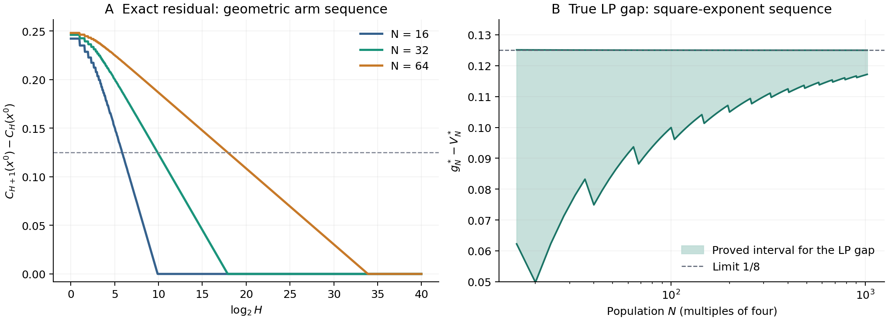

# Synchronization, relaxation gaps, and uniform planning horizons in heterogeneous restless bandits

**Complete mathematical manuscript — 25 November 2026.**

This manuscript contains written proofs; it does not claim Lean verification. All reward values are normalized per arm.

## Abstract

We study the relation between single-arm synchronization, static occupation relaxations, and finite planning horizons for heterogeneous restless bandits with a hard per-period activation budget. We construct one fixed infinite sequence of strictly positive arms with at most three states each, whose population prefixes have an actual two-step open-loop synchronization coefficient exactly 1/2 and uniquely determined normalized optimal terminal potentials of norm one. Nevertheless, along populations divisible by four, the static relaxation values converge to 1/4 while the true optimal stochastic average rewards converge to 1/8. This rules out a population-uniform performance guarantee relative to the static LP based only on the displayed open-loop parameters, for every policy, not merely for a particular planning algorithm. A related fixed geometric sequence admits an exact all-horizon planning-residual formula and a sharp threshold law log_2(T_epsilon(N))/N -> 1/2-2 epsilon; prescribed slower horizon scales can also be realized.

For a positive counterpart, we give a budget-preserving coupling under controlled-versus-passive synchronization and derive explicit certificates for the unchanged rolling LP. A reference kernel whose row perturbations are bounded by dual slack and whose mixing and passive-reachability parameters are uniform yields a population-uniform O(1/H) value-error bound. Complete reference refresh yields a geometric bound. A zero-cost-polytope certificate covers nonunique stationary states and zero-cost motions. We exhibit heterogeneous action-dependent models satisfying the certificates and, for an exactly aggregating example, prove both an exact geometric residual and a direct finite-population stochastic reward guarantee. These sufficient conditions are explicit repairs; feedback synchronization alone is not claimed to solve the entire uniform-horizon problem.

## 1. The question and the three different errors

Consider N independently evolving controlled arms coupled by one shared activation budget. An occupation LP replaces the hard stochastic budget by stationary average constraints. A finite-horizon fluid LP then uses its optimal flow dual as a terminal potential. Re-solving this same H-step problem at every time defines the rolling planning rule. Two limits are involved: a long planning horizon H and a large population N. A theorem for each fixed finite model need not remain uniform when new heterogeneous types appear as N grows.

We distinguish three quantities throughout:

| Quantity | Meaning | What the present paper establishes |
| --- | --- | --- |
| Delta_H(x)=C_{H+1}(x)-C_H(x) | Consecutive-horizon rotated planning residual | Exact negative examples, sharp horizon scales, and verifiable sufficient conditions for uniform decay |
| g_N^*-V_N^* | Static-LP relaxation gap against the true optimal stochastic value | A fixed infinite positive arm sequence with limiting gap 1/8 |
| V_N^*-V_N^{MPC,H} | Suboptimality of the actual rolling policy | A direct upper bound on an explicit positive family; no positive lower bound is claimed for the negative family |

The middle row is essential. A persistent LP relaxation gap prevents *any* policy from approaching that LP benchmark uniformly. It does not imply that a particular policy is separated from the true stochastic optimum. Conversely, a slowly vanishing residual can coexist with a fluid rolling policy that is already optimal in long-run reward. Both phenomena occur in the constructions below.

Narasimha and Gast formulate an open-loop synchronization coefficient and ask whether the horizon entering their LP-relative guarantee can depend only on the maximum arm state count, activation fraction, and synchronization parameters [R1, Conjecture 1 and Theorem 5]. The present negative results address those literal quantifiers. We retain the specified fixed terminal dual, and exclude a favorable dual-selection explanation by identifying every optimal normalized potential. Our positive results state their extra assumptions explicitly.

## 2. Model, duality, and quantifiers

Arm n has a finite state space S_n, transition matrices P_0^n,P_1^n, and rewards r_n(i,a) in [0,1]. The activation fraction is 0&lt;alpha&lt;1. In the stochastic model, after observing all current states a policy chooses at most b_N=floor(alpha N) active arms. Policies may randomize and depend on the entire observed history. Conditional on the past and chosen actions, the next states of different arms are independent. Define V_N^* as the supremum of limiting lower expected time-average rewards over admissible policies. Our stochastic upper bounds apply to every such policy from every initial state. The explicit stationary lower policies have ordinary long-run averages, so the upper/lower sandwich also applies to the usual finite-MDP average-reward optimum.

The fluid state space is X_N=product_n Delta(S_n). A control y satisfies y_n(i,a)>=0, sum_a y_n(i,a)=x_n(i), and N^{-1}sum_{n,i}y_n(i,1)<=alpha. Its successor and reward are

```math
\Phi_n(x,y)=\sum_{i,a}y_n(i,a)P_a^n(i,\cdot),\qquad
R(y)=\frac1N\sum_{n,i,a}r_n(i,a)y_n(i,a).
```

The stationary occupation LP adds Phi(x,y)=x and has optimal value g_N^*. A dual consists of a common resource price lambda>=0, arm gains gamma_n, and arm potentials mu_n, with

```math
s_n(i,a):=\gamma_n+\lambda a+\mu_n(i)-r_n(i,a)-P_a^n\mu_n(i)\ge0,
\qquad g_N^*=\alpha\lambda+\frac1N\sum_n\gamma_n.
```

Fix one optimal dual before selecting a horizon, tolerance, or initial state. Its potential is normalized separately on every arm by min_i mu_n(i)=0. The finite-horizon value and rotated cost are

```math
W_H^\mu(x)=\max\left\{\sum_{t=0}^{H-1}R(y_t)+\langle\mu,x_H\rangle_N\right\},
\quad C_H^\mu(x)=H g_N^*+\langle\mu,x\rangle_N-W_H^\mu(x),
```

where the optimization retains the original state-flow equations and per-period budget. Put C_0=0. The one-step cost satisfies the exact identity

```math
c(x,y)=g_N^*-R(y)+\langle\mu,x-\Phi(x,y)\rangle_N
=\frac1N\sum_{n,i,a}s_n(i,a)y_n(i,a)
+\lambda\left(\alpha-\frac1N\sum_{n,i}y_n(i,1)\right)\ge0.
\tag{M1}
```

Thus C_H is the minimum cumulative nonnegative cost over H steps, and Delta_H=C_{H+1}-C_H>=0. These optima exist because their feasible sets are compact polytopes. Per-arm additive constants in mu cancel from C_H and do not affect the optimization. A terminal potential depending on H or epsilon is not allowed.

We use the normalized total-variation metric d(x,z)=N^{-1}sum_n TV(x_n,z_n), whose diameter is at most one. A potential with per-arm span at most B is B-Lipschitz in this metric. The open-loop coefficient compares every row of every fixed k-action product P_{a_1}...P_{a_k} with every row of P_0^k, taking the minimum overlap across arms. The feedback coefficient instead allows each action to depend on the intermediate state. It is no larger than the open-loop coefficient; equality holds at k=1. The distinction is substantive when k>1.

Our negative quantifier order is particularly strong: fix an infinite sequence of arm models first, then take its N-arm prefixes. The coefficients m=3, alpha=1/4, k=2, and actual rho_2^{ol}=1/2 are identical for every prefix. All optimal normalized terminal potentials have norm one. The model sequence is not reselected after seeing H or an initial state. A separate arbitrary-growth result permits the infinite sequence to depend on a proposed growth function F, but never on the later prefix length N.

## 3. Main results and proof organization

**Persistent stochastic relaxation gap.** The anchored three-state family in Part I, with t_n=2^{-(n+2)^2}, satisfies

```math
\lim_{\substack{N\to\infty\\4\mid N}} g_N^*=\frac14,
\qquad
\lim_{\substack{N\to\infty\\4\mid N}} V_N^*=\frac18.
\tag{M2}
```

Part III proves (M2) for every history-dependent policy on the upper-bound side. It combines a one-step drift inequality with the binomial overload caused by independently refreshed labels inside the good states. Splitting off only O(sqrt N) relatively fast arms leaves a tail whose recovery rate is too small to sustain more than the hard budget's worth of good arms. Protecting a fixed set of b_N arms supplies the matching lower bound. No limiting argument through a reducible zero-transition model is needed.

**Exact residual and sharp planning scale.** For the same matrix architecture and any slow-arm parameters, Part I solves the planning LP at all horizons and for every optimal dual. For the fixed geometric sequence t_n=2^{-(n+2)}, Part II shows, for 0<=epsilon<1/4,

```math
\lim_{N\to\infty}\frac{\log_2 T_\epsilon(N)}N=\frac12-2\epsilon.
\tag{M3}
```

Here T_epsilon is the first horizon for which the residual at the specified all-bad slow-arm initial state is at most epsilon. The theorem includes explicit matching finite-N inequalities and their small-threshold qualifications. For any prescribed nondecreasing finite growth law F, a single fixed infinite sequence keeps that residual at least 1/8 through H<=F(N), along N divisible by four. This is a planning certificate lower bound, not an LP computational-complexity lower bound.

**A matrix-checkable repair.** Let pi be an optimal stationary state and K_n a reference kernel. Suppose each action row differs from K_n's corresponding row by at most Gamma times its nonnegative dual slack; suppose delta(K_n^ell)<=1-eta; and suppose reference k-step rows overlap passive k-step rows by at least rho. These are finite row inequalities. With a fixed normalized dual bounded by B and M=B+k/rho, Part VI proves

```math
0\le C_\infty(x)-C_H(x)
\le\frac{M\ell(1+\Gamma M)}{\eta H},\qquad H\ge1.
\tag{M4}
```

The same bound controls Delta_H, uniformly over population size, type count, and initial state. If every reference row equals pi_n, the bound improves to

```math
\Delta_H(x)\le M\left(\frac{M\Gamma}{1+M\Gamma}\right)^H.
\tag{M5}
```

The certificate allows different reference distributions, state-dependent action preferences, rewards, and nonoptimal transition effects across arms. Part VI gives explicit families and constants. Its static LP defect frontier further quantifies weaker relations between small slack and transition perturbation. None of these hypotheses is replaced by a claimed uniform convergence premise.

**Budget-feasible feedback comparison and zero-cost geometry.** Part IV proves a bounded terminal-dual selector under feedback synchronization. Part V constructs a coupling in which unmatched actual mass is passive and only matched mass copies active reference actions; this preserves the shared budget at every time. It gives total-cost and continuity bounds. If Z_L={C_L=0} stabilizes and C_L>=kappa dist(.,Z_L), then for H>=L

```math
C_\infty-C_H\le\frac{M^2}{\kappa\lfloor H/L\rfloor}.
\tag{M6}
```

The finite-polyhedral certificate permits a non-singleton invariant zero-cost set. Part VII instantiates it in an exactly aggregating heterogeneous family, with sup_x Delta_H=(3/8)4^{-H}, and proves a separate stochastic reward estimate. Its common retention and activation coefficients are explicit restrictions, so the example is not used as the sole evidence of the matrix theorem's breadth.

Local equation and theorem labels in the detailed parts below are scoped to their named part. Each proof is included in this file; reading an external component note is not necessary to reconstruct a claimed theorem.



**Figure 1.** Panel A evaluates the proved residual formula at integer horizons for the fixed geometric sequence; the horizontal line is epsilon=1/8. Panel B shades the proved finite-N lower and upper bounds on g_N^*-V_N^* for the distinct square-exponent sequence, not measured or fitted stochastic values. Its small jumps come from ceil(sqrt(N/4)) in the lower bound. Both sequences use the same strictly positive anchored matrix architecture and the same exact open-loop and dual constants.

## 4. Relation to prior work

The closest algorithmic work is the homogeneous rolling-LP analysis of Gast and Narasimha [R2] and its heterogeneous extension [R1]. The present paper separates a failure of the residual route from a persistent stochastic relaxation gap, then gives additional matrix conditions under which the original terminal-dual planning problem admits explicit uniform horizons. It does not replace fixed rolling optimization by a countdown or block-recomputation algorithm.

Brown and Zhang [R3] prove fluid and reoptimization guarantees for heterogeneous dynamic resource allocation with shared budgets; their published abstract also distinguishes stronger guarantees under nondegeneracy and fixed type count. This is a direct comparison for relaxation and reoptimization, rather than a venue-name comparison. The current paper contributes an average-reward obstruction under a literal synchronization hypothesis and an explicit planning certificate for growing type counts. We accessed the publisher abstract and bibliographic record, not the full Brown–Zhang paper; a claim that every possible transfer of that paper is excluded would exceed the evidence.

Zhang, Hong, and Wang [R4] already prove an O(N^{-1/2}) average-reward guarantee for fully heterogeneous weakly-coupled MDPs using a projection-based Lyapunov policy under assumptions on selected optimal arm chains. Accordingly, neither arbitrary heterogeneity nor a vanishing large-population error is claimed as a first here. Our question concerns the static-dual rolling LP and which synchronization hypotheses support its uniform horizon and LP benchmark. The negative family does not have a uniform mixing bound for its optimal controlled arm kernels, so it does not contradict that result.

Dissipativity, turnpike arguments, and concatenation near optimal sets are established economic-MPC tools. Grüne and Stieler [R5] analyze asymptotic stability and transient performance using dissipativity and controllability; Müller and Grüne [R6] treat optimal periodic behavior and the limitations of conventional receding-horizon operation; our comparison of that paper is confined to the acquired publisher abstract and excerpts. Gros and Zanon [R10] already extend economic-MPC dissipativity to the probability measures of undiscounted MDPs, so that conceptual extension is also not an originality claim here. We do not claim to invent those mechanisms. The positive contribution here is their explicit, budget-feasible realization through individual-arm matrix/slack data, with constants independent of the growing product dimension. The zero-cost-set result deliberately permits invariant motion instead of assuming one isolated optimal equilibrium.

Hong, Xie, Chen, and Wang [R9, Theorem 2] already give an all-policy LP-relative lower bound of order N^{-1/2} for homogeneous regular unstable models and distinguish this from regret against the true optimum. Their EC.5.1 also gives constant LP gaps under multichain or periodic degeneracy. Neither the gap distinction nor the existence of all-policy or constant relaxation lower bounds is new here. Our increment is a matching constant-gap limit along one fully heterogeneous prefix sequence with strictly positive transitions, while the actual open-loop coefficient and all normalized optimal duals remain fixed. Every finite instance is irreducible and aperiodic under every stationary policy. Wu, Zurek, Wang, and Xie [R7] develop heterogeneous learning guarantees and LP perturbation/drift-transfer analysis under uniformly bounded mixing times for all single-arm policies; the present slow-feedback family does not satisfy that stronger premise. The literature comparison also includes homogeneous average-reward work [R8] and is limited to the sources and versions described here. The principal negative theorem is an explicit construction, whose correctness is independently checkable regardless of such a global novelty claim.

## 5. Consequence for the original uniform performance formulation

At m=3, alpha=1/4, k=2, rho=1/2, ||mu||_infinity=1 and 4|N, the LP-relative inequality displayed in [R1, equation (15)] would have error epsilon+11 H(epsilon)sqrt(pi/N). If H(epsilon) depended only on those fixed parameters and epsilon, that error would tend to epsilon. But (M2) implies that every policy eventually loses almost 1/8 against the static LP. Choosing any fixed epsilon<1/8 gives a contradiction for sufficiently large N.

Thus the parameter-uniform LP-relative performance horizon served by that conjecture is impossible under the literal multi-step open-loop condition. This conclusion does not assert a positive lower bound on V_N^*-V_N^{MPC,H}; it also does not contradict a fixed-instance bound whose selected H can grow with all model details. The feedback coefficient of the negative family tends to zero. The repair results use additional, explicitly testable conditions and are logically compatible with the obstruction.

## 6. Verification, reproducibility, and remaining boundary

The general results are analytic proofs. Finite checks use exact rational arithmetic for matrix products, overlaps, primal/dual certificates, Bellman inequalities, and binomial/drift bounds. Selected horizons are separately compared with occupation-flow LPs. Floating-point agreement serves as an implementation diagnostic for the cases tested.

Figure 1 plots the derived formulas and bounds.

The open question left by the positive side is whether a fixed positive feedback-synchronization coefficient by itself implies an N-uniform horizon over the full model class. The matrix/slack and zero-cost-set certificates are sufficient conditions, and their failure is not claimed to be necessary for slow convergence. A general sharp stochastic bound for every certified matrix model is also not established here; the direct stochastic guarantee is confined to the explicit family in Part VII. Complete Lean formalization remains a separate, uncompleted obligation.

## References

- **[R1]** D. Narasimha and N. Gast. *Model Predictive Control is almost Optimal for Heterogeneous Restless Multi-armed Bandits*. arXiv:2511.08097v2, 1 September 2026. [Full text](https://arxiv.org/html/2511.08097v2). The arXiv header names European Journal of Operations Research; no formal journal DOI is asserted here.
- **[R2]** N. Gast and D. Narasimha. *Model predictive control is almost optimal for restless bandits*. COLT 2025, PMLR 291:2326–2361. [Proceedings](https://proceedings.mlr.press/v291/gast25a.html); [extended text](https://arxiv.org/html/2410.06307v2).
- **[R3]** D. B. Brown and J. Zhang. *Fluid Policies, Reoptimization, and Performance Guarantees in Dynamic Resource Allocation*. Operations Research 73(2):1029–1045, 2025; online 11 December 2023. [DOI:10.1287/opre.2022.0601](https://doi.org/10.1287/opre.2022.0601). Evidence scope: publisher abstract and metadata.
- **[R4]** X. Zhang, Y. Hong, and W. Wang. *Projection-based Lyapunov method for fully heterogeneous weakly-coupled MDPs*. NeurIPS 2025, Main Conference Track. [DOI:10.52202/085713-3045](https://doi.org/10.52202/085713-3045); [official proceedings](https://proceedings.nips.cc/paper_files/paper/2025/hash/832c9b595f2db0b6c1f4def491a877f8-Abstract-Conference.html); [extended version](https://arxiv.org/html/2502.06072v6).
- **[R5]** L. Grüne and M. Stieler. *Asymptotic stability and transient optimality of economic MPC without terminal conditions*. Journal of Process Control 24(8):1187–1196, 2014. [DOI:10.1016/j.jprocont.2014.05.003](https://doi.org/10.1016/j.jprocont.2014.05.003); [author accepted manuscript](https://epub.uni-bayreuth.de/id/eprint/1926/1/Gruene_Stieler_asymp_stability_econ_mpc_2014.pdf). This is distinct from the shorter six-page paper entitled *A Lyapunov function for economic MPC without terminal conditions*.
- **[R6]** M. A. Müller and L. Grüne. *Economic model predictive control without terminal constraints for optimal periodic behavior*. Automatica 70:128–139, 2016. [DOI:10.1016/j.automatica.2016.03.024](https://doi.org/10.1016/j.automatica.2016.03.024).
- **[R7]** T. Wu, M. Zurek, W. Wang, and Q. Xie. *Lyapunov-Based Sample Complexity Analysis for Weakly-Coupled MDPs*. arXiv:2606.14095v3, 7 November 2026. [Full version](https://arxiv.org/abs/2606.14095v3). COLT 2026/PMLR 336:6852–6857 is an extended abstract; it is not represented as a full flagship proceedings benchmark.
- **[R8]** Y. Hong, X. Zhang, Q. Xie, Y. Chen, and W. Wang. *Achieving an O(1/N) Optimality Gap in Average-Reward Weakly-Coupled MDPs*. arXiv:2609.38132v1, 29 September 2026. [Full text](https://arxiv.org/html/2609.38132v1). Its homogeneous setting and additional hypotheses are retained in the comparison.

- **[R9]** Y. Hong, Q. Xie, Y. Chen, and W. Wang. *Achieving Exponential Asymptotic Optimality in Average-Reward Restless Bandits without Global Attractor Assumption*. arXiv:2405.17882v3, 31 October 2026. [Full text](https://arxiv.org/html/2405.17882v3).

- **[R10]** S. Gros and M. Zanon. *Economic MPC of Markov Decision Processes: Dissipativity in Undiscounted Infinite-Horizon Optimal Control*. Automatica 146:110602, 2022. [DOI:10.1016/j.automatica.2022.110602](https://doi.org/10.1016/j.automatica.2022.110602); [author full text](https://arxiv.org/abs/2104.10997v3).

---

# Detailed proofs

## Part I. Exact anchored construction and all-horizon formula

### A. The fixed family

Fix alpha=1/4. Arm 0 is a two-state, zero-reward anchor with

```math
P_0^{\rm anc}=\begin{pmatrix}1/4&3/4\\1/4&3/4\end{pmatrix},\qquad
P_1^{\rm anc}=\begin{pmatrix}3/4&1/4\\3/4&1/4\end{pmatrix}.
\tag{A1}
```

It starts at (1/4,3/4). The remaining arms are indexed by n>=1. Fix any sequence of distinct numbers t_n in (0,1/8]. Write

```math
D_t=1+t-t^2,\quad R_t=\frac{1+2t}{2D_t},\quad
c_t=\frac{t-t^2}{2D_t},\quad \gamma_t=\frac{t}{2D_t},
\quad q(z)=(z/2,z/2,1-z).
\tag{A2}
```

For the three-state arm with parameter t, set

```math
s_t=q(1-t^2),\quad b_t=q(t^2),\quad v_t=q(t),\qquad
P_0(t)=\begin{pmatrix}s_t\\b_t\\v_t\end{pmatrix},\quad
P_1(t)=\begin{pmatrix}b_t\\s_t\\v_t\end{pmatrix}.
\tag{A3}
```

Its only nonzero rewards are r_t(1,0)=r_t(2,1)=R_t. Every main arm starts at e_3. For each population size N>=4, use the anchor and the first M=N-1 main arms. This is a prefix of one fixed infinite arm sequence. In statements involving an integer stochastic activation budget, restrict N to multiples of four, so floor(alpha N)=alpha N.

All transitions are strictly positive. All rewards belong to [0,1], since

```math
\frac12 \lt R_t<1\qquad(0 \lt t\le1/8).
```

#### A.1 Actual two-step open-loop coefficient

For the main arm, every two-step fixed-action row has the form q(x_t), q(y_t) or q(w_t), where

```math
x_t=\tfrac12-\tfrac12t^2+t^3,\quad
y_t=t+\tfrac12t^2-t^3,\quad w_t=\tfrac32t-t^2.
```

These are ordered x_t>=w_t>=y_t, and all three occur in P_0(t)^2. Because the overlap of q(d) and q(e) is 1-|d-e|, the actual coefficient is

```math
\rho_2^{\rm ol}(t)=\tfrac12+t+t^2-2t^3>\tfrac12.
\tag{A4}
```

For the anchor, the last fixed action determines the output row. Comparing its all-active second action with P_0^2 gives overlap exactly 1/2, and no comparison is smaller. Therefore the complete population's **actual** coefficient is

```math
\rho_2^{\rm ol}(\mathcal I_N)=\frac12
\tag{A5}
```

for every N, without merely using a lower bound. Thus m=3, alpha=1/4, k=2 and the actual rho=1/2 are fixed.

### B. Stationary LP: bounded and uniquely determined terminal duals

Use common resource price lambda=1, anchor gain and potential zero, and main-arm gains and potentials

```math
\gamma_n=\gamma_{t_n},\qquad \mu_n=(1,0,c_{t_n}).
\tag{B1}
```

The dual inequalities are gamma_n+lambda a+mu_n(s)-sum_z P_a^n(s,z)mu_n(z)>=r_n(s,a). For each main arm the exact slacks, arranged by states and then actions, are

```math
\begin{pmatrix}0&2\\0&0\\0&1\end{pmatrix}.
\tag{B2}
```

For the anchor the passive slack is zero and active slack is one. This proves dual feasibility.

Set beta=alpha N/M=N/[4(N-1)]. Since N>=4, beta<=1/3. On each main arm use stationary occupation

```math
z_t^*(\beta)=\frac{t+(1-2t^2)\beta}{1/2+t},
```

```math
y(1,0)=z_t^*/2,\quad y(2,0)=z_t^*/2-\beta,\quad
y(2,1)=\beta,\quad y(3,0)=1-z_t^*.
\tag{B3}
```

All four entries are positive. Indeed,

```math
z_t^*/2-\beta=\frac{t[1-2\beta(1+t)]}{1+2t}>0
```

because 2 beta(1+t)<=3/4, while

```math
1-z_t^*=\frac{1-2\beta(1-2t^2)}{1+2t}>0.
```

The next state has good mass t+(1/2-t)z_t^*+(1-2t^2)beta=z_t^*, so the state-flow equations hold. Put the anchor in its passive stationary occupation. The total activation is M beta=alpha N. Every positive occupation has zero slack, so primal and dual values agree and

```math
g_N^*=\alpha+\frac1N\sum_{n=1}^{M}\gamma_{t_n}.
\tag{B4}
```

**Lemma B.1 (all-dual uniqueness).** Every optimal joint dual has lambda=1, the gains in (B1), zero normalized anchor potential, and mu_n=(1,0,c_{t_n}) on every main arm. The only freedom is adding an arbitrary constant to each arm's potential. Hence every normalized optimal dual has infinity norm exactly one.

**Proof.** Complementary slackness with (B3) forces equality at the four positive main-arm occupations. On one arm subtract h(3), and write d=(h(1)+h(2))/2. The passive state-3 and state-2 equations imply gamma=td and h(2)=(t^2-t)d. The passive state-1 equation then forces (1+2t)d=R_t. Equality at active state 2 and passive state 1 gives lambda=h(1)-h(2)=2D_t d=1. Shifting the potential to minimum zero yields h=(1,0,c_t), while gamma=gamma_t. Both passive anchor occupations are positive; their equalities have the same right side and therefore force its two potential entries equal and its gain zero. Normalize the common entry to zero. These equations apply to every optimal dual, not only to the exhibited one. $\square$

Per-arm additive constants cancel from C_H=H g_N^*+<mu,x>_N-W_H^mu(x), because each arm has mass one initially and terminally. The following formula is therefore valid for **all** optimal terminal flow duals and all selection rules.

### C. The rotated control problem and its exact solution

The main-arm state remains symmetric q(z_n) after every transition, under every policy. Write u_{n,1},u_{n,2},u_{n,3} for active masses in its three states, and let e_n=u_{n,2}-u_{n,1}. Then

```math
z_n'=t_n+(1/2-t_n)z_n+(1-2t_n^2)e_n,
\tag{C1}
```

and e_n<=z_n/2. The joint budget implies sum_n e_n<=alpha N, even if some e_n are negative.

The zero-slack decomposition (B2) gives an especially simple rotated cost. The unused-budget term is alpha minus total activation divided by N. Adding the main-arm dual slacks 2u_{n,1}+u_{n,3} and the anchor's activation slack cancels all terms except

```math
\ell(z,u)=g_N^*-r(z,u)+\langle\mu,x-x'\rangle_N
=\alpha-\frac1N\sum_{n=1}^{M} e_n.
\tag{C2}
```

In particular, ell>=0 for every feasible action.

Define the free full-good trajectory by

```math
z_{n,0}^{\rm free}=0,\quad
z_{n,h+1}^{\rm free}=t_n+(1-t_n-t_n^2)z_{n,h}^{\rm free}.
```

Its closed form and bounds are

```math
z_{n,h}^{\rm free}=\frac{1-(1-t_n-t_n^2)^h}{1+t_n},\qquad
0\le z_{n,h}^{\rm free}\le\min\{1,h t_n\},\qquad
z_{n,h}^{\rm free}\uparrow\bar z_n:=\frac1{1+t_n}.
\tag{C3}
```

For every feasible policy and every h, z_{n,h}<=z_{n,h}^{free}. This follows by induction from e_n<=z_n/2 in (C1) and monotonicity of the free affine map, whose slope 1-t_n-t_n^2 is positive. Therefore, pointwise in time,

```math
\ell(z_h,u_h)\ge d_h:={\left(\alpha-\frac1{2N}\sum_{n=1}^{M}z_{n,h}^{\rm free}\right)}_+.
\tag{C4}
```

#### C.1 One policy attains every pointwise lower bound

Use no active mass in state 1, state 3 or the anchor. If sum_n z_n/2<=alpha N, activate all state-2 mass; otherwise choose any u_{n,2} in [0,z_n/2] with sum_n u_{n,2}=alpha N.

Let tau be the first time sum_n z_{n,h}^{free}>=2alpha N. Before tau, this policy agrees with every free trajectory, so ell=d_h. The time tau is finite because

```math
\sum_{n=1}^{M}\bar z_n\ge\frac89(N-1)>\frac N2=2\alpha N
\quad(N\ge4).
\tag{C5}
```

The region z_n<=bar z_n is invariant for every choice u_{n,2}<=z_n/2. Moreover, within that region,

```math
t_n(1-z_n)\ge t_n^2 z_n\ge 2t_n^2u_{n,2}.
\tag{C6}
```

If sum_n z_n>=2alpha N and full budget sum_n u_{n,2}=alpha N is used, (C1) and (C6) imply

```math
\sum_n z_n'
=\frac12\sum_nz_n+\alpha N
 +\sum_n\bigl[t_n(1-z_n)-2t_n^2u_{n,2}\bigr]
\ge2\alpha N.
\tag{C7}
```

Thus full budget can be used forever after tau, independent of how it is split among the main arms. The rotated cost is then zero, and d_h is also zero because the free trajectories are increasing. The same policy attains (C4) for every time and every horizon.

**Theorem C.2 (all-horizon exact formula).** For every collection t_1,...,t_M in (0,1/8], every N>=4, every H>=0, and every optimal terminal flow dual mu,

```math
C_H^\mu(x_0)=\sum_{h=0}^{H-1}
{\left(\alpha-\frac1{2N}\sum_{n=1}^{M}
\frac{1-(1-t_n-t_n^2)^h}{1+t_n}\right)}_+,
\tag{C8}
```

```math
C_{H+1}^\mu(x_0)-C_H^\mu(x_0)
={\left(\alpha-\frac1{2N}\sum_{n=1}^{M}
\frac{1-(1-t_n-t_n^2)^H}{1+t_n}\right)}_+.
\tag{C9}
```

**Proof.** Summing (C2) telescopes exactly to the definition of C_H. Inequality (C4) bounds the cost of every feasible H-step plan from below. Section C.1 constructs one feasible policy attaining every summand, hence attaining the optimum for every H simultaneously. Lemma B.1 handles arbitrary optimal-dual selection. $\square$

#### C.2 What this says about the fluid policy

The same argument applies from any symmetric state with 0<=z_n<=bar z_n: its free trajectories are increasing, the pointwise lower bounds hold, and the full-capacity region remains invariant. Consequently a one-step fluid MPC optimizer chooses all available state-2 mass before capacity is sufficient, and a full-budget allocation afterward. A fixed longer horizon cannot improve its cumulative rotated cost from these states.

After the finite time tau the one-step policy has zero rotated cost forever. Since its terminal potential is bounded, telescoping (C2) shows that its long-run average reward is exactly g_N^*. This is an exact **fluid-policy** statement. No claim about the actual finite-N stochastic policy's average-reward gap follows from this proof.

### D. Fixed exact coefficient, fixed dual norm, exponentially slow residual

Freeze t_n=2^{-(n+2)} for all n>=1. This produces N different arm types in every N-arm prefix, including the anchor. If N=4q and L=q-1, then for 0<=h<=2^{q+1},

```math
\sum_{n=1}^{N-1}z_{n,h}^{\rm free}
\le L+h\sum_{n=L+1}^{\infty}2^{-(n+2)}
=L+h2^{-(L+2)}\le q=\frac N4.
\tag{D1}
```

Substitution into (C9) gives

```math
C_{H+1}^\mu(x_0)-C_H^\mu(x_0)\ge\frac18
\quad\text{for }N\in4\mathbb N,\quad0\le H\le2^{N/4+1}.
\tag{D2}
```

The actual open-loop coefficient is identically 1/2, the normalized terminal-dual norm is identically one, and all matrices are strictly positive. Thus even allowing the horizon bound to depend on those exact numerical constants cannot restore an N-independent residual horizon.

For every fixed H, (C3) also gives sum_n z_{n,H}^{free}<=H/4. Formula (C9) consequently implies

```math
\lim_{N\to\infty}[C_{H+1}^\mu(x_0)-C_H^\mu(x_0)]=\frac14.
\tag{D3}
```

For each fixed N the residual eventually becomes exactly zero, by Theorem C.2. The two limits are therefore nonuniform in N. This is not caused by an H-dependent choice of parameters: the infinite sequence was fixed once before taking prefixes.

### E. No universal population-size rate on this parameter class

Given any finite-valued nondecreasing F:$\mathbb N$$\to[1,\infty)$, instead freeze

```math
t_n=\frac{2^{-(n+2)}}{F(4n)}.
\tag{E1}
```

These are distinct and in (0,1/8]. For N=4q and H<=F(N),

```math
\sum_{n=1}^{N-1}z_{n,H}^{\rm free}
\le q-1+H\sum_{n=q}^{\infty}t_n
\le q-1+2^{-(q+1)}\le N/4.
```

Hence the residual is at least 1/8 for every integer H<=F(N), while all constants in Section D remain unchanged. The infinite family may depend on F, but it does not change with N. The statement excludes any proposed universal rate that depends only on population size and the listed fixed class constants. It is not a computational lower bound on solving the planning LP.

### F. Feedback synchronization and scope boundaries

For a main arm, the exact two-step feedback-versus-passive coefficient is

```math
\rho_2^{\rm fb}(t)=t+\frac52t^2-2t^3-t^4.
\tag{F1}
```

To see this, a two-step feedback row has good mass t+(A-t)d, with A in {t^2,1/2,1-t^2} and d in {1-t^2,t^2,t}. Its extrema are Q_max=1-2t^2+t^3+t^4 and Q_min=t^2+t^3-t^4. The passive two-step range is [y_t,x_t]. For t<=1/8, Q_max-y_t dominates x_t-Q_min, since their difference is 1/2-t-t^2+2t^3>0. The overlap formula gives (F1). It tends to zero, whereas (A5) is fixed at 1/2.

The family therefore lies outside a class with a fixed positive feedback-synchronization lower bound. Any positive theorem under that stronger assumption remains logically compatible with this counterexample. A new assumption must be clearly labeled as a repair, not silently substituted into the original open-loop formulation.

The proof shows that the stated open-loop condition gives no population-uniform residual horizon. The LP-relative performance consequence follows from the stochastic result in Part III, as explained in Section 5 of the overview. It does not prove that a fixed-horizon stochastic MPC policy has a nonzero optimality gap; the all-horizon formula in fact demonstrates why residual obstruction and fluid-policy performance must be distinguished.

### G. Verification boundary

Finite verification uses exact rational arithmetic to check transition rows, overlaps, primal and dual feasibility, and the telescoping identity. Direct occupation-flow LP calculations at selected horizons serve as numerical diagnostics. The all-parameter conclusions follow from the written proofs.

---

## Part II. Sharp horizon law for a fixed geometric sequence

### 1. Definitions and exact input

There are `N` total arms: one zero-reward anchor and `M=N-1` slow arms. The budget is `alpha=1/4`; the slow-arm parameters are

```math
t_n=2^{-(n+2)},\qquad a_n=1-t_n-t_n^2,\qquad
z_{n,H}=\frac{1-a_n^H}{1+t_n},\qquad
S_M(H)=\sum_{n=1}^{M}z_{n,H}.
\tag{F1}
```

For the all-bad slow-arm initial state and the unique per-arm-normalized optimal dual, the construction in Part I proves, for every integer `H>=0`,

```math
\Delta_{N,H}:=C_{H+1}(x^0)-C_H(x^0)
=\left(\frac14-\frac{S_{N-1}(H)}{2N}\right)_+.
\tag{F2}
```

The anchor fixes the **actual** two-step open-loop coefficient at `1/2`, for every prefix. Every transition entry is positive and every slow-arm optimal dual has span exactly one. These are structural conclusions of the proof in Part I, not additional assumptions of a numerical fit.

For `0<=epsilon<1/4`, set `q=1/2-2 epsilon>0` and define the first certified horizon at this initial state by

```math
T_\epsilon(N)=\min\{H\in\mathbb N_0:\Delta_{N,H}\le\epsilon\}.
\tag{F3}
```

The minimum is finite: `S_{N-1}(H)` increases to `sum_n 1/(1+t_n)`, which exceeds `N/2` for every `N>=4`. Indeed this sum is at least `8(N-1)/9>N/2`.

### 2. Uniform staircase estimate

**Lemma F1.** Let `H>=4` be an integer and put `L=floor(log_2 H)-2>=0`. For every integer `M>=1`,

```math
\min(M,L)-\frac54\ \le\ S_M(H)\ \le\ \min(M,L+2).
\tag{F4}
```

**Proof.** The recurrence `z_{n,h+1}=t_n+a_n z_{n,h}`, initialized at zero, gives `0<=z_{n,H}<=min(1,H t_n)`. If `L<M`, split the sum after index `L`. Since

```math
\sum_{n>L}t_n=2^{-(L+2)},\qquad H<2^{L+3},
```

the first `L` terms contribute at most `L` and the tail less than `2`. If `L>=M`, use `S_M(H)<=M`. This proves the upper bound.

For the lower bound put `J=min(M,L)`. Since `1-u<=exp(-u)` for `u>=0`,

```math
1-z_{n,H}=\frac{t_n+a_n^H}{1+t_n}
\le t_n+e^{-H t_n}.
\tag{F5}
```

The total `t_n` mass is `1/4`. For `n<=J<=L`, `H t_n>=2^{L-n}`. Consequently,

```math
\sum_{n=1}^{J}e^{-H t_n}
\le \sum_{j=0}^{\infty}e^{-2^j}
\le \sum_{j=0}^{\infty}2^{-(j+1)}=1.
\tag{F6}
```

The last inequality follows from `2^j>=j+1` and `e>=2`. Thus the first `J` terms of `S_M(H)` sum to at least `J-5/4`. All remaining terms are nonnegative. This proves (F4). When `L=0`, the empty-sum lower bound remains valid. ∎

### 3. Matching horizon bounds and the exact exponential rate

**Theorem F2.** Fix `0<=epsilon<1/4` and `q=1/2-2 epsilon`. For every integer `N>=8` satisfying `qN>=2`,

```math
2^{qN}\ \le\ T_\epsilon(N)\ \le\ 2^{\lceil qN\rceil+4}.
\tag{F7}
```

In particular,

```math
\lim_{N\to\infty}\frac{\log_2 T_\epsilon(N)}{N}
=\frac12-2\epsilon.
\tag{F8}
```

The same limit holds along `N` divisible by four, so the budget `alpha N` can always be integral.

**Proof.** By (F2), the threshold condition is exactly `S_{N-1}(H)>=qN`. For `H<4`, the bound `S_{N-1}(H)<=H/4<1` rules this out when `qN>=2`. For `H>=4`, the upper bound in (F4) implies

```math
S_{N-1}(H)\le L+2=\lfloor\log_2H\rfloor\le\log_2H.
```

Therefore every threshold-crossing integer `H` obeys `H>=2^{qN}`.

For the upper bound choose the integer `H=2^{ceil(qN)+4}`. Then `L=ceil(qN)+2`. Because `q<=1/2` and `N>=8`, we have `L<=N-1`. The lower bound in (F4) gives

```math
S_{N-1}(H)\ge\lceil qN\rceil+2-\frac54
\ge qN+\frac34>qN.
```

Thus this `H` crosses the threshold. Dividing the logarithms of (F7) by `N` proves (F8). ∎

Examples of the precise asymptotic statement are `T_0(N)=2^{N/2+O(1)}` and `T_{1/8}(N)=2^{N/4+O(1)}`. The `O(1)` is in the exponent and is bounded by the explicit constants in (F7); this is not an extrapolation from finite computations.

### 4. Failure of exchanging the two limits

**Corollary F3.** For the same fixed infinite sequence of arms,

```math
\lim_{H\to\infty}\lim_{N\to\infty}\Delta_{N,H}=\frac14,
\qquad
\lim_{N\to\infty}\lim_{H\to\infty}\Delta_{N,H}=0.
\tag{F9}
```

**Proof.** For every fixed integer `H`, `S_{N-1}(H)<=H sum_n t_n<=H/4`, so (F2) tends to `1/4` as `N` grows. For each fixed `N>=4`, the limiting sum in Section 1 is strictly larger than `N/2`. It crosses that value in finite time, after which (F2) is identically zero. ∎

This distinction identifies the missing uniformity in a finite-dimensional Dini argument. A correct fixed-instance limit does not furnish a horizon common to the growing prefixes, even when the open-loop coefficient and the optimal terminal-potential norm are exactly constant.

### 5. Claim boundary

The construction concerns the original terminal-dual fluid LP and its dissipativity residual. It does not replace the rolling policy by a block policy. The proof in Part I establishes that one-step **fluid** MPC already achieves the LP average gain on this family after a finite transient; that is why slow residual certification must not be described as a positive stochastic-policy regret lower bound. No finite-N stochastic asymptotic lower bound follows from (F7).

---

## Part III. A persistent stochastic relaxation gap

### 1. Actual stochastic model and the stationary LP certificate

Let N be a positive multiple of four, N>=4, and write b=N/4 and M=N-1. There is one two-state zero-reward anchor and M three-state main arms. Conditional on the full current state and action vector, the arms' next-state draws are independent. At each time at most b arms may be active. Policies may use the full observed history and additional randomness independent of future transition draws.

The anchor has passive rows (1/4,3/4), active rows (3/4,1/4), and reward zero. For a main arm with parameter 0< t<=1/8 put

```math
D_t=1+t-t^2,\quad
R_t=\frac{1+2t}{2D_t},\quad
c_t=\frac{t-t^2}{2D_t},\quad
\gamma_t=\frac{t}{2D_t},\quad q(d)=(d/2,d/2,1-d).
\tag{S1}
```

Its two transition matrices are

```math
P_0(t)=\begin{pmatrix}q(1-t^2)\\q(t^2)\\q(t)\end{pmatrix},\qquad
P_1(t)=\begin{pmatrix}q(t^2)\\q(1-t^2)\\q(t)\end{pmatrix}.
\tag{S2}
```

Only r_t(1,0)=r_t(2,1)=R_t are nonzero. Call states 1 and 2 good states and state 3 the bad state. Call (1,0) and (2,1) good actions; the other action at a good state is a wrong action. An anchor activation never improves its zero reward or any other arm's transition, but the upper bound below permits policies to waste budget on it.

For every collection t_1,...,t_M in (0,1/8], the stationary relaxation has

```math
g_N^*=\frac14+\frac1N\sum_{n=1}^{M}\gamma_{t_n}.
\tag{S3}
```

Every optimal dual has common resource price lambda=1 and, up to per-arm additive constants, main-arm potentials mu_n=(1,0,c_{t_n}) and anchor potential zero. These claims were proved for arbitrary such collections in Part I, Section B. A brief independent certificate is as follows. The main-arm dual slacks at states 1,2,3 and actions 0,1 are

```math
\begin{pmatrix}0&2\\0&0\\0&1\end{pmatrix}.
\tag{S4}
```

With beta=N/[4(N-1)]<=1/3, set z_t^*=[t+(1-2t^2)beta]/(1/2+t) and stationary occupations

```math
y(1,0)=z_t^*/2,\quad y(2,0)=z_t^*/2-\beta,\quad
y(2,1)=\beta,\quad y(3,0)=1-z_t^*.
```

These four entries are positive, flow balance holds, their total activation across main arms is b, and they occupy only zero-slack actions. This proves (S3). Complementarity at these four positive entries uniquely forces the displayed price and per-arm potential, so every normalized optimal potential has norm one.

The actual two-step open-loop coefficient of a main arm is

```math
\rho_2^{\rm ol}(t)=\frac12+t+t^2-2t^3>\frac12.
```

The anchor's actual coefficient is exactly 1/2. Thus the actual coefficient of the complete population is exactly 1/2 for every choice of t_n and every N. All transition entries are positive and all rewards lie in [0,1].

For a policy pi and initial joint state x, write

```math
\mathcal R_{N,T}^{\pi}(x)=\frac1{NT}\,
\mathbb E_x^\pi\sum_{h=0}^{T-1}\sum_{n=1}^{M}
r_n(S_{n,h},A_{n,h}).
```

Define

```math
V_N^*(x)=\sup_\pi\liminf_{T\to\infty}\mathcal R_{N,T}^{\pi}(x).
```

The upper bounds below hold for limsup for every policy, and even include a policy-independent finite-T remainder. They therefore cover other usual expected average-reward conventions as well; no exchange of an uncontrolled policy supremum and a limit is required.

### 2. Fair labels after every transition

Every transition row of every main arm is q(d). It can be generated by first deciding whether the next state is good with probability d, and then, conditional on being good, assigning label 1 or 2 using an independent fair coin.

Consequently, at every time h>=1, conditional on the set of main arms currently in good states, their labels 1/2 are independent fair coins. More precisely, this remains true conditional on the full history through the previous action vector and on the current good set. The success probabilities d_n may depend on that history and action vector, but the conditional good labels do not.

This property is unaffected by history-dependent action selection at time h: labels are drawn before that action is selected. It is the point at which the independent transition draws of the actual RMAB model enter the argument.

For any fixed subset A of main arms, let

- K_h^A be the number of its arms currently in good states;
- J_h^A be the number currently in state 2;
- L_h^A be the number taking a wrong action at a good state;
- e_h^A be the number of active state-2 arms minus the number of active state-1 arms.

Pathwise,

```math
e_h^A=J_h^A-L_h^A,
\qquad L_h^A\ge(J_h^A-b)_+.
\tag{S5}
```

The second inequality holds because at most b of the state-2 arms can be active, even if the entire budget is devoted to A. For h>=1, conditional on the good set in A,

```math
J_h^A\sim\operatorname{Bin}(K_h^A,1/2),\qquad
\mathbb E e_h^A=\frac12\mathbb E K_h^A-\mathbb E L_h^A.
\tag{S6}
```

### 3. A loss bound that is uniform over all policies

**Lemma 3.1 (fair-label overload).** For integers k,b>=0,

```math
\mathbb E(\operatorname{Bin}(k,1/2)-b)_+
\ge2^{-(b+1)}(k-b)_+.
\tag{S7}
```

**Proof.** There is nothing to prove when k<=b. Otherwise designate any b of the k independent fair labels. On the event that these b labels are all 2, the excess number of 2 labels equals the number of 2 labels among the remaining k-b labels. The designated event has probability 2^{-b}, is independent of the remaining labels, and those labels have expected count (k-b)/2. Retaining only this event proves the bound. $\square$

It follows from (S5)--(S7) that for h>=1,

```math
\mathbb E K_h^A\le b+2^{b+1}\mathbb E L_h^A,
\quad
\mathbb E e_h^A\le\frac b2+(2^b-1)\mathbb E L_h^A.
\tag{S8}
```

Define

```math
B_A=\sum_{n\in A}t_n,\qquad
\tau_A=\max_{n\in A}t_n,\qquad a_A=1-\tau_A^2.
```

For an empty A the subsequent conclusions are trivial; below A is nonempty. Conditional on the current full history and action vector, a good action loses good-state membership with probability t_n^2; a wrong good-state action loses it with probability 1-t_n^2; and a bad-state arm enters the good set with probability t_n. Therefore

```math
\mathbb E[K_{h+1}^A-K_h^A\mid\mathcal H_h,A_h]
\le-a_A L_h^A+B_A.
\tag{S9}
```

This inequality allows arbitrary coupling of the action choices across arms. Summing it gives

```math
\frac1T\sum_{h=0}^{T-1}\mathbb E L_h^A
\le\frac{B_A}{a_A}+\frac{|A|}{a_A T}.
\tag{S10}
```

If all main arms start in state 3, the remainder in (S10) can be omitted, because K_0^A=0 and K_T^A>=0.

The interpretation is direct: an arm population with a very small total recovery rate can sustain only a very small rate of wrong actions. Independent fair labels force such wrong actions whenever too many arms are simultaneously kept good.

### 4. Exact stochastic dual identity and a general reward bound

Let e_h=e_h^{\{1,\ldots,M\}}, and let

```math
\mathcal M_h=\frac1N\sum_{n=1}^{M}\mu_n(S_{n,h})\in[0,1].
```

Using (S4), conditional dual slacks plus unused resource give the exact identity

```math
g_N^*-\frac1N\sum_n r_n(S_{n,h},A_{n,h})
 +\mathcal M_h-\mathbb E[\mathcal M_{h+1}\mid\mathcal H_h,A_h]
=\frac14-\frac{e_h}{N}.
\tag{S11}
```

Indeed, main-arm active state 1 contributes slack 2, active state 3 contributes slack 1, and anchor activation contributes slack 1; adding these to the unused-budget term cancels all activation counts except active state 2 minus active state 1. This argument concerns actual integer actions, not fluid occupancies.

Taking expectations and summing gives

```math
\mathcal R_{N,T}^{\pi}(x)
=g_N^*-\frac14+
\frac1{NT}\sum_{h \lt T}\mathbb E e_h
+\frac{\mathbb E\mathcal M_0-\mathbb E\mathcal M_T}{T}.
\tag{S12}
```

In particular, the potential term has absolute value at most 1/T.

Choose any excluded set F of main arms, let |F|=L, and let A be its complement. The fair-label identity gives E e_h^F<=L/2 for h>=1. Combining (S8), (S10) and (S12) yields the following all-policy theorem.

**Theorem 4.1 (slow-population obstruction).** For every nonanticipating randomized history-dependent policy and every initial state,

```math
\limsup_{T\to\infty}\mathcal R_{N,T}^{\pi}(x)
\le g_N^*-\frac14+\frac{b+L}{2N}
 +\frac{(2^b-1)B_A}{N(1-\tau_A^2)}.
\tag{S13}
```

Consequently,

```math
g_N^*-V_N^*(x)
\ge\frac18-\frac L{2N}
-\frac{(2^b-1)B_A}{N(1-\tau_A^2)}.
\tag{S14}
```

For finite T, the right side of (S13) is an upper bound after adding

```math
\frac1T\left(1+\frac bN+
\frac{(2^b-1)|A|}{N(1-\tau_A^2)}\right).
\tag{S15}
```

The bound is independent of the policy. Starting all main arms in state 3 improves this remainder to 1/T.

**Proof.** For h>=1, (S8) and the bound on F give

```math
\mathbb E e_h\le\frac{b+L}{2}+(2^b-1)\mathbb E L_h^A.
```

At time zero use e_0<=b. Sum this inequality, apply (S10), divide by N T, and use (S12). This proves (S13) and the stated finite-T remainder. Taking the supremum over policies preserves the bound because it already holds with a common finite-T remainder. Since b=N/4, (S14) follows. If all main arms start bad, e_0=0 and the same per-time bound holds at time zero, while (S10) has no remainder; only the bounded potential term remains. $\square$

No existence or continuity theorem for optimal stationary policies is used in this argument. The upper bound directly covers all of the policies requested in the model.

### 5. Explicit triangular arrays with a constant gap for every N

For each N in 4$\mathbb N$, put

```math
b=N/4,\quad \delta_N=2^{-(b+9)},\quad
t_{n,N}=\delta_N\left(1+\frac nN\right),
\quad n=1,\ldots,N-1.
\tag{S16}
```

The parameters are distinct and lie in [delta_N,2delta_N], with maximum below

```math
\tau_N=2^{-(b+8)}\le1/8.
```

Use A equal to all main arms and L=0. Since B_A< (N-1)tau_N and 1-tau_N^2>=63/64,

```math
\frac{(2^b-1)B_A}{N(1-\tau_A^2)}
\le\frac{2^b\tau_N}{1-\tau_N^2}
\le\frac1{256}\cdot\frac{64}{63}=\frac1{252}.
```

**Corollary 5.1.** For every N in 4$\mathbb N$, every initial state, and the explicit heterogeneous N-arm instance (S16),

```math
g_N^*-V_N^*(x)\ge\frac18-\frac1{252}
=\frac{61}{504}>\frac3{25}>\frac1{10}.
\tag{S17}
```

All arms have strictly positive transition probabilities, the actual open-loop coefficient is exactly 1/2, and every normalized optimal terminal dual has norm one. This is an unconditional analytic lower bound on the relaxation gap, with no stationarity assumption on the competing policy.

The construction in this section is a triangular array: its arm parameters change when N changes. The next section removes that qualification.

### 6. One fixed infinite sequence: the true optimum tends to 1/8 and the LP tends to 1/4

Freeze the anchor and the main-arm sequence

```math
t_n=2^{-(n+2)^2},\qquad n=1,2,\ldots.
\tag{S18}
```

For each N in 4$\mathbb N$, use the anchor and the first N-1 main arms. The sequence is fixed once; the number of distinct types grows with N. Let b=N/4 and L=ceil(sqrt(b)), let F={1,...,L}, and let A={L+1,...,N-1}. This A is nonempty for N>=4.

The ratios of successive t_n are at most 1/2. Therefore

```math
\sum_{n\ge1}t_n\le\frac1{256},\qquad
B_A\le\sum_{n>L}t_n\le2^{1-(L+3)^2}.
\tag{S19}
```

Since L^2>=b,

```math
\frac{(2^b-1)B_A}{1-\tau_A^2}
\le\frac{64}{63}\,2^{b+1-(L+3)^2}
\le\frac1{252}.
\tag{S20}
```

The last bound is deliberately coarse; the preceding expression tends to zero exponentially in sqrt(N). Applying Theorem 4.1 gives

```math
g_N^*-V_N^*(x)\ge\frac18-\frac{\lceil\sqrt{N/4}\rceil}{2N}
-\frac1{252N}.
\tag{S21}
```

#### 6.1 A feasible policy proving the matching limit

Select any b main arms. At every time, activate each selected arm that is in state 2; use action 0 in all other states and on all unselected arms. At most b activations occur, so this is feasible for the actual stochastic system.

Each selected arm uses the good action whenever it is good. Its probability z_h of being good satisfies

```math
z_{h+1}=t+(1-t-t^2)z_h,
```

and hence converges from every initial state distribution to 1/(1+t). Its average expected reward converges to

```math
\frac{R_t}{1+t}
=\frac12+\frac{t^3}{2(1+t-t^2)(1+t)}>\frac12.
\tag{S22}
```

The other arms' rewards are nonnegative. Thus, for every N and initial state in this family,

```math
V_N^*(x)\ge\frac{b}{2N}=\frac18.
\tag{S23}
```

Moreover gamma_t=t/(2D_t)<=t/2, so (S3) and (S19) give

```math
\frac14\le g_N^*\le\frac14+\frac1{512N}.
\tag{S24}
```

Combining (S21)--(S24) proves the complete limit statement.

**Theorem 6.2 (fixed-prefix exact relaxation-gap limit).** For the one fixed infinite sequence (S18), uniformly over the initial state in the indicated bounds,

```math
\lim_{\substack{N\to\infty\\4\mid N}}g_N^*=\frac14,\qquad
\lim_{\substack{N\to\infty\\4\mid N}}V_N^*(x)=\frac18,
\qquad
\lim_{\substack{N\to\infty\\4\mid N}}
\bigl(g_N^*-V_N^*(x)\bigr)=\frac18.
\tag{S25}
```

More explicitly,

```math
\frac18-\frac{\lceil\sqrt{N/4}\rceil}{2N}-\frac1{252N}
\le g_N^*-V_N^*(x)
\le\frac18+\frac1{512N}.
\tag{S26}
```

For example, (S26) implies a relaxation gap greater than 1/12 for every N>=64 divisible by four. Indeed `ceil(sqrt(N/4))/(2N)<=1/(4sqrt(N))+1/(2N)<=5/128`, and `1/(252N)<=1/16128`, whose sum is below 1/24.

The true optimum approaches half of the stationary-LP value on this family. This conclusion concerns the optimum over **all** allowed policies, not a particular algorithm or tie-breaking rule.

### 7. Consequences and limits of interpretation

The stationary LP averages activation over state occupation. In this family its optimum maintains approximately half the arms good, allocating mean active mass 1/4. The actual independent good-state labels fluctuate. A fixed pathwise budget cannot preserve an arbitrarily large set of slowly recovering good arms without occasional wrong actions, and the very small recovery rates prevent those losses from being replenished at the required rate. The proof quantifies this mechanism through (S7)--(S10).

The result shows that the specified open-loop coefficient and a bounded optimal terminal dual do not, by themselves, make this relaxation uniformly tight as the number of heterogeneous arms grows. Every individual finite instance has strictly positive transition probabilities; the issue is the missing uniform controlled mixing/recovery information.

This is stronger than failure of a fluid residual certificate, but it is a **different gap** from `V_N^*-V_N^{MPC}`. The latter might be small or zero even when the stationary LP lies above both. No positive MPC-versus-optimal reward gap is asserted here. A claim about a particular published theorem additionally requires verification that its standing hypotheses and its benchmark are exactly those used here.

Finite verification covers exact identities, all state/action pairs for small instances, binomial overload bounds, and selected tail inequalities. Direct full-joint-state MDP occupation LP calculations serve as floating-point diagnostics. The all-policy and asymptotic claims follow from the analytic proof. The manuscript has not undergone external peer review or formal proof-assistant verification.

The finite computations pass **9,390 exact rational checks** and **9 floating-point diagnostic checks**, with zero failures. The exact joint-state checks cover every one of the 108 state/action pairs in each of two N=4 fixtures, including 5,832 joint-transition fair-label identities across those fixtures. Three independently assembled 27-state average-reward occupation LPs satisfy the proved analytic brackets. For the N=4 triangular fixture, the diagnostic stochastic value is 0.1262925084 and the stationary armwise LP value is 0.2505484993; these decimals illustrate the finite analytic bound, rather than establish it.

---

## Part IV. Bounded dual selection under feedback synchronization

This part supplies the bounded-dual input used in the feedback repair. The discount-limit argument is standard; its role here is to state the correct controlled-versus-passive assumption and carry out the heterogeneous joint-dual selection explicitly. Rewards are in [0,1], the passive action consumes no resource, and the feedback overlap over k steps is at least rho.

### D.1 A price-independent bias bound

Fix an arm and a resource price lambda>=0. For 0< beta<1, the discounted Bellman equation has a unique solution

```math
v_\beta(i)=\max_{a\in\{0,1\}}\{r(i,a)-\lambda a+\beta P_av_\beta(i)\}.
```

The always-passive policy has nonnegative rewards, whereas every penalized reward is at most one. Thus 0<=v_beta<=1/(1-beta). Write V=max v_beta and v=min v_beta. A k-step optimal deterministic time-dependent feedback policy, started at a maximizing state, gives

```math
V\le k+\beta^k Qv_\beta.
```

Following the passive policy from a minimizing state gives v>=beta^k Rv_beta, where R is a row of P_0^k. The feedback assumption applies to Q and R. For any bounded function f, (Q-R)f<=TV(Q,R) span(f). Subtracting therefore yields

```math
\operatorname{span}(v_\beta)
\le k+\beta^k(1-\rho)\operatorname{span}(v_\beta)
\le k+(1-\rho)\operatorname{span}(v_\beta).
```

Consequently span(v_beta)<=k/rho. Set h_beta=v_beta-v and gamma_beta=(1-beta)v. The pair belongs to the compact set [0,k/rho]^{|S|} times [0,1]. Along a sequence beta increasing to one it has a convergent subsequence. Passing to the limit in the finite Bellman maximum gives

```math
\gamma+h(i)=\max_a\{r(i,a)-\lambda a+P_ah(i)\},
\qquad \min_i h(i)=0,\quad 0\le h\le k/\rho.
\tag{D1}
```

The Bellman inequalities telescope under every randomized history-dependent policy, bounding its expected average penalized reward by gamma. A fixed maximizing action at each state attains equality for every finite expected reward sum up to the bounded terminal-potential term. Its limiting average is therefore gamma from every initial state. No uniform mixing assumption on the joint population chain is used.

### D.2 The heterogeneous joint dual and a fixed selector

For each arm let gamma_n(lambda) be the gain in (D1). It also equals the arm's unconstrained stationary occupation-LP value: multiplying the inequalities by a stationary occupation gives the upper bound, while a stationary distribution of a maximizing finite-state policy attains equality. Finite-dimensional LP duality gives

```math
g^*=\min_{\lambda\ge0}\left\{\alpha\lambda+
\frac1N\sum_n\gamma_n(\lambda)\right\}.
\tag{D2}
```

Each gamma_n(lambda) is nonnegative because passivity is available, and the objective at price zero is at most one. The minimum can therefore be attained with 0<=lambda<=1/alpha. Existence also follows directly because each gain is the maximum of a linear function over a fixed compact occupation polytope, so the price objective is continuous on that compact interval. Taking the biases in (D1) at an optimal price supplies a joint optimal dual with

```math
\min_i\mu_n(i)=0,\qquad \|\mu\|_\infty\le k/\rho.
\tag{D3}
```

A selector independent of the horizon, error tolerance, initial state, and time can be fixed as follows. Intersect the optimal-dual polyhedron with 0<=lambda<=1/alpha, 0<=gamma_n<=1, and 0<=mu_n<=k/rho. This is a nonempty compact convex set. Minimize sum_{n,i} mu_n(i)^2 over it. Strict convexity makes the potential component unique, even if price or gains are not unique. If all entries of one arm's selected potential were positive, subtracting their minimum would preserve dual feasibility and objective and strictly decrease the squared norm. Thus each arm is normalized automatically. This establishes a legitimate single terminal-dual choice before quantifying H, epsilon, or x.

### D.3 Sharp scale of the auxiliary bound

For two identical actions with reward (1,0) and transition

```math
P=\begin{pmatrix}1-s/2&s/2\\s/2&1-s/2\end{pmatrix},\qquad 0 \lt s\le1,
```

the average gain is 1/2 and the bias difference is 1/s. The k-step feedback overlap is 1-(1-s)^k. Choosing s=1-(1-rho)^{1/k} therefore gives span(h)=1/[1-(1-rho)^{1/k}], asymptotic to k/rho as rho decreases to zero with k fixed. At k=1 the bound is exactly attained. This establishes the scale of the auxiliary bias bound, not sharpness of a planning-horizon theorem.

---

## Part V. Budget-preserving comparison and zero-cost geometry

### 1. Setup

For arm n, let S_n be a finite state space, let P^n_0,P^n_1 be stochastic matrices, and let 0 <= r_n(s,a) <= 1. The state space is X=product_n Delta(S_n). An admissible fluid action consists of nonnegative occupancies y_n(s,a) with sum_a y_n(s,a)=x_n(s) and N^{-1}sum_{n,s}y_n(s,1)<=alpha. Its successor is Phi_n(x,y)=sum_{s,a}y_n(s,a)P^n_a(s,·). The one-period reward is R(y)=N^{-1}sum r_n(s,a)y_n(s,a).

Fix a static occupation-LP optimal primal point (x*,y*) and an optimal dual (lambda,gamma_n,mu_n). Assume 0<=mu_n(s)<=B, with per-arm constants normalized away. Set

    c(x,y)=g* - R(y) + <mu,x-Phi(x,y)>_N.

The dual inequalities and budget feasibility imply c(x,y)>=0. Indeed, if

    s_n(s,a)=gamma_n+lambda*a+mu_n(s)-r_n(s,a)-P^n_a mu_n(s)>=0,

then c is the normalized occupied slack plus lambda times the unused budget. At the optimal stationary pair, c(x*,y*)=0.

Define C_0=0 and

    C_H(x)= min sum_{t=0}^{H-1} c(x_t,y_t)
          = H*g* + <mu,x>_N - W_H^mu(x).

All minima are attained: for fixed H the feasible trajectory set is a nonempty compact polytope. C_H is continuous, convex, piecewise affine, and nonnegative; C_H is nondecreasing in H.

For x,z in X use the normalized total-variation metric

    d(x,z)=(1/(2N)) sum_n ||x_n-z_n||_1.

Its diameter is at most one. A vector with per-arm span at most B obeys |<mu,x-z>_N|<=B*d(x,z).

#### Feedback synchronization

For a deterministic state-feedback rule d:S_n->{0,1}, write K_d(s,z)=P^n_{d(s)}(s,z). Assume that for every n, every initial pair s,s', and every sequence d_1,...,d_k,

    overlap((K_{d_1}...K_{d_k})(s,·), (P^n_0)^k(s',·)) >= rho > 0.

The constants k,rho are common across all arms. This is the feedback condition in Part IV, not the weaker open-loop condition.

The same overlap lower bound holds for arbitrary initial distributions and randomized time-dependent Markov reference rules. To see this, each randomized Markov matrix is a convex combination of deterministic row-selection matrices. Expanding its k-fold product gives a convex combination of deterministic feedback products. Mixing initial states adds further convex combinations. The overlap function sum_z min(p_z,q_z) is jointly concave; alternatively, total variation is jointly convex. The stated extension follows.

### 2. Budget-preserving shadow coupling

**Lemma 1.** Let (z_t,v_t) be any feasible reference fluid trajectory, finite or infinite. For any actual initial state x_0, there is a feasible actual trajectory (x_t,u_t), and nonnegative numbers e_{n,b}, such that

    e_{n,0}=TV(x_{n,0},z_{n,0}),
    e_{n,b+1}<=(1-rho)e_{n,b},
    d(x_t,z_t)<=N^{-1}sum_n e_{n,floor(t/k)},
    |R(v_t)-R(u_t)|<=N^{-1}sum_n e_{n,floor(t/k)}.

In particular, if q=1-rho and d_0=d(x_0,z_0), then the last two quantities are at most q^{floor(t/k)}d_0, and

    sum_{t>=0}|R(v_t)-R(u_t)| <= (k/rho)*d_0.

Here q^0=1, including rho=1.

**Proof.** Choose randomized reference rules pi_{n,t}(a|s) realizing v_{n,t}(s,a)=z_{n,t}(s)pi_{n,t}(a|s). At states of zero reference mass, assign arbitrary probabilities. Couple the initial distributions maximally. In each block of k steps maintain labels for matched and unmatched mass.

Matched mass has equal reference and actual states. Give it the reference action and couple its next transitions identically. It remains matched throughout the block. Give every unmatched actual particle action 0, while the unmatched reference particle uses pi_{n,t}. Do not promote accidental matches during the block.

At the block boundary the unmatched actual marginal is its initial marginal propagated by P_0^k. The unmatched reference marginal is propagated by the k reference feedback matrices. By feedback synchronization, at least rho of the unmatched mass can be matched at that boundary. Re-couple these endpoint marginals maximally, and use the new labels for the next block. This re-coupling changes neither marginal trajectory and is legitimate for fluid occupancies; no assertion about a physical cross-arm coupling is needed.

The actual active mass at every state and time is exactly the active part of the matched reference mass. It is thus nonnegative, at most the actual state mass, and its sum over all arms is at most the total reference activation. Consequently the original per-period constraint is satisfied at every step. The actual rule can depend on the auxiliary match label, but its marginal state-action occupancies are admissible for the original fluid LP, which is all that is required.

The two rewards agree on matched mass and each lies in [0,1] on unmatched mass. This proves the reward bound. Actual and reference states can differ only on the labeled unmatched mass, proving the total-variation bound. Iteration gives e_{n,b}<=q^b e_{n,0}; summing k time slots in each block gives k/rho. QED.

### 3. Uniform bounds, including fixed-N residual convergence

Set

    M=B+k/rho,       L_c=2B+k/rho.

**Theorem 2.** Under the assumptions above, for every N, every admissible instance, every H>=0, and every x,z in X,

    0<=C_H(x)<=M*d(x,x*)<=M,
    |C_H(x)-C_H(z)|<=L_c*d(x,z).

The constants do not depend on N, type count, H, or the particular transition matrices. If the bounded dual is selected using the feedback-bias lemma, B=k/rho is available, so M=2k/rho and L_c=3k/rho.

**Proof of the upper bound.** Use the stationary optimal trajectory (x*,y*) as the reference in Lemma 1. For the feasible coupled trajectory, write its cumulative rotated cost through T as

    S_T=sum_{t<T}(g*-R(u_t)) + <mu,x_0-x_T>_N
       =sum_{t<T}(R(y*)-R(u_t))
          +<mu,x_0-x*>_N-<mu,x_T-x*>_N.

The reward series is absolutely summable with absolute sum at most (k/rho)d_0. The final inner product tends to zero. Every summand in S_T is nonnegative by dual feasibility; hence S_T increases to a finite limit at most (k/rho+B)d_0. Every C_H is at most the H-step cost of this trajectory, which is at most its infinite total cost. This proves the bound with M, without an unjustified finite-horizon cancellation.

**Proof of the Lipschitz bound.** Take an optimal H-step reference trajectory starting at z and couple a feasible trajectory starting at x. The difference between their rotated costs is

    sum_{t<H}(R(v_t)-R(u_t))
       +<mu,x-z>_N-<mu,x_H-z_H>_N.

The reward sum is at most (k/rho)d(x,z), and each endpoint term has absolute value at most B*d(x,z). Thus C_H(x)-C_H(z)<=L_c*d(x,z). Swap x and z. QED.

**Corollary 3 (each fixed instance).** C_infinity(x)=sup_H C_H(x) is finite and L_c-Lipschitz. On the compact finite-dimensional X, C_H increases uniformly to C_infinity. Consequently

    sup_x [C_{H+1}(x)-C_H(x)] -> 0.

This follows from Dini's theorem, whose continuity premise is supplied by the horizon-uniform Lipschitz bound. It is a fixed-instance assertion. It does not interchange this limit with a supremum over arm counts or instances.

#### An explicit, dimension-dependent fixed-instance bound

For completeness, the following argument makes the dependence on state-space size visible rather than hiding it inside Dini's theorem. Let K(r) be a covering number of (X,d) by balls of radius r. For epsilon>0 put r=epsilon/(4L_c). Then

    H >= K(r)*(floor(2M/epsilon)+1)

implies sup_x [C_{H+1}(x)-C_H(x)]<epsilon.

To prove this, suppose Delta_H(x_0)>=epsilon and take an optimal H-step trajectory. By the Bellman principle, its tails are optimal, and

    Delta_{H-t}(x_t)<=Delta_{H-t-1}(x_{t+1})

for t<H, where Delta_h=C_{h+1}-C_h. Thus Delta_{H-t}(x_t)>=epsilon for t=0,...,H. If i< j are consecutive visits to one covering ball, the intervening cost is

    C_{H-i}(x_i)-C_{H-j}(x_j)
      >= C_{H-i}(x_j)-L_c*d(x_i,x_j)-C_{H-j}(x_j)
      >= epsilon-L_c*d(x_i,x_j)>=epsilon/2.

The entire H-step cost is at most M. Any one ball is therefore visited at most floor(2M/epsilon)+1 times. Counting the H+1 visited states proves the claim.

If every arm has at most m>=2 states, round each simplex to denominator Q=ceil(4L_c(m-1)/epsilon). The resulting grid has covering radius r and

    K(r)<=binomial(Q+m-1,m-1)^N.

The exponential N-dependence is explicit; this bound is not a solution of the N-uniform conjecture.

### 4. Zero-cost geometry supplies a checkable O(1/H) certificate

For an integer L>=0 define

    Z_L={x in X:C_L(x)=0}.

These are nonempty compact convex polytopes, because C_L is a nonnegative linear-program value and stationary optimal states belong to every Z_L. They decrease with L, starting from Z_0=X.

**Lemma 4 (finite stabilization).** If for some integer L>=1,

    Z_L=Z_{L+1},

then Z_L is controlled invariant under zero rotated cost: every z in Z_L admits a feasible first control with c=0 and successor in Z_L. In particular an infinite zero-cost trajectory starts from every z in Z_L, and Z_j=Z_L for every j>=L.

**Proof.** For z in Z_{L+1}, take an optimal (L+1)-step trajectory of cost zero. Nonnegativity forces its first cost to be zero and its remaining L-step cost to be zero. Its successor lies in Z_L. Equality of the two sets yields the invariant property. Iterating gives an infinite zero-cost path and proves the stabilization. QED.

**Lemma 5 (distance-to-zero-cost bound).** If Z is any nonempty closed set from every point of which an infinite zero-cost feasible trajectory starts, then

    C_infinity(x)<=M*dist_d(x,Z).

**Proof.** Select a nearest z in Z (or take an approximating sequence if compactness has not been assumed) and couple the actual trajectory to an infinite zero-cost reference trajectory from z by Lemma 1. The difference between the cumulative rotated costs again telescopes. The reference total is identically zero, the final potential difference tends to zero, the reward difference is absolutely summable, and the initial potential difference is at most B*d(x,z). Every actual partial cost is nonnegative and at most its total, giving the bound. QED.

**Theorem 6 (finite-horizon error certificate).** Suppose, for some L>=1 and kappa>0, that Z=Z_L=Z_{L+1} and

    C_L(x)>=kappa*dist_d(x,Z)       for all x in X.             (EB)

Then, for every H>=L,

    0<=C_infinity(x)-C_H(x)
       <= M^2/[kappa*floor(H/L)],

and therefore

    0<=C_{H+1}(x)-C_H(x)
       <= M^2/[kappa*floor(H/L)].

A sufficient planning horizon is H>=L*ceil(M^2/(kappa*epsilon)). The constants are independent of N if k,rho,B,L,kappa are uniform for the family being considered. No uniqueness of the static optimizer, convergence to a single equilibrium, or absence of zero-cost cycles is assumed.

**Proof.** Fix an optimal H-step path, and let J=floor(H/L). Its J disjoint L-blocks have total cost at most C_H(x)<=M. At least one block starting at time jL therefore has cost at most M/J. Since C_L at its initial state is no larger than the cost of that block, (EB) gives

    dist_d(x_{jL},Z)<=M/(kappa J).

Follow the optimal finite path up to time jL and then use the infinite coupled path of Lemma 5. Its total rotated cost is at most the prefix cost plus M^2/(kappa J). The prefix cost is at most C_H(x). Every finite-horizon optimum is no larger than this infinite feasible total cost, so taking the supremum of those optima proves the first bound. The second follows from C_{H+1}<=C_infinity. QED.

### 5. Finite exact verification and existence of kappa for a fixed stabilized model

For a fixed finite instance, condition Z_L=Z_{L+1} is an equality of polyhedral projections of finite trajectory LPs with the additional equality sum c=0. Since Z_{L+1} is always contained in Z_L, only the reverse inclusion needs certification. A finite H-representation and rational LP checks of its facets or vertices give an exact certificate when the input data are rational. The computational size may be large; no polynomial complexity is asserted.

Once stabilization holds, a strictly positive kappa satisfying (EB) exists for that fixed instance. Here is an elementary finite-polyhedral proof, avoiding any unproved numerical conditioning assertion.

Both C_L and d_Z(x)=dist_d(x,Z_L) are continuous piecewise affine functions on X. The first fact follows from its parametric LP; the second follows by introducing absolute-value epigraph variables in the distance-to-polytope LP. Take a finite common subdivision of X into compact polytopes on each of which both functions are affine. They have exactly the same zero set. For every vertex v of every cell with d_Z(v)>0, the ratio C_L(v)/d_Z(v) is strictly positive. Let kappa be the minimum of these finitely many positive ratios; if there are no such vertices, both functions vanish everywhere and any positive kappa works. At vertices with d_Z(v)=0, both values vanish. Expressing any point of a cell as a convex combination of its vertices proves C_L(x)>=kappa*d_Z(x).

All quantities and comparisons can be exact rational quantities for rational input data and a rational optimal dual. Alternatively, if d_Z=max_j ell_j is a finite affine representation, (EB) is equivalent to the finite family

    min over feasible L-step trajectories [sum_{t<L}c(x_t,y_t)-kappa*ell_j(x_0)] >=0.

Each member is an ordinary LP, including the choice of x_0 in X. For singleton Z={x*}, one may use the explicit 2^{sum_n|S_n|} sign representation of normalized L1 distance. For a general polytope Z, a finite representation can be obtained from its distance LP. Floating-point solver success alone is not a rational certificate.

Finite stabilization is an additional condition. This part does not prove that it occurs for every feedback-synchronized model, that one can choose L uniformly in N, or that the resulting kappa is uniformly bounded away from zero. These are substantive remaining questions; the theorem does not assume its desired conclusion under a renamed horizon parameter.

### 6. Relation to prior methodology

The negative results under open-loop synchronization remain unchanged. In particular, fixed-instance convergence for strictly positive examples is consistent with failure of a uniform horizon across a family whose feedback constants deteriorate. Theorem 2 is adequate to justify this distinction whenever an individual positive example has a positive feedback coefficient.

The shadow coupling is a direct repair of the controlled-versus-passive comparison required by the existing fluid-MPC literature. Dissipativity, static LP dual potentials, and Dini's theorem are existing methods, not claimed as new inventions. The explicit feedback distinction, the fully written budget-preserving coupling, the visible dimension-dependent bound, and the zero-cost-polytope certificate are the present authored derivations.

Primary comparison sources

- D. Narasimha and N. Gast, Model Predictive Control is almost Optimal for Heterogeneous Restless Multi-armed Bandits, arXiv:2511.08097v2, https://arxiv.org/html/2511.08097v2. Read the state-uniform residual definition and Appendix C.2 Dini argument; the stronger feedback condition above is not attributed to that paper.
- N. Gast and D. Narasimha, Model predictive control is almost optimal for restless bandits, arXiv:2410.06307v2 / COLT 2025, https://arxiv.org/html/2410.06307v2. Read the homogeneous model and Appendix C.3 framework. The present result does not claim that homogeneous MPC or economic-MPC dissipativity is new.


---

## Part VI. Matrix and static-frontier certificates for uniform horizons

### 1. Model and finite certificate

Use the original heterogeneous, two-action fluid LP, with per-step activation at most `alpha N`, rewards in `[0,1]`, and objective normalized by `N`. Fix a stationary primal optimum `y*` and a stationary dual optimum `(lambda,gamma,mu)`. Normalize each arm potential to have minimum zero, and assume `0<=mu_n<=B`.

The per-state-action dual slack is

```math
s_n(i,a)=\gamma_n+\lambda a+\mu_n(i)
  -r_n(i,a)-P_a^n(i,\cdot)\mu_n\ge0.
\tag{T1}
```

Write `pi_n(i)=sum_a y*_n(i,a)`. Let `K_n` be a stochastic matrix on arm `n`. The certificate consists of constants `0<=Gamma<infinity`, positive integers `ell,k`, and `eta,rho>0`, independent of `N`, satisfying:

1. **Transition differences are controlled by slack.** For every arm, state and action,
   ```math
   \operatorname{TV}(P_a^n(i,\cdot),K_n(i,\cdot))
   \le\Gamma s_n(i,a).
   \tag{T2}
   ```
2. **Reference mixing.** The Dobrushin coefficient satisfies
   ```math
   \delta(K_n^\ell):=\max_{i,j}\operatorname{TV}
   (K_n^\ell(i,\cdot),K_n^\ell(j,\cdot))\le1-\eta.
   \tag{T3}
   ```
3. **One-sided passive reachability.** For all states `i,j`,
   ```math
   \operatorname{ov}(K_n^k(i,\cdot),(P_0^n)^k(j,\cdot))
   \ge\rho,
   \qquad \operatorname{ov}(p,q)=\sum_z\min(p_z,q_z).
   \tag{T4}
   ```

All inequalities concern finitely many explicit matrix rows and dual slacks. No planning horizon, value-function convergence, zero-set stabilization, or inverse conditioning of an `N`-dimensional polyhedron is assumed.

Complementary slackness gives `s_n(i,a)=0` whenever `y*_n(i,a)>0`. By (T2), every action used by the reference occupation then has transition row `K_n(i,.)`. Consequently `pi_n K_n=pi_n`. Condition (T3) implies that `pi_n` is the unique stationary distribution of `K_n`.

An especially simple sufficient condition for (T2) is: each state has a unique dual-tight action, all other actions have slack at least `sigma>0`, and `K_n` is the tight-action kernel. Then `Gamma=1/sigma` always works. The sharper coefficient is the maximum of the row-TV/slack ratios. Tied tight actions are allowed when their transition rows coincide. If a tied pair has distinct transition rows, this certificate fails, and no finite `Gamma` should be reported.

The all-feedback synchronization condition in Part V implies (T4) for the fixed reference policy. It does not, by itself, imply (T2) or (T3). Conversely, (T4) alone is sufficient for the reference-tracking argument below and need not be upgraded to an assumption about every policy.

### 2. Nonnegative costs and reference tracking

For a feasible state-action occupation `y` with state `x` and next state `x'`, the rotated cost equals

```math
c(x,y)=g^*-r(y)+\langle\mu,x-x'\rangle_N
=\frac1N\sum_{n,i,a}s_n(i,a)y_n(i,a)
 +\lambda\left(\alpha-\frac1N\sum_{n,i}y_n(i,1)\right)\ge0.
\tag{T5}
```

The stationary reference has zero rotated cost. Let

```math
d(x,z)=\frac1N\sum_n\operatorname{TV}(x_n,z_n),
\qquad M=B+\frac{k}{\rho}.
\tag{T6}
```

**Lemma T1 (tracking bound).** Under (T2) and (T4),

```math
0\le C_H(x)\le C_\infty(x):=\lim_{J\to\infty}C_J(x)
\le M\,d(x,\pi)\le M.
\tag{T7}
```

**Proof.** Start a reference arm process in its stationary distribution `pi_n`, with the action probabilities prescribed by `y*_n`. Its transition kernel is `K_n`, its joint mean activation is at most `alpha N`, and its normalized reward is `g*` at every time. Couple the initial reference and actual distributions maximally. Matched mass copies the reference state and action and uses identical randomness thereafter. Unmatched actual mass uses only passive actions. At the end of each `k`-step block, couple the unmatched endpoint distributions maximally.

For an unmatched pair of starting states, the reference endpoint law is a row of `K_n^k`, and the passive actual endpoint law is a row of `(P_0^n)^k`. Mixtures of these rows retain overlap at least `rho`: overlap is jointly concave, or equivalently total variation is jointly convex. Hence unmatched mass contracts by at least `1-rho` at block boundaries. It never increases within a block. If `d_0=d(x,pi)`, the mismatch mass at time `t` is bounded by `d_0(1-rho)^{floor(t/k)}`.

The constructed actual activation never exceeds the reference activation: only matched mass copies active reference actions, and unmatched actual mass is passive. Thus the original per-step fluid budget is respected, without altering the optimization algorithm. The normalized reward shortfall at a time is at most the mismatch mass because all rewards lie in `[0,1]`. Its infinite sum is at most `(k/rho)d_0`. The initial potential difference is at most `B d_0`, and the terminal potential difference tends to zero as the coupling completes. Telescoping the nonnegative rotated costs shows that this feasible infinite control has total rotated cost at most `M d_0`.

Every finite optimum is bounded by the corresponding prefix of this control. Nonnegativity makes `C_H` nondecreasing. Taking its limit gives (T7). The coupling is a comparison proof; the deployed controller remains the original finite-horizon rolling LP. ∎

### 3. Population-uniform `1/H` convergence

**Theorem T2.** Under (T1)–(T4), for every population size, every initial product-simplex state, and every integer `H>=1`,

```math
0\le C_\infty(x)-C_H(x)
\le\frac{M\ell(1+\Gamma M)}{\eta H}.
\tag{T8}
```

In particular,

```math
0\le C_{H+1}(x)-C_H(x)
\le\frac{M\ell(1+\Gamma M)}{\eta H}.
\tag{T9}
```

There is no dependence on `N`, the number of arm types, the dimension of the product simplex, or a choice of a finite state-space cover.

**Proof.** Fix an optimal `H`-step trajectory and denote its states by `x_t`, costs by `c_t`, and one-step transition defects by the signed row vectors

```math
e_{n,t}=x_{n,t+1}-x_{n,t}K_n.
```

Each defect has mass zero. By (T2) and (T5),

```math
\frac1N\sum_n\frac{\|e_{n,t}\|_1}{2}
\le\frac1N\sum_{n,i,a}y_{n,t}(i,a)
   \operatorname{TV}(P_a^n(i,\cdot),K_n(i,\cdot))
\le\Gamma c_t.
\tag{T10}
```

Let `q=1-eta`. Iterating the linear identity `x_{t+1}=x_tK+e_t`, using `pi K=pi`, the total-variation contraction of stochastic matrices, and (T3), yields

```math
d(x_t,\pi)
\le q^{\lfloor t/\ell\rfloor}d(x_0,\pi)
 +\Gamma\sum_{s=0}^{t-1}q^{\lfloor(t-1-s)/\ell\rfloor}c_s.
\tag{T11}
```

The same estimate applies to signed zero-mass defects because the Dobrushin coefficient is their induced total-variation norm. Summing (T11) for `0<=t<H`, using `sum_{t>=0}q^{floor(t/ell)}=ell/eta`, `d(x_0,pi)<=1`, and `sum_{s< H}c_s=C_H(x_0)<=M`, gives

```math
\sum_{t=0}^{H-1}d(x_t,\pi)
\le\frac\ell\eta(1+\Gamma M).
\tag{T12}
```

Choose a time `t` in this range with distance no greater than the average. Concatenating the first `t` controls with a reference-tracking continuation gives

```math
C_\infty(x_0)
\le\sum_{s \lt t}c_s+M d(x_t,\pi)
\le C_H(x_0)+\frac{M\ell(1+\Gamma M)}{\eta H}.
```

The first inequality can also be obtained directly from finite-horizon dynamic programming and then taking increasing limits; no unproved interchange of an infinite-horizon infimum is needed. The second uses nonnegativity of all costs. This proves (T8); monotonicity and `C_{H+1}<=C_infty` give (T9). ∎

For an error tolerance `epsilon>0`, the original rolling LP can therefore use

```math
H_0=\max\left(1,\left\lceil\frac{M\ell(1+\Gamma M)}{\eta\epsilon}\right\rceil\right).
\tag{T13}
```

The result applies to the fixed optimal terminal dual appearing in the certificate. It does not replace that dual by an exact coupled-system bias.

### 4. A completely refreshing reference gives geometric convergence

**Theorem T3.** In addition to (T1), (T2), and (T4), suppose every row of `K_n` equals `pi_n`. Define

```math
q_*=\frac{M\Gamma}{1+M\Gamma}\in[0,1).
\tag{T14}
```

Then for every `N`, every initial state and every integer `H>=0`,

```math
(1-q_*^H)C_\infty(x)\le C_H(x)\le C_\infty(x),
\qquad
C_{H+1}(x)-C_H(x)\le Mq_*^H.
\tag{T15}
```

For the case `Gamma=0`, interpret the assertion as `C_H=C_infty` for every `H>=1`; `C_0=0` remains unchanged.

**Proof.** Complete refresh and (T10) give, for every feasible single-step control,

```math
d(x',\pi)\le\Gamma c(x,y).
```

The dynamic-programming comparison and (T7) therefore imply

```math
C_\infty(x)\le c(x,y)+C_\infty(x')
\le (1+M\Gamma)c(x,y).
\tag{T16}
```

Thus every feasible first-step cost is at least `C_infty(x)/(1+M Gamma)`. Suppose inductively that `C_H(z)>=(1-q_*^H)C_infty(z)` for all states. For every feasible control,

```math
\begin{aligned}
c+C_H(x')
&\ge (1-q_*^H)(c+C_\infty(x'))+q_*^H c\\
&\ge\left(1-q_*^H+\frac{q_*^H}{1+M\Gamma}\right)C_\infty(x)
=(1-q_*^{H+1})C_\infty(x).
\end{aligned}
```

Taking the finite minimum proves the induction from `C_0=0`. The residual bound follows from `C_{H+1}<=C_infty<=M`. ∎

This gives a directly certified `O(log(1/epsilon))` planning horizon for the original rolling LP on a whole heterogeneous class. It is stronger than a single aggregate-state example: no common stationary distribution, common action preference, common nonoptimal transition, or fixed number of types is required.

### 5. A broad two-state family, with all parameters explicit

The following family demonstrates that the certificate can be verified without solving a growing-dimensional viability problem. Let the states be `G,B`, fix `alpha=1/4`, and choose arbitrary numbers

```math
p_n\in[1/5,3/10],\quad \frac1N\sum_np_n=\frac14,
\quad d_n\in[0,1/4],\quad h_n\in[1/16,1/8],
\quad e_{n,G},e_{n,B}\in[-1/20,1/20].
\tag{T17}
```

These parameters may all vary across arms, with as many different types as arms. Define the reference good-state probabilities

```math
K_n(G,G)=p_n+d_n(1-p_n),\qquad
K_n(B,G)=p_n(1-d_n).
\tag{T18}
```

The other entries make rows sum to one. Set `P_1(G,.)=K_n(G,.)` and `P_0(B,.)=K_n(B,.)`. Define `P_0(G,G)=K_n(G,G)+e_{n,G}` and `P_1(B,G)=K_n(B,G)+e_{n,B}`. Every transition probability is strictly positive. In fact, every good-state probability lies in `[1/10,21/40]`.

Choose

```math
\lambda=\frac14,\quad \gamma_n=\frac12,\quad
\mu_n=(h_n,0),\quad \sigma=\frac18,
```

and define the reward from the dual equality with slack zero on `(G,1),(B,0)` and slack `sigma` on `(G,0),(B,1)`:

```math
r_n(i,a)=\gamma_n+\lambda a+\mu_n(i)
  -P_a^n(i,\cdot)\mu_n-s_n(i,a).
\tag{T19}
```

All rewards lie in `[0,1]`. The reference occupation assigns mass `p_n` to `(G,1)` and `1-p_n` to `(B,0)`. Its state distribution `pi_n=(p_n,1-p_n)` is invariant under `K_n`, and its average activation is exactly `alpha`. Its reward equals the dual objective `g*=1/2+(1/4)(1/4)=9/16`, proving primal and dual optimality.

The matrix parameters are certified uniformly by

```math
B=\frac18,\quad \Gamma=\frac25,\quad
\ell=k=1,\quad \eta=\frac34,\quad\rho=\frac12.
\tag{T20}
```

Indeed `delta(K_n)=d_n<=1/4`; (T2) holds because each nonzero row perturbation has TV at most `1/20` and slack `1/8`; and every reference row and every passive row have overlap at least `1-(21/40-1/10)>1/2`. Therefore `M=17/8`, and Theorem T2 gives the concrete uniform bound

```math
C_{H+1}(x)-C_H(x)\le\frac{629}{120H}.
\tag{T21}
```

When all `d_n=0`, the reference kernels completely refresh. The stronger one-sided overlap bound `rho=19/20` then holds because passive rows differ from `pi_n` by at most `1/20`. Thus `M=179/152`, and Theorem T3 yields

```math
C_{H+1}(x)-C_H(x)
\le\frac{179}{152}\left(\frac{179}{559}\right)^H.
\tag{T22}
```

The original per-step budget and optimal terminal dual are retained throughout. No fixed type count, local attractor assumption, or scalar aggregation identity is used in deriving these bounds.

### 6. A static LP frontier replaces a uniform positive slack gap

The rowwise linear domination (T2) is convenient, but it is not necessary for the same argument. The following extension allows positive slacks to approach zero across arms. It also exposes the obstruction caused by genuinely different zero-slack transitions.

For this section choose `K_n` directly as the transition kernel of the stationary reference policy obtained from `y*`:

```math
K_n(i,\cdot)=\sum_a\frac{y^*_n(i,a)}{\pi_n(i)}P_a^n(i,\cdot)
\quad\text{if }\pi_n(i)>0.
\tag{T23}
```

At a state with zero stationary mass, choose any action distribution and use its transition row. Then `pi_n K_n=pi_n` follows from the primal flow equations, without (T2). Retain the bounded dual, reference mixing (T3), and directed reachability (T4). The proof of Lemma T1 still applies because the stationary reference has transition kernel `K_n`. Define

```math
D_n(i,a)=\operatorname{TV}(P_a^n(i,\cdot),K_n(i,\cdot))\in[0,1].
\tag{T24}
```

For `z>=0` define the following finite, static linear program:

```math
\begin{aligned}
\Psi_N(z)=\max_{v\ge0}\quad&\frac1N\sum_{n,i,a}D_n(i,a)v_n(i,a)\\
\text{subject to}\quad&\sum_{i,a}v_n(i,a)=1\quad\text{for each }n,\\
&\frac1N\sum_{n,i,a}s_n(i,a)v_n(i,a)\le z.
\end{aligned}
\tag{T25}
```

The stationary occupation makes this LP feasible for every `z>=0`. Its constraints deliberately omit state consistency, stationarity, and the activation budget. Thus it is an upper envelope for the actual one-step defects, obtained solely from the original matrix rows and the selected optimal dual. Its feasible set is compact; its value is nondecreasing, concave, and at most one.

**Theorem T4 (static-frontier bound).** Under the assumptions of this section, for every `H>=1`,

```math
\boxed{\quad
0\le C_\infty(x)-C_H(x)
\le\frac{M\ell}{\eta}
       \left[\frac1H+\Psi_N\!\left(\frac MH\right)\right].
\quad}
\tag{T26}
```

The same upper bound holds for `C_{H+1}(x)-C_H(x)`. In particular, a family-wide bound `Psi_N(z)<=psi(z)` with `psi(z)->0` as `z` decreases to zero supplies a planning horizon uniform in `N` and in the initial state. The condition concerns a static LP with no horizon variable, rather than an assumption about the desired convergence.

**Proof.** For an optimal `H`-step trajectory put

```math
\varepsilon_t=\frac1N\sum_{n,i,a}D_n(i,a)y_{n,t}(i,a).
```

The signed transition defect has average total variation at most `epsilon_t`. The occupation averaged over time,

```math
\bar y_n(i,a)=\frac1H\sum_{t=0}^{H-1}y_{n,t}(i,a),
```

has mass one on every arm and average occupied slack at most

```math
\frac1H\sum_{t=0}^{H-1}c_t=\frac{C_H(x)}H\le\frac MH.
```

It is therefore feasible in (T25), so

```math
\frac1H\sum_{t=0}^{H-1}\varepsilon_t\le\Psi_N(M/H).
\tag{T27}
```

Iterating `x_{t+1}=x_t K+e_t` exactly as in (T11), with `epsilon_s` in place of `Gamma c_s`, and summing the geometric impulse response gives

```math
\frac1H\sum_{t=0}^{H-1}d(x_t,\pi)
\le\frac\ell\eta\left[\frac1H+\frac1H\sum_{t=0}^{H-1}\varepsilon_t\right]
\le\frac\ell\eta[H^{-1}+\Psi_N(M/H)].
```

Choose a time attaining no more than this average, and concatenate the optimal prefix with the feasible reference-tracking continuation from Lemma T1. This proves (T26). ∎

An equivalent scalar dual form of the static LP is

```math
\Psi_N(z)=\inf_{\theta\ge0}
\left\{\theta z+
\frac1N\sum_n\max_{i,a}[D_n(i,a)-\theta s_n(i,a)]\right\}.
\tag{T28}
```

This follows by attaching the multiplier `theta` to the sole coupling inequality in (T25); the per-arm simplex maxima are explicit. Ordinary finite-LP strong duality applies. Consequently every `theta>=0` gives the directly evaluable bound

```math
C_{H+1}(x)-C_H(x)
\le\frac{M\ell}{\eta}
 \left[\frac{1+\theta M}{H}
       +\frac1N\sum_n\max_{i,a}(D_n(i,a)-\theta s_n(i,a))\right].
\tag{T29}
```

When (T2) holds, use `theta=Gamma` to recover Theorem T2. At zero slack, (T25) simplifies to

```math
\Psi_N(0)=\frac1N\sum_n\max_{(i,a):\,s_n(i,a)=0}D_n(i,a).
\tag{T30}
```

Every arm has at least one zero-slack state-action pair, since its reference occupation has mass one. Formula (T30) is an explicit warning: distinct zero-slack transitions can leave a positive frontier intercept, in which case this method alone does not prove convergence. A failure of this sufficient certificate is not a proof that the actual horizon residual fails to converge.

#### 6.1 Hölder row domination

Suppose, for some exponent `beta in (0,1]` and constant `0<=L_D< infinity`, independent of the population,

```math
D_n(i,a)\le L_D\,s_n(i,a)^\beta.
\tag{T31}
```

Jensen's inequality applied to the normalized weights `v_n(i,a)/N` in (T25) gives `Psi_N(z)<=L_D z^beta`. Theorem T4 therefore gives

```math
C_{H+1}(x)-C_H(x)
\le\frac{M\ell}{\eta}
 \left[\frac1H+L_D\left(\frac MH\right)^\beta\right].
\tag{T32}
```

This is `O(H^{-beta})` with no positive lower bound on the nonzero slacks. The case `beta=1` is Theorem T2; for `beta<1`, the best linear ratio `D/s` can diverge while this population-uniform bound remains valid.

**A fixed infinite heterogeneous witness outside every uniform linear certificate.** Keep the family (T17)–(T19), but give arm `n` a parameter `u_n in (0,1]`, replace the two nonzero slacks by `sigma_n=u_n^2/8`, and allow perturbations `|e_{n,G}|,|e_{n,B}|<=u_n/20`. All other bounds, primal optimality, and dual optimality continue to hold. The reference mixing and reachability constants remain `ell=k=1`, `eta=3/4`, `rho=1/2`, and `B=1/8`, so `M=17/8`. Now

```math
D_n(i,a)\le\frac{\sqrt2}{10}\sqrt{s_n(i,a)}.
```

Consequently every population and every initial state satisfy

```math
C_{H+1}(x)-C_H(x)
\le\frac{17}{6H}+\frac{17\sqrt{17}}{120\sqrt H}.
\tag{T33}
```

For the fixed infinite sequence `p_n=1/4`, `u_n=2^{-n}`, and `e_{n,G}=u_n/20`, every prefix obeys the same activation budget `alpha=1/4`, while the necessary linear coefficient at arm `n` is at least `(2/5)2^n`. Thus no `N`-uniform `Gamma` exists. The parameters `d_n` and `h_n` may vary arbitrarily in their stated ranges, and the resulting arm types need not repeat. The uniform square-root horizon rate is therefore a substantive extension beyond a uniform positive action gap or a fixed type class.

#### 6.2 A near-zero-slack population condition

Another sufficient condition can be checked by counting arms. For `sigma>0`, call arm `n` exceptional if it has a state-action pair satisfying `s_n(i,a)<sigma` and `D_n(i,a)>0`; let `F_N(sigma)` be the fraction of such arms. For any feasible `v` in (T25), all positive-defect mass on nonexceptional arms has slack at least `sigma`. Since `D<=1` and each arm has mass one,

```math
\Psi_N(z)\le z/\sigma+F_N(\sigma).
\tag{T34}
```

For example, if `F_N(sigma)<=L_F sigma^p` for all sufficiently small `sigma>0`, uniformly in `N`, where `L_F>0` and `p>0`, then for all sufficiently small `z>0`, optimizing the right side gives

```math
\Psi_N(z)\le(p+1)p^{-p/(p+1)}
 L_F^{1/(p+1)}z^{p/(p+1)}.
\tag{T35}
```

The optimizing value is `sigma=(z/(p L_F))^{1/(p+1)}`; the assertion uses only values in the range where the counting hypothesis holds. This supplies a uniform rate `O(H^{-p/(p+1)})`. It allows a small proportion of arbitrarily weakly penalized transitions, as long as that proportion has the stated uniform decay. The premise is a directly checkable empirical condition on the given matrices and dual slacks; it is not implied here by feedback synchronization alone.

### 7. What remains open and what is being claimed

The feedback-synchronization class can have zero-slack actions with different transitions, so (T2) and the vanishing-frontier condition are real additional conditions. We have not proved that feedback synchronization alone yields population-uniform planning residuals. Reference mixing (T3) also cannot be inferred from the directed passive overlap: even an identity controlled kernel can overlap a refreshing passive kernel. The negative family in Part I fails (T2) precisely at a state with two dual-tight actions whose transition rows differ substantially; no finite `Gamma` can certify it. The present results provide independently checkable repair classes and identify a concrete source of missing quantitative control. They do not assert an actual stochastic-policy lower bound for that negative family.

Dissipativity, turnpike estimates, a near-optimal visit followed by a feasible continuation, and extra hypotheses yielding geometric convergence are established economic-MPC methodology. In particular, Grüne–Stieler, *Journal of Process Control* (2014), DOI `10.1016/j.jprocont.2014.05.003`, is a necessary prior-art comparison. The claimed development here is the explicit RMAB matrix/slack instantiation, the budget-preserving passive comparison, the normalized static frontier, and rates with every dependence on population size and heterogeneous type count exposed. This part does not claim a new general turnpike principle.

---

## Part VII. An exact positive family and its stochastic reward bound

### 1. Family and exact theorem

Let N>=1 be arbitrary. Choose a_n in (0,1/2) with N^{-1}sum_n a_n=1/4. There is no bound on the number of distinct a_n. For example,

    a_n = 1/4 + (2n-N-1)/(16N),       n=1,...,N,

are all distinct and satisfy the stated conditions. Each arm has states G,B and actions 0,1. The probability of next state G is

| Current state | Passive, action 0 | Active, action 1 |
| --- | --- | --- |
| G | a_n+1/4 | a_n+1/2 |
| B | a_n | a_n+1/4 |

The probability of B is the complement. All transition probabilities are strictly positive. The only nonzero reward is r_n(G,1)=1. The fluid activation budget is at most N/2 per period.

**Theorem.** The static occupation LP has g*=1/2, and an optimal dual is

    lambda=1/2,  gamma_n=a_n,  mu_n(G)=1, mu_n(B)=0.

For every N, every allowed heterogeneous sequence, every fluid initial state x, and every integer H>=0, let q=N^{-1}sum_n x_n(G). Then the original H-step fluid reward LP with this fixed dual terminal potential has rotated value

    C_H(x)=c(q) * (1-4^{-H})/(1-1/4),

where

    c(q) = (1/4)(1/2-q),       0<=q<=1/2,
           (3/4)(q-1/2),       1/2<=q<=1.

Consequently

    C_{H+1}(x)-C_H(x)=4^{-H} c(q),
    sup_x [C_{H+1}(x)-C_H(x)] = (3/8)4^{-H}.

This is an exact equality, not only a rate. The actual one-step feedback and open-loop synchronization coefficients are both 1/2, independent of N and of the a_n. Thus H>=max(0,ceil(log_4(3/(8epsilon)))) suffices for the residual to be at most epsilon for the entire class. A rolling policy that requires a positive planning length can replace this threshold by its maximum with 1.

### 2. Static certificate and synchronization

The state-action occupancy

    y_n(G,1)=2a_n,       y_n(B,0)=1-2a_n

has state marginal x*_n(G)=2a_n. Its next G mass is

    2a_n(a_n+1/2)+(1-2a_n)a_n=2a_n.

It is stationary. Its average activation and reward are both 2*mean(a_n)=1/2.

For the displayed dual, compute the state-action slack

    gamma_n+lambda*a+mu_n(s)-r_n(s,a)-P^n_a mu_n(s).

In the order (G,0),(G,1),(B,0),(B,1), the slacks are

    3/4, 0, 0, 1/4.

They are nonnegative; the dual objective mean(gamma_n)+lambda/2 is 1/2. The primal and dual certificates therefore prove optimality. The terminal potential is fixed once, independently of H, epsilon, or x.

For two Bernoulli rows with G probabilities p,p', their overlap is 1-|p-p'|. The largest distance between an arbitrary action row and a passive row of the same arm is 1/2, attained by (G,1) versus (B,0). Hence rho_1=1/2 exactly. Feedback and open-loop conditions coincide for k=1. Strict positivity is not being used to smuggle in an instance-dependent mixing coefficient.

### 3. Exact aggregation of the finite-horizon LP

Let A_G=N^{-1}sum_n y_n(G,1) and A_B=N^{-1}sum_n y_n(B,1). Every aggregate pair with

    0<=A_G<=q,  0<=A_B<=1-q,  A_G+A_B<=1/2

is realizable by splitting the relevant fluid masses across arms. One proof is to choose active occupancy proportional to the available G mass and separately proportional to the available B mass, with the zero-total cases interpreted as zero.

The immediate reward is A_G. The mean next G mass is exactly

    q'=1/4 + q/4 + (A_G+A_B)/4.

The individual a_n cancel only after averaging; they remain distinct in the actual transition matrices. The terminal potential is q. It follows by finite-horizon dynamic programming that the value depends on x only through q and obeys

    W_0(q)=q,
    W_H(q)=max [ A_G + W_{H-1}(1/4+q/4+(A_G+A_B)/4) ]

over the stated aggregate feasible set.

Inductively W_H is strictly increasing in q. For H=0 this is immediate. If W_{H-1} is strictly increasing, any available unused activation increases q' without reducing A_G, so an optimum uses A_G+A_B=1/2. For this fixed total, q' does not depend on its allocation between G and B. Maximizing immediate reward therefore gives

    A_G=min(q,1/2),   A_B=1/2-A_G,
    F(q)=q'=3/8+q/4.

The Bellman recursion becomes W_H(q)=min(q,1/2)+W_{H-1}(F(q)), which is strictly increasing because F is strictly increasing and W_{H-1} is strictly increasing. This completes the induction and proves the optimizer description for every H. No replacement of the horizon, terminal cost, or fixed rolling LP is involved.

### 4. Rotated cost and residual

Along the optimal update, the one-step rotated cost is

    1/2-min(q,1/2)+q-F(q)=c(q).

Moreover F(q)-1/2=(q-1/2)/4. The side of 1/2 is preserved, so c(F^t(q))=4^{-t}c(q). Summing the geometric series proves the finite-H formula, including H=0. Taking a consecutive difference proves the exact residual. Its maximum is c(1)=3/8; this endpoint is feasible for every N and every parameter sequence, so the supremum is attained.

### 5. A non-singleton zero-cost polytope and an exact error certificate

For this class,

    Z_1=Z_2=...={x: mean_n x_n(G)=1/2}.

If x belongs to this set, activate all G mass and leave all B mass passive. The activation is exactly N/2, all occupied dual slacks vanish, and the next mean G mass remains 1/2. Each individual coordinate need not be stationary: it evolves as x'_n(G)=a_n+x_n(G)/2. The zero-cost set has dimension N-1 for N>=2. The certificate therefore does not require convergence to one special state before zero cost can be sustained.

In normalized total variation,

    dist(x,Z_1)=|q-1/2|.

The lower bound is the triangle inequality. For attainment, increase or decrease the individual G masses within [0,1] until their mean is 1/2; there is enough total available mass, and all modifications have the same sign. Hence the total absolute modification equals N|q-1/2|.

It follows that

    C_1(x)>= (1/4)dist(x,Z_1),

with equality whenever q<1/2. Thus L=1 and kappa=1/4 are exact, N-uniform zero-cost-polytope certificates. The general certificate theorem supplies an O(1/H) bound, while the extra scalar affine structure here gives the strictly stronger exact geometric law.

### 6. Scope and verification

This family has arbitrary distinct arm types, two genuinely different transition matrices per arm, a binding shared budget, and a fixed normalized dual of norm one. Its aggregation relies on a common state-retention coefficient and a common activation effect; arbitrary heterogeneous transition effects are not covered. The theorem is not described as a resolution of the full feedback-synchronized problem.

### 7. The unchanged rolling rule also has a direct finite-N reward guarantee

For a physical N-arm system, let b=floor(N/2), beta=b/N, and let Q_t be the fraction of arms in state G. Implement the first fluid-LP action by activating min(NQ_t,b) good arms and filling the remaining budget with bad arms. Any fixed or history-dependent tie breaking within each state is allowed. This is the good-priority, full-budget rounding of the optimal fluid first action for every H>=1. In particular, it is the same rolling rule for all positive planning horizons in this class; the algorithm is not changed into a countdown-block policy.

Conditional on the complete past and the chosen actions, the next arm states are independent Bernoulli variables. Since every action increases its arm's next-G probability by 1/4, the conditional mean and variance satisfy

    E[Q_{t+1}|past]=1/4+Q_t/4+beta/4,
    Var(Q_{t+1}|past)<=1/(4N).

The conditional mean does not depend on how ties were broken. Put m_t=E Q_t and v_t=Var(Q_t). Then

    m_t -> m_beta=(1+beta)/3,
    v_{t+1}<=1/(4N)+v_t/16,
    limsup_t v_t<=4/(15N).

The actual normalized reward is min(Q_t,beta). For any integrable Q with mean m,

    E min(Q,beta)
      =(m+beta-E|Q-beta|)/2
      >=min(m,beta)-(1/2)E|Q-m|
      >=min(m,beta)-(1/2)sqrt(Var Q).

Here m_beta>=beta because beta<=1/2. Therefore every initial state and every admissible tie-breaking choice obey

    liminf_{T->infinity} (1/T)sum_{t<T} E R_t
       >= beta - 1/sqrt(15N).

Static LP duality bounds the true optimal average reward by g*=1/2: sum the dual inequalities along an arbitrary admissible stochastic history policy and telescope the bounded potentials. Thus, with V_N^* denoting the true optimal average reward and V_N^MPC the displayed rolling implementation,

    0<=V_N^*-V_N^MPC
      <=1/sqrt(15N)+(1/2-floor(N/2)/N).

For even N the rounding term is zero; for odd N it is 1/(2N). No stationarity assumption on the initial state or N-uniform mixing of the joint N-arm chain is needed. The assertion concerns liminf expected time averages if a chosen history-dependent tie-breaking rule does not have a limit. For a fixed Markov tie rule, strict positivity of the finite joint transition matrix gives an ordinary long-run average, and the same bound applies.

This direct proof is limited to the explicit family. It is not imported into the arbitrary heterogeneous class, and it is not a claim that the rolling policy is exactly optimal at finite N.

Exact finite checks verify the static and synchronization certificates for several heterogeneous rational families. At selected horizons, they also verify the Bellman upper inequality at every vertex of the piecewise-affine three-variable state-action polytopes. The written proofs establish the general quantifiers.

---
