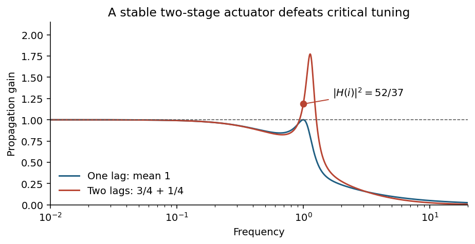
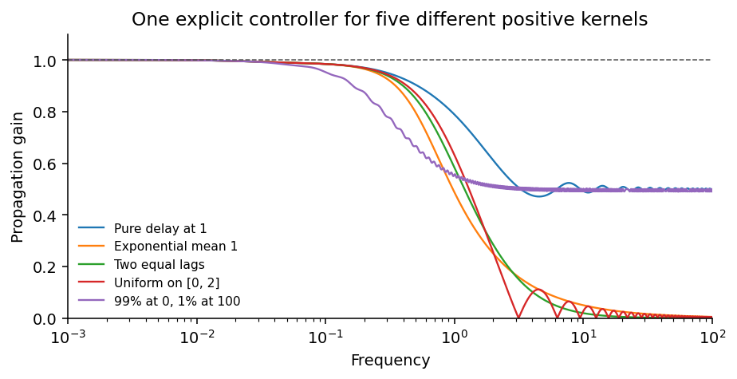

# Exact headway and gain limits for positive actuation kernels with bounded mean

**Research manuscript — 26 November 2026**

## Abstract

We study a constant time-headway controller with positive position and velocity gains and a fixed predecessor-acceleration feedforward gain \(a\in[0,1)\). The actuator is an unknown causal convolution by a probability measure with mean at most \(L>0\), without a support, variance, shape, or realization-order restriction. A common controller exists exactly when \(h>2L/(1+a)\). Beyond this existence boundary, we characterize every feasible positive gain pair: an exact transform value set reduces the infinite distributional uncertainty and frequency optimization to two quartic tests with at most ten candidate mixing weights for each continuous phase. The nonstrict attenuation inequalities themselves imply uniform internal zero-state \(L^2\) stability. With \(H=h/L\), \(H_*=2/(1+a)\), and \(P=L^2p\), the supremal feasible position gain obeys \(P_{\max}(H,a)\sim C(a)(H-H_*)\), where \(C(a)=2(1-a^2)^2(1+a)/(8a^2-5a+3)\). We give matching controllers, a forced first-order velocity-gain correction, and finite two-point obstruction kernels. A rational controller is stable and contractive for every pure delay up to the mean budget but is stably amplified by a same-mean mixture, proving strict gain-region separation. We also classify the headway endpoint for every fixed positive lag-cascade order: equality is possible for one stage and impossible for every order of two or more. The two-point and trigonometric-support ingredients have antecedents in distributed-delay and quantum-speed-limit analysis; the contribution is their use in the complete control-gain characterization, sharp gain law, and stable separations for this model.

## 1. Introduction

A constant time-headway policy specifies the following distance as an equilibrium offset plus a multiple of the following vehicle's velocity. Reducing that multiplier increases the intended traffic density, but actuator lag and delay constrain disturbance attenuation. Internal stability and string stability impose different requirements. Xiao, Darbha, and Gao [6], and Xiao and Gao [1], derive sufficient conditions for ACC models combining a first-order lag and a transport delay. The public preprint of Ma, Pagilla, and Darbha gives sufficient headway bounds for uncertain transport delay, including \(h>2L/(1+a)\) for one predecessor [3, Theorem 3.2]; the subsequent publication is explicitly titled as a sufficient-bound result [2]. More general heterogeneous interconnections require careful specification of the propagated signals and the stability norm [4]. Sipahi, Atay, and Niculescu [13] analyze constant-headway driving with distributed driver memory; their specified uniform-window kernel and relative-velocity feedback lead to a different asymptotic-stability problem.

The numerical value of the pure-delay threshold in the ACC case is not new. Soundararajan's 2021 thesis studies the same \(a=0\) pure-delay PD architecture, reports the threshold from numerical gain-region calculations, and lists analytical corroboration as future work [5, Sections 4.4 and 5]. Mean-delay principles and extremal distributions also have a substantial history. Bernard and Crauste [9] analyze an optimal stability condition for a scalar first-order delayed equation and use a distribution supported at zero and one positive delay. Trigonometric support functions and zero-plus-one-positive two-level constructions occur in quantum-speed-limit work [10–12]. These precedents are relevant to the mathematical method, although their dynamical questions differ from the second-order propagation-attenuation problem considered here.

Our actuator class contains every positive convolution operator with unit steady-state gain and mean memory length at most \(L\). This includes pure delays, exponential lags, arbitrary finite positive lag cascades, mixtures, and measures with unbounded support. One positive controller-gain pair must work independently of the distribution, its variance, its support, and its realization order. An existence threshold alone leaves a second design problem: which gain pairs are feasible, how much position feedback can be retained close to the boundary, and whether checking all pure delays suffices for a particular controller.

We answer these questions within the specified architecture. The exact existence threshold is \(h>2L/(1+a)\). The full gain region has a necessary-and-sufficient description using a continuous phase and finitely many algebraic mixing candidates at each phase. It is strictly smaller than the region obtained by testing all pure delays, as an explicit stable counterexample shows. Near the threshold, the maximal dimensionless position gain has an exact leading coefficient; asymptotically optimal controllers also have a uniquely forced first-order velocity correction. A further endpoint distinction separates one uncertain positive lag from every fixed order of two or more positive stages.

### 1.1. Main contributions and boundaries

The principal new control result is a complete necessary-and-sufficient characterization of the common positive-gain region for the entire mean-bounded probability-kernel class, including internal zero-state stability. It yields the sharp critical position-gain coefficient and a rigidity law for asymptotically optimal velocity gains. Matching lower and upper proofs identify two distinct obstruction mechanisms: a full pure delay and a rare long-delay mixture. A separate exact example proves that a controller can be internally stable and contractive for every admissible pure delay yet remain internally stable and fail contraction for a same-mean mixture. These statements concern completed theorems for one specified controller architecture, not a numerical search, a claim of unrestricted-controller optimality, or an assumed pure-delay worst-case principle.

Sections 4–6 prove the headway threshold with explicit common gains and a continuous-boundary stability argument. Section 7 supplies preliminary linear-order gain bounds. Section 8 establishes the fixed-order endpoint distinction, and Sections 9–10 give exact examples and model boundaries. Section 11 derives the exact transform representation and full gain criterion. Section 12 proves the sharp coefficient and rigidity law; Section 13 gives the stable pure-delay/mixture separation. Section 14 compares the conclusions and methods with the inspected sources.

The expression \(2L/(1+a)\), the controller architecture, the classical one-stage baseline, and the underlying two-point support idea are not claimed as independent inventions. The simple certificate in Section 4 is sufficient; the later criterion in Section 11 characterizes all positive gain pairs. One continuous phase parameter remains in that criterion, so it is not a finite phase-grid decision algorithm. The kernel is fixed and deterministic. Heavy-tailed kernels are covered in the zero-state \(L^2\) sense, without a claim about exponential decay from arbitrary infinite histories. No settling-time, bandwidth, random-delay, or collision-avoidance conclusion is inferred.

## 2. Model and definitions

For a Borel probability measure \(\mu\) on \([0,\infty)\), define

\[
P_\mu(s)=\int_{[0,\infty)}e^{-st}\,d\mu(t),\qquad \Re s\ge0.
\tag{2.1}
\]

Let

\[
\mathcal M_L=\left\{\mu:\mu([0,\infty))=1,\quad \int t\,d\mu(t)\le L\right\},
\qquad L>0.
\tag{2.2}
\]

Atoms, including at zero, are allowed. There is no bounded-support or second-moment assumption.

Fix \(a\in[0,1)\), time headway \(h\ge0\), and gains \(v,p>0\). The symbol \(v\) denotes the velocity-feedback gain, not vehicle velocity. Put

\[
g=v+hp.
\tag{2.3}
\]

Suppressing equilibrium offsets, a homogeneous predecessor-following model is

\[
\begin{aligned}
u_i&=a\ddot x_{i-1}+v(\dot x_{i-1}-\dot x_i)
+p(x_{i-1}-x_i-h\dot x_i),\\
\ddot x_i(t)&=\int_{[0,\infty)}u_i(t-r)\,d\mu(r).
\end{aligned}
\tag{2.4}
\]

With zero histories, its scalar propagation transfer is

\[
H_\mu(s)=\frac{N_\mu(s)}{D_\mu(s)},\qquad
N_\mu(s)=P_\mu(s)(as^2+vs+p),
\tag{2.5}
\]

\[
D_\mu(s)=s^2+P_\mu(s)(gs+p).
\tag{2.6}
\]

For a homogeneous string this transfer propagates position perturbations, velocity perturbations, and consecutive constant time-headway spacing errors. The last assertion uses commutation of the common scalar transfer with the common difference operator defining the errors. It is not automatically valid for heterogeneous local spacing errors.

Let \(\mathbb C_+=\{s:\Re s>0\}\). The propagation requirement is

\[
H_\mu\in H^\infty(\mathbb C_+),\qquad
\|H_\mu\|_{H^\infty}\le1.
\tag{2.7}
\]

We require internal zero-freeness on \(\overline{\mathbb C_+}\) and bounded analytic resolvents

\[
D_\mu^{-1},\quad sD_\mu^{-1},\quad s^2D_\mu^{-1}
\in H^\infty(\mathbb C_+).
\tag{2.8}
\]

Section 5 connects these resolvents to a proper physical state-feedback realization. For an arbitrary infinite-memory kernel this is a zero-state input-output \(L^2\) assertion, not a claim of exponential decay of every infinite-history state.

## 3. Exact robust headway

**Theorem 3.1 (exact robust threshold).**  
For \(L>0\), \(a\in[0,1)\), and \(h\ge0\), there exist common gains \(v,p>0\), independent of \(\mu\), satisfying (2.7), (2.8), and closed-right-half-plane zero-freeness for every \(\mu\in\mathcal M_L\), if and only if

\[
h>\frac{2L}{1+a}.
\tag{3.1}
\]

The construction gives strict attenuation at every nonzero boundary frequency and common bounds on the internal resolvents. Since \(H_\mu(0)=1\), the propagation norm is exactly one.

The proof occupies Sections 4–6. Section 4 constructs the frequency certificate, Section 5 establishes internal stability, and Section 6 proves sharp necessity.

## 4. Positive-kernel geometry and a common controller

### 4.1. Transform bounds

**Lemma 4.1 (first-moment bounds).**  
For \(P=P_\mu\), \(\mu\in\mathcal M_L\), the transform is analytic on \(\mathbb C_+\), continuous on its closure, and

\[
|P(s)|\le1,\qquad |1-P(s)|\le L|s|,
\qquad \Re s\ge0.
\tag{4.1}
\]

For \(\omega\ge0\),

\[
-\Im P(i\omega)\le L\omega.
\tag{4.2}
\]

*Proof.* The bound \(|e^{-st}|\le1\) gives the first inequality. Since
\[
1-e^{-st}=\int_0^t se^{-su}\,du,
\]
integration gives \(|1-P(s)|\le |s|\int t\,d\mu(t)\). Inequality (4.2) follows from \(\sin(\omega t)\le\omega t\). Dominated convergence gives continuity on the closed half-plane. Exponential damping permits differentiation under the integral on compact subsets of the open half-plane, without higher moment assumptions. \(\square\)

A joint bound is stronger than applying the two moment estimates separately.

**Lemma 4.2 (joint kernel inequality).**  
For \(\omega\ge0\), put

\[
R=1-\Re P(i\omega),\qquad r=L\omega+\Im P(i\omega).
\]

Then \(R,r\ge0\), and

\[
R^2\le2L\omega r.
\tag{4.3}
\]

*Proof.* For every \(x\ge0\), Cauchy–Schwarz and
\(\sin^2 t\le2(1-\cos t)\) give

\[
(1-\cos x)^2
=\left(\int_0^x\sin t\,dt\right)^2
\le x\int_0^x\sin^2t\,dt
\le2x(x-\sin x).
\tag{4.4}
\]

Let \(\theta=\omega t\) under the probability law \(\mu\), and let
\(M=\mathbb E\theta\le L\omega\). A second Cauchy–Schwarz inequality gives

\[
R=\mathbb E(1-\cos\theta)
\le\mathbb E\sqrt{2\theta(\theta-\sin\theta)}
\le\sqrt{2M\,\mathbb E(\theta-\sin\theta)}.
\]

Here \(\mathbb E(\theta-\sin\theta)=M+\Im P(i\omega)\ge0\), and it is at most \(r\). Thus (4.3) follows. \(\square\)

### 4.2. The frequency certificate

Define

\[
K=2hv+h^2p+2a,\qquad
\delta=1-a^2-2gL.
\tag{4.5}
\]

**Proposition 4.3 (uniform positive-gain certificate).**  
Suppose

\[
\delta>0,\qquad K>2,\qquad
p(K-1)^2L< g(K-2).
\tag{4.6}
\]

Then every \(\mu\in\mathcal M_L\) satisfies

\[
|D_\mu(i\omega)|^2-|N_\mu(i\omega)|^2
\ge m\omega^2>0\qquad(\omega\ne0),
\tag{4.7}
\]

where

\[
m=p(K-2)-\frac{p^2(K-1)^2L}{g}>0.
\tag{4.8}
\]

*Proof.* By conjugation it suffices to take \(\omega>0\). Write
\(z=P_\mu(i\omega)\). Expanding squared moduli gives

\[
\begin{aligned}
F_\mu(\omega)
&:=\frac{|D_\mu(i\omega)|^2-|N_\mu(i\omega)|^2}{\omega^2}\\
&=\omega^2(1-a^2|z|^2)+2g\omega\Im z
+p\{K|z|^2-2\Re z\}.
\end{aligned}
\tag{4.9}
\]

The coefficient \(K\) follows from
\(g^2-v^2+2ap=pK\).
Let \(R=1-\Re z\) and \(r=L\omega+\Im z\). Since
\(|z|\le1\),

\[
\omega^2(1-a^2|z|^2)+2g\omega\Im z
\ge\delta\omega^2+2g\omega r.
\]

Also,

\[
K|z|^2-2\Re z
=K-2-2(K-1)R+K|1-z|^2
\ge K-2-2(K-1)R.
\]

Lemma 4.2 therefore implies

\[
F_\mu(\omega)\ge
\delta\omega^2+p(K-2)+2g\omega r
-2p(K-1)\sqrt{2L\omega r}.
\tag{4.10}
\]

Completing the square in \(\sqrt{2g\omega r}\) gives

\[
2g\omega r-2p(K-1)\sqrt{2L\omega r}
\ge-\frac{p^2(K-1)^2L}{g}.
\]

Thus \(F_\mu(\omega)\ge\delta\omega^2+m\ge m>0\), as claimed. \(\square\)

### 4.3. Explicit feasible gains

**Proposition 4.4 (common-gain construction).**  
If \(h>2L/(1+a)\), define

\[
v=\frac12\left(\frac{1-a}{h}+\frac{1-a^2}{2L}\right),
\tag{4.11}
\]

\[
\delta_0=1-a^2-2Lv>0,\qquad
\kappa=2hv-2(1-a)>0,
\tag{4.12}
\]

\[
p=\min\left\{
\frac{\delta_0}{4hL},\
\frac{v\kappa}{4L(\kappa+2)^2},\
\frac1{h^2}
\right\}.
\tag{4.13}
\]

Then all gains are positive, (4.6) holds, and \(m\ge3p\kappa/4>0\).

*Proof.* The strict headway condition is equivalent to
\((1-a)/h< (1-a^2)/(2L)\), and the chosen \(v\) is strictly between the endpoints. Thus \(\delta_0,\kappa,p>0\). Since \(g=v+hp\),

\[
\delta=\delta_0-2hpL\ge\delta_0/2>0,\qquad
K-2=\kappa+h^2p\ge\kappa.
\]

Because \(h^2p\le1\), \(K-1\le\kappa+2\). Consequently,

\[
\frac{p(K-1)^2L}{g}
\le\frac{p(\kappa+2)^2L}{v}
\le\kappa/4< K-2.
\]

The same estimate in (4.8) gives \(m\ge3p\kappa/4\). \(\square\)

This construction proves the sharp existence result and is directly checkable. It is not asserted to optimize bandwidth, transient behavior, or the numerical value of the frequency margin.

## 5. Internal stability for unbounded-support kernels

**Proposition 5.1 (zero-freeness and bounded internal transfers).**  
Under (4.6), every \(D_\mu\) is zero-free on the closed right half-plane. Its three resolvents in (2.8) have bounds common to all \(\mu\in\mathcal M_L\), and
\(\|H_\mu\|_{H^\infty}=1\).

*Proof.* Fix \(\mu\), and form the homotopy

\[
\mu_t=(1-t)\delta_{\{0\}}+t\mu,\qquad
P_t=1-t+tP_\mu,\qquad 0\le t\le1.
\tag{5.1}
\]

Every \(\mu_t\) is admissible. For \(D_t=s^2+P_t(gs+p)\), Proposition 4.3 excludes nonzero imaginary-axis zeros, and \(D_t(0)=p>0\). On the closed right half-plane,

\[
|D_t(s)-s^2|\le g|s|+p.
\tag{5.2}
\]

Choose a fixed \(R\) so large that \(r^2>gr+p\) for every \(r\ge R\). No zero can occur outside this half-disc or cross its semicircular boundary.

On the boundary consisting of that semicircle and its imaginary-axis diameter, \(D_t\) is continuous, nonzero, and jointly continuous in \(s,t\). Its winding number is therefore invariant. The argument principle for an analytic interior function with a continuous nonzero boundary trace follows by approximation with interior contours, so no analytic continuation across the imaginary axis is assumed. At \(t=0\),

\[
D_0(s)=s^2+gs+p
\]

is Hurwitz. The invariant zero count in the open right half-disc is zero. This proves zero-freeness throughout the closed right half-plane.

For a fixed measure, zero-freeness and continuity give a positive lower bound on compact regions; (5.2) gives quadratic growth at infinity. Hence \(1/D_\mu,s/D_\mu,s^2/D_\mu\) are bounded analytic functions.

The bounds can be made common to the class. Near zero,

\[
|D_\mu(s)-p|\le |s|^2+(g+pL)|s|.
\tag{5.3}
\]

Choose \(r>0\) with \(r^2+(g+pL)r\le p/2\); then \(|D_\mu(s)|\ge p/2\) for \(|s|\le r\). At intermediate imaginary frequencies, (4.7) gives

\[
|D_\mu(i\omega)|\ge\sqrt m\,|\omega|.
\tag{5.4}
\]

For sufficiently large \(|s|\), (5.2) gives
\(|D_\mu(s)|\ge |s|^2/2\). These three estimates supply common boundary bounds for each resolvent. The maximum-modulus principle extends the bounds to the open half-plane, using the already established boundedness and the behavior at infinity.

The numerator in (2.5) now gives bounded analyticity of \(H_\mu\). Uniformly as \(|s|\to\infty\) in the closed right half-plane,

\[
H_\mu(s)=aP_\mu(s)+O(|s|^{-1}),
\tag{5.5}
\]

so its limiting upper modulus is at most \(a< 1\). Apply the maximum-modulus principle on increasing right half-discs, using (4.7) on the diameter, to obtain \(\|H_\mu\|_{H^\infty}\le1\). Finally \(H_\mu(0)=1\), so the norm equals one. \(\square\)

### 5.1. Proper physical internal stability

The resolvent assertion has a concrete interpretation that avoids treating a differentiating PD controller as a proper scalar transfer. Consider the zero-history state-feedback realization

\[
sX=V+d_x,\qquad
sV=P_\mu(-gV-pX+d_u)+d_v,
\tag{5.6}
\]

with controller output \(U=-gV-pX+d_u\). Direct elimination gives

\[
X=\frac{s+gP_\mu}{D_\mu}d_x+\frac1{D_\mu}d_v
+\frac{P_\mu}{D_\mu}d_u,
\tag{5.7}
\]

\[
V=-\frac{pP_\mu}{D_\mu}d_x+\frac{s}{D_\mu}d_v
+\frac{sP_\mu}{D_\mu}d_u,
\tag{5.8}
\]

\[
U=-\frac{ps}{D_\mu}d_x-\frac{gs+p}{D_\mu}d_v
+\frac{s^2}{D_\mu}d_u.
\tag{5.9}
\]

Every displayed transfer, and \(P_\mu U\), is in \(H^\infty\), with common bounds. To make the signal-space implication explicit, the classical half-plane Paley-Wiener correspondence identifies causal \(L^2(0,\infty)\) signals with \(H^2(\mathbb C_+)\). Multiplication by a bounded analytic transfer preserves \(H^2\), has operator norm at most its \(H^\infty\) norm, and its inverse transform is causal; this is standard Hardy-space systems theory [8]. Thus all these physically proper disturbance-to-state maps are bounded in the zero-state \(L^2\) sense. For \(L^2\) disturbances, the right sides of (5.6) are also \(L^2\); the inverse-transform identities therefore give causal weak derivatives of \(X,V\) in \(L^2\), with zero initial traces. The maps solve the actual zero-state equations, and zero-freeness gives uniqueness. An atom at zero may produce direct feedthrough, so strict causality is not required.

For finite positive lag cascades, the corresponding finite-dimensional characteristic polynomial is Hurwitz, and conventional exponential state stability follows. For arbitrary probability kernels with unbounded support we retain the input-output statement and make no assertion about exponential decay for unrestricted infinite histories.

## 6. A sharp pure-delay obstruction

**Proposition 6.1 (finite-frequency converse).**  
For any \(L>0,a\in[0,1),0\le h\le2L/(1+a)\), and \(v,p>0\), there exist a pure delay \(0\le\tau\le L\) and a finite frequency \(\omega>0\) with

\[
|D_{\delta_{\{\tau\}}}(i\omega)|^2
-|N_{\delta_{\{\tau\}}}(i\omega)|^2< 0.
\tag{6.1}
\]

*Proof.* Normalize \(L=1\) by replacing \(h,v,p,g\) with
\(h/L,Lv,L^2p,Lg\). Use the original letters for the normalized quantities, and set

\[
b=1-a^2,\qquad \alpha=\arccos a\in(0,\pi/2],
\qquad G=\alpha\sqrt b.
\tag{6.2}
\]

For a pure delay, divide numerator and denominator by its unit-modulus frequency value. With \(x=\tau\omega\), \(0\le x\le\omega\), the modulus difference divided by \(\omega^2\) is

\[
F(\omega,x)=b\omega^2-2g\omega\sin x
+g^2-v^2+2ap-2p\cos x.
\tag{6.3}
\]

Assume first \(h>0\). If \(g\ge G\), choose

\[
x=\alpha,\qquad \omega=g/\sqrt b,\qquad
\tau=\alpha/\omega\le1.
\]

Since \(\cos\alpha=a,\sin\alpha=\sqrt b\), the difference is

\[
F(\omega,x)=-v^2< 0.
\tag{6.4}
\]

If \(g< G\), then \(0< hp< g< G\). The function \(x\sin x\) increases strictly on \([0,\alpha]\), so there is a unique \(x\in(0,\alpha)\) with

\[
x\sin x=hp.
\tag{6.5}
\]

Take \(\omega=x,\tau=1\). Substitute \(v=g-hp\) and (6.5) into (6.3) to obtain

\[
F(x,x)=(\cos x-a)
\left[x^2(\cos x+a)-\frac{2x\sin x}{h}\right].
\tag{6.6}
\]

For \(0< x\le\pi/2\), \(2\tan(x/2)>x\), and hence

\[
\frac{\sin x}{x}>
\frac{1+\cos x}{2}
\ge\frac{a+\cos x}{1+a}.
\tag{6.7}
\]

The final comparison is equivalent to
\((1-a)(1-\cos x)\ge0\). If \(h\le2/(1+a)\), the bracket in (6.6) is strictly negative and \(\cos x-a>0\). This gives the obstruction.

For \(h=0\), \(g=v\). At \(\tau=0\), (6.3) tends to \(-2(1-a)p< 0\) as \(\omega\downarrow0\), so a small positive frequency suffices. Restoring dimensions proves the proposition. \(\square\)

Necessity does not assume internal stability: the required modulus inequality itself fails. Propositions 4.3, 4.4, 5.1, and 6.1 prove Theorem 3.1.

## 7. Linear scaling of the feasible position gain

The strict threshold alone does not state whether a nonvanishing position-feedback gain is available close to it. We first determine the order of its unavoidable reduction; Section 12 then identifies the sharp leading coefficient.

Normalize

\[
H=h/L,\qquad V=Lv,\qquad P=L^2p,\qquad
H_*=\frac2{1+a},\qquad b=1-a^2.
\tag{7.1}
\]

Let \(P_{\max}(H,a)\) be the supremum of \(P>0\) for which some \(V>0\) gives the common-controller properties of Theorem 3.1 over \(\mathcal M_L\). The normalization makes this supremum independent of the numerical value of \(L\).

**Theorem 7.1 (linear position-gain order).**  
Fix \(a\in[0,1)\), let
\(0< \epsilon=H-H_*\le1\), and put

\[
c_a=\frac2\pi-\frac a2>0.
\tag{7.2}
\]

Then

\[
\frac{b^2}{200}\epsilon
\le P_{\max}(H,a)
\le \frac{3(1+a)^2}{2c_a H}\epsilon.
\tag{7.3}
\]

Thus \(P_{\max}(H,a)\) is of linear order in \(\epsilon\) for each fixed \(a\).

*Proof of the lower bound.* The normalized construction (4.11)–(4.13) has

\[
V=\frac12\left(\frac{1-a}{H}+\frac b2\right)\ge b/4,
\quad
\delta_0=\frac{b\epsilon}{2H},
\quad
\kappa=\frac{b\epsilon}{2}.
\tag{7.4}
\]

Since \(H\le3\), \(b\le1\), and \(\epsilon\le1\), one has
\(\kappa+2\le5/2\). The three entries in the normalized minimum for \(P\) obey

\[
\frac{\delta_0}{4H}
=\frac{b\epsilon}{8H^2}
\ge\frac{b^2\epsilon}{72},
\]

\[
\frac{V\kappa}{4(\kappa+2)^2}
\ge
\frac{(b/4)(b\epsilon/2)}{25}
=\frac{b^2\epsilon}{200},
\]

\[
\frac1{H^2}\ge\frac19\ge\frac{b^2\epsilon}{9}.
\]

Their minimum is at least \(b^2\epsilon/200\), and Proposition 4.4 makes that gain feasible.

*Proof of the upper bound.* Put \(\Gamma=V+HP\), \(\alpha=\arccos a\), and \(G=\alpha\sqrt b\). Any robustly feasible gains must avoid Case I of Proposition 6.1, so \(\Gamma< G\). The point \(x\in(0,\alpha)\) defined by

\[
x\sin x=HP
\tag{7.5}
\]

therefore exists. Nonnegative attenuation at the full delay \(L\), using (6.6), implies

\[
H\ge\frac{2\sin x}{x(\cos x+a)}.
\tag{7.6}
\]

Define

\[
A_a(x)=(1+a)\sin x-x(\cos x+a).
\]

Its derivative is

\[
A_a'(x)=x\sin x-a(1-\cos x).
\]

For \(0\le x\le\pi/2\), \(\sin x\ge2x/\pi\) and
\(1-\cos x\le x^2/2\). Hence

\[
A_a'(x)\ge c_a x^2,\qquad
A_a(x)\ge c_a x^3/3.
\tag{7.7}
\]

Subtracting \(H_*=2/(1+a)\) from (7.6), and using
\(\cos x+a\le1+a\), gives

\[
\epsilon\ge
\frac{2A_a(x)}{(1+a)x(\cos x+a)}
\ge\frac{2c_a x^2}{3(1+a)^2}
\ge\frac{2c_a HP}{3(1+a)^2}.
\tag{7.8}
\]

The last step uses \(x\sin x\le x^2\). Rearranging proves the upper bound for every feasible \(P\), and hence for its supremum. \(\square\)

The upper bound uses robustness to the entire pure-delay subclass. It is a result for the full mean-bounded uncertainty class, not a separately proved gain bound for each restricted fixed-order family below. The theorem quantifies position-feedback gain only. It does not assert a corresponding exact rate for settling time, closed-loop bandwidth, or transient amplification.

## 8. Fixed-order positive lags and endpoint attainability

For a fixed integer \(n\ge1\), let

\[
\mathcal E_{n,L}
=\left\{
P(s)=\prod_{j=1}^n(1+\tau_j s)^{-1}:
\tau_j>0,\quad \sum_{j=1}^n\tau_j\le L
\right\}.
\tag{8.1}
\]

Each member is the transform of a sum of independent exponential variables and has mean \(\sum_j\tau_j\). The number of stages is known, but their positive allocation is not.

**Theorem 8.1 (fixed-order endpoint distinction).**  
Put

\[
h_*=\frac{2L}{1+a},\qquad
v_*=\frac{1-a^2}{2L}.
\tag{8.2}
\]

Common positive gains with stable contractive propagation exist for \(\mathcal E_{1,L}\) exactly when \(h\ge h_*\). At \(h=h_*\), \(v=v_*\) is forced and every \(p>0\) works. For every fixed \(n\ge2\), such common gains exist for \(\mathcal E_{n,L}\) exactly when \(h>h_*\).

### 8.1. The one-stage baseline

For \(P_\tau=(1+\tau s)^{-1}\), multiply numerator and denominator by \(1+\tau s\):

\[
\widetilde D_\tau=\tau s^3+s^2+gs+p,\qquad
\widetilde N=as^2+vs+p.
\tag{8.3}
\]

With \(b=1-a^2,A=1-a,z=\omega^2\), the modulus difference divided by \(\omega^2\) is

\[
G_\tau(z)=\tau^2z^2+(b-2\tau g)z+c,\qquad
c=g^2-v^2-2Ap.
\tag{8.4}
\]

At \(h=h_*,v=v_*\), \(hv=A\), so

\[
G_\tau(\omega^2)=
(\tau\omega^2-h_*p)^2+b(1-\tau/L)\omega^2\ge0.
\tag{8.5}
\]

The cubic is Hurwitz: its coefficients are positive and the remaining Routh-Hurwitz inequality is

\[
g>\tau p,\qquad
g-\tau p=v_*+(h_*-\tau)p>0,
\tag{8.6}
\]

because \(h_*>L\ge\tau\). Equality in headway is therefore feasible. At \(\tau=L\) it has a unit-gain contact at

\[
\omega^2=h_*p/L.
\tag{8.7}
\]

For necessity, consider \(\tau=L\). If \(h=0\), \(c=-2Ap< 0\). For \(h>0\), if \(g\le v_*\), nonnegativity at \(z=0\) requires

\[
c\ge0\quad\Longleftrightarrow\quad h(g+v)\ge2A.
\tag{8.8}
\]

Since \(v< g\le v_*\), this forces \(h>h_*\). If \(g>v_*\), the minimum of \(G_L(z)\) on \(z\ge0\) is \(c-(g-v_*)^2\). Its nonnegativity is equivalent to

\[
(v-v_*)^2+2p(A-v_*h)\le0.
\tag{8.9}
\]

Thus \(h\ge h_*\); at equality \(v=v_*\) is necessary. Formula (8.5) proves sufficiency for arbitrary \(p>0\). Above the endpoint, Theorem 3.1 supplies feasible gains.

### 8.2. Stable failure under an arbitrarily small two-stage split

Fix a critical one-stage controller \(h=h_*,v=v_*,p>0\). For \(0< \varepsilon< L\), use

\[
P_\varepsilon(s)=
\frac1{(1+(L-\varepsilon)s)(1+\varepsilon s)}.
\tag{8.10}
\]

Its mean is exactly \(L\). Write

\[
y=\frac{h_*p}{L}=\frac{2p}{1+a}>0,\qquad
d=\varepsilon(L-\varepsilon).
\tag{8.11}
\]

**Proposition 8.2 (exact split identity and retained stability).**  
At \(\omega=\sqrt y\),

\[
\frac{|D_\varepsilon(i\omega)|^2-|N_\varepsilon(i\omega)|^2}{\omega^2}
=-\frac{dy^2\{(1-a)-dy\}}{(1-dy)^2+L^2y}.
\tag{8.12}
\]

For every fixed critical controller there is an explicit \(\bar\varepsilon>0\) such that all \(0< \varepsilon\le\bar\varepsilon\) have negative difference and an internally stable closed loop.

*Proof.* Set \(Q_\varepsilon=1+Ls+ds^2\). After multiplication by \(Q_\varepsilon\),

\[
\widetilde D_\varepsilon=ds^4+Ls^3+s^2+gs+p,\qquad
\widetilde N=as^2+vs+p.
\tag{8.13}
\]

At \(\omega^2=y\), \(g=v+Ly\), so the imaginary parts agree and equal \(v\omega\). Since \(p=(1+a)y/2\), their real parts are

\[
-\frac{1-a}{2}y+dy^2,\qquad \frac{1-a}{2}y.
\]

The squared-modulus difference is
\(-dy^3\{(1-a)-dy\}\). Divide by \(y|Q_\varepsilon(i\omega)|^2\) to obtain (8.12).

For stability, define

\[
d_0=\frac{Lg-L^2p}{g^2}>0,\qquad
\bar\varepsilon=
\min\left\{\frac L2,\frac{1-a}{2Ly},\frac{d_0}{2L}\right\}.
\tag{8.14}
\]

Positivity of \(d_0\) follows from \(g-Lp=v_*+(h_*-L)p>0\). For \(0< \varepsilon\le\bar\varepsilon\),

\[
dy\le(1-a)/2,\qquad d\le d_0/2< d_0.
\]

The quartic in (8.13) has positive coefficients and Hurwitz determinants

\[
\Delta_1=L,\quad
\Delta_2=L-dg,\quad
\Delta_3=Lg-dg^2-L^2p,\quad
\Delta_4=p\Delta_3.
\tag{8.15}
\]

The inequality \(d< d_0\) makes \(\Delta_3>0\), and also \(\Delta_2>0\). Thus the polynomial is Hurwitz, while (8.12) is strictly negative. \(\square\)

The actuator perturbation is small in \(H^\infty\), not only in its parameter. Compact convergence to \((1+Ls)^{-1}\) is immediate. For \(\varepsilon\le L/2\) and \(\Re s\ge0\),

\[
|P_\varepsilon(s)|\le \frac2{L|s|},
\]

while the limiting transfer is bounded by \(1/(L|s|)\). The common tail estimate extends compact convergence to \(H^\infty\) convergence. Every critical one-stage controller therefore loses attenuation under arbitrarily small fixed-mean positive-kernel perturbations with stability retained.

### 8.3. Every fixed \(n\ge2\)

Sufficiency above the threshold follows from
\(\mathcal E_{n,L}\subset\mathcal M_L\).
For necessity fix \(n\ge2\).

If \(h< h_*\), or \(h=h_*,v\ne v_*\), the one-stage calculation produces a strictly negative modulus difference at a finite positive frequency for the lag \(L\). When strict negativity is first obtained at \(z=0\), continuity gives it at a sufficiently small positive \(z\). Approximate this lag by

\[
P_{\eta,n}(s)=
[1+(L-(n-1)\eta)s]^{-1}(1+\eta s)^{-(n-1)},
\quad 0< \eta< L/(n-1).
\tag{8.16}
\]

All stages are positive, their sum is \(L\), and the transfer converges to the one-stage value at the failing frequency. Since the modulus difference is continuous in \(P(i\omega)\), strict failure persists for small positive \(\eta\).

In the remaining case \(h=h_*,v=v_*\), Proposition 8.2 gives a strictly failing positive two-stage plant. For \(n>2\), replace it by

\[
[1+(L-\varepsilon-(n-2)\eta)s]^{-1}
(1+\varepsilon s)^{-1}(1+\eta s)^{-(n-2)}
\tag{8.17}
\]

with \(0< \eta< (L-\varepsilon)/(n-2)\). This again keeps every stage positive and the total mean equal to \(L\). As \(\eta\downarrow0\), strict failure at the chosen frequency persists. This proves Theorem 8.1.

The result concerns uncertainty over all positive stage allocations with bounded sum. It does not state that each specified, known multi-stage plant has the same optimal headway.

## 9. Exact numerical illustrations

### 9.1. Rational stable two-stage counterexample

Take

\[
L=1,\quad a=\frac12,\quad h=\frac43,\quad
v=\frac38,\quad p=\frac34,\quad g=\frac{11}{8}.
\tag{9.1}
\]

These are feasible critical one-stage gains for every lag \(\tau\le1\). Split the mean into \(3/4\) and \(1/4\), so \(d=3/16\). At \(\omega=1\),

\[
|\widetilde N(i)|^2=\frac{13}{64}=\frac{52}{256},
\qquad
|\widetilde D(i)|^2=\frac{37}{256}.
\]

Consequently,

\[
|H(i)|^2=\frac{52}{37}>1.
\tag{9.2}
\]

Internal stability is exact: the nontrivial quartic determinants are

\[
\Delta_2=\frac{95}{128}>0,\qquad
\Delta_3=\frac{277}{1024}>0.
\tag{9.3}
\]

No frequency grid or floating-point root test is needed.

{width=92%}

### 9.2. A rational common controller above the threshold

For \(L=1,a=1/2,h=2\), choose

\[
v=\frac5{16},\qquad p=\frac1{128},\qquad g=\frac{21}{64}.
\]

Then

\[
\delta=\frac3{32}>0,\qquad K=\frac{73}{32}>2,
\]

and

\[
p(K-1)^2L=\frac{1681}{131072}
< 
\frac{189}{2048}=g(K-2).
\tag{9.4}
\]

Proposition 4.3 therefore certifies this controller for every probability kernel of mean at most one. Its exact frequency-certificate margin is \(m=10415/5505024\). The conclusion includes pure delays, the two-stage counterexample plant above with the new controller, arbitrary finite positive cascades, and unbounded-support kernels. It is established analytically, not by finite sampling.

{width=92%}

## 10. Boundary cases and interpretation

### 10.1. Zero mean

If \(L=0\), only unit mass at zero is admissible. For \(a\in[0,1)\), the denominator is the Hurwitz quadratic \(s^2+gs+p\), and attenuation is equivalent to

\[
2hv+h^2p\ge2(1-a).
\tag{10.1}
\]

A positive-gain controller exists exactly for \(h>0\); the zero infimum is not attained. Formulae containing \(L^{-1}\) are not used.

### 10.2. Feedforward gain at or above one

For \(L>0\), no finite nonnegative headway and positive gains work for the whole class if \(a\ge1\). If \(a>1\), a pure-delay propagation transfer has high-frequency modulus tending to \(a>1\). If \(a=1\), fix \(\tau=L\) and let
\(L\omega=\pi/2+2\pi n\). The normalized difference is
\(-2g\omega+g^2-v^2+2p\), negative for large \(n\).
Zero position or velocity gains are excluded; they change the stability and endpoint questions.

### 10.3. String interpretation

For an interconnection modeled exactly by \(Y_i=H_iY_{i-1}\), each contractive scalar transfer gives
\(\|Y_n\|_2\le\|Y_0\|_2\) for every finite number of links. In the homogeneous model (2.4), this includes consecutive spacing-error propagation. For heterogeneous plants, position and velocity propagation remain valid linkwise, but local spacing-error ratios require their own derivation. We do not infer disturbance-to-all-vehicles bounds, spatial \(\ell_2\) estimates, or collision avoidance.

### 10.4. Model limits

The theorem relies on a positive unit-mass kernel and a first-moment upper bound. Sign-changing impulse responses, saturation, DC-gain uncertainty, time variation, separately delayed communication, and measurement-noise constraints are outside its assumptions. The mean bound is supplied, not estimated. The position-gain laws in Theorems 7.1 and 12.1 answer a particular near-threshold design question; it is not a theorem about settling time or bandwidth.

For fixed finite-dimensional cascades, the stability conclusion is the usual Hurwitz stability. For arbitrary heavy-tailed kernels the precise statement is bounded causal zero-state \(L^2\) input-output behavior. No stronger infinite-history state claim is required.

## 11. Exact frequency image and complete robust gain criterion

The headway theorem determines when a common controller exists. It does not characterize every feasible pair of positive gains. We now give such a characterization for the same architecture. Throughout this section, \(L>0\), \(0\le a< 1\), \(h\ge0\), \(v,p>0\), and \(g=v+hp\), unless a statement explicitly allows \(L=0\). The definitions of \(P_\mu,N_\mu,D_\mu,H_\mu\) and internal zero-state stability remain those of Sections 2 and 5.1.

Two-point extremizers and trigonometric supporting inequalities are established tools. Bernard and Crauste [9] use a zero-plus-positive-delay comparison in a scalar stability problem. Giovannetti, Lloyd, and Maccone [10], and subsequent analyses of the Margolus–Levitin bound [11, 12], use related two-level reductions and support geometry; the support family below overlaps those earlier trigonometric constructions. We do not claim these geometric methods as new. We give a self-contained formulation with a prescribed *complex* transform value, then use it to characterize the complete gain region of the second-order contraction problem.

### 11.1. Prescribed transform value and its minimum mean

**Theorem 11.1 (exact frequency image and unique minimum-mean law).**  
Fix \(\omega>0\). For every \(z\) in the closed unit disk with \(z\ne1\), there is a unique representation
\[
z=1-r+r e^{-i\theta},
\qquad 0< r\le1,\quad 0< \theta< 2\pi.
\]
Among all probability measures \(\mu\) on \([0,\infty)\) with finite first moment and \(P_\mu(i\omega)=z\), the minimum mean is
\[
\inf_\mu\int t\,d\mu(t)=\frac{r\theta}{\omega},
\qquad
\mu_{\min}=(1-r)\delta_0+r\delta_{\theta/\omega}.
\tag{11.1}
\]
The displayed measure is the unique minimizer. For \(z=1\), the minimum is zero and its unique minimizer is \(\delta_0\). Consequently, for every \(L\ge0\),
\[
\{P_\mu(i\omega):\mu\in\mathcal M_L\}
=
\{1\}\cup
\left\{1-r+r e^{-i\theta}:
0< r\le1,\ 0< \theta< 2\pi,\ r\theta\le\omega L\right\}.
\tag{11.2}
\]

*Proof.* Put \(u=1-\Re z\) and \(y=-\Im z\). The disk inequality and \(z\ne1\) imply \(u>0\). The unique parameters are determined by
\[
r=\frac{u^2+y^2}{2u}\in(0,1],
\qquad
\cot(\theta/2)=y/u,\quad 0< \theta< 2\pi.
\]
These equations give \(r(1-\cos\theta)=u\) and \(r\sin\theta=y\), hence the required representation.

For fixed \(\theta\in(0,2\pi)\), define
\[
A_\theta=\frac{\sin\theta-\theta\cos\theta}{1-\cos\theta},
\qquad
B_\theta=\frac{\theta\sin\theta}{1-\cos\theta}-1,
\]
\[
\phi_\theta(t)=t-A_\theta(1-\cos t)-B_\theta\sin t.
\tag{11.3}
\]
We claim that \(\phi_\theta(t)\ge0\) for every \(t\ge0\), with equality exactly at \(t=0,\theta\). Direct differentiation gives
\[
\begin{gathered}
\phi_\theta(0)=\phi_\theta(\theta)=0,\qquad
\phi_\theta'(\theta)=0,\\
\phi_\theta'(0)=2-\theta\cot(\theta/2)>0,\qquad
\phi_\theta''(\theta)=
\frac{\theta-\sin\theta}{1-\cos\theta}>0.
\end{gathered}
\tag{11.4}
\]
For the strict derivative at zero, \(\cot(\theta/2)\le0\) when \(\theta\ge\pi\). When \(0< \theta< \pi\), the inequality \(x\cot x< 1\), \(x=\theta/2\), follows by differentiating \(\sin x-x\cos x\).

Now \(\phi_\theta'(t)=1-A_\theta\sin t-B_\theta\cos t\). Its trigonometric amplitude exceeds one, since
\[
A_\theta^2+B_\theta^2
=
1+\left(\frac{\theta-\sin\theta}{1-\cos\theta}\right)^2>1.
\]
It therefore has exactly two simple zeros in each period. The zero at \(\theta\) changes sign from negative to positive. Since \(\phi_\theta'(0)>0\), the other zero lies in \((0,\theta)\), changing sign from positive to negative. Thus \(\phi_\theta\) first increases from zero, then decreases to zero at \(\theta\), and then increases to \(2\pi\). It is positive elsewhere in \((0,2\pi]\). Finally,
\(\phi_\theta(t+2\pi k)=\phi_\theta(t)+2\pi k\) for integers \(k\ge0\), proving the global claim and its equality set.

Apply this inequality to \(T=\omega t\) under any admissible law having transform \(z\). Only its first moment is needed:
\[
\omega\int t\,d\mu(t)
\ge
A_\theta\mathbb E(1-\cos T)+B_\theta\mathbb E\sin T
=r\{A_\theta(1-\cos\theta)+B_\theta\sin\theta\}
=r\theta.
\]
The measure in (11.1) attains equality. Conversely, equality forces the nonnegative integrable function \(\phi_\theta(T)\) to vanish almost surely, so \(T\) is supported on \(\{0,\theta\}\); the prescribed transform then forces mass \(r\) at \(\theta\). This proves uniqueness. A nonnegative random variable has mean zero only when it vanishes almost surely, which handles \(z=1\). The two inclusions in (11.2) follow from the minimum-mean bound and the attaining law. \(\square\)

At \(\omega=0\), the transform image is simply \(\{1\}\). The same is true for every frequency if \(L=0\). Neither \(r=0\) nor \(\theta=0\) is part of the unique representation of \(z\ne1\); both can represent the already separated value \(z=1\) in subsequent limiting formulas. The minimum-mean function is not continuous at that point: \(z_\varepsilon=e^{i\varepsilon}\to1\) has minimum mean \((2\pi-\varepsilon)/\omega\), whereas the minimum at \(1\) is zero. No continuity of that cost function is used below.

### 11.2. Non-strict boundary contraction already gives robust internal stability

The next result removes the strict sufficient certificate (4.6) from the stability argument.

**Theorem 11.2 (non-strict frequency test and internal stability).**  
For the fixed positive gains above, the following are equivalent:

1. Every \(\mu\in\mathcal M_L\) satisfies the internal zero-freeness, resolvent, and propagation requirements of Section 2.
2. For every \(\mu\in\mathcal M_L\) and every real \(\omega\),
   \[
   |D_\mu(i\omega)|^2-|N_\mu(i\omega)|^2\ge0.
   \tag{11.5}
   \]

When these conditions hold, all three internal resolvents have bounds common to \(\mathcal M_L\), every propagation norm equals one, and the proper realization of Section 5.1 has common bounded causal zero-state \(L^2\) maps to \(X,V,U,P_\mu U\). Strict attenuation at nonzero frequencies is not required.

*Proof.* The first condition implies (11.5) by continuity of \(N_\mu,D_\mu\) on the closed half-plane and the assumed zero-freeness. We prove the converse.

For \(\omega>0\), write
\[
\mathcal A_\omega=p-a\omega^2+i v\omega,
\qquad
\mathcal T_\omega=p+i g\omega,
\qquad z=P_\mu(i\omega).
\]
Then \(N_\mu=z\mathcal A_\omega\) and \(D_\mu=-\omega^2+z\mathcal T_\omega\). Since \(v>0\), \(|\mathcal A_\omega|>0\). Condition (11.5) gives
\[
\omega^2
=|z\mathcal T_\omega-D_\mu|
\le |D_\mu|
\left(1+\frac{|\mathcal T_\omega|}{|\mathcal A_\omega|}\right),
\]
and therefore the explicit class-uniform bound
\[
|D_\mu(i\omega)|
\ge
\frac{\omega^2|\mathcal A_\omega|}
{|\mathcal A_\omega|+|\mathcal T_\omega|}>0.
\tag{11.6}
\]
At zero, \(D_\mu(0)=p\); negative frequencies follow by conjugation.

Fix \(\mu\) and use the mixture homotopy
\(\mu_t=(1-t)\delta_0+t\mu\), \(0\le t\le1\).
Every \(\mu_t\) belongs to \(\mathcal M_L\), so (11.6) applies throughout the homotopy. Lemma 4.1 gives analyticity in the open right half-plane, continuity on its closure, and joint continuity in \((s,t)\). Moreover,
\[
|D_t(s)-s^2|\le g|s|+p.
\]
A sufficiently large common right half-disc therefore contains every possible right-half-plane zero, and its entire boundary has nonzero \(D_t\).

For completeness, boundary winding can be used here without analytic extension across the imaginary axis. Joint continuity and compactness give a positive minimum of \(|D_t|\) on the common boundary, uniformly in \(t\), and hence a zero-free inner collar. An interior contour in that collar lies wholly in the analytic region and has the same winding as the original boundary. The usual argument principle on this interior contour applies for every \(t\), and its integer zero count is invariant under the nonzero homotopy. At \(t=0\), \(D_0=s^2+gs+p\) is Hurwitz. Thus every \(D_\mu\) is zero-free throughout the closed right half-plane.

We next obtain common resolvent bounds directly. Choose \(0< r_0\le1\) such that
\[
r_0^2+(g+pL)r_0\le p/2.
\]
The first-moment estimate gives
\[
|D_\mu(s)-p|\le |s|^2+(g+pL)|s|,
\]
hence \(|D_\mu(s)|\ge p/2\) for \(|s|\le r_0\). Choose \(R_0\ge1\) large enough that
\[
|D_\mu(s)|\ge |s|^2-g|s|-p\ge |s|^2/2
\quad\text{for }|s|\ge R_0.
\]
These bounds hold on the closed right half-plane and are independent of the kernel. On intermediate imaginary frequencies, (11.6) implies
\[
|D_\mu(i\omega)|\ge d_*:=
\frac{v r_0^3}{2p+aR_0^2+(v+g)R_0}>0,
\qquad r_0\le|\omega|\le R_0.
\tag{11.7}
\]
Indeed \(|\mathcal A_\omega|\ge v r_0\), while the denominator in (11.6) is at most the denominator displayed in (11.7). Thus each \(s^j/D_\mu(s)\), \(j=0,1,2\), has modulus at most
\[
C_*=\max\{2/p,\ R_0^2/d_*,\ 2\}
\tag{11.8}
\]
on the imaginary axis and on every sufficiently large right semicircle. Zero-freeness and maximum modulus on increasing half-discs give the same bound throughout the open half-plane.

The propagation transfer is now bounded and analytic. At large \(|s|\), uniformly over the class,
\[
|H_\mu(s)-aP_\mu(s)|
\le \frac{2(v+ag)}{|s|}
+\frac{2p(1+a)}{|s|^2}.
\tag{11.9}
\]
Because \(a< 1\), a sufficiently large semicircle has \(|H_\mu|\le1\). Condition (11.5) and (11.6) give the same bound on its imaginary diameter. Maximum modulus proves \(\|H_\mu\|_{H^\infty}\le1\); continuity and \(H_\mu(0)=1\) give equality.

Finally, every coefficient in the physical transfer formulas (5.7)–(5.9), and their products with \(P_\mu\), is a sum or product of uniformly bounded analytic functions. The causal \(H^2\)-\(L^2\) correspondence used in Section 5.1 gives actual bounded maps for \(X,V,U,P_\mu U\), including possible direct feedthrough. The transformed equations \(sX=V+d_x\), \(sV=P_\mu U+d_v\) have \(L^2\) right sides. Their inverse-transform identities therefore provide causal weak derivatives of \(X,V\) in \(L^2\), with zero initial traces; the formulas solve the actual zero-state convolution equations. Zero-freeness gives uniqueness. This is the claimed physical internal stability, with no assertion about unrestricted infinite-history exponential decay. \(\square\)

### 11.3. Complete gain characterization by two branch polynomials

Put
\[
b=1-a^2,\qquad \lambda=Lg,\qquad \rho=L^2p,
\qquad K=2hv+h^2p+2a.
\]
For \(r\in[0,1]\) and \(\theta\in(0,\pi]\), write \(q_\theta=1-\cos\theta\), \(s_\theta=\sin\theta\), and define
\[
\begin{aligned}
B(r,\theta)&=b+2a^2q_\theta r(1-r),\\
c(r,\theta)&=K-2-2(K-1)q_\theta r+2Kq_\theta r^2,\\
S(r,\theta)&=\lambda s_\theta-\theta B(r,\theta),\\
E(r,\theta)&=\theta^2r^2B(r,\theta)
-2\lambda\theta s_\theta r^2+\rho c(r,\theta),\\
J(r,\theta)&=\rho B(r,\theta)c(r,\theta)
-\lambda^2s_\theta^2r^2.
\end{aligned}
\tag{11.10}
\]
Here \(B\ge b>0\). For each fixed phase, \(S\) has degree at most two in \(r\), while \(E,J\) have degree at most four.

**Theorem 11.3 (complete positive-gain criterion).**  
The fixed pair \(v,p>0\) is robustly feasible over \(\mathcal M_L\) if and only if
\[
K>2
\tag{11.11}
\]
and, for every \(\theta\in(0,\pi]\) and \(r\in[0,1]\),
\[
\begin{cases}
E(r,\theta)\ge0,& S(r,\theta)\le0,\\
J(r,\theta)\ge0,& S(r,\theta)\ge0.
\end{cases}
\tag{11.12}
\]
Both inequalities are imposed when \(S=0\); their signs then agree. Every failure of this criterion has an explicit finite-frequency witness supported on zero and one positive delay.

*Proof.* For \(z=1-r+r e^{-i\theta}\),
\[
|z|^2=1-2q_\theta r(1-r),\qquad
\Re z=1-rq_\theta,\qquad \Im z=-r\sin\theta.
\]
Substitution into (4.9) gives, for \(\omega>0\),
\[
F(\omega,r,\theta)
:=\frac{|D_\mu(i\omega)|^2-|N_\mu(i\omega)|^2}{\omega^2}
=B(r,\theta)\omega^2
-2gr\sin\theta\,\omega+p\,c(r,\theta).
\tag{11.13}
\]
By Theorem 11.1, this value is realizable by a kernel of mean at most \(L\) exactly when \(\omega\ge r\theta/L\), for \(r>0\), \(0< \theta< 2\pi\).

Only the lower half-circle needs testing. If \(\pi< \theta< 2\pi\), let \(\theta'=2\pi-\theta\). The reflected value has the same real part and modulus, has a smaller minimum mean, and satisfies
\[
F(\omega,r,\theta)
=F(\omega,r,\theta')+4gr\sin\theta'\,\omega
\ge F(\omega,r,\theta').
\]
Thus any upper-half-circle failure yields a lower-half-circle failure at the same frequency. The value \(z=1\) remains available separately.

First, robustness forces \(K>2\). At \(z=1\), (11.13) is
\(b\omega^2+p(K-2)\), which is negative at sufficiently small positive frequencies if \(K< 2\). If \(K=2\), take \(\theta=\pi\) and \(\omega=r\pi/L\). Then
\[
L^2F=E(r,\pi)=\pi^2r^2B(r,\pi)+\rho(-4r+8r^2).
\]
Since \(B\le1\), every choice
\[
0< r\le\min\left\{\frac14,\frac{\rho}{\pi^2+8\rho}\right\}
\]
gives \(E(r,\pi)\le-3\rho r< 0\). The corresponding mean-\(L\) law is \((1-r)\delta_0+r\delta_{L/r}\). In particular, \(h=0\), for which \(K=2a< 2\), is automatically excluded.

For \(r>0\), \(0< \theta\le\pi\), minimize the quadratic (11.13) over \(\omega\ge r\theta/L\). Its unconstrained vertex is
\[
\omega_v=\frac{gr\sin\theta}{B(r,\theta)}.
\]
The vertex lies at or below the constraint endpoint exactly when \(S(r,\theta)\le0\). In that case the minimum is \(E(r,\theta)/L^2\). When \(S(r,\theta)\ge0\), the minimum is \(J(r,\theta)/(L^2B(r,\theta))\). Direct calculation gives
\[
B(r,\theta)E(r,\theta)-J(r,\theta)
=r^2S(r,\theta)^2,
\tag{11.14}
\]
so the branch tests agree at the switch.

At \(r=0\), \(E=\rho(K-2)>0\) and \(J=\rho b(K-2)>0\); adding this endpoint introduces no extra restriction. If \(\theta=0\) is inserted by continuity, these same positive values result and \(S=0\). We exclude that redundant phase from the statement to keep the finite-root formulation below nondegenerate. The quadratic minimization, the lower-half-circle reduction, and Theorem 11.2 now prove the equivalence.

The minimizing values also give witnesses. If \(E(r,\theta)< 0\) in its branch, then \(r>0\), and choose
\[
\omega=\frac{r\theta}{L},
\qquad
\mu=(1-r)\delta_0+r\delta_{L/r}.
\tag{11.15}
\]
If \(J(r,\theta)< 0\) in its branch, choose
\[
\omega=\omega_v,\qquad
\mu=(1-r)\delta_0+r\delta_{\theta/\omega_v}.
\tag{11.16}
\]
Here \(r>0\), \(\sin\theta>0\), and the switch condition ensures \(r\theta/\omega_v\le L\). Thus both witnesses have finite positive frequency and one finite positive support point. The cases \(K\le2\) were constructed above. \(\square\)

The quantifiers in this theorem concern a *single fixed pair* of gains and every admissible kernel. Choosing a two-point witness separately at each failed frequency is legitimate for that robustness question. It does not assert one kernel that is simultaneously worst at all frequencies.

### 11.4. At most ten mixing-weight candidates per phase

The remaining \(r\)-quantifier in (11.12) has an exact finite reduction. To display the polynomials explicitly, write
\[
\beta=2a^2q_\theta,\quad c_0=K-2,\quad
\gamma=2(K-1)q_\theta,\quad \eta=2Kq_\theta.
\]
Then \(B=b+\beta r-\beta r^2\), \(c=c_0-\gamma r+\eta r^2\), and, writing \(E=\sum_{j=0}^4 e_jr^j\) and \(J=\sum_{j=0}^4 j_jr^j\), their coefficients are
\[
\begin{aligned}
e_0&=\rho c_0,& e_1&=-\rho\gamma,\\
e_2&=b\theta^2-2\lambda\theta s_\theta+\rho\eta,\\
e_3&=\beta\theta^2,& e_4&=-\beta\theta^2,\\
j_0&=\rho bc_0,& j_1&=\rho(\beta c_0-b\gamma),\\
j_2&=\rho(b\eta-\beta\gamma-\beta c_0)-\lambda^2s_\theta^2,\\
j_3&=\rho\beta(\eta+\gamma),&j_4&=-\rho\beta\eta.
\end{aligned}
\tag{11.17}
\]

**Corollary 11.4 (finite candidates at each phase).**  
Assume \(K>2\) and fix \(\theta\in(0,\pi]\). Form the candidate set consisting of:

1. \(r=0,1\);
2. the real roots of \(S(\,\cdot\,,\theta)\) in \((0,1)\), if \(S\) is not identically zero;
3. the real roots of \(\partial_rE(\,\cdot\,,\theta)\) in \((0,1)\) that satisfy \(S\le0\);
4. the real roots of \(\partial_rJ(\,\cdot\,,\theta)\) in \((0,1)\) that satisfy \(S\ge0\).

There are at most ten distinct candidate locations. Checking \(E\ge0\) at candidates with \(S\le0\), and \(J\ge0\) at candidates with \(S\ge0\), is equivalent to (11.12) at that phase.

*Proof.* The branch domains \(\{r\in[0,1]:S\le0\}\) and \(\{r\in[0,1]:S\ge0\}\) are compact unions of intervals and isolated points. A minimum of its branch polynomial occurs at an endpoint, which is \(0,1\) or a switch root, or at an interior stationary point. This proves the finite test.

If \(a>0\), then \(\beta>0\), and (11.17) shows that both branch derivatives are nonzero cubic polynomials. If \(a=0\), then \(B=1\), the branch polynomials have degree at most two, and both have nonzero linear coefficient \(-\rho\gamma\), since \(K>2\) and \(q_\theta>0\). Their derivatives are again not identically zero. Thus there are at most three stationary roots per branch and at most two switch roots, in addition to the two endpoints.

The only identically-zero switch possibility at a positive phase is \(a=0\) and \(\lambda\sin\theta=\theta\). In that case both branch domains are all of \([0,1]\); no switch roots are inserted, and the ordinary endpoint-and-stationary-point test applies. Identity (11.14) still guarantees agreement of the two branch values. \(\square\)

One continuous phase quantifier, \(\theta\in(0,\pi]\), remains. The corollary eliminates distribution, frequency, and mixing-weight optimization; it does not replace the phase interval by finitely many predetermined samples. A useful simplification occurs when \(\lambda\le b\): then \(\lambda\sin\theta\le b\theta\le B\theta\), so \(S\le0\) everywhere and only the boundary polynomial \(E\) is needed.

### 11.5. A robust pair outside the earlier sufficient certificate

The complete criterion is strictly stronger than requiring (4.6). An analytical example can be verified without solving any polynomial roots.

For \(a=0\), formula (4.9) can be written as
\[
F_\mu(\omega)
=
|i\omega+gP_\mu(i\omega)|^2
-v^2|P_\mu(i\omega)|^2-2p\Re P_\mu(i\omega).
\tag{11.18}
\]
By Lemma 4.1,
\[
|i\omega+gP_\mu(i\omega)|
\ge \sqrt{g^2+\omega^2}-gL|\omega|.
\]
If \(gL< 1\), Cauchy–Schwarz, applied to the vectors
\((g,|\omega|)\) and \((\sqrt{1-g^2L^2},gL)\), gives
\[
\sqrt{g^2+\omega^2}-gL|\omega|
\ge g\sqrt{1-g^2L^2}.
\]
Since \(|P_\mu|\le1\) and \(\Re P_\mu\le1\),
\[
F_\mu(\omega)\ge g^2(1-g^2L^2)-v^2-2p.
\tag{11.19}
\]

Take
\[
L=1,\qquad a=0,\qquad h=8,\qquad
v=\frac14,\quad p=\frac1{16},\quad g=\frac34.
\]
Then \(g=v+hp\), \(gL< 1\), and
\[
F_\mu(\omega)\ge
\frac{63}{256}-\frac{16}{256}-\frac{32}{256}
=\frac{15}{256}>0
\]
for every admissible kernel and every nonzero frequency. Theorem 11.2 proves internal zero-state stability with common bounds and \(\|H_\mu\|_{H^\infty}=1\) for the whole class. Yet the quantity required to be positive in (4.6) is
\[
\delta=1-2gL=-\frac12.
\]
Thus this exact robust gain pair lies outside the earlier sufficient gain certificate. Its feasibility follows from an analytic inequality over the full uncertainty class, not from finite-frequency sampling.

## 12. Sharp critical position-gain coefficient

Use the dimensionless variables of Section 7, so the mean bound is one.

**Theorem 12.1 (sharp coefficient and gain rigidity).**

Fix \(0\le a< 1\), and put
\[
b=1-a^2,\quad H_*=\frac2{1+a},\quad k=H_*-1=\frac{1-a}{1+a},
\quad d_a=\frac{4a}{(1+a)^2}.
\]
Let \(P_{\max}(H,a)\) be the supremum of positive position gains \(P\) for which a positive velocity gain \(V\) is feasible for the entire mean-at-most-one positive-kernel class. Then
\[
\boxed{\lim_{\epsilon\downarrow0}
\frac{P_{\max}(H_*+\epsilon,a)}{\epsilon}
=C(a):=\frac{2(1-a^2)^2(1+a)}{8a^2-5a+3}.}
\tag{12.1}
\]
The denominator is positive: \(8a^2-5a+3=8(a-5/16)^2+71/32\).
This concerns a supremum and does not assert finite-\(\epsilon\) attainment.

There is also a rigidity statement. Along any sequence of feasible controllers with
\(P/\epsilon\to C(a)\),
\[
\frac{V-b/2}{\epsilon}\longrightarrow-kC(a),\qquad
\frac{\Gamma-b/2}{\epsilon}\longrightarrow C(a),\quad \Gamma=V+HP.
\tag{12.2}
\]
Thus the sharp designs cross outside the earlier sufficient condition \(b-2\Gamma>0\).

### 12.1. Exact frequency representation

Use the complete frequency criterion of Section 11. Write
\[
z=1-r+r e^{-i\theta},\quad 0\le r\le1,\quad0< \theta\le\pi,
\quad K=2HV+H^2P+2a.
\]
For \(r>0\), its minimal admissible positive frequency is \(\omega=r\theta\); the value \(r=0\) is the memoryless boundary and is treated separately. Put
\[
A=1-\cos\theta,\quad
B=b+2a^2Ar(1-r),
\]
\[
E=\theta^2r^2B-2\Gamma\theta\sin\theta\,r^2+
P\{K-2-2(K-1)Ar+2KAr^2\}.
\tag{12.3}
\]
When \(\Gamma\le b\), the vertex of the frequency quadratic is below the permitted interval because
\[
\Gamma\sin\theta-\theta B\le(\Gamma-b)\theta\le0.
\]
Consequently nonnegative \(E\), together with the memoryless boundary, is sufficient for all frequencies and all admissible kernels. No approximation of the kernel class is used in this step.

### 12.2. A sharp elementary trigonometric bound

For \(0\le\theta\le\pi\),
\[
2(1-\cos\theta)-\theta\sin\theta\ge0.
\tag{12.4}
\]
For \(0< \theta< \pi\), factor the left side as
\(2\sin(\theta/2)[2\sin(\theta/2)-\theta\cos(\theta/2)]\)
and use \(\tan u\ge u\); the endpoints follow directly.
The derivative of
\(\theta(2+\cos\theta)-3\sin\theta\)
is the left side of (12.4), so
\[
\theta-\sin\theta\ge\frac{\theta(1-\cos\theta)}3.
\]
Combining this with \(1-\cos\theta\le\theta^2/2\) gives
\[
(1-\cos\theta)^2\le\frac32\theta(\theta-\sin\theta).
\tag{12.5}
\]
The ratio on the left to \(\theta(\theta-\sin\theta)\) tends to \(3/2\) as \(\theta\downarrow0\). This is a classical Cusa–Huygens type estimate, not an independent novelty claim.

### 12.3. Matching feasible controllers

Fix any \(q\) with \(0< q< C(a)\), let \(H=H_*+\epsilon\), and set
\[
P=q\epsilon,\qquad
V=\frac{b-2HP+2aP+H^2P^2}{2(1-HP)}.
\tag{12.6}
\]
For all sufficiently small positive \(\epsilon\), the denominator and \(V\) are positive. Direct algebra verifies the balancing identity
\[
b-2\Gamma+PK=0.
\tag{12.7}
\]
The first-order expansions, with \(a,q\) fixed, are
\[
V=\frac b2-kq\epsilon+O(\epsilon^2),\qquad
\Gamma=\frac b2+q\epsilon+O(\epsilon^2),
\]
\[
K-2=(b+d_aq)\epsilon+O(\epsilon^2).
\tag{12.8}
\]
In particular, \(\Gamma\le b\) and \(K>2\) for all sufficiently small positive \(\epsilon\).

Using (12.7), the exact expression (12.3) becomes
\[
\begin{aligned}
E={}&P(K-2)-2P(K-1)Ar\\
&+r^2\{b\theta(\theta-\sin\theta)
+PK[2A-\theta\sin\theta]+2a^2A\theta^2r(1-r)\}.
\end{aligned}
\tag{12.9}
\]
Both last terms in braces are nonnegative. By (12.5) and completing the square,
\[
E\ge P(K-2)-2P(K-1)Ar+\frac{2b}{3}A^2r^2
\ge P(K-2)-\frac{3P^2(K-1)^2}{2b}.
\tag{12.10}
\]
The last bound has expansion
\[
q\left[b+\left(d_a-\frac3{2b}\right)q\right]\epsilon^2
+O(\epsilon^3).
\tag{12.11}
\]
Its leading coefficient is positive precisely for \(q< C(a)\), since
\[
C(a)=\frac{b}{3/(2b)-d_a}.
\]
Thus (12.10) is strictly positive for all sufficiently small \(\epsilon\), uniformly in \(r,\theta\). The exact frequency/internal-stability equivalence supplies the same robust properties as the original theorem. It follows that
\(\liminf P_{\max}/\epsilon\ge q\), and letting \(q\uparrow C(a)\) proves the lower half of (12.1).

### 12.4. Bounded rescaled velocity for arbitrary feasible controllers

The linear upper bound in Theorem 7.1 gives \(P=O(\epsilon)\) for any feasible sequence.
Write \(V_*=b/2\). If \(\Gamma>V_*\), the necessary one-stage condition (8.9) gives
\[
(V-V_*)^2\le bP\epsilon,
\]
so \(V-V_*=O(\epsilon)\). If \(\Gamma\le V_*\), then \(V\le V_*\), while the necessary full-class inequality \(K>2\) gives
\[
V>\frac{1-a}{H}-\frac{HP}{2}=V_*+O(\epsilon).
\]
Again \(V-V_*=O(\epsilon)\). Hence the sequences
\[
q_\epsilon=P/\epsilon,\qquad
c_\epsilon=(V-b/2)/\epsilon
\]
are bounded. The argument does not assume gains from a particular sufficient certificate.

### 12.5. Two limiting kernel families force the matching upper bound

Consider any sequence \(\epsilon\downarrow0\) of feasible controllers and a subsequence along which
\(q_\epsilon\to q>0\) and \(c_\epsilon\to c\). Let
\[
u=c+kq,\qquad A_0=q[b+d_aq+2H_*u].
\]
For each fixed \(r\in(0,1]\) use the actual mean-one kernel
\[
\mu_r=(1-r)\delta_0+r\delta_{1/r}.
\]
For each fixed \(z_0>0\), test the positive frequency
\[
\omega_\epsilon=\sqrt{\epsilon z_0r},
\qquad \theta_\epsilon=\omega_\epsilon/r
=\sqrt{\epsilon z_0/r}.
\tag{12.12}
\]
Keep \(r,z_0\) fixed while taking the \(\epsilon\) limit. Expanding the exact difference (12.3) yields
\[
\frac{E}{\epsilon^2}\longrightarrow
A_0-qz_0+\frac b6z_0^2
+a^2z_0^2r(1-r)-2u z_0r.
\tag{12.13}
\]
Every such limit is nonnegative by feasibility.
Set \(z_0=3q/b\). First let \(r\downarrow0\) in the already obtained limiting inequality, and then separately use \(r=1\). After dividing by \(q>0\), the two conditions are
\[
T_0+2H_*u\ge0,\qquad
T_0+\left(2H_*-\frac6b\right)u\ge0,
\tag{12.14}
\]
where
\[
T_0=b+\left(d_a-\frac3{2b}\right)q.
\]
The coefficient \(2H_*-6/b\) is strictly negative. If \(u\le0\), the first condition forces \(T_0\ge0\); if \(u\ge0\), the second does. Therefore \(q\le C(a)\).

This proof uses the order of limits \(\epsilon\to0\), followed by \(r\downarrow0\). It does not silently use a Taylor expansion uniform in an unbounded delay \(1/r\).

To pass from arbitrary feasible gains to the supremum, suppose
\(\limsup P_{\max}/\epsilon>C(a)\). Select \(\delta>0\), a sequence of headways, and feasible gains with \(P>(C(a)+\delta)\epsilon\). The linear upper bound and the preceding velocity bound give a convergent subsequence with \(q\ge C(a)+\delta\), contradicting (12.14). This proves the upper half of (12.1), without assuming the supremum is attained.

### 12.6. Rigidity and witnesses

If \(q=C(a)\), then \(T_0=0\); both conditions in (12.14) force \(u=0\). Every convergent subsequence of \(c_\epsilon\) therefore has limit \(-kC(a)\), proving (12.2).

Conversely, any proposed subsequential coefficient \(q>C(a)\) violates at least one condition in (12.14). If the \(r=1\) condition is negative, a full pure delay and the frequency (12.12) violate attenuation for sufficiently small \(\epsilon\). Otherwise the \(r\downarrow0\) limit is negative, so some fixed sufficiently small positive \(r\), and then sufficiently small \(\epsilon\), give a two-point mean-one violation. These are admissible finite witnesses; no mass at an infinite delay is used.

The restriction to a fixed deterministic kernel, common positive gains, zero-state internal \(L^2\) behavior and the specified propagation signal remains in force.

This limit is for each fixed \(a\in[0,1)\). No uniform assertion as \(a\uparrow1\), finite-headway maximizer, bandwidth law, or settling-time law is inferred. \(\square\)

## 13. Stable separation of pure-delay and mean-bounded gain regions

The complete gain criterion distinguishes controllers that work for every bounded pure delay from controllers that work for every positive kernel with the same mean bound. The following rational example proves strict separation while retaining internal stability for the kernel that violates attenuation.

**Theorem 13.1 (strict gain-region inclusion with a stable witness).**  
Fix

\[
L=1,\qquad a=0,\qquad
h=\frac94,\quad v=\frac13,\quad p=\frac18.
\tag{13.1}
\]

Then

\[
g=v+hp=\frac{59}{96},\qquad
K=2hv+h^2p=\frac{273}{128}.
\tag{13.2}
\]

For every pure delay \(P_\tau(s)=e^{-\tau s}\), \(0\le\tau\le1\), the denominator is zero-free on the closed right half-plane, the three internal resolvents have common \(H^\infty\) bounds, and \(\|H_\tau\|_{H^\infty}=1\). Moreover, the normalized gap from (4.9) satisfies

\[
F_\tau(\omega)
=\frac{|D_\tau(i\omega)|^2-|N_\tau(i\omega)|^2}{\omega^2}
\ge\frac{71}{64512}>0
\qquad(\omega\ne0).
\tag{13.3}
\]

The probability kernel

\[
\mu_*=\frac34\delta_{\{0\}}+\frac14\delta_{\{4\}},
\qquad
P_*(s)=\frac34+\frac14e^{-4s},
\tag{13.4}
\]

has mean exactly one and also has an internally stable closed loop under (13.1). Nevertheless,

\[
F_{\mu_*}(1/4)
\le-\frac{168379}{61931520}< 0,
\tag{13.5}
\]

so \(|H_{\mu_*}(i/4)|>1\).

Thus, at the fixed headway \(h=9/4\), the common stable-contracting gain region for all mean-at-most-one probability kernels is a proper subset of the corresponding gain region for pure delays in \([0,1]\).

### 13.1. A uniform certificate for all pure delays

For \(\omega>0\), let \(x=\tau\omega\), so \(0\le x\le\omega\). Since the pure-delay transform has unit modulus, (4.9) becomes

\[
F_\tau(\omega)=\Phi(\omega,x)
:=\omega^2-2g\omega\sin x+pK-2p\cos x.
\tag{13.6}
\]

Using \(0< g< 1\) and \(\sin x\le x\), we obtain

\[
\begin{aligned}
\Phi(\omega,x)-\Phi(x,x)
&=(\omega-x)(\omega+x-2g\sin x)\\
&\ge(\omega-x)\{(\omega-x)+2(1-g)x\}\ge0.
\end{aligned}
\tag{13.7}
\]

It therefore suffices to bound \(f(x)=\Phi(x,x)\) for all \(x\ge0\).

Put \(X=2g=59/48< 2\). On \(0\le x\le X\), the alternating Taylor remainders give

\[
\sin x\le x-\frac{x^3}{6}+\frac{x^5}{120},
\qquad
\cos x\le1-\frac{x^2}{2}+\frac{x^4}{24}.
\tag{13.8}
\]

Substitution, followed by \(x^6\le X^2x^4\), yields

\[
f(x)\ge c_0+c_2x^2+c_4x^4,
\]

where

\[
c_0=p(K-2)=\frac{17}{1024},\qquad
c_2=1-2g+p=-\frac5{48},
\]

\[
c_4=\frac g3-\frac p{12}-\frac{gX^2}{60}
=\frac{2375101}{13271040}
=\frac7{40}+\frac{52669}{13271040}>\frac7{40}.
\tag{13.9}
\]

An exact completed square gives

\[
\begin{aligned}
f(x)
&\ge\frac{17}{1024}-\frac5{48}x^2+\frac7{40}x^4\\
&=\frac7{40}\left(x^2-\frac{25}{84}\right)^2
+\frac{71}{64512}.
\end{aligned}
\tag{13.10}
\]

For \(x\ge X=2g\), the elementary bounds \(\sin x\le1\) and \(\cos x\le1\) instead give

\[
f(x)\ge x(x-2g)+p(K-2)\ge\frac{17}{1024}
>\frac{71}{64512}.
\tag{13.11}
\]

Equations (13.7), (13.10), and (13.11) cover every positive frequency and every delay in \([0,1]\). Conjugation gives the negative-frequency statement, proving (13.3). At zero, \(D_\tau(0)=N_\tau(0)=p\).

### 13.2. Internal stability and Hardy contraction for the pure-delay family

The margin (13.3) excludes all nonzero imaginary-axis zeros of \(D_\tau\); its value at zero is \(p>0\). Uniformly for \(0\le\tau\le1\) and \(\Re s\ge0\),

\[
|D_\tau(s)-s^2|\le g|s|+p.
\tag{13.12}
\]

The common radius \(R=2\) excludes all zeros with \(|s|\ge R\), since \(r^2>gr+p\) for every \(r\ge2\). As \(\tau\) varies continuously from zero to any chosen delay in \([0,1]\), neither the imaginary-axis diameter nor the semicircle of this right half-disc contains a zero. The boundary winding number remains constant. At \(\tau=0\), the denominator \(s^2+gs+p\) is Hurwitz. The argument principle therefore gives zero-freeness on the entire closed right half-plane for every member of the pure-delay family.

Joint continuity in \((s,\tau)\), compactness of the delay interval, and zero-freeness give a common inverse-denominator bound on compact closed half-discs. Estimate (13.12) gives common quadratic growth at infinity. Consequently \(1/D_\tau,s/D_\tau,s^2/D_\tau\) have \(H^\infty\) bounds independent of \(\tau\).

Here \(a=0\), so \(H_\tau(s)=O(|s|^{-1})\) uniformly at infinity in the closed half-plane. The maximum-modulus principle and (13.3) imply \(\|H_\tau\|_{H^\infty}\le1\); continuity toward \(s=0\), where \(H_\tau(0)=1\), gives equality. The proper physical realization (5.6)–(5.9) then has common bounded causal zero-state \(L^2\) maps, by the Hardy-space argument in Section 5.1. This stability conclusion follows from the separate zero-exclusion argument, together with the bounded internal resolvents.

### 13.3. A rationally certified mixture failure

The kernel in (13.4) has mean \(4(1/4)=1\). At \(\omega=1/4\),

\[
P_*(i/4)=\frac34+\frac14(\cos1-i\sin1),
\qquad
|P_*(i/4)|^2=\frac58+\frac38\cos1.
\]

Substituting into (4.9) gives exactly

\[
F_{\mu_*}(1/4)
=\frac{341}{8192}
+\frac{307}{8192}\cos1
-\frac{59}{768}\sin1.
\tag{13.13}
\]

The alternating Taylor bounds

\[
\cos1\le1-\frac12+\frac1{24}=\frac{13}{24},
\qquad
\sin1\ge1-\frac16+\frac1{120}-\frac1{5040}
=\frac{4241}{5040}
\tag{13.14}
\]

have the appropriate directions for the two coefficients in (13.13). Therefore

\[
F_{\mu_*}(1/4)
\le
\frac{341}{8192}
+\frac{307}{8192}\frac{13}{24}
-\frac{59}{768}\frac{4241}{5040}
=-\frac{168379}{61931520}< 0.
\tag{13.15}
\]

This is an exact finite certificate of amplification. The support point four exceeds the pure-delay budget one, while its probability weight makes the mean admissible.

### 13.4. Stability of the failing mixed-kernel loop

To verify stability independently of attenuation, define

\[
B(s)=s^2+\frac34(gs+p),\qquad
T(s)=\frac{gs+p}{B(s)}.
\tag{13.16}
\]

The monic quadratic \(B\) is Hurwitz because its two remaining coefficients are positive. For \(y=\omega^2\ge0\), expansion gives

\[
\begin{aligned}
|B(i\omega)|^2-\frac14|gi\omega+p|^2
&=y^2+\left(\frac{5g^2}{16}-\frac{3p}{2}\right)y
+\frac{5p^2}{16}\\
&=y^2-\frac{10243}{147456}y+\frac5{1024}\\
&\ge y^2-\frac18y+\frac5{1024}\\
&=\left(y-\frac1{16}\right)^2+\frac1{1024}>0.
\end{aligned}
\tag{13.17}
\]

The coefficient comparison follows from
\(-10243/147456+1/8=8189/147456>0\).
Hence \(|T(i\omega)|< 2\). Since \(T\) is stable, proper, and tends to zero at infinity, the maximum-modulus principle gives \(\|T\|_{H^\infty}\le2\).

The actual denominator factors as

\[
D_*(s)
=B(s)\left(1+\frac14e^{-4s}T(s)\right).
\tag{13.18}
\]

Throughout the closed right half-plane,

\[
\left|\frac14e^{-4s}T(s)\right|\le\frac12,
\qquad
\left|1+\frac14e^{-4s}T(s)\right|\ge\frac12.
\tag{13.19}
\]

Thus \(D_*\) is zero-free there. The second factor in (13.18) has a bounded analytic inverse of norm at most two, while \(s^k/B(s)\in H^\infty\) for \(k=0,1,2\). Therefore all three resolvents \(s^k/D_*\) belong to \(H^\infty\), and the proper realization has bounded causal zero-state \(L^2\) internal maps. In particular \(D_*(i/4)\ne0\), so (13.15) proves \(|H_{\mu_*}(i/4)|>1\) for an internally stable loop.

Every pure delay in \([0,1]\) belongs to the mean-at-most-one class. This gives inclusion of the mean-bounded robust gain region in the pure-delay robust gain region. The controller (13.1) belongs to the latter and fails for the stable admissible kernel (13.4), proving that the inclusion is strict. \(\square\)

## 14. Prior-work comparison and verification status

| Source or theorem | Model class relevant here | Mathematical role |
|---|---|---|
| Xiao and Gao [1] | One first-order lag and a transport delay | Existing sufficient ACC headway involving their sum |
| Soundararajan [5] | Pure-delay ACC with \(a=0\) | Existing numerical threshold and explicit request for analytical corroboration |
| Ma, Pagilla, and Darbha [2, 3] | Unknown bounded transport delay | Existing sufficient \(2L/(1+a)\) headway bound |
| Rödönyi [4] | General heterogeneous unidirectional MIMO LTI systems | Broader string-stability framework and interpretation |
| Sipahi, Atay, and Niculescu [13] | Relative-velocity following with a specified dead-time plus uniform memory window | Distributed driver-memory asymptotic-stability analysis; different feedback and uncertainty quantifiers |
| Theorem 3.1 | All probability convolution kernels with bounded first moment | Exact existence threshold and common controller |
| Theorems 7.1 and 12.1 | The full uncertainty class near its threshold | Linear-order bounds upgraded to an exact leading coefficient and velocity-gain rigidity |
| Theorem 8.1 | Each fixed order of positive cascades with unknown allocation | One-stage versus multi-stage endpoint classification |
| Bernard and Crauste [9] | Scalar first-order distributed-delay stability | Earlier mean-delay theorem and zero-plus-positive-delay extremal constructions |
| Giovannetti et al. [10], Hörnedal and Sönnerborn [11], Andrzejewski et al. [12] | Quantum evolution with mean-energy constraints | Earlier trigonometric support and two-level extremal ideas |
| Section 11 | All mean-bounded positive kernels and all positive gain pairs | Exact gain criterion with internal stability and explicit failure kernels |
| Section 13 | All bounded pure delays versus the full mean-bounded class | Stable strict separation of the two feasible gain regions |

The published title of [2] explicitly describes sufficient bounds. The converse here complements such sufficient results; it is not presented as a correction of that title. The one-stage calculation is included to make the endpoint comparison self-contained and is not the paper's standalone novelty claim.

The pure-delay witnesses establish the threshold for controller existence. They do not show that a pure delay is a pointwise worst plant for every fixed controller and frequency. In general second-order delay equations, stability regions for a distributed delay and a concentrated mean delay can intersect [7]; a direct treatment of the full kernel class is therefore necessary. Section 13 strengthens this distinction for the present model by separating the two complete gain regions with a stable rational witness.

The frequency geometry in Section 11 is presented with its antecedents, not as a new general two-point principle. Bernard and Crauste [9, Section 4] use zero-plus-positive-delay distributions to optimize a sine transform under a cosine constraint in a first-order stability problem; their standing tail assumptions and stability objective differ from ours. Giovannetti, Lloyd, and Maccone [10, Appendix A.1] use an affine lower support for a trigonometric function and two energy levels. The arbitrary-fidelity bound and its saturating systems are treated analytically in [11], while [12, equations (20)–(21)] parameterizes support coefficients that agree with ours on their shared parameter range. Our full-phase, fixed-complex-value minimum-mean formula is proved here in the form needed for control. Its use in the complete positive-gain criterion, the exact coefficient in Theorem 12.1, and the stable strict separation in Section 13 is the mathematical increment being asserted. No priority claim is made for the support-function technique or for the generic existence of two-point extremizers. The original driver-memory model in [13, equations (2)–(6)] uses relative-velocity feedback and a uniform window shifted by a dead time. It does not supply the positive-position-gain, arbitrary-mean-bounded-kernel attenuation criterion or the critical coefficient proved here.

The literature audit inspected the original full texts of [1], [3], [4], and [5]. For [2], original Crossref metadata and the authors' institutional publication record were checked, but the published full text was not obtained; mathematical comparisons to that line of work use the fixed preprint [3]. Source [6] was available as an authorized abstract and metadata, and [7] as its publisher abstract. An additional 2026 lag-plus-delay preprint (DOI 10.2139/ssrn.5892743) was accessible only at abstract level. This paper does not claim to solve an uninspected exact conjecture in that preprint or to certify worldwide priority. The original preprint of [9], the original preprints of [10, 11], and the full publisher text of [12], and the institutional original full preprint of [13] were inspected for the comparisons just stated. The comparisons above are limited to the stated source-access levels.

All principal results are proved analytically. Rational examples provide short reproducible checks but do not replace proofs over an infinite uncertainty class.

## References

[1] Lingyun Xiao and Feng Gao. **Practical String Stability of Platoon of Adaptive Cruise Control Vehicles.** *IEEE Transactions on Intelligent Transportation Systems* 12(4), 1184–1194, 2011. DOI: [10.1109/TITS.2011.2143407](https://doi.org/10.1109/TITS.2011.2143407).

[2] Guoqi Ma, Prabhakar R. Pagilla, and Swaroop Darbha. **Sufficient Time-Headway Bounds for String Stability of ACC, CACC, and CACC+ Platoons Under Parasitic Actuation Delay.** *IEEE Transactions on Vehicular Technology*, 2026, pp. 1–16; publication metadata as available on the audit date. DOI: [10.1109/TVT.2026.3749012](https://doi.org/10.1109/TVT.2026.3749012).

[3] Guoqi Ma, Prabhakar R. Pagilla, and Swaroop Darbha. **Parasitic actuation delay limits the minimum employable time headway in connected and autonomous vehicles.** arXiv:2509.20722v2, 30 September 2025. [Official full text](https://arxiv.org/html/2509.20722v2). The HTML heading and bibliographic record differ in their use of “lag” and “delay”; the version and equations determine the comparison.

[4] Gábor Rödönyi. **Heterogeneous string stability of unidirectionally interconnected MIMO LTI systems.** *Automatica* 103, 354–362, 2019. DOI: [10.1016/j.automatica.2019.02.015](https://doi.org/10.1016/j.automatica.2019.02.015).

[5] Jaikrishna Soundararajan. **Minimum Time Headway and Stabilizing Control Gains for Vehicle Platoons with Time Delay.** M.S. thesis, Texas A&M University, 2021. [Institutional record](https://hdl.handle.net/1969.1/195167). [Institutional full text](https://oaktrust.library.tamu.edu/server/api/core/bitstreams/dcd773fb-fb4f-4966-adc6-fb871d5432c2/content).

[6] Lingyun Xiao, Swaroop Darbha, and Feng Gao. **Stability of String of Adaptive Cruise Control Vehicles with Parasitic Delays and Lags.** *11th International IEEE Conference on Intelligent Transportation Systems*, 1101–1106, 2008. DOI: [10.1109/ITSC.2008.4732532](https://doi.org/10.1109/ITSC.2008.4732532).

[7] Gábor Kiss and Bernd Krauskopf. **Stability implications of delay distribution for first-order and second-order systems.** *Discrete and Continuous Dynamical Systems — B* 13(2), 327–345, 2010. DOI: [10.3934/dcdsb.2010.13.327](https://doi.org/10.3934/dcdsb.2010.13.327).

[8] George Weiss. **Representation of shift-invariant operators on L2 by H-infinity transfer functions: An elementary proof, a generalization to Lp, and a counterexample for L-infinity.** *Mathematics of Control, Signals, and Systems* 4(2), 193–203, 1991. DOI: [10.1007/BF02551266](https://doi.org/10.1007/BF02551266).

[9] Samuel Bernard and Fabien Crauste. **Optimal linear stability condition for scalar differential equations with distributed delay.** *Discrete and Continuous Dynamical Systems — B* 20(7), 1855–1876, 2015. DOI: [10.3934/dcdsb.2015.20.1855](https://doi.org/10.3934/dcdsb.2015.20.1855). [Original full preprint](https://arxiv.org/html/1405.7333v1).

[10] Vittorio Giovannetti, Seth Lloyd, and Lorenzo Maccone. **Quantum limits to dynamical evolution.** *Physical Review A* 67, 052109, 2003. DOI: [10.1103/PhysRevA.67.052109](https://doi.org/10.1103/PhysRevA.67.052109). [Original preprint](https://arxiv.org/pdf/quant-ph/0210197).

[11] Niklas Hörnedal and Ole Sönnerborn. **Margolus-Levitin quantum speed limit for an arbitrary fidelity.** *Physical Review Research* 5, 043234, 2023. DOI: [10.1103/PhysRevResearch.5.043234](https://doi.org/10.1103/PhysRevResearch.5.043234). [Original full preprint](https://arxiv.org/html/2301.10063v3).

[12] Krzysztof Andrzejewski, Katarzyna Bolonek-Lasoń, and Piotr Kosiński. **Note on the Margolus–Levitin quantum speed limit for arbitrary fidelity.** *Quantum Information Processing* 23, 167, 2024. DOI: [10.1007/s11128-024-04375-0](https://doi.org/10.1007/s11128-024-04375-0).

[13] Rifat Sipahi, Fatihcan M. Atay, and Silviu-Iulian Niculescu. **Stability Analysis of a Constant Time-Headway Driving Strategy with Driver Memory Effects Modeled by Distributed Delays.** *IFAC-PapersOnLine* 48(12), 376–381, 2015. DOI: [10.1016/j.ifacol.2015.09.407](https://doi.org/10.1016/j.ifacol.2015.09.407). [Institutional original preprint](https://www.mis.mpg.de/publications/preprint-repository/article/2015/issue-71).
