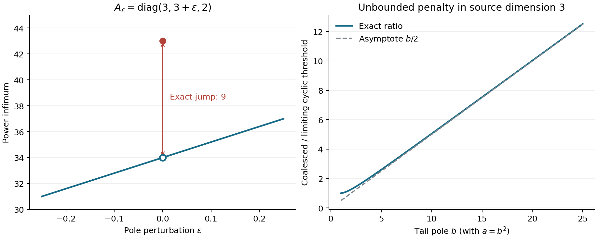

# Exact power thresholds for noncyclic Gaussian sources and their discontinuity at pole coalescence

Research manuscript, 25 November 2026. No formal verification or external peer review is claimed.

## Abstract

We study finite-dimensional linear time-invariant coding of an antistable Gaussian vector source over parallel Gaussian channels with noiseless delayed feedback. The objective is bounded estimation error under a total input-power constraint. Existing explicit spectral solutions assume that each unstable eigenvalue has geometric multiplicity one. We prove an exact elimination rule for an eigenspace whose dimension equals the number of channels. Removing a real pole $a$ with full geometric multiplicity transforms the entire positive definite covariance-budget region by the affine map $\Pi=a^2\Pi_{\rm tail}+(a^2-1)H^{-2}$. Repeated elimination yields a closed minimum-power formula for every real diagonalizable source transmitted through two channels, including a complete multiplicity obstruction. The argument permits general correlated input covariances and arbitrary finite-dimensional dynamic LTI encoders. A projected monotone Riccati argument supplies the converse, and an explicit deterministic observer supplies achievability. The resulting threshold is discontinuous at eigenvalue coalescence: for $A_0=\operatorname{diag}(a,a,b)$, $a>b>1$, and two identical channels, its upward jump relative to nearby distinct-pole sources is exactly $a^2(b-1)^2$. The ratio can be arbitrarily large in source dimension three. A corresponding discontinuity holds for any number of channels. All power thresholds are infima; positive process noise requires strict excess power.

## 1. Model, question, and contribution

Let
```math
 x_{t+1}=Ax_t+w_t,\qquad y_t=Hu_t+z_t,                         \tag{1}
```
where $x_t\in\mathbb R^d$, $u_t,y_t,z_t\in\mathbb R^r$,
$H=\operatorname{diag}(h_1,\ldots,h_r)\succ0$,
$w_t\sim N(0,Q)$, $Q\succ0$, and $z_t\sim N(0,I_r)$.
The two noise sequences are mutually independent, and each is independent and identically distributed in time. The source matrix is real diagonalizable and antistable: every eigenvalue is real and has modulus strictly larger than one. A real change of source coordinates therefore makes $A$ diagonal without changing bounded-estimation feasibility or input power.

The encoder knows $x_t$ and channel outputs through time $t-1$. It is any finite-dimensional deterministic real LTI system. In particular, after choosing a state representation it may be written
```math
\begin{split}
 \xi_{t+1}&=A_e\xi_t+K_e x_t+L_e y_{t-1},\\
 u_t&=M_e\xi_t+N_e x_t+R_e y_{t-1},\qquad y_{-1}=0.
\end{split}                                                    \tag{2}
```
The decoder is any finite-dimensional real LTI system using outputs through time $t$. The encoder and decoder have prescribed, synchronized deterministic initial states. A code is feasible if its time-averaged estimation MSE is bounded for every source initial condition $x_0$ with finite second moment, independent of the two noise sequences. More precisely, if $\widetilde x_t$ is the decoder estimate, we require
```math
 \limsup_{N\to\infty}\frac1N\sum_{t=0}^{N-1}
                  \mathbb E\|x_t-\widetilde x_t\|^2<\infty.
```
We use the power criterion
```math
 p(u)=\limsup_{N\to\infty}\frac1N\sum_{t=0}^{N-1}
                       \mathbb E\|u_t\|^2.                     \tag{3}
```
Let $P_*(A,H)$ be the infimum of scalar budgets $p$ for which a feasible code satisfies $p(u)\le p$ for every such source initial condition. We set $P_*=+\infty$ if no code is feasible and $P_*(\varnothing,H)=0$ for an empty source. No prescribed numerical bound on estimation error is imposed. Our constructions have convergent error and input second-moment matrices, so the same infimum results if that stronger convergence property is required.

The spectral solution of Jin, Li, Hara, and Chen [J26] assumes a cyclic unstable source, meaning geometric multiplicity one for each unstable eigenvalue. Their concluding discussion leaves the general noncyclic case open. We address a structured noncyclic class for arbitrary $r$, and obtain a complete answer for $r=2$ within the real diagonalizable setting.

**Theorem 1 (full-multiplicity elimination).** Suppose
```math
 A=\operatorname{diag}(a_1 I_r,\ldots,a_k I_r,T),\qquad
 E=\prod_{j=1}^k a_j^2,                                        \tag{4}
```
where the $a_j$ are distinct real antistable poles and none belongs to the spectrum of the real diagonalizable antistable tail $T$. Then
```math
 \boxed{\displaystyle
 P_*(A,H)=E P_*(T,H)+(E-1)\operatorname{tr}(H^{-2}).}             \tag{5}
```
The equality is understood in the extended nonnegative reals. There is also an exact affine equivalence of positive definite strict covariance-budget regions, proved in Section 4. Elimination order does not affect either region or threshold.

For two channels, every possible multiplicity is either one, two, or greater than two. The last case is impossible. The first two cases reduce by (5) to the already understood cyclic tail. We give the resulting explicit formula in Section 5.

The main new content is the noncyclic elimination and its consequences for the operational threshold. The cyclic majorization solution, scalar-channel results, classical Schur-complement algebra, and multiplicative eigenvalue/singular-value inequalities are prior ingredients. A rational counterexample to the older partitioning conjecture is not presented as a new result: the later cyclic solution [J26] already covers that phenomenon.

## 2. Relation to previous work

Han, Kostina, Hassibi, and Sabag [H25] relate linear source coding to a discrete algebraic Riccati equation and propose a partitioning conjecture. Their Appendix A gives the Lyapunov positivity framework that motivates our kernel. Jin et al. [J26] subsequently characterize cyclic-source feasibility through coupled majorization inequalities and solve total-power allocation. Thus resolving a distinct-pole special case, or rediscovering the failure of mode partitioning in that case, would not be a new contribution.

Earlier work by Shu and Middleton [SM11] studies stabilization over power-constrained parallel Gaussian channels. Vargas, Silva, and Chen [VSC13] treat two-input two-output stabilization using $H_2$ and all-pass methods. The latter paper's stated assumptions require simple unstable poles and finite nonminimum-phase zeros. These works establish important transfer-function and noise-power techniques. Our scalar kernel identity is compatible with classical interpolation/inner-factor algebra; we do not claim that identity as an independent new general matrix principle.

The distinction here is an explicit operational removal of a saturated repeated eigenspace, valid for general input covariance, followed by a complete two-channel noncyclic spectral formula and a quantitative coalescence discontinuity. Jahangiri, Aghaeinia, and Talebi [JAT25] address the related general linear-coding feasibility problem. Its formal full text was unavailable during this study: inspection was limited to registered metadata/abstract and the discussion in [J26]. Consequently the novelty comparison with [JAT25] has this access limitation; no uninspected theorem from it is used as a proof premise.

The all-LTI converse below does not assume a stationary memoryless innovation encoder at the outset. It extracts limiting source/input moments from an arbitrary dynamic code. This is needed because a proof only for one encoding ansatz would not settle the stated operational problem.

## 3. An operational positive-kernel characterization

Put $B=A^{-1}$. For a positive definite matrix $\Pi$, define
```math
 W=H\Pi H,\qquad C=(I_r+W)^{-1}.                               \tag{6}
```
Thus $0\prec C\prec I_r$. For a real $r\times d$ matrix $\Gamma$, let $J_0$ be the unique solution of
```math
 J_0=BJ_0B^\top-\Gamma^\top C\Gamma
                       +B\Gamma^\top\Gamma B^\top.             \tag{7}
```
Uniqueness follows because $B$ is Schur stable. Write
```math
 \mathcal F(A,H)=\{\Pi\succ0:\text{some }\Gamma
                    \text{ gives }J_0\succ0\text{ in (7)}\}.    \tag{8}
```
The empty-source convention makes $\mathcal F(\varnothing,H)$ the whole positive definite cone. An operational covariance budget $\Pi_0$ means that, for every $v\in\mathbb R^r$ and every admissible source initial condition,
```math
 \limsup_{N\to\infty}\frac1N\sum_{t=0}^{N-1}
          \mathbb E[(v^\top u_t)^2]\le v^\top\Pi_0v.
```
A strict budget means that the same property holds for $\Pi_0-\delta I_r$ for some $\delta>0$.

**Proposition 2 (operational equivalence).** On positive definite covariance budgets, weak operational feasibility and strict operational feasibility coincide, and their common region is (8). In particular, a code constructed from (8) has convergent input covariance strictly below its budget. Moreover,
```math
 P_*(A,H)=\inf_{\Pi\in\mathcal F(A,H)}\operatorname{tr}\Pi.       \tag{9}
```
The converse needs only finite time-averaged estimation MSE and finite time-averaged power, as in the operational definition. The region and threshold do not depend on the choice of $Q\succ0$.

### 3.1. Converse for arbitrary dynamic LTI codes

Augment the source and encoder states:
```math
 v_t=\begin{pmatrix}x_t\\ \xi_t\end{pmatrix},\quad
 F=\begin{pmatrix}A&0\\K_e&A_e\end{pmatrix},\quad
 D=\begin{pmatrix}N_e&M_e\end{pmatrix},\quad
 E_x=\begin{pmatrix}I_d&0\end{pmatrix},\quad
 \overline Q=\operatorname{diag}(Q,0).                          \tag{10}
```
Past-output terms are known when conditioning on
$\mathcal Y_{t-1}=\sigma(y_0,\ldots,y_{t-1})$, so they affect conditional means only. The augmented prediction covariance follows
```math
\begin{split}
 \Sigma_{t+1}=F\big[\,\Sigma_t
 &-\Sigma_tD^\top H(I+HD\Sigma_tD^\top H)^{-1}\\
 &\hspace{35mm}{}\cdot HD\Sigma_t\,\big]F^\top+\overline Q.
\end{split}                                                     \tag{11}
```
We may use the virtual recursion initialized at $\Sigma_0=0$; it is dominated by the recursion from any actual positive semidefinite initial covariance.
This covariance calculation may be carried out with Gaussian initial data. A deterministic linear encoder and decoder have the same power and error second moments for any initial distributions with the same first two moments. In addition, the operational requirement covers the deterministic zero initial state itself, so necessity never requires an extra Gaussian-initialization assumption.

The posterior covariance map is order preserving. On positive definite matrices this follows from
```math
 S-SL^\top(I+LSL^\top)^{-1}LS=(S^{-1}+L^\top L)^{-1},
```
and the semidefinite case follows by continuity. Consequently
$0\preceq\Sigma_t\preceq\Sigma_{t+1}$.

Only the following projection is needed:
```math
 V_t=
 \begin{pmatrix}E_x\\D\end{pmatrix}
 \Sigma_t
 \begin{pmatrix}E_x^\top&D^\top\end{pmatrix}
 =
 \begin{pmatrix}P_t&T_t^\top\\T_t&\Pi_t\end{pmatrix}.             \tag{12}
```
It is positive semidefinite and nondecreasing. Its input block satisfies
$\operatorname{tr}\Pi_t\le\mathbb E\|u_t\|^2$.
A nondecreasing nonnegative sequence whose Cesaro means are bounded has a finite limit no greater than that bound. Hence $\Pi_t$ has bounded trace.

Let $M_t$ be the MSE matrix of the given decoder. Conditional expectation minimizes MSE, so the source prediction block obeys
```math
 P_{t+1}\preceq AM_tA^\top+Q.                                  \tag{13}
```
Finite time-averaged MSE and monotonicity bound $\operatorname{tr}P_t$. Therefore $\operatorname{tr}V_t$ is bounded. A monotone sequence of finite-dimensional positive semidefinite matrices with bounded trace converges in norm. In particular,
```math
 V_t\longrightarrow
 \begin{pmatrix}P&T^\top\\T&\Pi\end{pmatrix}\succeq0,\qquad
 P\succeq Q\succ0,\qquad \operatorname{tr}\Pi\le p(u).            \tag{14}
```
No convergence of the entire hidden encoder-state covariance has been assumed.
If the given code is subject to a matrix budget $\Pi_0$, the same monotone-Cesaro argument applied to each quadratic form $v^\top\Pi_tv$ yields $\Pi\preceq\Pi_0$.

The source block of (11) is
```math
 P_{t+1}=AP_tA^\top+Q
       -AT_t^\top H(I+H\Pi_tH)^{-1}HT_tA^\top.
```
The inverse is continuous because its argument is at least $I_r$. Passing to the limit gives
```math
 P=APA^\top+Q
       -AT^\top H(I+H\Pi H)^{-1}HTA^\top.                       \tag{15}
```
This proves the requisite constant-moment converse.

If $\Pi\succ0$, set $R=HT$, $\Gamma=W^{-1/2}R$, and
```math
 J=P-R^\top W^{-1}R\succeq0,\qquad
 L_Q=\sum_{n=1}^{\infty}B^nQ(B^\top)^n\succ0.                   \tag{16}
```
The Schur complement in (14) proves the first inequality. Rearranging (15), using
$W^{1/2}(I+W)^{-1}W^{1/2}=I-C$, shows that
```math
 J_0=J+L_Q\succ0
```
satisfies (7).

For completeness, singular $\Pi$ does not obstruct the infimum argument. Let $W^\dagger$ denote its Moore--Penrose inverse. Block positivity implies that every column of $R$ lies in the range of $W$. Set
```math
 \Gamma=(W^\dagger)^{1/2}R,\qquad
 J=P-R^\top W^\dagger R\succeq0,\qquad C=(I+W)^{-1}.
```
The same calculation gives (7) with $J_0=J+L_Q\succ0$, although $C$ can have eigenvalue one. For $\varepsilon>0$, replace $W$ by $W+\varepsilon I_r$, equivalently $\Pi$ by $\Pi+\varepsilon H^{-2}$, and keep $\Gamma$ fixed. The new $C$ is smaller in the Loewner order. Its solution of (7) is $J_0$ plus a positive semidefinite Lyapunov sum, so it is positive definite. These positive definite budgets approach $\Pi$ in trace.

The same monotonicity proves that $\mathcal F(A,H)$ is upward closed: increasing a covariance budget decreases $C$, and the increment of $J_0$ is
```math
 \sum_{n=0}^{\infty}
 B^n\Gamma^\top(C_{\rm old}-C_{\rm new})\Gamma(B^\top)^n
 \succeq0.                                                     \tag{17}
```
Thus a code satisfying even a weak positive definite budget $\Pi_0$ places that budget in (8): first derive the supported kernel at its extracted $\Pi\preceq\Pi_0$, and then apply (17) to $C_0=(I+H\Pi_0H)^{-1}$. This changes the homogeneous kernel only after the exact Riccati identity has been established. Section 3.2 constructs strict slack at that same positive definite budget.

### 3.2. Explicit deterministic achievability

Suppose $\Pi\in\mathcal F(A,H)$, with matrices $C,\Gamma,J_0$ as above. Choose $\alpha>0$ large enough that
```math
 J=\alpha^2J_0-L_Q\succ0,\quad
 R=\alpha W^{1/2}\Gamma,\quad
 P=J+R^\top W^{-1}R.                                          \tag{18}
```
Direct substitution in (7) gives
```math
 P=APA^\top+Q-AR^\top(I+W)^{-1}RA^\top.                         \tag{19}
```
The Schur complement gives
```math
 U=RP^{-1}R^\top\prec W.                                      \tag{20}
```
Define fixed gains
```math
 L=H^{-1}RP^{-1},\qquad K=AR^\top(I+W)^{-1},\qquad
 F_c=A-KRP^{-1}.                                              \tag{21}
```
Expanding the square proves the exact identity
```math
 P=F_cPF_c^\top+Q+K(I+W-U)K^\top.                              \tag{22}
```
Since $Q\succ0$, this is a strict Lyapunov inequality and $F_c$ is Schur stable.

Use
```math
 u_t=L(x_t-\widehat x_t),\qquad
 \widehat x_{t+1}=A\widehat x_t+Ky_t.                           \tag{23}
```
Here $\widehat x_t$ is a predictor based on outputs through $t-1$; the encoder obtains it from delayed noiseless feedback. For example, the encoder state may store $\widehat x_{t-1}$, update it using $y_{t-1}$, and then form (23). Thus no current-output feedback is hidden in this notation.

The error follows
```math
 e_{t+1}=F_ce_t+w_t-Kz_t.
```
For every finite initial covariance it converges to
```math
 P_0=\sum_{n=0}^{\infty}F_c^n(Q+KK^\top)(F_c^\top)^n\preceq P.
```
The inequality follows from (22). Consequently the asymptotic input covariance is
```math
 LP_0L^\top\preceq H^{-1}UH^{-1}\prec\Pi.                       \tag{24}
```
This construction is deterministic, finite-dimensional, and time invariant. It proves sufficiency and (9), without a separate stabilizing-Riccati existence assumption.

### 3.3. The multiplicity obstruction and strict thresholds

**Lemma 3.** If a real antistable eigenvalue has geometric multiplicity greater than $r$, no feasible LTI code of finite power exists. If its geometric multiplicity equals $r$, every limiting input covariance extracted in (14) is positive definite.

**Proof.** From block positivity,
$\operatorname{rank}T\le\operatorname{rank}\Pi\le r$. If the stated multiplicity exceeds this rank, its left eigenspace contains a nonzero $v$ with $Tv=0$. Taking the quadratic form of (15) in $v$ gives
```math
 (1-a^2)v^\top Pv=v^\top Qv,
```
whose left side is negative and right side positive. This is impossible. $\square$

For a nonempty antistable source, a finite-error code cannot attain $P_*$. To include singular extracted input covariance, use the supported kernel from Section 3.1 and repeat (18) with
```math
 P=\alpha^2J_0-L_Q+\alpha^2\Gamma^\top\Gamma,\qquad
 R=\alpha W^{1/2}\Gamma.
```
The strict inequality $P-\alpha^2\Gamma^\top\Gamma\succ0$ implies
```math
 I_r-\alpha^2\Gamma P^{-1}\Gamma^\top\succ0.
```
Thus $W-U=W^{1/2}(I_r-\alpha^2\Gamma P^{-1}\Gamma^\top)W^{1/2}$ is positive semidefinite and strictly positive on the range of $W$. The supported identities in Section 3.1 still give (19) and (22), so the deterministic code (23) is stable. Its input-power trace is strictly below $\operatorname{tr}\Pi$ whenever $W\ne0$. A nonempty antistable source cannot have $W=0$, because (15) would then give $P=APA^\top+Q$, contradicting any antistable left-eigenvector quadratic form. Since the extracted trace is no greater than the original code's power, every feasible code can be replaced by one with strictly smaller power. Consequently operational feasibility under a scalar budget $p$ is exactly $p>P_*$ whenever $P_*<\infty$.

## 4. Elimination of a full repeated eigenspace

We prove an exact statement for the whole region (8), rather than assume diagonal input covariance.

After a source similarity, write
```math
 B=\operatorname{diag}(sI_r,D),\qquad 0<|s|<1,\qquad
 D=\operatorname{diag}(t_1,\ldots,t_m),\quad t_j\ne s.            \tag{25}
```
Repeated values among the $t_j$ are allowed. Orthogonally diagonalize $C$. This rotates $\Gamma$ and does not change the physical matrix $\Pi$. Write its eigenvalues as $c_i$. In these coordinates,
```math
 (J_0)_{jl}=\sum_{i=1}^r \Gamma_{ij}\Gamma_{il}
             K_{c_i}(b_j,b_l),\qquad
 K_c(t,u)=\frac{tu-c}{1-tu}.                                   \tag{26}
```

The first $r$ columns $\Gamma_s$ must be invertible. Otherwise a nonzero vector supported on the $s$-eigenspace and killed by $\Gamma_s$ has zero quadratic form under $J_0$, contradicting positivity. A source congruence acting only on that eigenspace sets $\Gamma_s=I_r$; it commutes with $B$. The leading block of $J_0$ is then
```math
 \operatorname{diag}\left(\frac{s^2-c_i}{1-s^2}\right).
```
Thus positivity requires
```math
 C\prec s^2 I_r.                                              \tag{27}
```

The Schur complement is evaluated by the identity
```math
\begin{split}
 K_c(t,u)-\frac{K_c(s,t)K_c(s,u)}{K_c(s,s)}
  ={}&\frac{s^2(1-c)}{s^2-c}
       \frac{s-t}{1-st}\frac{s-u}{1-su}\\
     &{}\cdot K_{c/s^2}(t,u).
\end{split}                                                     \tag{28}
```
It follows by multiplying through the nonzero denominators and expanding. Under (27) its row factor is positive. Every column factor is nonzero by $t_j\ne s$ and $|st_j|<1$.

If the tail columns of $\Gamma$ are $V_{ij}$, define
```math
 V'_{ij}
  =\sqrt{\frac{s^2(1-c_i)}{s^2-c_i}}\,
       V_{ij}\frac{s-t_j}{1-st_j}.                             \tag{29}
```
Then the Schur complement is precisely the tail kernel (7) for $D$, input matrix $V'$, and
```math
 C_{\rm tail}=C/s^2.                                         \tag{30}
```
All transformations in (29) are invertible. Conversely, given a positive tail kernel and $0\prec C_{\rm tail}\prec I_r$, set $C=s^2C_{\rm tail}$, invert (29), and take $\Gamma_s=I_r$. The leading block and Schur complement are positive, giving $J_0\succ0$. This proves a biconditional.

Return to physical covariance coordinates. By (6) and (30),
```math
 I+H\Pi_{\rm tail}H=s^2(I+H\Pi H).
```
Since $a=1/s$,
```math
 \Pi=a^2\Pi_{\rm tail}+(a^2-1)H^{-2}.                         \tag{31}
```
Thus
```math
 \mathcal F(\operatorname{diag}(aI_r,T),H)
   =a^2\mathcal F(T,H)+(a^2-1)H^{-2}.                          \tag{32}
```
Both sides use positive definite strict budgets. A merely positive semidefinite tail budget is a boundary point, not an automatic feasible original budget. Taking closures or infima is legitimate because (31) is an invertible affine map, and positive definite tail regularizations approach any finite boundary point.

Iterating (32) proves
```math
 \mathcal F(A,H)=E\mathcal F(T,H)+(E-1)H^{-2}.                  \tag{33}
```
The matrices $C$ are successively divided by the scalars $a_j^{-2}$; these operations commute. The affine maps also compose to (33) in every order. Taking trace infima and using Proposition 2 proves Theorem 1. It also gives the same affine relation between the closures of the two budget regions.

The proof applies to negative real poles as well as positive ones. It does not require $H$ to commute with $\Pi$, and it does not assume independent channel inputs.

## 5. Complete two-channel formula

Let $r=2$, $h_1\ge h_2>0$, and
```math
 v_1=h_1^{-2}\le v_2=h_2^{-2}.                                \tag{34}
```
If an eigenvalue of $A$ has multiplicity greater than two, Lemma 3 gives $P_*=+\infty$. Otherwise let $a_1,\ldots,a_k$ be the distinct eigenvalues of multiplicity two and $\lambda_1,\ldots,\lambda_m$ those of multiplicity one. Set
```math
 E=\prod_{j=1}^k a_j^2,\qquad
 U=\max_{1\le j\le m}\lambda_j^2,\qquad
 V=\prod_{j=1}^m\lambda_j^2,                                  \tag{35}
```
with $U=V=1$ when $m=0$. Define
```math
 q=\min\left\{V,\ \max\left\{U,\sqrt{\frac{Vv_2}{v_1}}\right\}\right\}. \tag{36}
```

**Theorem 4 (explicit threshold).** Under these assumptions,
```math
 \boxed{\displaystyle
 P_*(A,H)=E\left(v_1q+v_2\frac Vq\right)-(v_1+v_2).}            \tag{37}
```
This includes an empty singleton tail, one singleton, equal channel gains, negative real source poles, and all ties in (36). Every scalar budget strictly above (37) is achievable by a deterministic LTI code; equality is infeasible for a nonempty source with $Q\succ0$.

### 5.1. The cyclic ingredient and its attribution

We record the two-channel cyclic result used here. It is a specialization of the spectral solution in [J26], not a new claim of priority. Let $T$ have distinct real antistable eigenvalues $\lambda_j$. For a positive definite budget $\Pi$, let
$0 \lt c_1\le c_2<1$ be the eigenvalues of
$(I+H\Pi H)^{-1}$. Then
```math
\begin{array}{ll}
 m=0:& \text{every positive definite budget is feasible},\\
 m=1:& c_1<1/U,\\
 m\ge2:& c_1<1/U\quad\text{and}\quad c_1c_2<1/V.
\end{array}                                                     \tag{38}
```

For clarity, the necessity can be seen directly from the kernel. On the coordinate of a largest-modulus source eigenvalue, positivity of $J_0$ implies $c_1<1/U$. Also (7) rearranges as
```math
 J_0+\Gamma^\top C\Gamma
       =B(J_0+\Gamma^\top\Gamma)B^\top.
```
Taking determinants and applying the determinant lemma gives
```math
 \det(B)^2
 =\frac{\det(I_2+CM)}{\det(I_2+M)}
 >\det C,\qquad M=\Gamma J_0^{-1}\Gamma^\top\succeq0,            \tag{39}
```
where strictness follows from $C^{-1}\succ I_2$. This yields the product condition.

For sufficiency when $m\ge2$, (38) permits numbers
$\gamma_1\ge\gamma_2\ge1$ satisfying
```math
 \gamma_1\gamma_2=V,\qquad \gamma_1\ge U,\qquad
 \gamma_i<1/c_i.                                              \tag{40}
```
Equivalently, choose $\gamma_1\in[\max\{U,\sqrt V\},V]$ such that
$Vc_2<\gamma_1<1/c_1$. Such a choice exists because $U \lt V$, $\sqrt V \lt V$, and $Vc_2 \lt V$, while each lower constraint is strictly below $1/c_1$ by (38) and $c_1\le c_2$. The endpoint $\gamma_1=V,\gamma_2=1$ is permitted when it satisfies the strict budget inequalities.

The real multiplicative Horn theorem [Horn54], in the form also used in [J26, Lemma 4], constructs a real matrix with eigenvalues $\lambda_j$ and singular values
$\sqrt{\gamma_1},\sqrt{\gamma_2},1,\ldots,1$.
Its hypotheses follow because the largest squared eigenvalue is at most $\gamma_1$, the first two squared singular values have product $V$, all remaining singular values equal one, and every source squared eigenvalue exceeds one. Distinct real eigenvalues make the constructed matrix similar to $T$. Write
```math
 Z^{-1}TZ=O_L\operatorname{diag}
       (\sqrt{\gamma_1},\sqrt{\gamma_2},1,\ldots,1)O_R^\top,
```
with $Z$ real invertible and $O_L,O_R$ orthogonal. Set
```math
 X=ZZ^\top,\qquad
 M=\begin{bmatrix}\operatorname{diag}
       (\sqrt{\gamma_1-1},\sqrt{\gamma_2-1})&0\end{bmatrix}
          O_R^\top Z^{-1}.
```
Then direct multiplication gives
```math
 MXM^\top=\operatorname{diag}(\gamma_1-1,\gamma_2-1),\qquad
 X=T(I+XM^\top M)^{-1}XT^\top.
```
Define
```math
 \widetilde K=-TXM^\top(I+MXM^\top)^{-1},\qquad
 F=T+\widetilde K M=XT^{-\top}X^{-1}.
```
Thus $F$ is Schur stable, and expanding the zero-process-noise Riccati identity yields
```math
 X=FXF^\top+\widetilde K\widetilde K^\top.
```
Choose an orthogonal matrix $O$ such that
$H\Pi H=O\operatorname{diag}(c_1^{-1}-1,c_2^{-1}-1)O^\top$.
For $\varepsilon>0$, use the deterministic encoder and predictor
```math
 u_t=\varepsilon H^{-1}OM(x_t-\widehat x_t),\qquad
 \widehat x_{t+1}=T\widehat x_t-
                    \varepsilon^{-1}\widetilde K O^\top y_t.
```
Their error matrix is $F$. If
$S=\sum_{n\ge0}F^nQ(F^\top)^n$, the limiting error covariance is $\varepsilon^{-2}X+S$, and the normalized input covariance equals
```math
 H\Pi_{\rm actual}H
  =O\operatorname{diag}(\gamma_1-1,\gamma_2-1)O^\top
                  +\varepsilon^2OMS M^\top O^\top.
```
The strict gaps in (40) therefore give $\Pi_{\rm actual}\prec\Pi$ for sufficiently small $\varepsilon$. This is the cyclic observer construction underlying [J26], written out to establish general matrix-budget achievability. For a scalar tail $T=[\lambda]$, take $X=1$, $M=(\sqrt{\lambda^2-1},0)^\top$, and $\gamma_1=U,\gamma_2=1$; the same identities and scaling prove the $m=1$ case.

### 5.2. Optimization and reconstruction

For fixed eigenvalues $\gamma_1\ge\gamma_2$ of the limiting normalized input covariance plus identity, trace minimization aligns the larger value with the smaller physical noise weight $v_1$. This is the elementary trace rearrangement inequality; for a two-dimensional rotation the trace is affine in the squared cosine and minimized at that alignment. Thus the cyclic power infimum is
```math
 \min_{\substack{\gamma_1\gamma_2=V\\
                  \gamma_1\ge\max\{U,\sqrt V\}\\ \gamma_2\ge1}}
   \{v_1(\gamma_1-1)+v_2(\gamma_2-1)\}.                        \tag{41}
```
One may reduce any excess product to $V$, since both weights are positive and $U\le V$. Substituting $\gamma_2=V/\gamma_1$ gives a strictly convex scalar objective on the allowable interval. Its unconstrained minimizer is $\sqrt{Vv_2/v_1}$, and clipping it to $[\max\{U,\sqrt V\},V]$ gives (36). The case $m=0$ gives zero and the case $m=1$ gives $v_1(U-1)$.

Applying (5) proves (37). A covariance on the boundary of the optimal region is
```math
 \Pi_*=\operatorname{diag}\left(v_1(Eq-1),\
                               v_2(EV/q-1)\right).            \tag{42}
```
It is a limiting allocation, not a finite-error code at equality. Add an arbitrarily small positive definite slack, use the cyclic construction, invert the row/column maps (29), and then use (18)--(24). This gives a finite-dimensional deterministic code at every larger total power.

The three alternatives in (36) describe the mechanism: the weaker channel may be unused by the singleton tail; the largest singleton pole may constrain the allocation; or ordinary two-channel water filling determines the tail. In every case the repeated core imposes the baseline $(E-1)H^{-2}$ and multiplies the residual resource requirement by $E$.

An equivalent complete covariance criterion follows by combining (33) and (38). Let $c_1\le c_2$ be the eigenvalues of $(I+H\Pi H)^{-1}$. If at least one double pole is present, then
```math
 c_2<1/E,\quad
 c_1<1/(EU)\ \ (m\ge1),\quad
 c_1c_2<1/(E^2V)\ \ (m\ge2).                                  \tag{43}
```
Absent conditions are omitted. These are tests on the full covariance budget, not separate fixed power constraints on the individual physical channels.

## 6. Discontinuity under pole coalescence

**Theorem 5 (a three-dimensional jump).** Fix $a>b>1$, two identical channels $H=I_2$, and any $Q\succ0$. Let
```math
 A_0=\operatorname{diag}(a,a,b),\qquad
 A_\varepsilon=\operatorname{diag}(a,a+\varepsilon,b).
```
Then
```math
 P_*(A_0,I_2)=a^2(b^2+1)-2.                                  \tag{44}
```
For every sufficiently small positive $\varepsilon$,
```math
 P_*(A_\varepsilon,I_2)=2a(a+\varepsilon)b-2.                   \tag{45}
```
Consequently
```math
 P_*(A_0,I_2)-\lim_{\varepsilon\downarrow0}
                    P_*(A_\varepsilon,I_2)=a^2(b-1)^2>0.       \tag{46}
```

**Proof.** In (44), the repeated core has $E=a^2$ and the scalar tail has $U=V=b^2$, so (37) gives the result. For $\varepsilon>0$ all three poles are distinct. The cyclic product is
$V=a^2(a+\varepsilon)^2b^2$, and the largest squared pole is
$(a+\varepsilon)^2$. If
$0<\varepsilon \lt a(b-1)$, then
$(a+\varepsilon)^2 \lt a(a+\varepsilon)b=\sqrt V$.
Thus the equal-noise optimum has $q=\sqrt V$, giving (45). Taking the limit and subtracting proves (46). $\square$

This is not a dependence on the scale of process noise or on a prescribed MSE target. The same $Q=I_3$ can be used throughout, and each individual feasible design has finite error. What changes at coalescence is the rank required to observe a repeated eigenspace through time-invariant channels.

**Corollary 6 (unbounded relative penalty in fixed dimension).** For every $M>0$ and every $\delta>0$, there exist real diagonal antistable $3\times3$ matrices $A_0,A_1$ with
$\|A_0-A_1\|_{\rm op}<\delta$, two identical channels, and $Q=I_3$, such that
```math
 P_*(A_0,I_2)>M P_*(A_1,I_2).
```

**Proof.** Take $a=b^2$. The ratio of (44) to the limiting value of (45) is
```math
 \frac{b^4(b^2+1)-2}{2b^5-2}\sim b/2.
```
Choose $b$ large enough and then choose positive $\varepsilon<\delta$ sufficiently small. The operator-norm difference is $\varepsilon$. $\square$

**Theorem 7 (any number of channels).** For $r\ge2$, $a>b>1$, $H=I_r$, and
```math
 A_0=\operatorname{diag}(aI_r,b),
```
the threshold is
```math
 P_*(A_0,I_r)=a^2(b^2+r-1)-r.                                \tag{47}
```
For distinct-pole diagonal perturbations of the $r$ copies of $a$, the limiting cyclic threshold is
```math
 r a^2 b^{2/r}-r,                                            \tag{48}
```
so the upward jump is
```math
 a^2\big(b^2+r-1-rb^{2/r}\big)>0.                             \tag{49}
```

**Proof.** Equation (47) is Theorem 1 with a scalar tail. For nearby distinct poles, equal squared singular values
$\gamma=(\prod_j\lambda_j^2)^{1/r}$ on the $r$ channels satisfy the multiplicative majorization conditions: at the limiting configuration $\gamma=a^2b^{2/r}$ strictly exceeds every squared source pole, and the inequality persists for small perturbations. The cyclic construction in [J26], or the Horn construction in Section 5.1, achieves total power arbitrarily close to $r\gamma-r$.

For the converse, the determinant argument generalizing (39) gives
$\det(I_r+H\Pi H)>\det(A)^2$ for every positive definite feasible budget. At $H=I_r$, the arithmetic--geometric mean inequality therefore gives
$\operatorname{tr}\Pi>r|\det A|^{2/r}-r$. This matches the preceding construction in the limit. Strict positivity in (49) is the strict arithmetic--geometric mean inequality applied to $b^2,1,\ldots,1$. $\square$

The associated relative penalty is again unbounded for fixed $r$, for example by taking $a=b^2$ and then $b\to\infty$. This statement does not say that the ratio diverges for a single fixed source matrix; it is an unbounded family in the fixed dimension $r+1$.

## 7. An exact rational coding certificate

To check the constructive direction independently, take
```math
 A=\operatorname{diag}(3,3,2),\quad H=I_2,\quad Q=I_3,\quad
 \Pi=\operatorname{diag}(36,9),\quad
 \Gamma=\begin{pmatrix}1&0&1\\0&1&0\end{pmatrix}.
```
Equation (26) gives
```math
 J_0=\begin{pmatrix}7/74&0&31/185\\0&1/80&0\\31/185&0&11/37\end{pmatrix},
 \qquad \det J_0=3/5476000>0.
```
Its leading principal minors are positive. Choosing $\alpha=100$ in (18) gives a strictly positive $J$ and a deterministic code (23). The accompanying exact-arithmetic script verifies (7), (19), (22), and the stationary error Lyapunov equation with zero rational residuals. It verifies all required positive definite matrices by their leading principal minors; it does not use a floating-point eigenvalue test.

The actual stationary input covariance is
```math
 \operatorname{diag}\left(
 \frac{2616290115431267880000}{74419574277134913397},\quad
 \frac{5832720000}{728999999}\right).
```
Its trace is exactly
```math
 p_{\rm actual}=
 \frac{2341344030810834521157681960000}{54251869573611777589278086603},
 \qquad 43 \lt p_{\rm actual}<45.
```
For readability this is approximately $43.1569280323874615$. The value 43 is the global infimum from Theorem 4, while 45 is the chosen covariance budget trace. The calculation certifies one achievable code; the general converse, not this example, proves the global lower bound.

A second script checks identity (28) symbolically and nine exact instances of the scalar optimization, including empty and scalar tails, negative poles, both switching boundaries, and unequal channels. The source, complete rational matrices, strict minors, and reproducible JSON records are delivered with the manuscript. These are computational checks, not a claim of Lean kernel verification.



## 8. Verification and limitations

The mathematical proof consists of the projected dynamic-LTI moment converse, the deterministic reverse construction, the invertible Schur-complement elimination, the credited cyclic spectral ingredient, and scalar optimization. Each algebraic identity can be checked exactly over rational functions; numerical simulation is not used as evidence for the infinite-dimensional or all-time claims.

The study deliberately excludes nontrivial Jordan blocks, nonreal eigenvalues, noisy or delayed-more-than-one-step feedback, nonlinear encoders, finite-alphabet channels, and a prescribed finite MSE target. The full-multiplicity theorem itself permits any number of channels, but the complete explicit classification in (37) is for two channels and real diagonalizable sources. A repeated pole with multiplicity strictly between one and $r$ in larger channel dimension is not removed by the present argument.

The process-noise covariance must be positive definite. This assumption supports the strict operational converse and ensures that every antistable direction is continually excited. It must not be dropped without a separate analysis.

All displayed optimal boundary allocations describe infima. Equality at the minimum total-power threshold is infeasible for a nonempty source. A feasible code can use a singular input covariance when fewer than all channels are needed, so positive definite slack in every physical channel is not claimed to be universally necessary. Positive definite regularization preserves the infimum and suffices for our constructions; the exact affine region identities concern positive definite operational budgets, whose weak and strict versions coincide by Proposition 2. The manuscript contains written proofs and has not undergone external peer review.

## References

- [H25] B. Han, V. Kostina, B. Hassibi, and O. Sabag. Coded Kalman Filtering over MIMO Gaussian Channels with Feedback. arXiv:2406.17196v2, 5 August 2025. [Versioned full text](https://arxiv.org/html/2406.17196v2). Conference predecessor: ISIT 2024, pp. 3261--3266, DOI [10.1109/ISIT57864.2024.10619600](https://doi.org/10.1109/ISIT57864.2024.10619600).
- [J26] S. Jin, J. Li, S. Hara, and W. Chen. Linear Coding of LTI Sources Over Vector Gaussian Channels: A Majorization Approach. arXiv:2608.29511v1, 30 August 2026. [Versioned paper](https://arxiv.org/pdf/2608.29511v1). Assumption 1, Theorem 1, the total-power section, and Section VII are the relevant comparison points.
- [SM11] Z. Shu and R. H. Middleton. Stabilization over Power-Constrained Parallel Gaussian Channels. IEEE Transactions on Automatic Control 56(7), 1718--1724, 2011. DOI [10.1109/TAC.2011.2135270](https://doi.org/10.1109/TAC.2011.2135270).
- [VSC13] F. J. Vargas, E. I. Silva, and J. Chen. Stabilization of Two-Input Two-Output Systems over SNR-Constrained Channels. Automatica 49(10), 3133--3140, 2013. DOI [10.1016/j.automatica.2013.07.031](https://doi.org/10.1016/j.automatica.2013.07.031).
- [JAT25] S. Jahangiri, H. Aghaeinia, and H. A. Talebi. Finite MSE Estimation of Vector Gauss--Markov Source over MIMO Gaussian Channels with Feedback. IEEE Control Systems Letters 9, 2633--2638, 2025. DOI [10.1109/LCSYS.2025.3637107](https://doi.org/10.1109/LCSYS.2025.3637107). Formal full text unavailable during this study; inspected registered metadata/abstract and the discussion in [J26]. No uninspected theorem is used as a proof premise.
- [Horn54] A. Horn. On the Eigenvalues of a Matrix with Prescribed Singular Values. Proceedings of the American Mathematical Society 5(1), 4--7, 1954. DOI [10.1090/S0002-9939-1954-0061573-6](https://doi.org/10.1090/S0002-9939-1954-0061573-6). The real conjugate-symmetric version is also stated as Lemma 4 of [J26].
