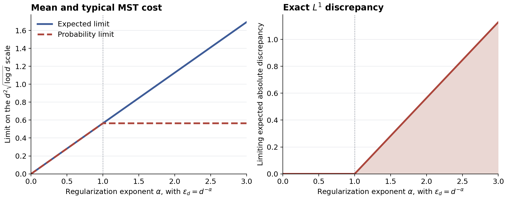

# A Vanishing Second Spike in a Real Haar Interaction Graph

## Exact mean asymptotics and a transition between expected and typical minimum spanning-tree weights

Research manuscript — 26 November 2026

### Abstract

Let a deterministic matrix with eigenvalues $1$, $\varepsilon$, and $d-2$ zeros be conjugated by a Haar orthogonal matrix, and assign the reciprocals of its off-diagonal magnitudes as costs on the complete graph. We determine the expected minimum spanning-tree weight uniformly over $0<\varepsilon\le1$, allowing $\varepsilon$ to depend arbitrarily on the dimension. The leading coefficient is a complete elliptic integral. We also prove a uniform probability law on the singular scale, in which $\log(1/\varepsilon)$ is truncated at $\log d$. In particular, for $\varepsilon=d^{-\alpha}$ with fixed $\alpha\ge0$, the expected weight normalized by $d^2\sqrt{\log d}$ converges to $\alpha/\sqrt\pi$, whereas the normalized weight converges in probability to $\min\{\alpha,1\}/\sqrt\pi$. Convergence in mean absolute error holds for $\alpha\le1$; for $\alpha>1$, we compute the limiting mean absolute discrepancy. At $\varepsilon=0$, the minimizing tree is an explicit star with infinite expectation, and its probability limit agrees with the saturated regime. The proof combines an exact conditional sphere law for a single row, a triangle-seeded tree comparison, a simultaneous two-column Gaussian coupling, and uniform truncation estimates. No independence of the Haar graph edges is assumed.

**Keywords:** minimum spanning tree; Haar orthogonal matrix; spiked spectrum; singular expectation; uniform integrability; quantum interaction graph.

## 1. Introduction

Reciprocal interaction strengths turn small matrix entries into large graph costs. A minimum spanning tree can avoid many weak edges, but every vertex must still be connected. This makes a nearly rank-one interaction matrix a useful setting in which to distinguish the expectation of an optimization certificate from its typical size.

Under real orthogonal conjugation, a rank-one matrix has an exact star-shaped optimum with infinite expected reciprocal cost. In dimension $d\ge4$, adding a positive second spectral value makes the expectation finite. We ask how this regularization behaves when the second value tends to zero as the dimension grows. A fixed-parameter limit does not resolve this question: the small parameter and the sample size interact through a logarithmic truncation.

### 1.1. Prior work and the present scope

Chambrion and Mendico [CM1, CM2] related spanning trees of reciprocal couplings to upper bounds for quantum state-transfer times. Vecer [V] established detailed mean asymptotics for complex Haar conjugation under bounded standardized spectra and identified real orthogonal conjugation as a direction for further study. His conditional row law and recursive-tree argument motivate parts of our proof. Squared real sphere coordinates have Dirichlet parameters $1/2$; their inverse moments require a different initial tree and admit a singular rank-one boundary.

The competition between a heavy-tail truncation scale and the sample size is an established probability mechanism. Chakrabarty and Samorodnitsky [CS] distinguish soft and hard truncation through the expected number of observations beyond the truncation level. Our Gaussian reciprocal family changes its tail behavior near the scale $1/\varepsilon$. It differs from their capped-variable model, and we prove the required triangular-array estimates directly. The contribution here is the exact manifestation of this mechanism in a dependent Haar MST, including its elliptic-integral mean and uniform comparison with row-radius sums.

Gaussian constructions of Haar orthogonal matrices and simultaneous entry approximations through Gram–Schmidt orthogonalization are classical; see Jiang [J]. The two-column argument below uses an exact weighted matrix identity to control reciprocal radii multiplicatively even when $\varepsilon$ is arbitrarily small. An unweighted additive approximation of matrix entries would not, by itself, control the reciprocal singularity.

We study the real two-spike family directly. Our main results are the parameter-uniform elliptic-integral mean law, the uniform probability law including a zero second spike, and the resulting threshold for agreement between mean and typical behavior. We also establish an exact finite-mean criterion and a relative expectation law for arbitrary nonconstant real spectra. These results provide a reusable graph comparison for the main theorem.

The critical complex-spectrum constant and the associated bounded-spectrum theory are results of [V]. Our conclusions concern a random MST certificate. We do not identify this certificate with an optimal quantum control time, establish an exponential-weight universality theorem, or determine graph connectivity or fluctuation limits.

## 2. Model and main results

All logarithms are natural. The parameter $\varepsilon$ is deterministic: it may depend on $d$, but it is not data-dependent or selected after observing the random matrix.

### Definition 2.1. Real two-spike reciprocal tree

For $d\ge4$ and $0\le\varepsilon\le1$, let $O_d$ be Haar distributed on $O(d)$, and set

$$
H_{d,\varepsilon}
=O_d^T\operatorname{diag}(1,\varepsilon,0,\ldots,0)O_d.
\tag{2.1}
$$

Equivalently, $H=uu^T+\varepsilon vv^T$, where $(u,v)$ is a uniformly distributed orthonormal pair in $\mathbb R^d$. On the complete graph with vertex set $\{1,\ldots,d\}$, define

$$
W_{ij}=|H_{ij}|^{-1},\qquad
M_{d,\varepsilon}=\min_T\sum_{\{i,j\}\in T}W_{ij}.
\tag{2.2}
$$

The minimum is taken over all spanning trees. We use the convention $1/0=+\infty$; in this model, each edge has a nonzero matrix entry almost surely. Any deterministic rule for resolving ties gives the same minimum weight. Define

$$
K(k)=\int_0^{\pi/2}\frac{d\theta}{\sqrt{1-k^2\sin^2\theta}},
\qquad 0\le k<1,
\quad
K_\varepsilon=K(\sqrt{1-\varepsilon^2})\quad(\varepsilon>0).
\tag{2.3}
$$

Finally, put

$$
\alpha_d(\varepsilon)=\frac{\log(1/\varepsilon)}{\log d}
\quad(\varepsilon>0),\qquad
\alpha_d(0)=+\infty.
\tag{2.4}
$$

### Theorem 2.2. Uniform expected weight

For every $d\ge4$ and $0<\varepsilon\le1$, the expectation of $M_{d,\varepsilon}$ is finite. Moreover,

$$
\sup_{0<\varepsilon\le1}
\left|
\frac{\sqrt\pi\sqrt{\log d}}{d^2K_\varepsilon}
\mathbb E M_{d,\varepsilon}-1
\right|\longrightarrow0.
\tag{2.5}
$$

At $\varepsilon=0$, the same rank-one construction has infinite expectation in every dimension $d\ge2$.

### Theorem 2.3. Uniform typical weight

For every $\eta>0$,

$$
\sup_{0\le\varepsilon\le1}
\mathbb P\left\{
\left|
\frac{M_{d,\varepsilon}}{d^2\sqrt{\log d}}
-\frac{\min\{\alpha_d(\varepsilon),1\}}{\sqrt\pi}
\right|>\eta\right\}
\longrightarrow0.
\tag{2.6}
$$

The supremum includes the singular parameter $\varepsilon=0$. This is a supremum of probabilities evaluated at deterministic parameter values, as displayed in (2.6); it is not a claim about the probability of a samplewise supremum over $\varepsilon$. The probability statement is compatible with the infinite expectation at the endpoint.

### Corollary 2.4. The logarithmic phase transition

Let $0<\varepsilon_d\le1$ and suppose that $\alpha_d(\varepsilon_d)\to\alpha\in[0,+\infty]$. Set $X_d=M_{d,\varepsilon_d}/(d^2\sqrt{\log d})$. If $\alpha<\infty$, then

$$
\mathbb EX_d\longrightarrow\frac\alpha{\sqrt\pi},
\qquad
X_d\longrightarrow\frac{\min\{\alpha,1\}}{\sqrt\pi}
\quad\text{in probability},
\tag{2.7}
$$

and

$$
\mathbb E\left|X_d-\frac{\min\{\alpha,1\}}{\sqrt\pi}\right|
\longrightarrow\frac{(\alpha-1)_+}{\sqrt\pi}.
\tag{2.8}
$$

Thus, convergence on this scale holds in $L^1$ exactly when $\alpha\le1$. If $\alpha=+\infty$, then $X_d\to1/\sqrt\pi$ in probability while $\mathbb E X_d\to+\infty$. At the fixed endpoint $\varepsilon_d=0$, the same probability limit holds and every expectation is infinite.

The condition $\alpha\le1$ refers to the singular normalization displayed above. When $\alpha=0$, the normalized random variable converges to zero. This zero limit on the coarser scale does not, by itself, imply relative concentration.

**Figure 1.** Analytical phase diagram for the normalization $d^2\sqrt{\log d}$. For a positive second spike with $\alpha_d(\varepsilon_d)\to\alpha<\infty$, the limiting normalized expectation is $\alpha/\sqrt\pi$, the probability limit is $\min\{\alpha,1\}/\sqrt\pi$, and the limiting mean absolute discrepancy is $(\alpha-1)_+/\sqrt\pi$. The curves are drawn from the exact formulas in Corollary 2.4; they are not simulation estimates. The singular endpoint $\varepsilon=0$ has the same saturated probability limit but infinite expectation.

Sections 3–5 prove the expectation theorem. Sections 6–8 establish the probability theorem, and Section 9 proves the corollary and explains the distinction between the limits.

## 3. Tree comparisons and real sphere coordinates

### Lemma 3.1. Rooted and triangle-seeded comparisons

Let $w_{ij}$ be positive, finite, symmetric costs on a complete graph with $d\ge3$ vertices, and let $M$ be its MST weight. Put $m_j=\min_{i\ne j}w_{ij}$. For any fixed root $r$,

$$
\sum_{j\ne r}m_j\le M.
\tag{3.1}
$$

There is also a tree whose weight is at most

$$
T'=\sum_{j=1}^3
\min_{i\in\{1,2,3\}\setminus\{j\}}w_{ij}
+\sum_{j=4}^d\min_{i \lt j}w_{ij}.
\tag{3.2}
$$

**Proof.** Orient a spanning tree toward $r$. Every nonroot vertex has one parent edge, and each edge is assigned exactly once. The edge assigned to vertex $j$ costs at least $m_j$, proving (3.1). For the upper bound, start with an MST of the triangle on vertices $1,2,3$. If the three triangle costs are $a\le b\le c$, its MST weight is $a+b$, whereas its three vertex minima sum to $2a+b$. Attach every subsequent vertex to a predecessor of minimum cost. Parent labels decrease until they reach the triangle, so the resulting graph is connected and has $d-1$ edges. Its weight is bounded by (3.2). $\square$

The lower bound loses no factor of two. The triangle in the upper bound avoids starting with a single reciprocal real entry, whose expectation is infinite even for many nonsingular spectra.

### Lemma 3.2. Conditional row direction

Let $H=O^T\Lambda O$, where $O$ is Haar orthogonal and $\Lambda$ is any deterministic nonconstant real diagonal matrix. If $o_j$ denotes column $j$ of $O$, define

$$
R_j^2=o_j^T\Lambda^2o_j-(o_j^T\Lambda o_j)^2
=\sum_{i\ne j}H_{ij}^2.
\tag{3.3}
$$

Conditional on $o_j$, the off-diagonal row divided by $R_j$ is uniform on the real unit sphere $S^{n-1}\subset\mathbb R^n$, where $n=d-1$. This direction is independent of $R_j$. Its squared coordinates have the $\operatorname{Dirichlet}(1/2,\ldots,1/2)$ distribution. The radius and the magnitude of each individual off-diagonal entry are positive almost surely.

**Proof.** Given $o_j$, the remaining columns form a Haar orthonormal basis of its orthogonal complement. The off-diagonal entries are the coordinates, in that basis, of $(I-o_jo_j^T)\Lambda o_j$. This vector has norm $R_j$, and its conditional coordinate direction is uniform. The conditional law depends only on the dimension, so the direction is independent of $o_j$ and of its radius. A vector of independent real standard Gaussians, normalized to unit length, is uniform on the sphere; its squared components are normalized independent $\operatorname{Gamma}(1/2,1)$ variables. The radius vanishes only when $o_j$ belongs to an eigenspace of $\Lambda$. These eigenspaces form a finite collection of proper linear subspaces, each of sphere measure zero. Every coordinate of the resulting direction is nonzero almost surely. $\square$

### Lemma 3.3. Gamma maxima and sphere maxima

Let $G_i$ be independent $\operatorname{Gamma}(1/2,1)$ variables, set $Z_m=\max_{i\le m}G_i$, and define

$$
h_m=\mathbb EZ_m^{-1/2},\qquad m\ge2.
\tag{3.4}
$$

Then $h_m$ is finite, $h_m\sqrt{\log m}\to1$, and

$$
\sum_{m=2}^n h_m\sim\frac n{\sqrt{\log n}}.
\tag{3.5}
$$

For a $\operatorname{Dirichlet}(1/2,\ldots,1/2)$ vector $P$ of length $n\ge2$, put

$$
D_{n,m}=\left(\max_{i\le m}P_i\right)^{-1/2},\qquad
g_n=\frac{\Gamma(n/2)}{\Gamma((n-1)/2)}.
$$

For $2\le m\le n$,

$$
\mathbb ED_{n,m}=g_nh_m.
\tag{3.6}
$$

The normalized inverse full-row maximum

$$
\Xi_n=\sqrt{\frac{2\log n}{n}}D_{n,n}
$$

satisfies $\delta_n:=\mathbb E|\Xi_n-1|\to0$.

**Proof.** Let $F$ be the distribution function of $\operatorname{Gamma}(1/2,1)$. Its density implies $F(x)\le C\sqrt x$ for $0 \lt x\le1$, and, for $x\ge1$,

$$
c x^{-1/2}e^{-x}\le1-F(x)\le C x^{-1/2}e^{-x}.
\tag{3.7}
$$

The lower tail bound follows by integrating the density over $[x,x+1]$; the upper bound follows by substituting $t=x+y$ and using $(x+y)^{-1/2}\le x^{-1/2}$. For fixed $q>0$ and $m/2>q$,

$$
\mathbb EZ_m^{-q}
=q\int_0^\infty x^{-q-1}F(x)^m\,dx.
\tag{3.8}
$$

Choose $x_0\in(0,1)$ such that $\rho=C\sqrt{x_0}<1$. The integral below $x_0$ is at most $q x_0^{-q}\rho^m/(m/2-q)$, and the part from $x_0$ to $1$ is exponentially small in $m$. Fix $\eta\in(0,1)$. On the interval from $1$ to $(1-\eta)\log m$, (3.7) gives $F(x)^m\le\exp[-c m^\eta/\sqrt{\log m}]$, so this contribution is also negligible. On the remaining interval, replace $F(x)^m$ by $1$ to obtain an upper bound of $((1-\eta)\log m)^{-q}$, up to negligible terms. Conversely, the union bound at $(1+\eta)\log m$ gives $\mathbb P\{Z_m\le(1+\eta)\log m\}\to1$, yielding the matching lower bound. Thus

$$
Z_m/\log m\to1\text{ in probability},\qquad
\mathbb EZ_m^{-q}\sim(\log m)^{-q}.
\tag{3.9}
$$

The small-$x$ behavior shows that the moment is finite exactly when $m/2>q$. Taking $q=1/2$ proves the assertion about $h_m$. Since $h_m$ decreases, for fixed $a\in(0,1)$ and sufficiently large $n$, its partial sum lies between $(n-1)h_n$ and $n^a h_2+n h_{\lfloor n^a\rfloor}$. Normalize by $n/\sqrt{\log n}$ and then let $a\uparrow1$ to obtain (3.5).

For the sphere identity, write $S_n=\sum_{i=1}^nG_i$ and $P_i=G_i/S_n$. The variable $S_n\sim\operatorname{Gamma}(n/2,1)$ is independent of $P$. Since $Z_m=S_n\max_{i\le m}P_i$, taking inverse square-root moments proves (3.6). No independence between $S_n$ and $Z_m$ is asserted.

Now $S_n/(n/2)\to1$ and $Z_n/\log n\to1$ in probability, so $\Xi_n\to1$ in probability. To obtain convergence in $L^1$, take $q=3/4$. Radial independence gives

$$
\mathbb E\Xi_n^{2q}
=\left(\frac{2\log n}{n}\right)^q
\frac{\Gamma(n/2)}{\Gamma(n/2-q)}\mathbb EZ_n^{-q}
\longrightarrow1.
\tag{3.10}
$$

The gamma-ratio limit follows from Stirling's formula. These moments are finite for $n\ge2$ and uniformly bounded. Hence $\Xi_n$ is uniformly integrable: for example, its first tail moment above $K$ is at most $K^{-1/2}\mathbb E\Xi_n^{3/2}$. Convergence in probability together with this tail bound yields $\mathbb E|\Xi_n-1|\to0$. $\square$

## 4. Integrability and a reusable real-spectrum expectation law

### Proposition 4.1. Exact finite-mean criterion

For $d\ge3$ and any nonconstant deterministic real spectrum,

$$
\mathbb EM<\infty
\quad\Longleftrightarrow\quad
\mathbb ER^{-1}<\infty
\quad\Longleftrightarrow\quad
\max_{\theta\in\operatorname{spec}(\Lambda)}
\dim\ker(\Lambda-\theta I)\le d-2.
\tag{4.1}
$$

Whenever these conditions hold,

$$
\mathbb EM\sim
\frac{d^{3/2}}{\sqrt{2\log d}}\mathbb ER^{-1},
\tag{4.2}
$$

and the relative error in (4.2) tends to zero uniformly over all such spectra.

**Proof.** Let $\theta_l$ be the distinct eigenvalues, let $m_l$ be their multiplicities, and let $P_l$ be the squared mass of a uniform real unit vector in their respective eigenspaces. The vector $P$ has distribution $\operatorname{Dirichlet}(m_1/2,\ldots,m_s/2)$, and

$$
R^2=\sum_{l \lt t}(\theta_l-\theta_t)^2P_lP_t.
\tag{4.3}
$$

Let $\delta$ be the smallest positive gap between distinct eigenvalues. If $\max_l P_l\le1/2$, then $\sum_{l \lt t}P_lP_t=(1-\sum_l P_l^2)/2\ge1/4$, so $R\ge\delta/2$. If $P_l\ge1/2$, then

$$
R^2\ge\delta^2P_l(1-P_l)\ge(\delta^2/2)(1-P_l).
\tag{4.4}
$$

The beta density of $1-P_l$ has first parameter $(d-m_l)/2$. Its inverse square-root moment is finite when $d-m_l>1$. The displayed regions cover the sphere, proving sufficiency. If some $m_l=d-1$, a scalar translation reduces the spectrum to a rank-one perturbation with nonzero gap $a$. Its radius is $|a|\sqrt{P(1-P)}$, where $P\sim\operatorname{Beta}(1/2,(d-1)/2)$, and the inverse square-root singularity at $P=0$ is not integrable. The same argument proves that a single edge has infinite expected cost when $d=2$.

For the tree comparison, put $n=d-1$ and apply Lemmas 3.1–3.3. Independence between a radius and the direction of the same row gives the exact bounds in the extended real numbers

$$
n(\mathbb ER^{-1})g_nh_n
\le\mathbb EM
\le(\mathbb ER^{-1})g_n
\left(3h_2+\sum_{m=3}^nh_m\right).
\tag{4.5}
$$

When $n=2$, the last sum is empty. The lower bound proves that the tree mean is infinite whenever the inverse-radius mean is infinite; the upper bound proves finiteness in all remaining cases. Since $g_n\sim\sqrt{n/2}$, $h_n\sim1/\sqrt{\log n}$, and the sum in (4.5) is asymptotic to $n/\sqrt{\log n}$, division by the common spectral factor proves (4.2). All remaining quantities are deterministic functions of $d$, so the relative convergence is uniform over the stated spectra. $\square$

The criterion involves the multiplicity of every eigenvalue. In particular, a rank-two spectrum with two equal nonzero eigenvalues and $d-2$ zeros has finite mean for every $d\ge4$.

## 5. Exact radius factor and the elliptic-integral mean

### Lemma 5.1. Two-spike radius sandwich

For the model (2.1), let

$$
A=u_j^2+v_j^2,\qquad T=u_j^2/A,\qquad
Q=u_j^2+\varepsilon^2v_j^2.
$$

Then $A\sim\operatorname{Beta}(1,(d-2)/2)$ and $T\sim\operatorname{Beta}(1/2,1/2)$ are independent, and

$$
Q=A[T+\varepsilon^2(1-T)],\qquad
(1-A)Q\le R_j^2\le Q.
\tag{5.1}
$$

Writing $\nu=(d-2)/2$ and $J_\varepsilon=2K_\varepsilon/\pi$, define

$$
\ell_d=\mathbb EA^{-1/2}
=\sqrt\pi\frac{\Gamma(\nu+1)}{\Gamma(\nu+1/2)},\qquad
u_d=\mathbb E[A(1-A)]^{-1/2}
=\nu\sqrt\pi\frac{\Gamma(\nu-1/2)}{\Gamma(\nu)}.
\tag{5.2}
$$

For $d\ge4$ and $0<\varepsilon\le1$,

$$
\ell_dJ_\varepsilon\le\mathbb ER_j^{-1}\le u_dJ_\varepsilon,
\qquad
\ell_d\sim u_d\sim\sqrt{\pi d/2}.
\tag{5.3}
$$

The ratios of the bounds to $J_\varepsilon$ are independent of $\varepsilon$.

**Proof.** The squared coordinates of a row of a Haar orthogonal matrix have distribution $\operatorname{Dirichlet}(1/2,\ldots,1/2)$. Grouping the first two coordinates gives the stated independent beta variables. Also,

$$
R_j^2=u_j^2+\varepsilon^2v_j^2-(u_j^2+\varepsilon v_j^2)^2.
$$

By Cauchy–Schwarz, the last square is at most $(u_j^2+v_j^2)(u_j^2+\varepsilon^2v_j^2)=AQ$, which proves (5.1). The beta density of $T$ gives

$$
\mathbb E[T+\varepsilon^2(1-T)]^{-1/2}
=\frac2\pi\int_0^{\pi/2}
\frac{d\theta}{\sqrt{\cos^2\theta+\varepsilon^2\sin^2\theta}}
=J_\varepsilon.
\tag{5.4}
$$

Independence of $A$ and $T$ proves (5.3). The beta integral gives the exact expressions in (5.2), which are finite because $\nu>1/2$. Stirling's formula gives their asymptotics. In particular, $u_d/\ell_d=\Gamma(\nu-1/2)\Gamma(\nu+1/2)/\Gamma(\nu)^2\to1$. $\square$

**Proof of Theorem 2.2.** Proposition 4.1 gives finiteness for every $d\ge4$ and $0<\varepsilon\le1$: the zero eigenspace has dimension $d-2$, and every remaining eigenspace has dimension at most two. Combine the exact bounds (4.5) and (5.3). With $n=d-1$,

$$
n\ell_dJ_\varepsilon g_nh_n
\le\mathbb EM_{d,\varepsilon}
\le u_dJ_\varepsilon g_n
\left(3h_2+\sum_{m=3}^nh_m\right).
\tag{5.5}
$$

Divide by $d^2K_\varepsilon/(\sqrt\pi\sqrt{\log d})$. Both resulting deterministic ratios tend to one, by $J_\varepsilon/K_\varepsilon=2/\pi$, $g_n\sim\sqrt{d/2}$, (3.5), and (5.3). This proves the uniform statement (2.5). At $\varepsilon=0$, an eigenvalue has multiplicity $d-1$, so Proposition 4.1 gives the infinite mean; the case $d=2$ was already covered in its proof. $\square$

### Lemma 5.2. Logarithmic elliptic growth

Uniformly over $0<\varepsilon\le1$,

$$
K_\varepsilon=\log(1/\varepsilon)+O(1).
\tag{5.6}
$$

**Proof.** The substitution $t=\tan\theta$ gives

$$
K_\varepsilon=\int_0^\infty
\frac{dt}{\sqrt{(1+t^2)(1+\varepsilon^2t^2)}}.
\tag{5.7}
$$

The integral below $1$ is bounded by $1$, and the part above $1/\varepsilon$ is bounded by $\int_{1/\varepsilon}^{\infty}(\varepsilon t^2)^{-1}\,dt=1$. On $[1,1/\varepsilon]$, the integrand is at most $1/t$. Its difference from $1/t$ is at most $\tfrac12 t^{-3}+\tfrac12\varepsilon^2t$, by applying $1-(1+x)^{-1/2}\le x/2$ separately to the two factors. The integral of this difference is bounded by an absolute constant. This proves (5.6), including $\varepsilon=1$, for which the central interval is empty. $\square$

## 6. A uniform Gaussian truncation law

Let $X,Y$ be independent standard real normal variables and define

$$
Z_\varepsilon=(X^2+\varepsilon^2Y^2)^{-1/2},\qquad
0\le\varepsilon\le1,\qquad c_0=\sqrt{2/\pi}.
\tag{6.1}
$$

At $\varepsilon=0$, this means $Z_0=1/|X|$.

### Lemma 6.1. Tail and truncated mean

For $t>0$,

$$
\mathbb P(Z_\varepsilon>t)
\le\min\left\{1,\frac{c_0}{t},\frac1{2\varepsilon t^2}\right\},
\tag{6.2}
$$

where the last entry is omitted at $\varepsilon=0$. For $b\ge1$,

$$
\mathbb E\min(Z_\varepsilon,b)
=c_0\min\{\log b,\log(1/\varepsilon)\}+O(1),
\tag{6.3}
$$

uniformly in $b$ and $\varepsilon$, with $\log(1/0)=+\infty$. Moreover,

$$
\mathbb E\min(Z_\varepsilon,b)^2\le Cb.
\tag{6.4}
$$

For $0<\varepsilon\le1$, the untruncated mean is

$$
\mathbb EZ_\varepsilon=c_0K_\varepsilon.
\tag{6.5}
$$

**Proof.** The event in (6.2) implies $|X|<1/t$, whose probability is at most $c_0/t$. For $\varepsilon>0$, the event is an ellipse of area $\pi/(\varepsilon t^2)$. Since the joint normal density is at most $1/(2\pi)$, this gives the other tail bound.

For $t\ge1$, expansion of the normal density gives, uniformly over $0\le a\le1$,

$$
\mathbb P(|X| \lt a)=c_0a+O(a^3).
$$

Conditioning on $Y$ therefore gives

$$
\mathbb P(Z_\varepsilon>t)
=\frac{c_0}{t}F(\varepsilon t)+O(t^{-3}),
\quad
F(z)=\mathbb E\sqrt{(1-z^2Y^2)_+}.
\tag{6.6}
$$

For $z\ge0$, we have $0\le F(z)\le1$ and

$$
0\le1-F(z)\le z^2.
\tag{6.7}
$$

Indeed, $1-\sqrt{(1-x)_+}\le x$ for $x\ge0$, and $\mathbb E Y^2=1$. Integrate (6.6) from $1$ to $\min\{b,1/\varepsilon\}$. The error from (6.7) is at most $c_0\varepsilon^2\int_1^{\min\{b,1/\varepsilon\}}t\,dt$, which is uniformly bounded; the $t^{-3}$ error is integrable. If $b>1/\varepsilon$, (6.2) bounds the remaining tail integral by $1/2$. The integral from $0$ to $1$ is also bounded. This proves (6.3), with $\varepsilon=0$ following directly from $F(0)=1$. Formula (6.4) follows by bounding $2\int_0^b t\,\mathbb P(Z_\varepsilon>t)\,dt$ using the $c_0/t$ tail estimate.

Finally, use polar coordinates $X=r\cos\theta$ and $Y=r\sin\theta$. The radius has density $r\exp(-r^2/2)$ and is independent of the uniform angle. Its inverse mean is $\sqrt{\pi/2}$, while the angular inverse factor is $2K_\varepsilon/\pi$ by (5.4). Their product is $c_0K_\varepsilon$, proving (6.5). $\square$

### Proposition 6.2. Uniform triangular-array weak law

Let $(X_i,Y_i)$, $i=1,\ldots,d$, be independent copies of $(X,Y)$, and define $Z_{i,\varepsilon}$ as in (6.1). For every $\eta>0$,

$$
\sup_{0\le\varepsilon\le1}
\mathbb P\left\{
\left|\frac1{d\log d}\sum_{i=1}^d Z_{i,\varepsilon}
-c_0\min\{\alpha_d(\varepsilon),1\}\right|>\eta
\right\}\longrightarrow0.
\tag{6.8}
$$

**Proof.** Cap each variable at $b_d=d\log d$. The probability that any cap changes a value is at most $dc_0/b_d=O(1/\log d)$, uniformly in $\varepsilon$. By (6.4), the variance of the capped sum, divided by $d^2(\log d)^2$, is at most $C/\log d$. Chebyshev's inequality therefore makes the centered fluctuation vanish uniformly. By (6.3), the common capped mean divided by $\log d$ differs by $O(1/\log d)$ from

$$
c_0\min\left\{\frac{\log(d\log d)}{\log d},
\frac{\log(1/\varepsilon)}{\log d}\right\}.
$$

Replacing the first entry of the minimum by $1$ changes the expression by at most $c_0\log\log d/\log d$. This proves (6.8). $\square$

The variables in Proposition 6.2 are auxiliary independent Gaussian pairs; no independence is asserted for the Haar matrix entries. Chebyshev's inequality is applied only to capped variables. For every fixed $\varepsilon>0$, the uncapped second moment is infinite, because the integral of $(x^2+\varepsilon^2y^2)^{-1}$ against the positive Gaussian density diverges logarithmically at the origin.

## 7. Comparing all row radii with the Gaussian array

### Lemma 7.1. Simultaneous two-column representation

There is a coupling of the orthonormal pair $(u,v)$ in (2.1) with the independent Gaussian pairs of Proposition 6.2 such that, uniformly over $0\le\varepsilon\le1$,

$$
R_j^{-1}=\sqrt d\,Z_{j,\varepsilon}(1+o_{\mathbb P}(1)),
\qquad j=1,\ldots,d,
\tag{7.1}
$$

where the relative error in (7.1) holds simultaneously for every $j$. In particular, for every $\eta>0$,

$$
\sup_{0\le\varepsilon\le1}
\mathbb P\left\{
\left|\frac{\sum_jR_j^{-1}}{d^{3/2}\log d}
-c_0\min\{\alpha_d(\varepsilon),1\}\right|>\eta
\right\}\longrightarrow0.
\tag{7.2}
$$

**Proof.** Let $X=(X_i)$ and $Y=(Y_i)$ be independent standard Gaussian vectors, and apply Gram–Schmidt orthogonalization:

$$
u=\frac X{\|X\|},\quad
\beta=\frac{\langle X,Y\rangle}{\|X\|^2},\quad
v=\frac{Y-\beta X}{\|Y-\beta X\|}.
\tag{7.3}
$$

This produces a uniform orthonormal pair. It has the same law as the first two rows of $O$ in (2.1), since Haar measure is invariant under transposition. Put $a=\sqrt d/\|X\|$ and $b=\sqrt d/\|Y-\beta X\|$. The Gaussian weak laws imply $a\to1$, $b\to1$, and $\beta\to0$ in probability. Explicitly, $\|X\|^2/d\to1$, $\|Y\|^2/d\to1$, and $\langle X,Y\rangle/d\to0$; moreover, $\|Y-\beta X\|^2=\|Y\|^2-\langle X,Y\rangle^2/\|X\|^2$.

For every coordinate $j$, the following identity is exact:

$$
\begin{pmatrix}\sqrt d\,u_j\\ \varepsilon\sqrt d\,v_j\end{pmatrix}
=
\begin{pmatrix}a&0\\-\varepsilon b\beta&b\end{pmatrix}
\begin{pmatrix}X_j\\\varepsilon Y_j\end{pmatrix}.
\tag{7.4}
$$

The $2\times2$ matrix converges to the identity in operator norm uniformly over $0\le\varepsilon\le1$. Its singular values therefore equal $1+o_{\mathbb P}(1)$, with a common error for all coordinates. If $Q_j=u_j^2+\varepsilon^2v_j^2$, this gives

$$
Q_j^{-1/2}=\sqrt d\,Z_{j,\varepsilon}(1+o_{\mathbb P}(1))
$$

simultaneously. Because the comparison is multiplicative, it remains valid for arbitrarily small $\varepsilon$ and arbitrarily small weighted coordinate magnitudes.

It remains to replace $Q_j$ by $R_j^2$. For $A_j=u_j^2+v_j^2$, the beta law in Lemma 5.1 gives $\mathbb P(A_j>x)=(1-x)^{(d-2)/2}$. A union bound, for example with $x=8\log d/d$, proves that $\max_j A_j\to0$ in probability. By (5.1), $R_j^2/Q_j$ lies between $1-\max_j A_j$ and $1$. This proves (7.1), including $\varepsilon=0$. The sum in Proposition 6.2, divided by $d\log d$, is uniformly tight because its deterministic target is bounded. Multiplication by the simultaneous relative errors proves (7.2). $\square$

## 8. A tree-to-radius comparison that survives infinite means

An expectation comparison alone does not yield Theorem 2.3 when $\varepsilon$ is very small, and cannot be used at $\varepsilon=0$. We therefore truncate the radius factors before applying the directional estimates for individual rows.

### Lemma 8.1. Uniform radius tail

There is an absolute constant $C$ such that, for every $d\ge4$, $0\le\varepsilon\le1$, and $t>0$,

$$
\mathbb P(R_j^{-1}>t)\le\min\{1,C\sqrt d/t\}.
\tag{8.1}
$$

With $B_d=d^{3/2}\log d$ and $Y_j=\min\{R_j^{-1},B_d\}$,

$$
\mathbb P\{\exists j:R_j^{-1}>B_d\}=O(1/\log d),\qquad
\mathbb EY_j\le C\sqrt d\log d,
\tag{8.2}
$$

uniformly in $\varepsilon$.

**Proof.** By (5.1), $Q\ge AT$, and hence

$$
R_j^{-1}\le[A(1-A)]^{-1/2}T^{-1/2}.
\tag{8.3}
$$

For $T\sim\operatorname{Beta}(1/2,1/2)$, the distribution function satisfies $\mathbb P(T \lt x)=(2/\pi)\arcsin(\sqrt x)\le\sqrt x$ on $[0,1]$. Thus $\mathbb P(T^{-1/2}>s)\le\min\{1,1/s\}$. Conditioning on $A$ and using its independence from $T$ gives

$$
\mathbb P(R_j^{-1}>t)
\le t^{-1}\mathbb E[A(1-A)]^{-1/2}=u_d/t.
$$

The gamma expression in (5.2) gives $u_d\le C\sqrt d$ for $d\ge4$, establishing (8.1). A union bound proves the first assertion in (8.2). Integrating $\min\{1,C\sqrt d/t\}$ from $0$ to $B_d$ proves the second. $\square$

### Proposition 8.2. Uniform probability reduction of the tree

For every $\eta>0$,

$$
\sup_{0\le\varepsilon\le1}
\mathbb P\left\{
\left|M_{d,\varepsilon}
-\sqrt{\frac d{2\log d}}\sum_{j=1}^dR_j^{-1}\right|
>\eta d^2\sqrt{\log d}\right\}\longrightarrow0.
\tag{8.4}
$$

**Proof.** Put $n=d-1$. Let $D_{j,m}$ denote the inverse of the maximum absolute directional coordinate in row $j$ over the relevant fixed set of $m$ neighbors. It has the law of $D_{n,m}$ in Lemma 3.3 and is independent of the radius of the same row. Use the full neighbor set for $D_{j,n}$, the other two triangle vertices for $j=1,2,3$ and $m=2$, and the predecessors for $j\ge4$ and $m=j-1$.

The lower and upper expressions of Lemma 3.1 become

$$
L=\sum_{j=2}^dR_j^{-1}D_{j,n},\qquad
T'=\sum_{j=1}^3R_j^{-1}D_{j,2}
+\sum_{j=4}^dR_j^{-1}D_{j,j-1},
\quad L\le M\le T'.
\tag{8.5}
$$

Replace each $R_j^{-1}$ by $Y_j$ from Lemma 8.1 to obtain $L^{\mathrm{cap}}$ and $T^{\mathrm{cap}}$. Their difference is nonnegative term by term:

$$
T^{\mathrm{cap}}-L^{\mathrm{cap}}
=Y_1D_{1,2}
+\sum_{j=2}^3Y_j(D_{j,2}-D_{j,n})
+\sum_{j=4}^dY_j(D_{j,j-1}-D_{j,n})\ge0.
\tag{8.5a}
$$

The root contributes a nonnegative triangle term. For $j=2,3$, the inverse maximum over two neighbors is at least the inverse maximum over the full row; for every $j\ge4$, the same ordering holds for the predecessor subset. Multiplication by the capped positive radii preserves these signs. Let $E_d$ be the event that at least one radius cap is active. On $E_d^c$, we have $L^{\mathrm{cap}}=L$ and $T^{\mathrm{cap}}=T'$, so $L^{\mathrm{cap}}\le M\le T^{\mathrm{cap}}$ there. No upper bound by $T^{\mathrm{cap}}$ is asserted on $E_d$.

Let $k_n=3h_2+\sum_{m=3}^n h_m$. Independence of the radius and direction in each row, together with exchangeability, gives

$$
\mathbb E(T^{\mathrm{cap}}-L^{\mathrm{cap}})
=(\mathbb EY_1)g_n(k_n-nh_n).
\tag{8.6}
$$

Lemma 3.3 gives $g_n(k_n-nh_n)=o(d^{3/2}/\sqrt{\log d})$. Since $\mathbb E Y_1\le C\sqrt d\log d$, the expression in (8.6) is $o(d^2\sqrt{\log d})$, uniformly in $\varepsilon$. Moreover, $M\ge L\ge L^{\mathrm{cap}}$ always, and, for every $t>0$,

$$
\mathbb P\{M-L^{\mathrm{cap}}>t\}
\le\mathbb P(E_d)
+\frac{\mathbb E(T^{\mathrm{cap}}-L^{\mathrm{cap}})}{t}.
\tag{8.6a}
$$

The exceptional-event estimate and Markov's inequality therefore show that $M-L^{\mathrm{cap}}$ is negligible in probability on the required scale.

For the full-row direction, write $D_{j,n}=\sqrt{n/(2\log n)}\,\Xi_{n,j}$, where $\Xi_{n,j}$ is independent of $Y_j$ and has the law of $\Xi_n$ in Lemma 3.3. Thus

$$
\mathbb E\left|L^{\mathrm{cap}}
-\sqrt{\frac n{2\log n}}\sum_{j=2}^dY_j\right|
\le n\sqrt{\frac n{2\log n}}(\mathbb EY_1)\delta_n
=o(d^2\sqrt{\log d}).
\tag{8.7}
$$

After multiplication by $\sqrt{d/(2\log d)}$, the omitted root contributes at most $Cd\sqrt{\log d}$ in expectation, which is negligible relative to $d^2\sqrt{\log d}$. Replacing $n$ by $d$ in the deterministic square-root factor changes that factor by a relative $o(1)$; the expectation of the remaining normalized expression is uniformly bounded by (8.2). Finally, outside the exceptional event, every $Y_j$ equals $R_j^{-1}$. These observations, Markov's inequality, and (8.7) prove (8.4). $\square$

**Proof of Theorem 2.3.** Divide (8.4) by $d^2\sqrt{\log d}$. The radius term becomes

$$
\frac1{\sqrt2}\frac{\sum_jR_j^{-1}}{d^{3/2}\log d}.
$$

Apply (7.2). Since $c_0/\sqrt2=1/\sqrt\pi$, the limiting deterministic expression is exactly that in (2.6). Every error estimate is uniform in $\varepsilon$. $\square$

## 9. Mean absolute convergence, saturation, and the rank-one endpoint

**Proof of Corollary 2.4.** Equation (5.6) gives $K_{\varepsilon_d}/\log d\to\alpha$ when $\alpha<\infty$, and divergence to $+\infty$ when $\alpha=+\infty$. The uniform relative expectation formula (2.5) therefore proves the assertions about means. The probability assertions follow immediately from Theorem 2.3.

For finite $\alpha$, let $c=\min\{\alpha,1\}/\sqrt\pi$. Since $X_d\ge0$ and $X_d\to c$ in probability, the bounded random variables $(c-X_d)_+$ converge to zero in $L^1$. The identity

$$
|X_d-c|=X_d-c+2(c-X_d)_+
\tag{9.1}
$$

then yields (2.8) from $\mathbb E X_d\to\alpha/\sqrt\pi$. If $\alpha=+\infty$, the mean diverges while $c=1/\sqrt\pi$ remains the probability limit; (9.1) also shows that the mean absolute distance from $c$ diverges. At $\varepsilon=0$, Theorem 2.3 gives the same probability limit, and Theorem 2.2 gives the infinite means. $\square$

For $\alpha\in(0,\infty)$, these results also imply

$$
\frac{M_{d,\varepsilon_d}}{\mathbb EM_{d,\varepsilon_d}}
\longrightarrow\frac{\min\{\alpha,1\}}\alpha
\quad\text{in probability}.
\tag{9.2}
$$

When $\alpha=+\infty$, the ratio converges to zero in probability. These ratio statements concern strictly positive $\varepsilon_d$, so every denominator is finite. For $\varepsilon_d=d^{-\alpha}$, the separation is explicit: beyond $\alpha=1$, typical samples have the same leading tree weight on the singular scale, while the limiting normalized expectation continues to increase linearly in $\alpha$.

### Proposition 9.1. Exact star at zero second spike

At $\varepsilon=0$, write $u_i=N_i/\sqrt S$, where $N_i$ are independent standard real normal variables, $S=\sum_i N_i^2$, and $A=\max_i|N_i|$. Almost surely, the MST is the star centered at the vertex of largest $|u_i|$, and

$$
M_{d,0}=\frac S A
\left(\sum_i|N_i|^{-1}-A^{-1}\right).
\tag{9.3}
$$

Consequently, $M_{d,0}/(d^2\sqrt{\log d})\to1/\sqrt\pi$ in probability, in agreement with Theorem 2.3.

**Proof.** With $H=uu^T$, the cheapest incident edge of each noncentral vertex leads to the vertex of largest coordinate magnitude. Rooting (3.1) at that vertex shows that the star attains the lower bound and is an MST. The coordinate magnitudes are positive and their maximum is unique almost surely. Substituting $u_i=N_i/\sqrt S$ gives (9.3).

The weak law gives $S/d\to1$. Lemma 3.3, applied to $N_i^2/2$, gives $A/\sqrt{2\log d}\to1$. Proposition 6.2 at $\varepsilon=0$ yields $\sum_i|N_i|^{-1}/(d\log d)\to\sqrt{2/\pi}$, while $A^{-1}/(d\log d)\to0$. Substitution in (9.3) proves the probability limit. The infinite expectation follows independently from Proposition 4.1. $\square$

The proof explains the difference between the two limits. The reciprocal of a single Gaussian coordinate has a tail proportional to $1/t$. A positive second spike changes this tail only beyond a scale of order $1/\varepsilon$. A sample of size $d$ typically explores the tail only up to order $d$, apart from logarithmic factors. The exact graph comparisons preserve this distinction without assuming that an optimal tree behaves like an independent collection of edges.

## 10. Interpretation and boundaries

The family (2.1) is a real random interaction graph with a tunable second spectral direction. The mean law is uniform for arbitrarily fast decay of that direction, while the probability law includes its complete removal. The finite-mean regularization therefore has a nonuniform large-dimension limit, precisely described by Corollary 2.4.

In applications using reciprocal MST weight as a control certificate, the results distinguish a mean certificate from a typical one. The deterministic control estimate in [CM1, CM2] requires its own structural and spectral-independence hypotheses; any use of our MST theorem must retain them. We do not prove that an optimal control time equals the certificate, that the real ensemble has all the properties of a complex isotropic ensemble, or that infinite expected certificate cost implies infinite expected control time. Control-amplitude constraints are outside this model.

The parameter interval in the main theorems is $[0,1]$, with two nonnegative spikes. Opposite signs and several simultaneously vanishing spikes are outside the two-spike phase law. Proposition 4.1 applies to arbitrary nonconstant real spectra, but only as a relative expectation statement expressed through their exact inverse-radius mean. The first-order boundary $\alpha=1$ allows $d\varepsilon_d$ to tend to zero, to a positive constant, or to infinity at subpower rates. Our theorem does not resolve second-order behavior within this boundary; in particular, it gives no critical-window distribution when $d\varepsilon_d$ tends to a positive constant. No optimal rate, sharp threshold-graph connectivity theorem, or central limit theorem is claimed.

## 11. Reproducible finite diagnostics

The accompanying script `code/diagnostics.py` provides finite checks of the deterministic tree comparisons, the rank-one star formula, and numerical scale calculations. Its simulations distinguish actual Haar MSTs from the independent Gaussian surrogate in Section 6. They use finite samples and neither estimate the divergent endpoint mean nor certify the uniform asymptotic theorems. For small positive $\varepsilon$, the elliptic coefficient should be evaluated using a complementary-parameter routine such as `ellipkm1(epsilon**2)`, to avoid loss of precision from forming $1-\varepsilon^2$. Every theorem in this manuscript has an analytical proof independent of these diagnostics.

## References

[CM1] T. Chambrion and C. Mendico. *Vanishing Control Times for Single-Input Bilinear Quantum Systems under Rapid Drift Spectral Growth*. arXiv:2611.12502v2, 2026. [Preprint](https://arxiv.org/abs/2611.12502v2).

[CM2] T. Chambrion and C. Mendico. *Minimal Control Time of Large Generic Quantum Systems at Critical Spectral Growth: A Minimum-Spanning-Tree Analysis*. arXiv:2611.14091v2, 2026. [Preprint](https://arxiv.org/abs/2611.14091v2).

[CS] A. Chakrabarty and G. Samorodnitsky. *Understanding Heavy Tails in a Bounded World or, Is a Truncated Heavy Tail Heavy or Not?* Stochastic Models 28(1), 109–143, 2012. [DOI: 10.1080/15326349.2012.646551](https://doi.org/10.1080/15326349.2012.646551). [Preprint](https://arxiv.org/abs/1001.3218).

[J] T. Jiang. *How Many Entries of a Typical Orthogonal Matrix Can Be Approximated by Independent Normals?* The Annals of Probability 34(4), 1497–1529, 2006. [DOI: 10.1214/009117906000000205](https://doi.org/10.1214/009117906000000205). [Author version](https://arxiv.org/abs/math/0601457v2).

[V] J. Vecer. *Frieze's $\zeta(3)$ and the Avram–Bertsimas constant under Haar conjugation*. arXiv:2611.31583v1, 2026. [Preprint](https://arxiv.org/abs/2611.31583v1).

### Verification scope

Theorems 2.2 and 2.3, their corollary, and all auxiliary propositions are proved analytically in this manuscript. The proofs use finite-dimensional Haar invariance, Gaussian and gamma representations of sphere measure, elementary integration, and basic probability inequalities. They do not depend on finite numerical experiments. No formal proof-assistant verification or external peer review is asserted.
