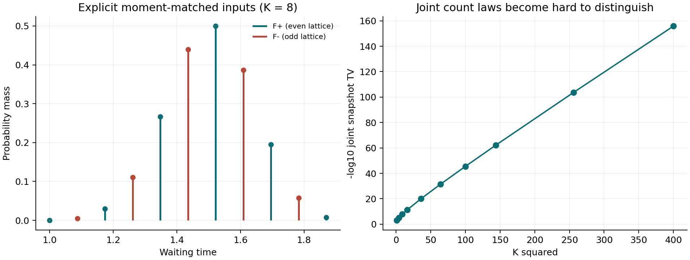

# Sharp recovery limits for renewal waiting times from spatial count snapshots

**Research manuscript · 26 November 2026**

## Abstract

We study the statistical recovery of an arbitrary renewal interarrival distribution from independent equilibrium count snapshots. Interarrival times are strictly positive, bounded by a known constant $B$, and have mean at least a known $m_0\in(0,B)$; there is no common positive lower bound on individual gaps. Each arrival spends a known deterministic time $\tau$ in a nuclear compartment and then has an independent exponential cytoplasmic lifetime with known rate $d$. For $0\le\tau \lt B$, we prove that the minimax expected Wasserstein-1 error from $n$ joint nuclear/cytoplasmic snapshots is of order $[\log(n+1)]^{-1/2}$, and that cytoplasmic counts alone achieve this order. A measurable minimum-distance estimator gives the upper bound. For the lower bound, an explicit polynomial with positive roots produces two positive interarrival laws with equal means, exactly matched Laplace-transform values, and exact transport separation. Absolutely convergent binomial inversion controls their entire joint count distributions. The same order survives fixed known binomial thinning and Poisson background, and every fixed finite panel of independent experimental conditions sharing the same interarrival law. These are worst-case nonparametric statements; they neither rule out improvements in finite-parameter models nor establish the rate for total counts alone. Classical queueing moments, identifiability, and polynomial moment comparison are background tools, not originality claims.

**Keywords:** renewal process; inverse problem; minimax risk; Wasserstein distance; moment matching; stochastic gene expression.

## Introduction and relation to prior work

Spatially resolved molecular counts offer information about production and transport that can be obscured by aggregate measurements. For a renewal production stream with deterministic nuclear residence and exponential cytoplasmic degradation, Wang, Szavits-Nossan, Cao and Grima [R1] obtained joint generating-function formulas and studied inference in specified gene-expression models. The question studied here is different: if the waiting-time law itself is unrestricted within a bounded class, how accurately can any procedure recover it from a finite number of independent stationary cells?

The forward model and its classical moment identities are already known. Shi, Jiang and Zhou [R2] developed a binomial-moment inversion for waiting-time inference in a queueing model and exhibited numerical sensitivity to small distributional errors. The tutorial of Szavits-Nossan and Grima [R3] places these formulas in the broader infinite-server queueing literature. Thus neither the existence of a formal inverse nor qualitative ill-conditioning is the contribution of this manuscript. We turn that distinction into a matching finite-sample minimax rate for a precisely specified observation experiment.

On the statistical side, polynomial approximation, denoised moment methods and moment-matching lower bounds have a substantial history. Wu and Yang [R4], in particular their Lemma 24 and Theorem 5, provide a closely related Wasserstein moment-comparison method and optimal recovery results for Gaussian mixtures. Our Section 6 supplies a self-contained version of the standard approximation argument needed here. The new model-specific difficulty is the nonlinear product of Laplace-transform ratios in renewal count moments: its inversion loses a factor exponential in the square of the moment order. The lower-bound construction matches that loss for the complete joint observation, including all fixed experimental conditions simultaneously. We do not inherit, or claim, the computational efficiency guarantees of denoised moment algorithms in other models.

Measurement loss is also established modeling practice. Gu and colleagues [R5] study practical identifiability with known binomial capture in finite-parameter gene-expression models. Li and colleagues [R6] analyze generating-function inference, molecular loss and contamination through numerical experiments. The calibrated extension here concerns preservation of an already sharp nonparametric minimax order under a fixed known channel; thinning itself is not a new modeling contribution. Bayesian nonparametric inference of promoter-state structure [R7] addresses a different unknown object and does not make this a first claim to nonparametric gene-expression inference. Older queue-identifiability work [R8] further rules out treating the broad identifiability question as new.

Three conclusions delimit the contribution. First, Section 7 proves a uniform upper rate without assuming a common positive lower gap. Second, Sections 8–11 prove a matching lower rate for every estimator using the **entire nuclear/cytoplasmic pair**, rather than only selected moments or the cytoplasmic marginal. Third, Section 12 extends the result to known observation noise and fixed finite panels using a single simultaneously matched pair. The result compares joint counts with **cytoplasmic counts alone**. The joint-versus-total-count comparison in [R1] is a different comparison: no matching upper bound for observing only $N+M$ is asserted here.

The preceding literature motivates this research question. Section 15 lists the sources supporting the comparison.

## 1. Model, parameter class, and theorems

Fix constants

```math
d>0,\qquad B>0,\qquad 0 \lt m_0 \lt B.
```

The unknown interarrival law belongs to

```math
\mathcal F_{B,m_0}=\{F:\ F((0,B])=1,\quad \mu_F:=\int t\,F(dt)\ge m_0\}.
```

There is **no common positive lower bound** on the interarrival times. Individual members may have support accumulating at zero. Atomic positive interarrival laws, including deterministic ones, are allowed. An atom at zero is excluded in the statistical model; no batch-arrival interpretation is needed.

For each F, take the stationary, two-sided renewal point process on the real line with interarrival law F. Every arriving molecule spends a fixed known time $\tau$ in the nucleus and then independently survives in the cytoplasm for an exponential lifetime of rate d. At time zero let N denote the nuclear count and M the cytoplasmic count. The observation is either M alone or $(N,M)$. Across cells the observations are iid copies of this stationary snapshot, rather than samples along a single dependent trajectory. There is one renewal input stream, no extrinsic cell-to-cell rate mixture, and no unknown calibration parameter.

Let $P_F^M$ and $P_F^{N,M}$ denote the corresponding distributions. The law $P_F^M$ does not depend on $\tau$. All estimators may take values in probability measures on $[0,B]$, with $W_1$ the usual transport distance on this interval. The estimator constructed below actually takes values in $\mathcal F_{B,m_0}$.

Define

```math
R_n^M=\inf_{\widehat F}\sup_{F\in\mathcal F_{B,m_0}}
\mathbb E_F W_1(\widehat F,F),
\qquad
R_n^{N,M}=\inf_{\widehat F}\sup_{F\in\mathcal F_{B,m_0}}
\mathbb E_F W_1(\widehat F,F).
```

The infima refer to the stated respective experiments with n iid snapshots. The repeated notation for the integrand does not identify the two experiments.

### Theorem A: exact minimax order

For a fixed known $0\le\tau \lt B$, there are constants $0 \lt c\le C<\infty$, depending only on $d,B,m_0,\tau$, such that for every integer $n\ge1$,

```math
\frac{c}{\sqrt{\log(n+1)}}
\le R_n^{N,M}\le R_n^M
\le\frac{C}{\sqrt{\log(n+1)}}.
\tag{A}
```

The upper bound uses the cytoplasmic count only. Its constants do not depend on $\tau$ and it holds for any fixed finite $\tau$. The restriction $\tau \lt B$ enters the particular joint-observation lower bound constructed here. No theorem for the joint experiment when $\tau\ge B$ is claimed.

### Theorem B: fixed known thinning and Poisson background

Suppose that the recorded cytoplasmic count is

```math
Y_M=\operatorname{Bin}(M,q_M)+Z_M,
\qquad q_M\in(0,1],\quad Z_M\sim\operatorname{Pois}(\lambda_M),
```

where the thinning is independent across molecules and $Z_M$ is independent of all original variables. Both $q_M$ and $\lambda_M\ge0$ are fixed and known. The nuclear count may similarly be recorded through independent fixed known thinning and independent Poisson background:

```math
Y_N=\operatorname{Bin}(N,q_N)+Z_N.
```

For definiteness one may take $q_N$ in $[0,1]$ and $\lambda_N\ge0$; even a completely discarded nuclear measurement causes no difficulty because the upper bound ignores it. Given $(N,M)$, the two measurement channels are independent and identical from sample to sample. Then the risks based on $Y_M$ and on $(Y_N,Y_M)$ satisfy the same order (A), with constants allowed to depend on the calibration parameters. This statement is for fixed $q_M>0$. It is not a uniform claim as $q_M$ tends to zero or the background tends to infinity, and it does not address unknown capture efficiency or unknown background.

### Theorem C: a fixed finite panel of experimental conditions

Fix an integer $r\ge1$. Under condition $\ell=1,\ldots,r$, use known constants $d_\ell>0$ and $0\le\tau_\ell \lt B$, and optionally the independent known measurement channels of Theorem B with $q_{M,\ell}>0$. Every condition shares the same unknown F in the class above. The data are $n_\ell$ independent stationary snapshots under condition $\ell$, independent also across conditions, with deterministic allocation and total sample size $n_{\rm tot}=\sum_\ell n_\ell\ge1$. Then, uniformly over all such allocations,

```math
\inf_{\widehat F}\sup_F\mathbb E_F W_1(\widehat F,F)
\asymp [\log(n_{\rm tot}+1)]^{-1/2},
\tag{C}
```

where the implicit positive constants may depend on the fixed r and all fixed condition/calibration parameters. This is a fixed-design statement for distinct independent cells assigned to conditions. It is not a claim about r increasing with sample size, degradation rates chosen to diverge with sample size, adaptive designs, or repeated multiple-label measurements on the same cell.

## 2. Construction, nonexplosion, and the stationary age representation

Since $T>0$ almost surely and $0<\mu_F\le B$, sums of iid interarrival times diverge almost surely in both directions. For example, the strong law gives $(T_1+\cdots+T_j)/j\to\mu_F>0$. Thus the renewal process is locally finite even when the support has no positive lower endpoint.

A stationary two-sided renewal process can be constructed by putting the origin uniformly inside a size-biased interval: choose an interval length T* with law $tF(dt)/\mu_F$, choose U uniform on $[0,1]$ independently, put its endpoints at -UT* and (1-U)T*, and continue to the left and right with independent iid gaps of law F. This construction also handles arithmetic or deterministic F: the random origin supplies the stationary phase. No convergence from a deterministic initial phase is assumed.

The backward age A from zero to the most recent arrival has density

```math
\mathbb P(A\in dx)=\frac{\mathbb P(T>x)}{\mu_F}\,dx,
\qquad x\ge0,
\tag{2.1}
```

and the older iid gaps T_1,T_2,... are independent of A. The arrival ages are

```math
A_i=A+T_1+\cdots+T_i,\qquad i=0,1,2,\ldots.
```

For $s>0$, Tonelli gives

```math
\mathbb E e^{-sA}
=\frac{1}{\mu_F}\mathbb E\int_0^T e^{-sx}\,dx
=\frac{1-\phi_F(s)}{\mu_Fs},
\qquad
\phi_F(s)=\mathbb E e^{-sT}<1.
\tag{2.2}
```

The export times are the arrival times shifted by $\tau$. Stationarity implies that these export times form a stationary renewal process with the same law. Conditional on its ages, cytoplasmic survivors are independent Bernoulli variables with survival probabilities $e^{-dA_i}$. Formula (3.1) below gives $\mathbb E M=1/(\mu_Fd)<\infty$; hence M is finite almost surely. The nuclear count is finite by local finiteness. One can therefore define all counts without a finite-past cutoff; equivalently take increasing finite-past cutoffs and use monotone convergence.

## 3. Classical binomial moments: derivation and interpretation

Write

```math
b_0(F)=1,\qquad b_k(F)=\mathbb E_F\binom{M}{k},\quad k\ge1.
```

### Lemma 3.1: binomial moment formula

For every $k\ge1$,

```math
b_k(F)=\frac{1}{\mu_Fdk}
\prod_{j=1}^{k-1}\frac{\phi_F(jd)}{1-\phi_F(jd)}.
\tag{3.1}
```

**Proof.** Given arrival ages, a k-element subset of surviving molecules contributes the product of its survival probabilities. For selected ranks $0\le i_1<\cdots \lt i_k$, write $r_0=i_1\ge0$ and $r_j=i_{j+1}-i_j\ge1$ for $j=1,\ldots,k-1$. In the sum of their ages, A has coefficient k, the first $r_0$ gaps have coefficient k, the next $r_1$ gaps coefficient k-1, and so on. Independence and the nonnegative geometric series give

```math
\begin{aligned}
b_k(F)
&=\mathbb E e^{-kdA}
\left(\sum_{r_0=0}^{\infty}\phi_F(kd)^{r_0}\right)
\prod_{j=1}^{k-1}\left(\sum_{r=1}^{\infty}\phi_F(jd)^r\right)\\
&=\frac{1-\phi_F(kd)}{\mu_Fdk}
\frac{1}{1-\phi_F(kd)}
\prod_{j=1}^{k-1}\frac{\phi_F(jd)}{1-\phi_F(jd)}.
\end{aligned}
```

All interchanges are justified by Tonelli. Every displayed factor is finite, proving (3.1). In particular $b_1=1/(\mu_Fd)$. $\square$

This is a standard $G/M/\infty$ forward formula; see [R2, R3]. It is not claimed as new. The same convention is important throughout: $b_k$ is a **binomial moment**, equal to the falling-factorial moment divided by $k!$.

### Corollary 3.2: exact identifiability as a background fact

The complete cytoplasmic count law determines F. Indeed $b_1$ determines $\mu_F$, and for $j\ge1$,

```math
\phi_F(jd)=
\frac{(j+1)b_{j+1}(F)}{jb_j(F)+(j+1)b_{j+1}(F)}.
\tag{3.2}
```

These are the integer moments of the law of $U=e^{-dT}$ on the compact interval $[e^{-dB},1]$. Equality of those moments, including the zeroth moment 1, gives equality of integrals of all polynomials, then all continuous functions by polynomial approximation, and hence equality of the two laws. Since $t\mapsto e^{-dt}$ is injective, F is recovered uniquely. The moment finiteness needed here follows already from (3.1); Section 4 gives a uniform exponential moment.

This qualitative identifiability is not the principal contribution. The statistical issue is the quantitative cost of inverting an increasingly small sequence of forward binomial moments.

## 4. Uniform tails and variance without a positive lower support bound

Define

```math
q_*:=1-\frac{m_0}{B}(1-e^{-dB})\in(0,1),
\qquad R:=\frac{q_*}{1-q_*}>0,
\qquad A_*:=\frac1{m_0d}.
```

For $s\ge d$, convexity of the exponential on $[0,B]$ gives the chord bound

```math
e^{-st}\le 1-\frac{t}{B}(1-e^{-sB}),
```

and therefore

```math
\phi_F(s)\le1-\frac{\mu_F}{B}(1-e^{-sB})\le q_*.
\tag{4.1}
```

Inserting this into (3.1) yields

```math
0 \lt b_k(F)\le\frac{A_*}{k}R^{k-1}.
\tag{4.2}
```

Choose

```math
r_0=\frac{1}{2(1+R)},\qquad
s_0=\sqrt{1+r_0}-1>0.
```

By the binomial theorem and Tonelli,

```math
\begin{aligned}
\mathbb E_F(1+r_0)^M
&=\sum_{k=0}^{\infty}b_k(F)r_0^k\\
&\le1+A_*r_0\sum_{k=1}^{\infty}(Rr_0)^{k-1}
\le1+2A_*r_0=:C_*.
\end{aligned}
\tag{4.3}
```

For all integers $m,k\ge0$,

```math
\binom{m}{k}s_0^k\le(1+s_0)^m,
```

with binomial coefficients defined as zero when $k>m$. Squaring and using $(1+s_0)^2=1+r_0$ gives

```math
\mathbb E_F\binom{M}{k}^2\le C_*s_0^{-2k}.
\tag{4.4}
```

Thus for iid observations and

```math
\widehat b_k=\frac1n\sum_{i=1}^n\binom{M_i}{k},
```

```math
\mathbb E_F|\widehat b_k-b_k(F)|
\le\sqrt{C_*}\,s_0^{-k}n^{-1/2}.
\tag{4.5}
```

The opposite deterministic bound, which controls inversion, follows from $T\le B$:

```math
\phi_F(jd)\ge e^{-jdB},
\qquad
b_k(F)\ge\frac1{Bdk}
\exp\left[-\frac{dB}{2}k(k-1)\right].
\tag{4.6}
```

We used $\phi/(1-\phi)\ge\phi$ and $\mu_F\le B$. These bounds are uniform over the entire parameter class and do not assume $T\ge a>0$.

## 5. Stability of the ratio inversion

For two model laws F,G and $K\ge1$ let

```math
\Delta_K(F,G)=\sum_{k=1}^{K+1}|b_k(F)-b_k(G)|.
```

For positive $x,y,x\prime,y\prime$,

```math
\left|\frac{x}{x+y}-\frac{x'}{x'+y'}\right|
\le\frac{|x-x'|+|y-y'|}{x+y}.
\tag{5.1}
```

To verify this, write the numerator as $y'(x-x')+x'(y'-y)$ and use $x\prime,y\prime\le x\prime+y\prime$. Apply this with $x=(j+1)b_{j+1}(F)$, $y=jb_j(F)$, and their G versions. By (4.6),

```math
x+y\ge jb_j(F)\ge\frac1{Bd}
e^{-dB j(j-1)/2}.
```

Consequently, for every $1\le j\le K$,

```math
|\phi_F(jd)-\phi_G(jd)|
\le Bd(K+1)e^{dBK(K-1)/2}\Delta_K(F,G).
\tag{5.2}
```

In particular the dangerous denominator is a forward model quantity, whose deterministic lower bound is available. The estimator below does not take ratios of possibly zero or negative raw empirical moments.

## 6. A fully specified polynomial moment-to-Wasserstein bound

### Lemma 6.1

There are constants $C_1,C_2>0$ and $D>1$, depending only on d,B, such that for every $K\ge1$ and F,G supported on $[0,B]$,

```math
W_1(F,G)
\le\frac{C_1}{K}
+C_2D^K\max_{1\le j\le K}|\phi_F(jd)-\phi_G(jd)|.
\tag{6.1}
```

**Proof, including the approximation and coefficient estimates.** Put $l=e^{-dB}$, $c=(1+l)/2$, $a_0=(1-l)/2$. In the Kantorovich-Rubinstein formula it suffices to consider 1-Lipschitz $f:[0,B]\to\mathbb R$ with $f(0)=0$; these have norm at most B. Define

```math
g(u)=f(-\log u/d),\quad l\le u\le1,
\qquad
h(\theta)=g(c+a_0\cos\theta).
```

The function g is $(dl)^{-1}$-Lipschitz. The even, $2\pi$-periodic h has norm at most B and is Lipschitz on the circle with constant at most $L_0=a_0/(dl)$.

For an integer $m\ge1$ define

```math
R_m(v)=\frac{\sin(mv/2)}{\sin(v/2)},\qquad
Z_m=\frac1{2\pi}\int_{-\pi}^{\pi}R_m(v)^4\,dv,
\qquad J_m(v)=R_m(v)^4/Z_m,
```

using the continuous values at multiples of $2\pi$. The fourth power is a nonnegative trigonometric polynomial of degree $2m-2$: this follows by writing the squared modulus of $\sum_{j=0}^{m-1}e^{ijv}$, then squaring once more. Its normalized integral is one.

There are numerical constants $c_0$,C_0>0 such that

```math
Z_m\ge c_0m^3,
\qquad
\frac1{2\pi}\int_{-\pi}^{\pi}|v|R_m(v)^4\,dv\le C_0m^2.
\tag{6.2}
```

For completeness: on $|v|\le1/m$, $|R_m(v)|\ge2m/\pi$, obtained from $\sin x\ge2x/\pi$ on $[0,\pi/2]$ and $\sin(v/2)\le |v|/2$. Integration gives the first bound. Everywhere, $|R_m(v)|\le\min\{m,\pi/|v|\}$. Splitting the weighted integral at $1/m$ bounds it by a constant times $\int_0^{1/m}vm^4dv+\int_{1/m}^{\pi}v^{-3}dv=O(m^2)$. This proves (6.2).

The convolution

```math
h_m(\theta)=\frac1{2\pi}\int_{-\pi}^{\pi}h(\theta-v)J_m(v)\,dv
```

is an even trigonometric polynomial of degree $2m-2$, has norm at most B, and satisfies

```math
\|h-h_m\|_\infty\le C L_0/m.
\tag{6.3}
```

Choose $m=\lfloor K/2\rfloor+1$. Write

```math
h_m(\theta)=\sum_{j=0}^{2m-2}\alpha_j\cos(j\theta).
```

Fourier integration gives $|\alpha_0|\le B$ and $|\alpha_j|\le2B$ for $j\ge1$. Set

```math
p_K(u)=\sum_{j=0}^{2m-2}\alpha_j
T_j((u-c)/a_0),
```

where $T_j$ is the Chebyshev polynomial. Then $\deg p_K\le K$ and $\|g-p_K\|_\infty\le C/K$, with C depending only on d,B. This remains true for $K=1$ by enlarging C.

We also need control of monomial coefficients rather than just a uniform approximation. For a polynomial P write $\|P\|_{\mathrm{coef},1}$ for the sum of absolute monomial coefficients. Let $H=(1+c)/a_0$ and $D=2H+1>1$. The recurrence $T_{j+1}(x)=2xT_j(x)-T_{j-1}(x)$, together with submultiplicativity of this coefficient norm, proves inductively

```math
\|T_j((u-c)/a_0)\|_{\mathrm{coef},1}\le D^j.
```

Hence $\|p_K\|_{\mathrm{coef},1}\le C_2D^K$ after changing $C_2$. Applying $p_K$ to the two laws of $U=e^{-dT}$, its constant coefficient cancels and every other coefficient pairs with a difference $\phi_F(jd)-\phi_G(jd)$. The two approximation errors give $C_1/K$. Taking the supremum over f proves (6.1). The compact-interval Kantorovich-Rubinstein formula can equivalently be obtained from $W_1(F,G)=\int_0^B|F(t)-G(t)|dt$ by integration by parts. $\square$

This is a classical polynomial-approximation mechanism; compare [R4, Lemma 24]. It is proved here to make both approximation error and coefficient growth explicit for the statistical argument, and is not claimed as a new general moment-comparison theorem.

## 7. A measurable estimator and the upper minimax bound

### 7.1 Countable dense candidate family

Let $\mathcal D=\{Q_1,Q_2,\ldots\}$ consist of all finitely supported probability measures with support in $\{jB/r:1\le j\le r,\ r\in\mathbb N\}$, rational masses, and mean at least $m_0$. It is countable, contains $\delta_B$, and is dense in $\mathcal F_{B,m_0}$ for weak convergence or $W_1$. One proof is to round support points upward on a fine positive grid, then approximate weights rationally; when a small mean slack is required, first mix with a vanishing mass at B. The assumption $m_0 \lt B$ ensures this creates slack unless the target is already $\delta_B$, which belongs to the family.

For fixed k, formula (3.1) defines a continuous function of a probability measure on the compact set

```math
\overline{\mathcal F}=\{Q:\operatorname{supp}(Q)\subseteq[0,B],\ \int tQ(dt)\ge m_0\}.
```

Indeed the mean and finitely many Laplace transforms are continuous; their denominators are bounded away from zero by (4.1). This is just an algebraic continuity observation. No operational renewal model with $T=0$ is used. Density therefore implies convergence of every fixed finite vector of $b_k$.

### 7.2 Approximate minimum-distance rule

For an integer $K\ge1$, define

```math
L_j=\sum_{k=1}^{K+1}|b_k(Q_j)-\widehat b_k|,
\qquad L_*=\inf_{j\ge1}L_j.
```

Let $\widehat j$ be the smallest index satisfying $L_j\le L_*+n^{-1}$, and put $\widehat F=Q_{\widehat j}$. Such an index exists by the definition of an infimum. Each $L_j$ and $L_*$ is measurable; the first-index rule over a countable family is measurable. Thus this is a valid statistical estimator, even though no efficient numerical implementation is asserted.

By density $L_*\le\sum_{k=1}^{K+1}|b_k(F)-\widehat b_k|$. The triangle inequality gives

```math
\Delta_K(\widehat F,F)
\le2\sum_{k=1}^{K+1}|\widehat b_k-b_k(F)|+n^{-1}.
\tag{7.1}
```

Using (4.5),

```math
\sup_F\mathbb E_F\Delta_K(\widehat F,F)
\le\frac{2\sqrt{C_*}(K+1)s_0^{-(K+1)}}{\sqrt n}+n^{-1}.
\tag{7.2}
```

Equations (5.2), (6.1), and (7.2) imply constants C,C'>0 such that

```math
\sup_F\mathbb E_F W_1(\widehat F,F)
\le \frac C K
+C(K+1)^2\frac{\exp\{(dB/2)K^2+C'K\}}{\sqrt n}
+C(K+1)\frac{\exp\{(dB/2)K^2+C'K\}}{n}.
\tag{7.3}
```

Choose a fixed sufficiently small $\kappa$>0 with $(dB/2)\kappa^2<1/8$, and for sufficiently large n let $K=\lfloor\kappa\sqrt{\log n}\rfloor$. The linear term $C\prime K$ and the logarithm of the polynomial factor are $o(\log n)$, so both stochastic terms are at most $C n^{-1/4}$ for all sufficiently large n. Thus the risk is at most $C/\sqrt{\log n}$. For the finitely many smaller n use the estimator $\delta_B$, whose loss is at most B, and enlarge C to obtain the upper bound with $\log(n+1)$ for every $n\ge1$. The same estimator proves the joint upper bound because it discards N.

## 8. Mixed binomial moments in the hard subfamily

Fix numbers

```math
\max\{m_0,\tau\} \lt a \lt b \lt B.
\tag{8.1}
```

For F supported on $[a,b]$, at most one arrival is still in the nucleus, so N is Bernoulli-valued. Define

```math
c_k(F)=\mathbb E_F\left[N\binom{M}{k}\right],\qquad k\ge0.
```

### Lemma 8.1

```math
c_0(F)=\frac\tau{\mu_F},
\qquad
c_k(F)=\frac{e^{dk\tau}-1}{\mu_Fdk}
\prod_{j=1}^{k}\frac{\phi_F(jd)}{1-\phi_F(jd)},\quad k\ge1.
\tag{8.2}
```

**Proof.** In the original arrival process $N=1$ exactly when the most recent age A lies in $[0,\tau)$, apart from a null boundary event. On this interval (2.1) has density $1/\mu_F$ because $T\ge a>\tau$. All older arrivals have already exported. Given $A=x<\tau$, their cytoplasmic survival probabilities are

```math
\exp[-d(x+T_1+\cdots+T_i-\tau)],\qquad i\ge1.
```

When selecting k older arrivals the first selected rank is at least one, as are all subsequent rank gaps. The same geometric-series calculation as in Section 3 gives the conditional binomial moment

```math
e^{-dk(x-\tau)}\prod_{j=1}^{k}\frac{\phi_F(jd)}{1-\phi_F(jd)}.
```

Integrate x from zero to $\tau$ with density $1/\mu_F$. For $k\ge1$ the integral equals $(e^{dk\tau}-1)/(\mu_Fdk)$; for $k=0$ it is $\tau/\mu_F$. This proves (8.2). At $\tau=0$ all $c_k$ vanish and $N=0$ almost surely. $\square$

Since N is zero or one,

```math
0\le c_k(F)\le b_k(F).
\tag{8.3}
```

For $k\ge1$ this can also be checked directly: $c_k/b_k=(e^{dk\tau}-1)\phi_F(kd)/(1-\phi_F(kd))\le(e^{dk\tau}-1)/(e^{dka}-1)<1$.

## 9. Explicit moment matching with exact transport separation

Fix $K\ge1$, and let

```math
h=\frac{b-a}{K+2},\quad r=e^{-dh}\in(0,1),\quad t_i=a+ih\ (0\le i\le K+2).
```

Define

```math
W(z)=(z-1)^2\prod_{j=1}^{K}(z-r^j)
=\sum_{i=0}^{K+2}w_i z^i.
\tag{9.1}
```

Every root is positive, so all coefficients are nonzero and alternate in sign. Since $W(1)=0$, the sums of positive and negative coefficient masses agree. Their common magnitude is

```math
A_K=\frac{|W(-1)|}{2}=2\prod_{j=1}^{K}(1+r^j).
\tag{9.2}
```

Set

```math
F_+=\frac1{A_K}\sum_i(w_i)_+\delta_{t_i},
\qquad
F_-=\frac1{A_K}\sum_i(w_i)_-\delta_{t_i},
```

where $(x)_-=\max\{-x,0\}$. These are probabilities in the hard subfamily. The double root at one gives

```math
\mu_{F_+}-\mu_{F_-}
=\frac{aW(1)+hW'(1)}{A_K}=0.
\tag{9.3}
```

For $j=1,\ldots,K$,

```math
\phi_{F_+}(jd)-\phi_{F_-}(jd)
=\frac{e^{-jda}}{A_K}W(r^j)=0.
\tag{9.4}
```

Thus (3.1) and (8.2) give

```math
b_k(F_+)=b_k(F_-)\quad(0\le k\le K+1),
\qquad
c_k(F_+)=c_k(F_-)\quad(0\le k\le K).
\tag{9.5}
```

The transport distance is exactly h, not merely bounded below by a constant times h. To see this put

```math
V(z)=\frac{W(z)}{z-1}=(z-1)\prod_{j=1}^{K}(z-r^j)=\sum_{i=0}^{K+1}v_i z^i.
```

The coefficient identity $w_i=v_{i-1}-v_i$, with out-of-range $v_i$ zero, gives $\sum_{j=0}^i w_j=-v_i$ for $0\le i\le K+1$. The coefficients of V again alternate, whence

```math
\sum_{i=0}^{K+1}\left|\sum_{j=0}^i w_j\right|
=\sum_i|v_i|=|V(-1)|=A_K.
```

The one-dimensional transport formula on the equally spaced support therefore gives

```math
W_1(F_+,F_-)
=\frac h{A_K}\sum_{i=0}^{K+1}\left|\sum_{j=0}^i w_j\right|=h.
\tag{9.6}
```

This explicit construction yields exact mean matching, Laplace matching, positivity and transport separation in one calculation. Its role is to close the lower bound for this nonlinear observation experiment. Moment matching as a general method is established, for example in [R4].

## 10. Superexponential forward tails and joint total variation

Let $q=e^{-da}$ in $(0,1)$. For every F in the hard subfamily,

```math
\frac{\phi_F(jd)}{1-\phi_F(jd)}\le\frac{q^j}{1-q^j}.
```

The constant

```math
C_q=\prod_{j=1}^{\infty}(1-q^j)^{-1}<\infty
```

is finite because $-\log(1-q^j)\le q^j/(1-q)$ has a summable upper bound. In particular $C_q\le\exp[q/(1-q)^2]$. By (3.1) and $\mu_F\ge a$,

```math
b_k(F)\le U_k:=\frac{C_q}{adk}
e^{-da k(k-1)/2},\qquad k\ge1.
\tag{10.1}
```

The same bound holds for $c_k$ by (8.3). Consequently $\sum 2^k b_k<\infty$, indeed $\mathbb E z^M<\infty$ for every finite $z\ge1$ in this subfamily.

### 10.1 Absolutely convergent binomial inversion

Write $p_m=\mathbb P(M=m)$, $p_{1m}=\mathbb P(N=1,M=m)$. Then

```math
p_m=\sum_{k=m}^{\infty}(-1)^{k-m}\binom{k}{m}b_k,
\qquad
p_{1m}=\sum_{k=m}^{\infty}(-1)^{k-m}\binom{k}{m}c_k.
\tag{10.2}
```

One verification starts with $\binom{n}{k}\binom{k}{m}=\binom{n}{m}\binom{n-m}{k-m}$ and the finite binomial identity $\sum_{k=m}^n(-1)^{k-m}\binom{k}{m}\binom nk=\mathbf1_{\{n=m\}}$. Absolute interchange is permitted since the sum over m and k of the coefficient bounds is $\sum_{k\ge0}2^kb_k=\mathbb E3^M<\infty$; $c_k\le b_k$. Thus (10.2) recovers probability coefficients, not just a formal power series. Also $p_{0m}=p_m-p_{1m}$.

For the pair ($F_+$,$F_-$) in Section 9, let $\Delta$ denote a difference. By (9.5),

```math
\begin{aligned}
\operatorname{TV}(P_{F_+}^{N,M},P_{F_-}^{N,M})
&=\frac12\sum_m(|\Delta p_{0m}|+|\Delta p_{1m}|)\\
&\le\frac12\sum_m|\Delta p_m|+\sum_m|\Delta p_{1m}|\\
&\le\frac12\sum_{k\ge K+2}2^k|\Delta b_k|
+\sum_{k\ge K+1}2^k|\Delta c_k|\\
&\le3\sum_{k\ge K+1}2^kU_k.
\end{aligned}
\tag{10.3}
```

The omitted $k=0$ terms cancel, including $c_0=\tau/\mu_F$, because the two means match.

For completeness put $\alpha=da/2$ and $\beta=da/2+\log2$. Since

```math
-\alpha k^2+\beta k
\le-\frac\alpha2 k^2+\frac{\beta^2}{2\alpha},
```

equation (10.1) gives $2^kU_k\le C e^{-\gamma k^2}$ with $\gamma=da/4>0$. Also

```math
\sum_{k\ge K+1}e^{-\gamma k^2}
\le\frac{e^{-\gamma(K+1)^2}}{1-e^{-\gamma}},
```

using $k^2\ge(K+1)^2+(k-K-1)$. Hence constants $C_T\ge1$ and $\gamma>0$ independent of K satisfy

```math
\operatorname{TV}(P_{F_+}^{N,M},P_{F_-}^{N,M})
\le C_Te^{-\gamma(K+1)^2}.
\tag{10.4}
```

This is the crucial quantitative phenomenon: a transport separation of order 1/K is hidden behind a count-law difference exponentially small in K squared.

## 11. Le Cam lower bound and completion of Theorem A

For n iid observations, total variation between product measures is at most n times the one-snapshot total variation. This follows directly by coupling each coordinate or by the telescoping product identity. Choose an integer $K\ge1$ so that

```math
K+1\ge\sqrt{\gamma^{-1}\log(4C_Tn)}.
```

For example the ceiling of the right side, enlarged to at least two, provides such a K. Then the n-sample total variation is at most 1/4, while $K+2$ is bounded above by a constant times $\sqrt{\log(n+1)}$.

For any estimator construct a test choosing the closer of $F_+$,$F_-$ in $W_1$. On a testing error its loss under the true distribution is at least h/2. The sum of the two testing error probabilities is at least one minus the n-sample total variation. Thus

```math
\max_{\sigma\in\{+,-\}}
\mathbb E_{F_\sigma}W_1(\widehat F,F_\sigma)
\ge\frac h4(1-\operatorname{TV}(P_+^{\otimes n},P_-^{\otimes n}))
\ge\frac{3h}{16}.
```

Since $h=(b-a)/(K+2)$, this is at least $c/\sqrt{\log(n+1)}$. The two laws belong to the full parameter class, giving the joint lower bound. Observing M alone cannot lower the minimax risk below that of observing $(N,M)$, and Section 7 gives a matching upper bound from M alone. This proves Theorem A.

If one wishes to restrict the lower bound to absolutely continuous F rather than positive atomic laws, convolve each matched law with the same independent uniform perturbation on $[-\varepsilon,\varepsilon]$. Choose the original grid in an interior subinterval of $[a,b]$, and $\varepsilon \lt h/10$. The two means remain equal; their Laplace transforms acquire the same multiplicative factor, preserving (9.4). A transport triangle inequality gives a remaining separation at least $h-2\varepsilon$. All supports stay strictly above $\tau$ and $m_0$. Thus no reliance on atomic target laws is essential to the lower-bound order. This does not claim a lower bound under a fixed smoothness or bounded-density constraint.

## 12. Calibrated measurement error: proof of Theorem B

Write $q=q_M>0$ and $\lambda=\lambda_M\ge0$ for this section. Conditional thinning and independent Poisson background give

```math
\mathbb E_F(1+t)^{Y_M}=e^{\lambda t}\mathbb E_F(1+qt)^M
\tag{12.1}
```

whenever the expectations are finite. In particular for $0\le t\le r_0$,

```math
\mathbb E_F(1+t)^{Y_M}\le e^{\lambda r_0}C_*,
\tag{12.2}
```

because $q\le1$ and (4.3) holds. Let $\widetilde b_j=\mathbb E\binom{Y_M}{j}$. Comparing the coefficients in (12.1), or using the binomial convolution identity and finite moments, gives

```math
\widetilde b_k=\sum_{j=0}^k q^jb_j(F)\frac{\lambda^{k-j}}{(k-j)!}.
```

Multiplication by $e^{-\lambda t}$ inverts this finite triangular relation. Thus the polynomial statistic

```math
D_k(y)=q^{-k}\sum_{j=0}^k
\frac{(-\lambda)^{k-j}}{(k-j)!}\binom yj
\tag{12.3}
```

is unbiased for $b_k$(F). It can be negative; no assertion of pointwise positivity is made.

For any $s>0$,

```math
\begin{aligned}
|D_k(y)|
&\le q^{-k}(1+s)^y\sum_{j=0}^k
\frac{\lambda^{k-j}}{(k-j)!}s^{-j}\\
&\le(qs)^{-k}e^{\lambda s}(1+s)^y.
\end{aligned}
```

Take $s=s_0$. Squaring and applying (12.2) at $t=r_0$ yields

```math
\sup_F\mathbb E_F D_k(Y_M)^2
\le C_*e^{2\lambda s_0+\lambda r_0}(qs_0)^{-2k}.
\tag{12.4}
```

Consequently the empirical mean of $D_k$ has absolute mean error bounded by $C(qs_0)^{-k}/\sqrt n$. Optionally replace this mean by its projection onto $[0,\infty)$; since $b_k(F)\ge0$, projection cannot increase the absolute error. Denote the resulting nonnegative estimate by $\widehat b_k^{\rm cal}$.

Use exactly the countable approximate minimum-distance estimator from Section 7 with these calibrated moment estimates in place of raw count moments. The error bound (7.2) is unchanged in form, with a different fixed exponential-in-k constant. The leading $\exp\{(dB/2)K^2\}$ inversion cost is unaffected; K asymptotic to $\sqrt{\log n}$ again gives the desired upper rate.

For the lower bound, fixed known thinning and Poisson background define a Markov kernel from the ideal joint snapshot to the recorded joint snapshot. Total variation contracts under this kernel. Thus the pair in Section 9 is at least as difficult to distinguish after measurement error. The same Le Cam lower bound applies. Nuclear calibration does not enter the upper estimator. This proves Theorem B under the explicitly fixed and known calibration assumptions.

### 12.1 Proof of Theorem C

For the upper bound choose a condition $\ell_*$ with maximal $n_\ell$. Then $n_{\ell_*}\ge n_{\rm tot}/r$. Apply the estimator from Theorem A or B to this condition's cytoplasmic measurements alone. Since there are only r fixed conditions, take the largest of their upper-bound constants. For $n_{\rm tot}$ sufficiently large, $\log(n_{\rm tot}/r+1)$ is bounded below by a positive constant multiple of $\log(n_{\rm tot}+1)$. The finitely many smaller totals are absorbed using the diameter bound $W_1\le B$. Thus the upper bound is uniform in the deterministic allocation.

For the lower bound choose

```math
\max\{m_0,\tau_1,\ldots,\tau_r\} \lt a \lt b \lt B.
```

For $K\ge1$ put $L=rK+2$, $h=(b-a)/L$, $t_i=a+ih$ for $i=0,\ldots,L$, and set

```math
W(z)=(z-1)^2\prod_{\ell=1}^{r}\prod_{j=1}^{K}
\left(z-e^{-d_\ell h j}\right).
\tag{12.5}
```

Normalize the positive and negative coefficients exactly as in Section 9. All roots are strictly positive, so the coefficients of W and $W/(z-1)$ alternate; repeated roots cause no problem. The two probabilities $F_+$,$F_-$ have equal means, and

```math
\phi_{F_+}(j d_\ell)=\phi_{F_-}(j d_\ell)
\quad(1\le j\le K,\ 1\le\ell\le r),
\qquad W_1(F_+,F_-)=h.
\tag{12.6}
```

The exact $W_1$ calculation depends only on positivity of the polynomial roots, not on their forming a single geometric progression. Under every condition the hard-subfamily nuclear count remains in $\{0,1\}$. Consequently (10.4), with condition-dependent constants, gives

```math
\operatorname{TV}(P_{+,\ell},P_{-,\ell})
\le C_\ell e^{-\gamma_\ell(K+1)^2}.
```

For calibrated observations the same bounds hold by data processing. Taking $C_{\max}=\max_\ell C_\ell\ge1$ and $\gamma_{\min}=\min_\ell\gamma_\ell>0$, the independent stratified experiment satisfies

```math
\operatorname{TV}\left(
\bigotimes_{\ell=1}^rP_{+,\ell}^{\otimes n_\ell},
\bigotimes_{\ell=1}^rP_{-,\ell}^{\otimes n_\ell}\right)
\le\sum_{\ell=1}^r n_\ell\operatorname{TV}(P_{+,\ell},P_{-,\ell})
\le n_{\rm tot} C_{\max} e^{-\gamma_{\min}(K+1)^2}.
\tag{12.7}
```

Choose K of order $\sqrt{\log(n_{\rm tot}+1)}$ to make the last quantity at most 1/4. The separation $h=(b-a)/(rK+2)$ is bounded below by a positive fixed multiple of $[\log(n_{\rm tot}+1)]^{-1/2}$, since r is fixed. The same testing argument proves (C). $\square$

## 13. Boundary and interpretation checks

1. **$\tau=0$.** $N=0$ almost surely; every mixed moment $c_k=0$. The lower bound and upper bound reduce to the marginal experiment without a division by $\tau$.
2. **$m_0=B$.** The class becomes the singleton $\{\delta_B\}$; the minimax risk is exactly zero, so a positive lower constant would be false. Theorem A assumes $m_0 \lt B$. If an individual unknown F in the nondegenerate class happens to have mean B, it is $\delta_B$, but this does not invalidate a worst-case lower bound over the larger class.
3. **$m_0>B$ or $B=0$.** There is no nonempty model class of positive gaps with those requirements. They are excluded.
4. **$\tau\ge B$.** The upper bound from M remains valid, but the present N-in-$\{0,1\}$ hard subfamily is unavailable. The joint lower bound is not asserted there.
5. **Small gaps and explosion.** A support accumulating at zero causes no explosion for iid strictly positive gaps of positive finite mean. No hidden uniform lower gap was used in the upper bound.
6. **Atom at zero.** Excluded in the operational model. The closure class used to explain continuity is only an algebraic device; the actual estimator selects strictly positive finitely supported gap laws.
7. **Stationarity and lattice gaps.** Stationarity is supplied by the equilibrium-phase construction; a deterministic or lattice renewal process is not assumed to converge from a fixed phase. Independent cells mean independent stationary constructions.
8. **Interpretation of the lower bound.** It is a worst-case nonparametric statement. It does not say every parametric family, every fixed F, or every biological regime has logarithmic convergence, and it does not negate better finite-parameter fitting with spatial information.
9. **Calibration.** The noisy theorem assumes fixed known $q_M>0$ and fixed known finite $\lambda_M$. Unknown calibration and sequences $q_M$ tending to zero with n require separate analysis.
10. **Computational scope.** The estimator is measurable and establishes an information-theoretic upper bound. No polynomial running-time guarantee, practical optimality, or finite-sample numerical accuracy is asserted.
11. **Biological scope.** The application in [R1] includes finite-state promoter examples, gene-copy assumptions, and extrinsic-noise handling. The theorem here concerns an iid single-stream renewal model with bounded positive gaps and a fixed-delay/exponential-lifetime observation channel. It does not automatically extend to that paper's entire data-analysis pipeline.
12. **Multiple experimental conditions.** Theorem C permits fixed finite panels and arbitrary deterministic sample allocations, but not designs whose number or parameters vary with sample size. Its lower pair matches all the fixed Laplace lattices simultaneously; it is not a lower bound derived by ignoring data from the additional conditions.

## 14. Reproducible diagnostics

The proofs in Sections 2–12 establish the theorems. The following Python calculations illustrate the explicit witness and moment formulas. The Monte Carlo runs use simulated data.

For each integer $K=1,\ldots,30$, the calculation uses the rational value $r=(K+3)/(K+4)$ and constructs (9.1) with exact rational arithmetic. It checks coefficient normalization, the double root at one, all $K$ prescribed roots, equality of means and the cumulative-mass identity yielding $W_1/h=1$. There are 675 exact finite arithmetic assertions in the recorded run. These finitely many checks do not establish the identities for arbitrary $K$.

At 240 decimal digits, binomial inversion truncated at order 90 was evaluated for ten witness pairs with $K\in\{1,2,3,4,6,8,10,12,16,20\}$, $a=d=1$, $\tau=1/2$, and $h=-\log r$. All support points lie below 2, so these are admissible, for example, for $B=3$ and $m_0=3/4$. The results show the anticipated rapid decrease of joint count-law differences. They are high-precision numerical diagnostics, not interval-certified total-variation bounds. Equation (10.4), rather than the plotted values, supplies the rigorous bound.



A separate Monte Carlo calculation samples the equilibrium size-biased interval and random phase, then simulates past renewal arrivals and independent survival. For each of the two $K=4$ laws it uses 120,000 independent cells with seed 20261126. The five quantities $N$, $M$, $NM$, $\binom M2$ and $N\binom M2$ agree with their analytic expectations to within 1.095 estimated standard errors in this run. The finite past cutoff is $\tau+28$ with $d=1$; the probability of omitting any survivor in one sample is at most $e^{-28}/\mu_F$, by the expected stationary number of such survivors. Simulation sampling error and floating-point error remain distinct from the exact rational checks.

The estimator in Section 7 is an existence construction. These calculations test the moment formulas and the lower-bound pair.

## 15. References and access limitations

**[R1]** Yiling Wang, Juraj Szavits-Nossan, Zhixing Cao and Ramon Grima (2025). *Joint Distribution of Nuclear and Cytoplasmic mRNA Levels in Stochastic Models of Gene Expression: Analytical Results and Parameter Inference.* Physical Review Letters **135**, 068401. [doi:10.1103/q5sd-tpms](https://doi.org/10.1103/q5sd-tpms). The official main-article PDF was inspected, including the renewal forward model, generating function and inference experiments. The separate Supplemental Material was identified but not fully retrieved; no claim about its uninspected contents supports a proof or priority assertion here.

**[R2]** Changhong Shi, Yiguo Jiang and Tianshou Zhou (2020). *Queuing Models of Gene Expression: Analytical Distributions and Beyond.* Biophysical Journal **119**(8), 1606–1616. [doi:10.1016/j.bpj.2020.09.001](https://doi.org/10.1016/j.bpj.2020.09.001). Full text was inspected through the primary PMC record, especially the waiting-time inversion and numerical sensitivity discussion.

**[R3]** Juraj Szavits-Nossan and Ramon Grima (2024). *Solving stochastic gene-expression models using queueing theory: A tutorial review.* Biophysical Journal **123**(9), 1034–1057. [doi:10.1016/j.bpj.2024.04.004](https://doi.org/10.1016/j.bpj.2024.04.004). The final published PDF and publisher/PubMed metadata were inspected. Its forward moments and inversion discussion are background.

**[R4]** Yihong Wu and Pengkun Yang (2020). *Optimal estimation of Gaussian mixtures via denoised method of moments.* Annals of Statistics **48**(4), 1981–2007. [doi:10.1214/19-AOS1873](https://doi.org/10.1214/19-AOS1873). The author manuscript [arXiv:1807.07237v2](https://arxiv.org/abs/1807.07237) was inspected, including Lemma 24 and the higher-order mixture results; final-publication metadata were checked separately. The observation operator, sharp rate and algorithmic guarantees in that paper are different from those proved here.

**[R5]** Junhao Gu, Nandor Laszik, Christopher E. Miles, Jun Allard, Timothy L. Downing and Elizabeth L. Read (2025). *Scalable inference and identifiability of kinetic parameters for transcriptional bursting from single cell data.* Bioinformatics **41**(11), btaf581. [doi:10.1093/bioinformatics/btaf581](https://doi.org/10.1093/bioinformatics/btaf581). The primary PMC full text was inspected for known binomial capture and finite-parameter practical identifiability.

**[R6]** Shiyue Li, Yiling Wang, Zhanpeng Shu, Ramon Grima, Qingchao Jiang and Zhixing Cao (2026). *Efficiency, accuracy and robustness of probability generating function based parameter inference method for stochastic biochemical reactions.* PLoS Computational Biology **22**(4), e1014160. [doi:10.1371/journal.pcbi.1014160](https://doi.org/10.1371/journal.pcbi.1014160). The publisher full text was inspected. Its numerical parametric inference and contamination studies are not treated as a nonparametric minimax theorem.

**[R7]** Zeliha Kilic, Max Schweiger, Camille Moyer, Douglas Shepherd and Steve Pressé (2023). *Gene expression model inference from snapshot RNA data using Bayesian non-parametrics.* Nature Computational Science **3**(2), 174–183. [doi:10.1038/s43588-022-00392-0](https://doi.org/10.1038/s43588-022-00392-0). The author accepted manuscript archived in PMC was inspected for the unknown promoter-state structure and snapshot observation experiment. The Nature final version and separate supplements were not retrieved.

**[R8]** Sheldon M. Ross (1970). *Identifiability in GI/G/k queues.* Journal of Applied Probability **7**(3), 776–780. [doi:10.2307/3211956](https://doi.org/10.2307/3211956). Only publisher metadata and an opening extract were obtained. Its full theorem scope was not checked. Consequently generic queue identifiability is excluded from the originality claim; absence of a result in this uninspected full text is not asserted.
