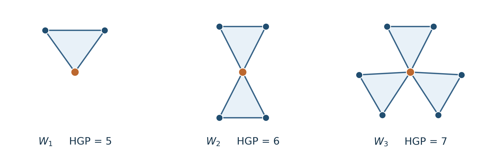

# Proper hat guessing on triangular windmills: exact values and saturation at three blades

**AI-assisted research manuscript · 24 November 2026**

## Abstract

Let $W_r$ be the graph formed by identifying one vertex of each of $r$ otherwise disjoint triangles. In the proper hat guessing game, hats are colored so that adjacent vertices have different colors; each player sees only neighboring hats, makes one deterministic guess, and the team must have a correct guess under every allowed coloring. We prove that the proper hat guessing number of $W_r$ is $5$ for $r=1$, $6$ for $r=2$, and $7$ for every $r\ge3$. The one-triangle value is known. The remaining values determine the entire triangular windmill family and show that three blades are necessary and sufficient to reach its maximum. Arbitrary strategies satisfy the upper bounds. The lower bounds use short explicit tables whose correctness reduces to three covers of a four-vertex complete graph and one partition of a five-vertex complete graph. These small certificates yield a proof that can be checked by hand. We provide a Lean 4.19.0 formalization project and supplementary exact enumeration. The novelty assessment is limited to the material actually inspected: two relevant follow-up papers were available only through their abstracts. This manuscript has not undergone external peer review.

## 1. Problem, contribution, and relation to previous work

The proper hat guessing game was introduced by Adriaensen et al. [1]. Their Table 1 leaves the proper hat guessing number of the five-vertex hourglass between $5$ and $7$, and their concluding discussion includes windmills among the graph families to be determined. Their complete-graph theorem already gives the value $5$ for a single triangle.

We determine every triangular windmill, including the hourglass and the exact point at which adding more triangles stops increasing the number of colors that can be handled. Within the source-comparison scope of Section 8, the new mathematical claims are the value $6$ for two blades and the value $7$ for every number of blades at least three. We reproduce the one-blade case to make the proof self-contained. No claim is made here about windmills with larger complete graphs as blades, arbitrary cactus graphs, or the other graph classes mentioned in [1].

The proof adapts an established method. He, Ido, and Przybocki [2] organized ordinary windmill games through products of losing sets and used intersection and counting arguments for upper bounds: see published Lemma 24 and the proofs of Theorems 4 and 5. These are Lemma 4.4 and Theorems 1.4 and 1.5 in their arXiv version. Our surviving-center formulation uses that framework with the additional proper-coloring constraints. We do not claim the decoder principle, product organization, or counting method as new in themselves. The contribution is their precise application here, together with explicit matching constructions and the complete $5,6,7$ classification.

## 2. Model and main theorem

For an integer $r\ge1$, let

$$
V(W_r)=\{o\}\cup\{a_i,b_i:1\le i\le r\},
$$

and let the edges be exactly $oa_i$, $ob_i$, and $a_i b_i$, for $1\le i\le r$. The vertex $o$ is the center. Each pair $a_i,b_i$, together with the center, forms a blade. Thus $W_1=K_3$, $W_2$ is the hourglass, and $W_r$ has $2r+1$ vertices.

Fix a nonempty finite palette $Q$ with $q$ colors. A deterministic strategy consists of functions

$$
f_i,g_i:Q\times Q\longrightarrow Q,
\qquad
h:(Q\times Q)^r\longrightarrow Q.
$$

If the center has color $c$ and the leaves in blade $i$ have colors $x_i,y_i$, player $a_i$ guesses $f_i(c,y_i)$, player $b_i$ guesses $g_i(c,x_i)$, and the center guesses $h((x_i,y_i)_{i=1}^r)$. Every function may depend on its vertex label, and no symmetry is required. Defining the functions on improper observations as well makes them total without changing the game.

The coloring is proper exactly when, for every $i$,

$$
c\ne x_i,\qquad c\ne y_i,\qquad x_i\ne y_i.
$$

The strategy wins if every proper coloring satisfies

$$
h((x_i,y_i)_i)=c
\quad\text{or}\quad
\exists i:\ f_i(c,y_i)=x_i\ \text{or}\ g_i(c,x_i)=y_i.
$$

The proper hat guessing number, denoted $\operatorname{HGP}(W_r)$, is the largest positive integer $q$ for which such a strategy exists.

**Theorem 1.** For every integer $r\ge1$,

$$
\operatorname{HGP}(W_r)=
\begin{cases}
5,&r=1,\\
6,&r=2,\\
7,&r\ge3.
\end{cases}
$$

{width=95%}

In particular, the maximum over the triangular windmill family is $7$, and the smallest blade count attaining it is $3$.

We will use two elementary monotonicity facts.

**Lemma 2 (palette restriction).** If $W_r$ has a winning strategy with $q$ colors, then it has one with every positive number $p\le q$ of colors.

**Proof.** Choose a $p$-element subset $P$ of the original palette and a fixed color $p_0\in P$. Restrict observations to colors in $P$. Each player follows its original rule when that rule outputs a member of $P$, and outputs $p_0$ otherwise. Any coloring proper over $P$ is proper over the original palette. A player whose original guess was correct outputs a color in $P$, so that correct guess is preserved. At least one correct guess therefore remains. Relabeling $P$ gives any desired palette of size $p$. $\square$

**Lemma 3 (adding blades).** A winning strategy on $W_s$ with $q$ colors extends to $W_r$ with the same palette whenever $1\le s\le r$.

**Proof.** Keep the rules of the first $s$ blades. The center ignores the additional leaves and uses its old rule on the first $s$ observations. Additional leaves make any fixed guess. Every proper coloring of $W_r$ restricts to a proper coloring of the retained $W_s$, where an original player is correct. $\square$

## 3. Surviving center colors and separation

Fix all leaf rules. For a blade $i$ and a proposed center color $c$, write

$$
L_i(c)=\{(x,y)\in Q^2:
 x\ne y,\ x\ne c,\ y\ne c,
 f_i(c,y)\ne x,\ g_i(c,x)\ne y\}.
$$

This is the set of proper leaf observations on which both leaves fail under center color $c$. For an exterior observation $z=((x_i,y_i))_{i=1}^r$, put

$$
R(z)=\{c\in Q:(x_i,y_i)\in L_i(c)\text{ for every }i\}.
$$

These are exactly the possible center colors for which the full coloring is proper and every leaf is wrong. This is the proper-coloring specialization of the product-of-losing-sets viewpoint described in [2].

**Lemma 4 (center decoder).** The fixed leaf rules admit a winning center rule if and only if $|R(z)|\le1$ for every exterior observation $z$.

**Proof.** If $c\ne d$ both belong to $R(z)$, the center sees the same $z$ in two proper colorings and every leaf is wrong in both. Its single output cannot equal both center colors, so no winning center rule exists.

Conversely, suppose all survivor sets have at most one member. When $R(z)$ is a singleton, let the center output its unique member; when it is empty, let the center output a fixed color of $Q$. This is a function only of the center's observation. In any proper coloring, either a leaf guesses correctly, or the actual center color lies in $R(z)$ and is therefore output by the center. $\square$

For distinct $c,d$, say that blade $i$ **separates** $c,d$ when $L_i(c)\cap L_i(d)=\varnothing$.

**Lemma 5 (pair criterion).** The condition in Lemma 4 holds if and only if every pair of distinct center colors is separated by at least one blade.

**Proof.** If no blade separates some $c\ne d$, choose a pair $(x_i,y_i)\in L_i(c)\cap L_i(d)$ in each blade. There are finitely many blades, and each chosen set is nonempty. Concatenating these choices gives an observation $z$ with $c,d\in R(z)$.

In the other direction, if $c,d\in R(z)$ for distinct colors, then $(x_i,y_i)\in L_i(c)\cap L_i(d)$ for every blade. No blade can separate them. These two implications prove the equivalence. $\square$

## 4. Upper bounds for unrestricted strategies

The arguments in this section apply to every deterministic choice of local rules. They impose none of the table symmetries used later for the constructions.

### 4.1 Eight colors are impossible for any blade count

**Proposition 6.** For every $r\ge1$, no strategy on $W_r$ wins with eight colors.

**Proof.** Fix arbitrary leaf rules and two distinct proposed center colors $c,d$. Set $S=Q\setminus\{c,d\}$, so $|S|=6$. In any one blade there are $6\cdot5=30$ ordered pairs $(x,y)$ of distinct elements of $S$. Every such pair is proper under both proposed center colors.

At most six of these pairs satisfy $f_i(c,y)=x$, since each of the six choices of $y$ determines at most one successful $x$. The same bound holds for each of $g_i(c,x)=y$, $f_i(d,y)=x$, and $g_i(d,x)=y$. Consequently at most $4\cdot6=24$ pairs satisfy at least one of these four equalities. At least six pairs make all four guesses incorrect.

Thus $L_i(c)\cap L_i(d)$ is nonempty in every blade. Lemma 5 rules out a winning center rule. Since the leaf rules were arbitrary, no eight-color strategy wins. $\square$

By Lemma 2, a winning strategy with more than eight colors would imply an eight-color strategy. Hence

$$
\operatorname{HGP}(W_r)\le7\qquad(r\ge1).
$$

### 4.2 The counting inequality

**Proposition 7.** Let $q\ge4$ be an integer. If $W_r$ has a winning strategy with $q$ colors, then

$$
q\big((q-1)(q-4)\big)^r\le\big(q(q-1)\big)^r.
$$

**Proof.** For a fixed center color $c$, one blade has $(q-1)(q-2)$ proper ordered leaf pairs. Each leaf guesses correctly on at most $q-1$ pairs. Therefore

$$
|L_i(c)|\ge(q-1)(q-2)-2(q-1)=(q-1)(q-4).
$$

The observations surviving at $c$ form the product of the $r$ losing sets. The incidence set $\mathcal I=\{(c,z):c\in R(z)\}$ consequently has at least $q((q-1)(q-4))^r$ elements. All its exterior observations have distinct colors within each leaf pair; there are $(q(q-1))^r$ such observations in total. A winning strategy has at most one surviving center for every observation by Lemma 4. Forgetting $c$ is therefore injective on $\mathcal I$, giving the inequality. $\square$

### 4.3 Seven colors are impossible on two blades

**Proposition 8.** No strategy on $W_2$ wins with seven colors.

**Proof.** Fix arbitrary leaf rules. For a fixed root color $c$, one blade has $6\cdot5=30$ proper ordered leaf pairs. Each leaf guesses correctly on at most six pairs, so

$$
|L_i(c)|\ge30-6-6=18.
$$

The two blades can be chosen independently, giving at least $18^2$ exterior observations surviving at that particular $c$. The incidence set

$$
\mathcal I=\{(c,z):c\in R(z)\}
$$

therefore satisfies

$$
|\mathcal I|\ge7\cdot18^2=2268.
$$

There are only $(7\cdot6)^2=1764$ exterior observations in which each of the two leaf pairs has distinct colors. If every $R(z)$ had size at most one, forgetting the center color would give an injection from $\mathcal I$ into this set of 1764 observations. This contradicts $2268>1764$. Lemma 4 now rules out a winning strategy. $\square$

Palette restriction implies $\operatorname{HGP}(W_2)\le6$.

### 4.4 Six colors are impossible on one blade

**Proposition 9.** No strategy on $W_1$ wins with six colors.

**Proof.** For each fixed center color, there are $5\cdot4=20$ proper leaf pairs. The two leaf rules together cover at most $5+5=10$ of them, leaving at least ten pairs in $L_1(c)$. There are six center colors, so the incidence count is at least $60$. There are only $6\cdot5=30$ exterior observations with distinct leaf colors. As in Proposition 8, some observation has at least two surviving center colors, contradicting Lemma 4. $\square$

Thus $\operatorname{HGP}(W_1)\le5$. This agrees with the known complete-graph theorem of [1], but the argument here is self-contained.

## 5. Explicit winning strategies

We use the palette $\mathbb Z/q\mathbb Z$, represented by $0,\ldots,q-1$. Given a table $T$, both leaves in its blade use

$$
\ell_T(c,u)=c+T(u-c)\pmod q,
$$

where $c$ is the observed center color and $u$ is the partner's color. All arithmetic in a table construction is modulo its stated palette size. The value $T(0)$ never matters in a proper coloring; we set it to zero. Unless specified otherwise, the center uses the decoder in Lemma 4.

The same rule at both leaves lets us verify separation on unordered leaf-color pairs. Reversing the two leaves preserves whether at least one of them is correct.

### 5.1 Five colors on one triangle

Take $q=5$ and $T(z)=2z$. Equivalently, the leaves guess $2u-c$. For distinct observed leaf colors $x,y$, the root colors on which a leaf succeeds are

$$
c_1=2y-x,\qquad c_2=2x-y.
$$

Neither equals $x$ or $y$: any such equality would force $x=y$ modulo 5. They are also distinct, since $c_1-c_2=3(y-x)$ and $3$ is invertible modulo 5. Thus exactly two of the three legal root colors are covered by leaf successes. The remaining color is

$$
c_3=-2(x+y)=3(x+y)\pmod5,
$$

because the sum of all five residues is zero. Let the center guess $3(x+y)$. Every proper coloring either has center color $c_1$ or $c_2$, when a leaf succeeds, or has center color $c_3$, when the center succeeds. This proves the five-color lower bound.

### 5.2 Six colors on two blades

For $q=6$, use the following tables in the two blades.

| $z$ | 0 | 1 | 2 | 3 | 4 | 5 |
|---|---:|---:|---:|---:|---:|---:|
| $T_A(z)$ | 0 | 2 | 3 | 1 | 1 | 1 |
| $T_B(z)$ | 0 | 2 | 4 | 4 | 1 | 2 |

We claim that the first blade separates center differences $\pm2$, while the second separates differences $\pm1$ and $3$. These are all possible nonzero differences modulo 6.

Here is a complete small certificate. For each row, fix the two listed center colors, let $S$ be the colors legal at both leaves under both centers, and write $uv$ for the unordered pair $\{u,v\}$. The last two columns list the pairs in $S$ on which at least one leaf succeeds under the indicated center color. They are obtained by substituting the table into $\ell_T(c,u)$.

| Table; centers $0,d$ | $S$ | Successful pairs at $0$ | Successful pairs at $d$ |
|---|---|---|---|
| $T_A$; $0,2$ | $1,3,4,5$ | $13,14,15$ | $13,34,35,45$ |
| $T_B$; $0,1$ | $2,3,4,5$ | $24,25,34$ | $23,25,35,45$ |
| $T_B$; $0,3$ | $1,2,4,5$ | $12,14,24,25$ | $14,15,25,45$ |

In each row, the union is all six unordered pairs of distinct colors in $S$. Therefore no legal leaf pair makes both leaves wrong under both proposed centers.

Adding the same residue to all colors preserves the rule $\ell_T(c,u)=c+T(u-c)$. Hence the first two rows also handle every pair whose difference is $2$ or $1$, respectively. Exchanging the two proposed centers handles the negative differences; the third row handles difference $3$, which is its own negative. Every distinct pair of center colors is consequently separated by a blade. Lemmas 4 and 5 complete the six-color strategy.

### 5.3 Seven colors on three blades

Work modulo 7 and begin with

| $z$ | 0 | 1 | 2 | 3 | 4 | 5 | 6 |
|---|---:|---:|---:|---:|---:|---:|---:|
| $T(z)$ | 0 | 3 | 5 | 2 | 5 | 3 | 2 |

First consider proposed center colors $0$ and $1$. Their common legal leaf colors are $S=\{2,3,4,5,6\}$. Direct substitution gives the successful unordered leaf pairs

$$
E_0=\{23,25,26,35,45\}
$$

under center color $0$, and

$$
E_1=\{24,34,36,46,56\}
$$

under center color $1$. Again, $uv$ means $\{u,v\}$. The two lists are disjoint and together contain all ten edges of the complete graph on $S$. Thus the base table separates centers $0,1$. Translation and exchange of the centers show that it separates every center difference $\pm1$.

For $d=1,2,3$, put

$$
T_d(z)=d\,T(d^{-1}z)\pmod7
$$

and use $T_d$ in blade $d$. Multiplication of all colors by $d^{-1}$ is a palette permutation and transforms the rule from $T_d$ into the base rule. Blade $d$ therefore separates every center difference $\pm d$. The six nonzero residues modulo 7 are exactly $\pm1,\pm2,\pm3$, so the three blades separate every pair of distinct center colors. The center decoder makes the strategy winning.

For direct implementation, the expanded tables are:

| $z$ | 0 | 1 | 2 | 3 | 4 | 5 | 6 |
|---|---:|---:|---:|---:|---:|---:|---:|
| $T_1(z)$ | 0 | 3 | 5 | 2 | 5 | 3 | 2 |
| $T_2(z)$ | 0 | 3 | 6 | 6 | 3 | 4 | 4 |
| $T_3(z)$ | 0 | 2 | 6 | 2 | 6 | 1 | 1 |

The construction uses only the center color and the partner color at each leaf. The center computes the unique surviving color from its own observation. No communication after the hats are assigned, global observation by a leaf, or assumption about the adversary is used.

## 6. Completion of the classification

The one-blade construction of Section 5.1 and Proposition 9 give $\operatorname{HGP}(W_1)=5$. The two-blade construction of Section 5.2 and Proposition 8 give $\operatorname{HGP}(W_2)=6$.

Section 5.3 gives a seven-color strategy on $W_3$. Lemma 3 extends it to every $W_r$ with $r\ge3$. Proposition 6, together with palette restriction, gives the matching upper bound $7$ for every such $r$. This proves Theorem 1. Since the two smaller blade counts have values $5$ and $6$, three blades are the first to attain $7$. $\square$

## 7. Formalization and reproducibility

The accompanying project targets Lean 4.19.0. Its mathematical model contains arbitrary local leaf functions, a center function of the full exterior observation, the exact proper-coloring predicate, and the universal winning quantifiers. The formal development separates the model, explicit tables, unrestricted upper bounds, decoder and monotonicity bridges, and the final classification. The small table separation statements are established by ordinary kernel-checked `decide`; they do not use `native_decide` or assume the separation property as an axiom. Release-level compilation, axiom audit, adversarial review, and remote re-verification are recorded separately in the case status and verification files.

The exact enumeration is supplementary. An integer-only checker independent of the SAT search model evaluates the displayed tables, checks the separation of every root pair, and enumerates all proper colorings for the three minimal witnesses:

| Colors | Blades | Proper full colorings | Exterior observations with distinct leaf colors in each blade | Colorings where all leaves fail and the center succeeds |
|---:|---:|---:|---:|---:|
| 5 | 1 | 60 | 20 | 20 |
| 6 | 2 | 2,400 | 900 | 600 |
| 7 | 3 | 189,000 | 74,088 | 40,824 |

For a given $q,r$, the proper full-coloring count is $q((q-1)(q-2))^r$, while the number of exterior observations with distinct leaf colors within each blade is $(q(q-1))^r$. Every exterior observation in these checks has either zero or one surviving root. The survivor counts in the last column are Python execution records, not separate Lean-certified enumerations. These finite checks confirm the explicit witnesses; the unrestricted upper bounds and the extension to all $r$ are supplied by the proofs above.

## 8. Novelty scope and limitations

The source comparison was conducted on 24 November 2026. The relevant passages in [1] and the published windmill arguments in [2] were inspected. The prior one-triangle value and the inherited proof framework are explicitly attributed above.

Two relevant follow-ups could be inspected only through accessible abstracts:

- Zhai's *Proper Hat-Guessing on Two-Spine Book Graphs* [3] describes the graphs $B_{k,n}=K_k\vee\overline{K_n}$, a finite coverability invariant, and particular two-spine book cases. Its full text was not obtained.
- Kakatelis's *An upper bound on the proper hat guessing number of graphs* [4] describes bounds involving vertex count and maximum degree, with random-graph and dense-graph consequences. Its full text was not obtained.

The available abstracts do not state the classification proved here. They are insufficient to exclude unmentioned collateral results, however. Accordingly, the novelty finding is **limited to the sources and portions actually verified**; this manuscript does not assert an exhaustive literature search or global priority. This limitation concerns the novelty comparison, while the mathematical statement has a self-contained proof. The work is an AI-assisted research manuscript, with no claim of external human peer review.

## References

[1] S. Adriaensen et al. *Hat guessing with proper colorings*. arXiv:2603.04909v4, 24 August 2026. Relevant locations: Theorem 1.1, Table 1, and Section 7. [Full text](https://arxiv.org/html/2603.04909v4).

[2] X. He, Y. Ido, and B. Przybocki. *Hat Guessing on Books and Windmills*. Electronic Journal of Combinatorics 29(1) (2022), P1.12. DOI: [10.37236/10098](https://doi.org/10.37236/10098). Relevant published locations: Lemma 24 and the proofs of Theorems 4 and 5. [Published PDF](https://www.combinatorics.org/ojs/index.php/eljc/article/download/v29i1p12/pdf/). [arXiv version](https://arxiv.org/pdf/2010.13249), with corresponding numbering Lemma 4.4 and Theorems 1.4 and 1.5.

[3] Y. Zhai. *Proper Hat-Guessing on Two-Spine Book Graphs*. arXiv:2607.25274, 2026. [Source record](https://arxiv.org/abs/2607.25274). [Accessible abstract transcription](https://www.arxiv.symmetricfunctions.com/date/2026-07-28). Abstract only inspected; full text unavailable during this review.

[4] I. Kakatelis. *An upper bound on the proper hat guessing number of graphs*. arXiv:2610.04124v2, 2026. [Source record](https://arxiv.org/abs/2610.04124). [Accessible abstract transcription](https://www.arxiv.symmetricfunctions.com/paper/2610.04124v2). Abstract only inspected; full text unavailable during this review.
