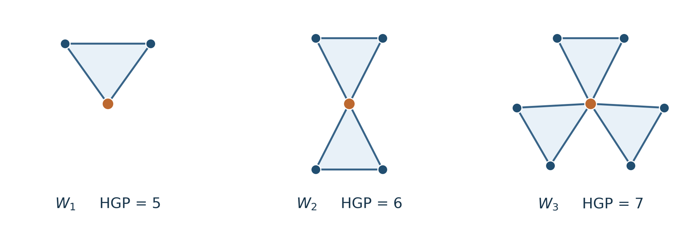

# 合法着色猜帽中的三角风车图：精确值与三瓣饱和

**AI 辅助研究稿件 · 2026 年 11 月 24 日**

## 摘要

设 $W_r$ 是将 $r$ 个原本互不相交的三角形各取一个顶点、再把这些顶点识别为同一中心所得的图。在合法着色猜帽游戏中，相邻顶点的帽子颜色必须不同；每位玩家只能看见邻点的帽子，按预先约定的确定性规则猜测一次自己的颜色，团队要求在每种允许的着色下都至少有一人猜对。本文证明：$W_r$ 的合法着色猜帽数在 $r=1$ 时为 $5$，在 $r=2$ 时为 $6$，在所有 $r\ge3$ 时为 $7$。单个三角形的值已有文献结论。其余结果完成了三角风车图整族的分类，并确定三瓣恰好是达到该族最大值所需的最小瓣数。上界针对任意确定性策略；下界由短小的显式表给出，其正确性归结为三个四顶点完全图的边覆盖证书和一个五顶点完全图的边划分证书，因此可以手工核验。项目同时提供 Lean 4.19.0 形式化与补充性的精确枚举。查新结论仅限于实际核验的资料：两篇相关后续论文只能获得摘要。本文尚未经过外部同行评审。

## 1. 问题、贡献与已有工作的关系

Adriaensen 等人在文献 [1] 中提出合法着色猜帽游戏。该文表 1 将五顶点沙漏图的合法着色猜帽数限制在 $5$ 与 $7$ 之间，并在结尾讨论中把风车图列为待确定的图族。该文关于完全图的定理已经给出单个三角形的值 $5$。

本文确定每个三角风车图的精确值，既解决沙漏图情形，也确定继续增加三角形何时不再提高可保证获胜的颜色数。在第 8 节限定的查新范围内，本文新增的数学结论是两瓣时的值 $6$，以及至少三瓣时恒为 $7$。为使证明自足，文中也重述并证明已知的一瓣情形。本文不涉及以更大完全图为瓣的一般风车图、任意仙人掌图，或文献 [1] 中的其他图族。

本文采用的基本方法已有先例。He、Ido 与 Przybocki 在研究普通帽子猜测游戏时，用各瓣失败集合的笛卡尔积组织风车图策略，并以交集与计数方法证明上界；见文献 [2] 刊行版引理 24，以及定理 4、5 的证明。在其 arXiv 版本中，相应编号是引理 4.4 和定理 1.4、1.5。本文的中心存活颜色表述是在该框架中加入合法着色约束。中心解码原则、失败集合的乘积组织方式与计数方法本身不作为本文首创。本文的贡献是针对本问题的精确应用、匹配上界的显式构造，以及完整的 $5,6,7$ 分类。

## 2. 模型与主定理

对整数 $r\ge1$，定义

$$
V(W_r)=\{o\}\cup\{a_i,b_i:1\le i\le r\},
$$

其边恰为 $oa_i$、$ob_i$ 和 $a_i b_i$，其中 $1\le i\le r$。顶点 $o$ 是中心；每对 $a_i,b_i$ 与中心构成一瓣。因此 $W_1=K_3$，$W_2$ 是沙漏图，而 $W_r$ 有 $2r+1$ 个顶点。

固定一个含 $q$ 种颜色的非空有限调色板 $Q$。确定性策略由以下函数组成：

$$
f_i,g_i:Q\times Q\longrightarrow Q,
\qquad
h:(Q\times Q)^r\longrightarrow Q.
$$

当中心颜色为 $c$，第 $i$ 瓣的两个叶顶点颜色为 $x_i,y_i$ 时，玩家 $a_i$ 猜测 $f_i(c,y_i)$，玩家 $b_i$ 猜测 $g_i(c,x_i)$，中心猜测 $h((x_i,y_i)_{i=1}^r)$。各顶点可采用不同规则，不要求任何对称性。函数也在不可能来自合法着色的观察上定义，使其成为全函数；这些额外取值不影响游戏。

合法着色恰好要求每个 $i$ 都满足

$$
c\ne x_i,\qquad c\ne y_i,\qquad x_i\ne y_i.
$$

一个策略获胜，是指每种合法着色都满足

$$
h((x_i,y_i)_i)=c
\quad\text{或}\quad
\exists i:\ f_i(c,y_i)=x_i\ \text{或}\ g_i(c,x_i)=y_i.
$$

记 $\operatorname{HGP}(W_r)$ 为存在此类获胜策略的最大正整数颜色数 $q$，称为合法着色猜帽数。

**定理 1。** 对每个整数 $r\ge1$，有

$$
\operatorname{HGP}(W_r)=
\begin{cases}
5,&r=1,\\
6,&r=2,\\
7,&r\ge3.
\end{cases}
$$

{width=95%}

特别地，三角风车图族中的最大值是 $7$，第一次达到该值的瓣数为 $3$。

证明使用以下两个基本单调性事实。

**引理 2（限制调色板）。** 若 $W_r$ 存在 $q$ 色获胜策略，则对每个正整数 $p\le q$，也存在 $p$ 色获胜策略。

**证明。** 在原调色板中选取一个 $p$ 元子集 $P$，并固定 $p_0\in P$。将所有观察限制在 $P$ 内。若原规则输出属于 $P$，玩家保留该输出；否则输出 $p_0$。任何使用 $P$ 的合法着色也是使用原调色板的合法着色。原先猜对的玩家必定输出了 $P$ 中的颜色，因此其正确猜测保持不变。团队仍至少有一人猜对。最后重命名颜色即可得到任意指定的 $p$ 元调色板。$\square$

**引理 3（增加瓣数）。** 若 $W_s$ 存在 $q$ 色获胜策略且 $1\le s\le r$，则该策略可扩展为 $W_r$ 的 $q$ 色获胜策略。

**证明。** 保留前 $s$ 瓣的叶顶点规则。中心忽略新增叶顶点，只对前 $s$ 瓣的观察使用原规则。其余叶顶点任意猜测一个固定颜色。$W_r$ 的任何合法着色限制到保留的 $W_s$ 后仍合法，因此原有玩家中至少有一人猜对。$\square$

## 3. 中心存活颜色与分离判据

先固定所有叶顶点规则。对第 $i$ 瓣和假定的中心颜色 $c$，定义

$$
L_i(c)=\{(x,y)\in Q^2:
 x\ne y,\ x\ne c,\ y\ne c,
 f_i(c,y)\ne x,\ g_i(c,x)\ne y\}.
$$

它记录中心颜色为 $c$ 时，两个叶顶点均猜错的所有合法叶颜色对。对外部观察 $z=((x_i,y_i))_{i=1}^r$，定义

$$
R(z)=\{c\in Q:(x_i,y_i)\in L_i(c)\text{ 对每个 }i\text{ 成立}\}.
$$

$R(z)$ 恰好由那些使完整着色正常、并且使所有叶顶点猜错的中心颜色组成。它是文献 [2] 中失败集合乘积观点在合法着色条件下的具体形式。

**引理 4（中心解码）。** 固定的叶顶点规则能够配以获胜的中心规则，当且仅当每个外部观察 $z$ 都满足 $|R(z)|\le1$。

**证明。** 若不同颜色 $c,d$ 同时属于 $R(z)$，则存在两个合法着色，它们给中心完全相同的观察 $z$，且所有叶顶点都猜错。中心的单一输出不可能同时等于 $c$ 与 $d$，因此不存在获胜的中心规则。

反之，设所有存活集合的大小至多为一。当 $R(z)$ 是单元素集合时，中心输出其唯一元素；当 $R(z)$ 为空时，中心输出 $Q$ 中某个固定颜色。这只依赖中心能够看到的观察。对任何合法着色，如果没有叶顶点猜对，真实中心颜色就属于 $R(z)$，从而被中心正确输出。$\square$

对不同颜色 $c,d$，若 $L_i(c)\cap L_i(d)=\varnothing$，则称第 $i$ 瓣**分离** $c,d$。

**引理 5（逐对分离判据）。** 引理 4 中的条件成立，当且仅当每对不同的中心颜色都被至少一瓣分离。

**证明。** 若某对 $c\ne d$ 没有被任何一瓣分离，则可以在每个非空交集 $L_i(c)\cap L_i(d)$ 中选取一对 $(x_i,y_i)$。瓣数有限，把这些选择拼接成外部观察 $z$，便有 $c,d\in R(z)$。

另一方面，如果某个 $R(z)$ 同时包含不同的 $c,d$，则每瓣都满足 $(x_i,y_i)\in L_i(c)\cap L_i(d)$，所以没有一瓣能分离这两个颜色。两方向合起来即得等价关系。$\square$

## 4. 对任意策略成立的上界

本节适用于任意确定性局部规则，不要求它们具有第 5 节构造所用的对称形式。

### 4.1 任意瓣数都不可能处理八种颜色

**命题 6。** 对每个 $r\ge1$，$W_r$ 都不存在八色获胜策略。

**证明。** 固定任意叶顶点规则，并固定两个不同的假定中心颜色 $c,d$。令 $S=Q\setminus\{c,d\}$，则 $|S|=6$。在任意一瓣中，从 $S$ 选取不同的有序叶颜色对 $(x,y)$，共有 $6\cdot5=30$ 对。每一对在中心为 $c$ 或 $d$ 时都满足合法着色条件。

等式 $f_i(c,y)=x$ 至多对其中六对成立，因为给定六种可能的 $y$ 中的任何一种，最多只能有一个成功的 $x$。同样，等式 $g_i(c,x)=y$、$f_i(d,y)=x$ 和 $g_i(d,x)=y$ 各至多覆盖六对。因此满足至少一个等式的有序对至多有 $4\cdot6=24$ 对，至少六对使四次猜测全部失败。

所以每瓣的 $L_i(c)\cap L_i(d)$ 都非空。由引理 5，不存在获胜的中心规则。由于叶顶点规则任意，八色获胜策略不存在。$\square$

根据引理 2，若存在颜色数大于八的获胜策略，就必然存在八色获胜策略。因此

$$
\operatorname{HGP}(W_r)\le7\qquad(r\ge1).
$$

### 4.2 一般计数不等式

**命题 7。** 设 $q\ge4$ 为整数。若 $W_r$ 存在 $q$ 色获胜策略，则

$$
q\big((q-1)(q-4)\big)^r\le\big(q(q-1)\big)^r.
$$

**证明。** 固定中心颜色 $c$ 后，一瓣有 $(q-1)(q-2)$ 对正常的有序叶颜色对。每个叶顶点至多猜对 $q-1$ 对，故

$$
|L_i(c)|\ge(q-1)(q-2)-2(q-1)=(q-1)(q-4).
$$

使 $c$ 存活的外部观察构成这 $r$ 个失败集合的笛卡尔积。因此关联集合 $\mathcal I=\{(c,z):c\in R(z)\}$ 至少含有 $q((q-1)(q-4))^r$ 个元素。每个对应的外部观察都要求同瓣两个叶颜色不同，这样的观察总共只有 $(q(q-1))^r$ 个。由引理 4，获胜策略对每个观察至多保留一个中心颜色，所以在 $\mathcal I$ 上遗忘 $c$ 的映射是单射。所需不等式随即成立。$\square$

### 4.3 两瓣不可能处理七种颜色

**命题 8。** $W_2$ 不存在七色获胜策略。

**证明。** 固定任意叶顶点规则。给定中心颜色 $c$ 后，一瓣有 $6\cdot5=30$ 对正常的有序叶颜色对。每个叶顶点至多猜对六对，因此

$$
|L_i(c)|\ge30-6-6=18.
$$

两瓣可以独立选择，所以对每种固定中心颜色，至少有 $18^2$ 个外部观察使它存活。于是关联集合

$$
\mathcal I=\{(c,z):c\in R(z)\}
$$

满足

$$
|\mathcal I|\ge7\cdot18^2=2268.
$$

但是，每瓣两个叶颜色不同的外部观察总数仅为 $(7\cdot6)^2=1764$。如果每个 $R(z)$ 的大小都至多为一，遗忘中心颜色的映射就会把 $\mathcal I$ 单射到这个大小为 1764 的集合，与 $2268>1764$ 矛盾。由引理 4，不存在获胜策略。$\square$

限制调色板后得到 $\operatorname{HGP}(W_2)\le6$。

### 4.4 一瓣不可能处理六种颜色

**命题 9。** $W_1$ 不存在六色获胜策略。

**证明。** 固定中心颜色后，有 $5\cdot4=20$ 对合法叶颜色对。两个叶顶点的正确猜测合计至多覆盖 $5+5=10$ 对，因而 $L_1(c)$ 中至少有十对。六种中心颜色产生的关联数至少为 $60$，但两个叶颜色不同的外部观察只有 $6\cdot5=30$ 个。与命题 8 的论证相同，必有某个观察保留至少两个中心颜色，这与引理 4 矛盾。$\square$

因此 $\operatorname{HGP}(W_1)\le5$。这与文献 [1] 的完全图定理一致，但此处的证明不依赖该定理。

## 5. 显式获胜策略

取调色板 $\mathbb Z/q\mathbb Z$，以 $0,\ldots,q-1$ 表示颜色。给定一张表 $T$，相应一瓣中的两个叶顶点都使用规则

$$
\ell_T(c,u)=c+T(u-c)\pmod q,
$$

其中 $c$ 是观察到的中心颜色，$u$ 是另一叶顶点的颜色。每个构造中的运算均按其指定的颜色数取模。合法着色不会用到 $T(0)$，统一令其为零。除非另作说明，中心使用引理 4 的解码规则。

由于同瓣两个叶顶点使用相同规则，可以用无序叶颜色对核验分离性质：交换两个叶顶点不改变“至少一位叶玩家猜对”是否成立。

### 5.1 单个三角形的五色策略

令 $q=5$ 且 $T(z)=2z$，即叶顶点猜测 $2u-c$。给定不同的叶颜色 $x,y$，至少有一个叶顶点猜对所对应的两个中心颜色为

$$
c_1=2y-x,\qquad c_2=2x-y.
$$

它们均不等于 $x$ 或 $y$，否则会迫使 $x=y$。此外，$c_1-c_2=3(y-x)$，而 $3$ 在模 5 运算中可逆，因此 $c_1\ne c_2$。于是三个合法中心颜色中恰有两个由叶顶点的正确猜测覆盖。由于模 5 的五个剩余类之和为零，第三个合法中心颜色为

$$
c_3=-2(x+y)=3(x+y)\pmod5.
$$

令中心猜测 $3(x+y)$。在任何合法着色中，中心颜色若为 $c_1$ 或 $c_2$，就有叶顶点猜对；若为 $c_3$，则中心猜对。这证明五色下界。

### 5.2 两瓣的六色策略

令 $q=6$，两瓣分别采用下表。

| $z$ | 0 | 1 | 2 | 3 | 4 | 5 |
|---|---:|---:|---:|---:|---:|---:|
| $T_A(z)$ | 0 | 2 | 3 | 1 | 1 | 1 |
| $T_B(z)$ | 0 | 2 | 4 | 4 | 1 | 2 |

第一瓣分离中心颜色差为 $\pm2$ 的颜色对，第二瓣分离差为 $\pm1$ 和 $3$ 的颜色对。这些差已经覆盖模 6 的所有非零剩余类。

以下是可以逐项手核的完整小证书。每行固定两个给出的中心颜色；$S$ 是在两个中心颜色下都可合法用作叶颜色的集合。记 $uv$ 为无序对 $\{u,v\}$。后两列列出在相应中心颜色下至少有一位叶玩家猜对的 $S$ 内颜色对，它们可直接代入 $\ell_T(c,u)$ 得到。

| 表与中心颜色 $0,d$ | $S$ | 中心为 $0$ 时成功的颜色对 | 中心为 $d$ 时成功的颜色对 |
|---|---|---|---|
| $T_A$；$0,2$ | $1,3,4,5$ | $13,14,15$ | $13,34,35,45$ |
| $T_B$；$0,1$ | $2,3,4,5$ | $24,25,34$ | $23,25,35,45$ |
| $T_B$；$0,3$ | $1,2,4,5$ | $12,14,24,25$ | $14,15,25,45$ |

每行最后两列的并集都包含 $S$ 上所有六个不同元素无序对，也就是一个 $K_4$ 的全部边。因此不存在一个合法叶颜色对，使两个假定中心颜色下的叶顶点都失败。

对所有颜色同时加上同一个剩余类，保持规则 $\ell_T(c,u)=c+T(u-c)$ 的形式。因此前两行分别处理所有差为 $2$ 或 $1$ 的中心颜色对。交换两个假定中心颜色，便处理相应负差；第三行处理差为 $3$ 的情形，且该差等于自身的负数。故每对不同中心颜色都被至少一瓣分离。引理 4、5 给出完整的六色获胜策略。

### 5.3 三瓣的七色策略

在模 7 的调色板上，先取基本表

| $z$ | 0 | 1 | 2 | 3 | 4 | 5 | 6 |
|---|---:|---:|---:|---:|---:|---:|---:|
| $T(z)$ | 0 | 3 | 5 | 2 | 5 | 3 | 2 |

先考虑假定中心颜色 $0$ 和 $1$。共同合法的叶颜色集合为 $S=\{2,3,4,5,6\}$。直接代入规则可得，中心为 $0$ 时成功的无序叶颜色对为

$$
E_0=\{23,25,26,35,45\},
$$

中心为 $1$ 时成功的无序叶颜色对为

$$
E_1=\{24,34,36,46,56\}.
$$

仍以 $uv$ 表示 $\{u,v\}$。这两个列表互不相交，合起来恰为 $S$ 上完全图的十条边。因此基本表分离中心颜色 $0,1$。再对颜色作平移并交换两个中心颜色，就能分离所有差为 $\pm1$ 的中心颜色对。

对 $d=1,2,3$，令

$$
T_d(z)=d\,T(d^{-1}z)\pmod7,
$$

并在第 $d$ 瓣使用 $T_d$。把所有颜色乘以 $d^{-1}$ 是一个调色板置换，并把 $T_d$ 的规则变换为基本规则，因此第 $d$ 瓣分离每个差为 $\pm d$ 的中心颜色对。模 7 的六个非零剩余类恰为 $\pm1,\pm2,\pm3$，所以三瓣共同分离所有不同中心颜色对。使用中心解码规则即得到获胜策略。

为便于直接实现，展开后的三张表如下：

| $z$ | 0 | 1 | 2 | 3 | 4 | 5 | 6 |
|---|---:|---:|---:|---:|---:|---:|---:|
| $T_1(z)$ | 0 | 3 | 5 | 2 | 5 | 3 | 2 |
| $T_2(z)$ | 0 | 3 | 6 | 6 | 3 | 4 | 4 |
| $T_3(z)$ | 0 | 2 | 6 | 2 | 6 | 1 | 1 |

每位叶玩家只使用其看到的中心颜色和另一叶顶点的颜色；中心根据自己看到的外部观察计算唯一存活颜色。策略不需要帽子分配后的通信，也不需要叶顶点观察全图或对对手的着色作额外假设。

## 6. 分类证明的完成

第 5.1 节的构造与命题 9 给出 $\operatorname{HGP}(W_1)=5$。第 5.2 节的构造与命题 8 给出 $\operatorname{HGP}(W_2)=6$。

第 5.3 节给出 $W_3$ 的七色策略。由引理 3，该策略扩展到每个 $r\ge3$ 的 $W_r$。命题 6 与调色板限制给出匹配的上界 $7$，从而证明定理 1。由于更小的两个正瓣数分别对应值 $5$ 和 $6$，第一次达到 $7$ 的瓣数恰为三。$\square$

## 7. 形式化与可复现性

随稿项目使用 Lean 4.19.0。其数学模型包含任意局部叶顶点函数、以完整外部观察为输入的中心函数、精确的合法着色谓词，以及对全部允许着色量化的获胜条件。形式化分别组织模型、显式表、无策略形式限制的上界、中心解码与单调性桥接，以及最终分类。有限表的分离性质由普通 `decide` 生成并经内核检查，不使用 `native_decide`，也不把表的正确性当作额外公理。发布级编译、公理审计、对抗审查与远端复验结果，另记于案例的状态和验证文件中。

精确枚举只是补充证据。一个独立于 SAT 搜索模型、仅使用整数运算的检查器核验所列各表与所有中心颜色对的分离性质，并对三个最小构造穷举全部合法着色：

| 颜色数 | 瓣数 | 完整合法着色数 | 同瓣叶颜色不同的外部观察数 | 全部叶玩家猜错而中心猜对的着色数 |
|---:|---:|---:|---:|---:|
| 5 | 1 | 60 | 20 | 20 |
| 6 | 2 | 2,400 | 900 | 600 |
| 7 | 3 | 189,000 | 74,088 | 40,824 |

给定 $q,r$，完整合法着色数为 $q((q-1)(q-2))^r$；同瓣两个叶颜色不同的外部观察数为 $(q(q-1))^r$。检查中，每个外部观察均有零个或一个存活中心颜色。末列的中心补救次数是 Python 运行记录，并未作为独立的 Lean 枚举定理认证。这些有限检查确认了具体构造；针对任意策略的上界及向所有 $r$ 的扩展，则由前面的证明给出。

## 8. 查新范围与限制

本次文献比较日期为 2026 年 11 月 24 日。已核验文献 [1] 的相关段落，以及文献 [2] 刊行版中的风车图论证。单三角形的已有结果与继承的证明框架均已在上文明确归属。

两篇相关后续文献只能通过可访问摘要核验：

- Zhai 的 *Proper Hat-Guessing on Two-Spine Book Graphs* [3] 讨论图 $B_{k,n}=K_k\vee\overline{K_n}$、一个有限覆盖不变量，以及若干双书脊书图的具体情形。本次未获得全文。
- Kakatelis 的 *An upper bound on the proper hat guessing number of graphs* [4] 讨论同时涉及顶点数与最大度的上界，以及随机图和稠密图上的推论。本次未获得全文。

可访问摘要均未陈述本文的分类，但摘要不足以排除正文中未被提及的附带结果。因此，新颖性判断**仅限于实际核验的来源与部分**，本文不声称已经穷尽全部文献，也不声称已确立全球优先权。这一限制属于文献比较层面；本文数学结论本身具有自足证明。本稿为 AI 辅助研究成果，不具有外部人类同行评审的声明。

## 参考文献

[1] S. Adriaensen et al. *Hat guessing with proper colorings*. arXiv:2603.04909v4，2026 年 8 月 24 日。相关位置：定理 1.1、表 1 与第 7 节。[全文](https://arxiv.org/html/2603.04909v4)。

[2] X. He, Y. Ido, and B. Przybocki. *Hat Guessing on Books and Windmills*. Electronic Journal of Combinatorics 29(1) (2022), P1.12。DOI：[10.37236/10098](https://doi.org/10.37236/10098)。相关刊行版位置：引理 24，以及定理 4、5 的证明。[刊行版 PDF](https://www.combinatorics.org/ojs/index.php/eljc/article/download/v29i1p12/pdf/)。[arXiv 版本](https://arxiv.org/pdf/2010.13249) 的对应编号为引理 4.4 和定理 1.4、1.5。

[3] Y. Zhai. *Proper Hat-Guessing on Two-Spine Book Graphs*. arXiv:2607.25274，2026 年。[来源记录](https://arxiv.org/abs/2607.25274)。[可访问的摘要转载](https://www.arxiv.symmetricfunctions.com/date/2026-07-28)。仅核验摘要；本次审查未获得全文。

[4] I. Kakatelis. *An upper bound on the proper hat guessing number of graphs*. arXiv:2610.04124v2，2026 年。[来源记录](https://arxiv.org/abs/2610.04124)。[可访问的摘要转载](https://www.arxiv.symmetricfunctions.com/paper/2610.04124v2)。仅核验摘要；本次审查未获得全文。
